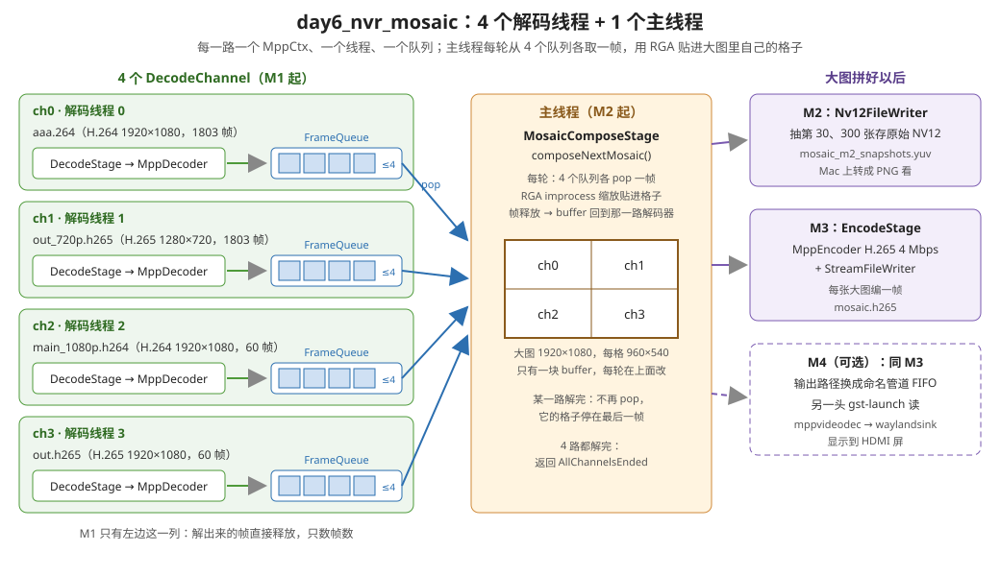

# M1 4 路解码同时跑

Day 6 做一个 **NVR 多画面拼接**：同时解 4 路码流，用 RGA 把 4 路画面拼成一张 2×2 的大图，再用 MPP 编码成一个 H.265 文件。

```
aaa.264 ─────────┐
out_720p.h265 ───┤  4 个 MPP 解码器    RGA 缩放后          MPP 编码
main_1080p.h264 ─┤  （4 个线程）     →  贴进 2×2 大图   →  （H.265） → mosaic.h265
out.h265 ────────┘
```

NVR（Network Video Recorder，网络录像机）就是监控系统里接很多路摄像头、同时录像和预览的那台机器。它的预览画面通常是 4 格、9 格、16 格，每一格是一路摄像头。这一天做的就是它的核心：**多路解码 + 拼图**。

---

## 1. Day 6 的四个里程碑

| 里程碑 | 做什么 | 新学的东西 |
|---|---|---|
| **M1 4 路解码同时跑** | 4 个线程，每个线程一个 MPP 解码器，只解码、数帧数 | 一个进程里开多个 MppCtx；不同码流、不同格式解出来的 stride 不一样 |
| **M2 RGA 拼 2×2** | 每路解出来的帧放进自己的队列，主线程从 4 个队列各取一帧，用 RGA 缩放后贴进大图 | RGA 把画面缩放到大图里的指定矩形；4 个生产者 + 1 个消费者；有一路先播完怎么办 |
| **M3 编码成 mosaic.h265** | 每拼好一张大图就编码一帧 | 一块 buffer 先给 RGA 写、再给编码器读，要等编码器读完才能拼下一张 |
| **M4（可选）显示到 HDMI 屏** | 编码输出写进命名管道，另一头 gst-launch 解码并显示 | 用 FIFO 把我们的码流实时交给播放器 |

每个里程碑一份文档：本文（M1）、[m2流程.md](m2流程.md)、[m3流程.md](m3流程.md)、[m4流程.md](m4流程.md)。整个 Day 6 的架构写在本文第 2 节，M2～M4 都沿用它。

---

## 2. 架构

### 2.1 数据怎么流



- **左边一列（M1 起）**：4 个 `DecodeChannel`，每个在自己的线程里跑，各有一个 MPP 解码器。M1 只有这一列，解出来的帧马上释放，只数帧数。
- **中间（M2 起）**：主线程。每一轮从 4 个队列各取一帧，用 RGA 缩放后贴进大图里自己的格子。
- **右边**：大图拼好以后去哪。M2 抽两张存成原始数据看一眼；M3 编码成文件；M4 编码后实时交给播放器显示。

### 2.2 分层

和 Day 5 一样分 4 层，**上层调用下层，下层不知道上层存在**：

| 层 | 目录 | 管什么 | Day 6 里有谁 |
|---|---|---|---|
| 第 4 层 | `app/` | 决定"怎么跑"：几个线程、谁调用谁、打印结果 | `m1_decode_channels`、`m2_compose_mosaic`、`m3_encode_mosaic`、`channel_helpers`、`app_config.h` |
| 第 3 层 | `pipeline/` | 把部件组装成"段" | `DecodeStage`（读文件 + 解码）、`FrameQueue`、`DecodeChannel`（解码段 + 队列）、`MosaicComposeStage`（拼图）、`EncodeStage`（编码 + 写文件） |
| 第 2 层 | `source/` `decoder/` `rga/` `encoder/` `sink/` | 每个只管一件事，互相不 include | `StreamFileReader`、`MppDecoder`、`resizeNv12IntoRectByRga`、`MppEncoder`、`StreamFileWriter`、`Nv12FileWriter` |
| 第 1 层 | `common/` | 谁都能用的小工具 | 日志、`MPP_CHECK`、RAII 指针、`Nv12Picture`、`PictureRect` |

### 2.3 按后面的里程碑来切接口

- **M1 就把"一路"做成一个独立的对象**（`DecodeStage`）。M1 开 4 个，每个放进一个线程；后面的里程碑不改它。
- **M2 在"一路"外面加一个队列**，合成 `DecodeChannel`，解码线程往里放、主线程从里取。拼图写成 `MosaicComposeStage::composeNextMosaic()`：每调用一次交出一张大图，和 `DecodeStage::readNextFrame()` 每调用一次交出一帧是同一个样子。
- **M3 只是"拼一张、编一张"**：拼图段一行不改，后面接一个 `EncodeStage`。
- **M4 只换输出路径**：M3 的整条流程写成 `runMosaicEncodePipeline(outputPath)`，M4 传一个命名管道进去。

### 2.4 不做的事

- **不按时间戳对齐**：4 个文件都是 30 fps，每一轮每路各取一帧就够了。真的 NVR 里各路摄像头的帧率、到达时间都不一样，要按时间戳挑帧，这里先不做。
- **不做命令行参数**：路径、尺寸、码率都写在 `app/app_config.h`。
- **不写虚接口**：输入只有文件一种。

### 2.5 目录

```
day6_nvr_mosaic/
├── CMakeLists.txt
├── run_on_board_with_mac.sh              编译 → adb push → adb shell 运行
├── day6编码流程/                         m1～m4 流程文档
├── doc/img/
└── src/
    ├── main.cpp                          只做一件事：按参数调用 runM1 / runM2 / runM3
    ├── app/
    │   ├── app_config.h                  4 路输入、大图尺寸、编码参数、输出路径
    │   ├── m1_decode_channels.h / .cpp   M1：4 个解码线程
    │   ├── channel_helpers.h / .cpp      （M2 起）打开 4 路、叫停 4 路、打印结果
    │   ├── m2_compose_mosaic.h / .cpp    （M2）拼图 + 抽两张存下来
    │   └── m3_encode_mosaic.h / .cpp     （M3）拼图 + 编码；M4 也调用它
    ├── common/
    │   ├── log.h                         带颜色的日志 LOGI / LOGE……
    │   ├── mpp_utils.h                   ALIGN、MPP_CHECK、RAII 指针
    │   ├── time_utils.h                  getNowMs
    │   └── nv12_picture.h / .cpp         （M2 起）Nv12Picture、PictureRect、申请 buffer、涂黑
    ├── source/
    │   └── stream_file_reader.h / .cpp   按 64KB 读码流文件
    ├── decoder/
    │   └── mpp_decoder.h / .cpp          MPP 解码器
    ├── rga/
    │   └── rga_compositor.h / .cpp       （M2 起）RGA 缩放贴图
    ├── encoder/
    │   └── mpp_encoder.h / .cpp          （M3 起）MPP 编码器
    ├── sink/
    │   ├── nv12_file_writer.h / .cpp     （M2 起）把大图存成 NV12 原始数据
    │   └── stream_file_writer.h / .cpp   （M3 起）把码流写进文件
    └── pipeline/
        ├── decode_stage.h / .cpp         一路解码：readNextFrame
        ├── frame_queue.h / .cpp          （M2 起）帧队列
        ├── decode_channel.h / .cpp       （M2 起）一路 = 解码段 + 队列
        ├── mosaic_compose_stage.h / .cpp （M2 起）拼图：composeNextMosaic
        └── encode_stage.h / .cpp         （M3 起）编码 + 写文件
```

### 2.6 每个对象归谁、什么时候释放

| 对象 | 谁拥有 | 什么时候释放 |
|---|---|---|
| 每一路的 `DecodeStage`（M1）/ `DecodeChannel`（M2 起） | `app/` 里的 `std::vector<std::unique_ptr<...>>` | 函数返回时 vector 析构，每个元素析构：先释放队列里剩下的帧，再 `mpp_destroy`，最后释放解码器内存池 |
| 解码出来的一帧（`MppFramePtr`） | 先归解码线程，放进队列后归队列，取出来后归主线程 | 主线程贴完这一帧，`MppFramePtr` 析构，buffer 回到**那一路**解码器的内存池 |
| 大图的 buffer（M2 起） | `MosaicComposeStage` | 它析构时 |
| 编码器（M3 起） | `EncodeStage` | 它析构时 |

### 2.7 哪些要自己敲

每个文件的完整代码都在各里程碑文档的"完整代码"一节，可以直接照着建工程，不用翻前几天的代码。

建议自己敲一遍的（MPP 核心，以及 Day 6 新的东西）：

| 文件 | 在哪篇 | 练什么 |
|---|---|---|
| `decoder/mpp_decoder.cpp` | M1 | 解码 API：create / init / split_parse / put_packet / get_frame / info change |
| `pipeline/decode_stage.cpp` | M1 | 送码流、取帧的循环，EOS 和错误帧 |
| `app/m1_decode_channels.cpp` | M1 | 一个进程里开 4 个解码器、4 个线程 |
| `rga/rga_compositor.cpp` | M2 | RGA 缩放到大图里的指定矩形 |
| `pipeline/mosaic_compose_stage.cpp` | M2 | 4 个队列各取一帧、贴图、一路先结束 |
| `encoder/mpp_encoder.cpp` | M3 | 编码 API：prep / rc / codec、取头、送帧取包 |
| `app/m3_encode_mosaic.cpp` | M3 | 拼一张、编一张，最后排空编码器 |

其余的（CMake、日志、读写文件、队列、main、运行脚本）是样板代码，直接复制。`frame_queue` 和 Day 5 一样；`log.h`、读写文件这几个从 Day 5 复制过来时按命名规范改了名（`logPrint`、`writtenBytes`、`filePtr`、`requestedChunkSizeBytes`），补全了注释。

---

## 3. M1：4 路解码同时跑

### 3.1 干了什么

开 4 个线程，每个线程有自己的 MPP 解码器，同时解 4 个码流文件，解出来的帧马上释放，只数帧数。4 个线程都结束后，打印每一路解了几帧、有没有错误帧、用了多久。

```
线程 0：aaa.264         → DecodeStage（MppDecoder H.264）→ 数帧数
线程 1：out_720p.h265   → DecodeStage（MppDecoder H.265）→ 数帧数
线程 2：main_1080p.h264 → DecodeStage（MppDecoder H.264）→ 数帧数
线程 3：out.h265        → DecodeStage（MppDecoder H.265）→ 数帧数
主线程：等 4 个线程都结束 → 打印结果
```

| 步骤 | 在哪 | 做什么 |
|---|---|---|
| 1 | `m1_decode_channels.cpp:52` | 每路 `make_unique` 一个 `DecodeStage`，打开文件、创建解码器 |
| 2 | `m1_decode_channels.cpp:74` | 每路起一个 `std::thread`，线程里跑 `runDecodeThread` |
| 3 | `m1_decode_channels.cpp:33` | 每个线程：反复 `readNextFrame`，直到 `EndOfStream` 或 `Error` |
| 4 | `m1_decode_channels.cpp:79` | 主线程 `join` 等 4 个线程都结束 |
| 5 | `m1_decode_channels.cpp:83` | 打印每一路的帧数、错误帧、读入字节、用时 |

### 3.2 输入

4 个码流文件，都在板子的 `/userdata/av/` 里，是前几天的输入或输出。2026-11-17 在板子上用 `ffprobe -count_frames` 数的：

| 路 | 文件 | 格式 | 分辨率 | 帧数 | 大小（字节） | 哪来的 |
|---|---|---|---|---|---|---|
| ch0 | `aaa.264` | H.264（Constrained Baseline） | 1920×1080 | 1803 | 58449590 | Day 2 的输入 |
| ch1 | `out_720p.h265` | H.265（Main） | 1280×720 | 1803 | 15028188 | Day 5 M1 的输出 |
| ch2 | `main_1080p.h264` | H.264（High） | 1920×1080 | 60 | 898624 | Day 4 M2 的主码流 |
| ch3 | `out.h265` | H.265（Main） | 1920×1080 | 60 | 874975 | Day 1 的输出 |

挑这 4 个是故意的：两种格式（H.264、H.265）、两种分辨率（1080p、720p）、两种长度（1803 帧、60 帧）。4 个文件的画面内容其实来自同一段视频。

### 3.3 输出

没有输出文件，只有日志。2026-11-17 上板实测：

```
I MppDecoder: [ch3] info change：1920x1080，stride 2304x1080，buf_size 4478976
I MppDecoder: [ch1] info change：1280x720，stride 1280x720，buf_size 1658880
I MppDecoder: [ch0] info change：1920x1080，stride 1920x1088，buf_size 4177920
I MppDecoder: [ch2] info change：1920x1080，stride 1920x1088，buf_size 4177920
I M1: ch0 /userdata/av/aaa.264：解完，正常帧 1803，错误帧 0，读入 58449590 字节，用时 2849 ms
I M1: ch1 /userdata/av/out_720p.h265：解完，正常帧 1803，错误帧 0，读入 15028188 字节，用时 2252 ms
I M1: ch2 /userdata/av/main_1080p.h264：解完，正常帧 60，错误帧 0，读入 898624 字节，用时 223 ms
I M1: ch3 /userdata/av/out.h265：解完，正常帧 60，错误帧 0，读入 874975 字节，用时 203 ms
I M1: 4 路全部结束，总用时 2850 ms
```

验收：
- 每一路的正常帧数 = 3.2 节表里 ffprobe 数的帧数（1803 / 1803 / 60 / 60）
- 错误帧都是 0
- 读入字节 = 文件大小
- 4 条 info change 的顺序每次跑都可能不一样：4 个线程同时跑，谁先解出第一帧不一定

### 3.4 技术点

#### MPP

| 调用 | 在哪 | 在这里做什么 |
|---|---|---|
| `mpp_create(&decoderCtx, &decoderApi)` | `mpp_decoder.cpp:24` | 每一路调用一次，得到**自己的** MppCtx。4 路就是 4 个 MppCtx，互相不共享任何东西 |
| `mpp_init(ctx, MPP_CTX_DEC, codingType)` | `mpp_decoder.cpp:26` | H.264 传 `MPP_VIDEO_CodingAVC`，H.265 传 `MPP_VIDEO_CodingHEVC`；两种格式的解码器用的是同一套 API |
| `mpp_dec_cfg_set_u32(cfg, "base:split_parse", 1)` | `mpp_decoder.cpp:32` | 打开内部分帧：我们按 64 KB 一块送，解码器自己找帧的边界 |
| `decode_put_packet` / `decode_get_frame` | `mpp_decoder.cpp:56`、`:76` | 送码流、取帧。返回 `MPP_ERR_BUFFER_FULL` 不是错误，是输入队列满了 |
| `mpp_buffer_group_get_internal` + `limit_config` | `mpp_decoder.cpp:115` | info change 时建内存池。**每一路有自己的内存池**，最多 24 块 |
| `mpp_frame_get_hor_stride / ver_stride` | `mpp_decoder.cpp:103` | 读这一路的 stride，打在 info change 那行日志里 |

MPP 开发参考里说"MPP 解码器的 MPI 接口是线程安全的"（`Rockchip_Developer_Guide_MPP_CN.md:448`）；官方的多路解码示例 `test/mpi_dec_multi_test.c` 也是每个线程自己 `mpp_create` 一个解码器（`:458`），和我们的做法一样。

#### 本篇重点：同样是 1080p，stride 不一样

| 路 | 格式 | 宽×高 | stride（实测） |
|---|---|---|---|
| ch0、ch2 | H.264 | 1920×1080 | **1920×1088** |
| ch3 | H.265 | 1920×1080 | **2304×1080** |
| ch1 | H.265 | 1280×720 | 1280×720 |

stride 是解码器定的，不同格式规则不同。RK3588 的解码硬件在 MPP 里叫 `vdpu38x`（`osal/mpp_soc.cpp:917`），H.264 和 H.265 都走 `vdpu34x` 这套代码：

- **H.265**：初始化时就把宽对齐成"256 的奇数倍"：`MPP_ALIGN(val, 256) | 256`（`mpp/hal/rkdec/h265d/hal_h265d_com.c:88`，在 `hal_h265d_vdpu34x.c:102` 设置）。1920 先对齐到 256 是 2048，再 `| 256` 变成 2304；1280 本来就是 256 的 5 倍（奇数倍），不变。高只对齐到 8（`hevc_ver_align`），1080 不变。
- **H.264**：宽只对齐到 16；只有宽 > 1920 或高 > 1088 时才用"256 的奇数倍"（`mpp/hal/rkdec/h264d/hal_h264d_vdpu34x.c:1209`）。1920×1080 是宽 1920、高对齐到 16 = 1088。

这对后面的意义：**M2 把每一路的帧交给 RGA 时，必须用这一帧自己的 stride**，不能假设 1080p 就是 1920×1088。用错了，ch3 的画面会斜着错位。所以 `describeDecodedFrame`（M2）每一帧都从 MppFrame 里读 stride。

#### Linux / C++

| 知识点 | 在哪 | 在这里做什么 |
|---|---|---|
| `std::vector<std::unique_ptr<DecodeStage>>` | `m1_decode_channels.cpp:54` | `DecodeStage` 里有 `MppDecoder`，它删掉了复制，也就不能移动；vector 扩容时要移动元素，所以不能直接放 `DecodeStage`。new 出来、vector 里放指针，扩容时移动的只是指针 |
| `std::make_unique<DecodeStage>()` | `:57` | new 一个对象，直接包进 `unique_ptr`。vector 析构时每个 `unique_ptr` 析构，对象跟着析构，解码器 `mpp_destroy` |
| `emplace_back([&decodeStage, &result] { ... })` | `:74` | 在 vector 里直接构造 `std::thread`，线程马上开始跑 lambda。`[&decodeStage, &result]` 按引用捕获这一路自己的两个变量 |
| `std::vector<ChannelDecodeResult> results(kChannelCount)` | `:66` | 起线程之前就建好、大小固定。线程拿着 `results[i]` 的引用，如果之后 vector 扩容，引用就指向已经释放的内存 |
| `join()` | `:79` | 等线程结束。`std::thread` 析构时如果还没 join，程序直接 `terminate`。join 之后再读 `results`：线程写完、主线程再读，不用加锁 |

#### 硬件：4 个解码器共用 2 个解码核

板子上 `ls /proc/mpp_service/` 能看到 `rkvdec-core0`、`rkvdec-core1`，也就是 H.264/H.265 解码硬件只有 2 个核。4 个 MppCtx 的解码任务都交给内核驱动 `mpp_service`，由它排队分给这 2 个核（按驱动名字推断，驱动代码没看）。对我们写代码没有影响：每一路只管自己的 MppCtx。

### 3.5 业务场景

- **NVR 回放 / 预览**：4 路、9 路、16 路摄像头同时解码，是 NVR 最基本的能力
- **多路视频分析**：同时解多路摄像头，把画面交给 NPU 做人脸、车牌识别
- **转码服务器**：一台机器同时把很多路码流转成别的格式、别的分辨率

### 3.6 怎么运行

1. 照 3.7 节建好文件，CLion 选 RK3588 的工具链编译
2. 板子用 OTG 线连 TypeC0 口，`adb devices` 能看到板子
3. 运行：

```bash
cd day6_nvr_mosaic
./run_on_board_with_mac.sh m1
```

日志应该和 3.3 节一样：4 路帧数 1803 / 1803 / 60 / 60，错误帧 0。

### 3.7 完整代码

按"从下往上"的顺序排：先 common，再部件，再 pipeline，最后 app 和 main。

2026-11-17 交叉编译通过（gcc 10.4，`-Wall -Wextra -Wshadow` 没有警告），上板结果见 3.3 节。

#### 3.7.1 `CMakeLists.txt`（M1 版）

M1 只列 M1 用到的文件，M2、M3 往 `add_executable` 里加文件，也会加链接库 `rga`。

```cmake
cmake_minimum_required(VERSION 3.20)
project(day6_nvr_mosaic)

# C++20：要用指定初始化（EncoderConfig{.width = 1920, ...}）
set(CMAKE_CXX_STANDARD 20)

add_executable(day6_nvr_mosaic
        src/main.cpp
        src/app/app_config.h
        src/app/m1_decode_channels.h
        src/app/m1_decode_channels.cpp
        src/common/log.h
        src/common/mpp_utils.h
        src/common/time_utils.h
        src/source/stream_file_reader.h
        src/source/stream_file_reader.cpp
        src/decoder/mpp_decoder.h
        src/decoder/mpp_decoder.cpp
        src/pipeline/decode_stage.h
        src/pipeline/decode_stage.cpp)

# 头文件搜索目录加上 src：任何文件里都写 #include "common/log.h"，不用数 ../ 有几层
target_include_directories(day6_nvr_mosaic PRIVATE src)

if (CMAKE_SYSTEM_PROCESSOR STREQUAL "aarch64")
    # rockchip_mpp → 链接器参数 -lrockchip_mpp → 在 sysroot 里找 librockchip_mpp.so（解码、编码）
    # Threads::Threads → 多线程要的库（std::thread）
    find_package(Threads REQUIRED)
    target_link_libraries(day6_nvr_mosaic PRIVATE rockchip_mpp Threads::Threads)

    # -Wall -Wextra：打开常用警告；-Wshadow：内层名字遮住外层（参数和成员同名）时警告
    target_compile_options(day6_nvr_mosaic PRIVATE -Wall -Wextra -Wshadow)

    # 板子 /usr/lib 里出厂的 MPP 库太旧，运行时优先加载自己编译的那份（/userdata/mpp_build/lib）
    # -Wl,-rpath,目录：把"运行时先去这个目录找库"写进程序文件，效果和 LD_LIBRARY_PATH 一样
    target_link_options(day6_nvr_mosaic PRIVATE "-Wl,-rpath,/userdata/mpp_build/lib")
endif ()
```

#### 3.7.2 `run_on_board_with_mac.sh`

编译 → `adb push` 到 `/tmp/CLion/run` → `adb shell` 运行。参数原样传给程序（`m1`、`m2`、`m3`）。CLion 的编译目录不叫 `cmake-build-rk3588-debug` 的话，用 `BUILD_DIR=目录名 ./run_on_board_with_mac.sh m1`。

```bash
#!/bin/sh
# 把编译好的程序通过 USB（adb）传到 RK3588 开发板并运行，输出显示在当前终端（CLion 的 Run 窗口）。
# 不走网络，不需要板子 IP，OTG 线（TypeC0 口）插在这台电脑上就行。
# 用法：./run_on_board_with_mac.sh [程序参数...]
# 可选环境变量：
#   ADB=/path/to/adb    不用 PATH 里的 adb 时指定
#   ADB_SERIAL=xxxx     同时连了多台 adb 设备时，指定板子的序列号（adb devices 第一列）

BIN_NAME=day6_nvr_mosaic
BUILD_DIR=${BUILD_DIR:-cmake-build-rk3588-debug}
REMOTE_DIR=/tmp/CLion/run
# 板子 /usr/lib 里出厂的 librockchip_mpp 太旧（缺 mpp_buffer_sync_begin_f 等函数），
# 运行时优先加载自己编译的 MPP 库（rk_code/external/mpp 编出来、放在板子上的那份）
BOARD_MPP_LIB=/userdata/mpp_build/lib

cd "$(dirname "$0")" || exit 1
LOCAL_BIN="$BUILD_DIR/$BIN_NAME"

# adb 直接用 PATH 里的（Mac 上已经加进环境变量；Ubuntu：sudo apt install adb）
ADB=${ADB:-adb}
if ! command -v "$ADB" >/dev/null 2>&1; then
    echo "找不到 adb：请把 adb 加到 PATH 里（Ubuntu: sudo apt install adb），或者设置 ADB=adb的路径" >&2
    exit 1
fi
if [ -n "$ADB_SERIAL" ]; then
    ADB="$ADB -s $ADB_SERIAL"
fi

# 先编译（用 CLion 自带的 cmake，编译目录就是 CLion 的 RK3588-Debug 配置生成的那个）
CMAKE=/Applications/CLion.app/Contents/bin/cmake/mac/aarch64/bin/cmake
"$CMAKE" --build "$BUILD_DIR" --target "$BIN_NAME" || exit 1

if [ ! -f "$LOCAL_BIN" ]; then
    echo "找不到 ${LOCAL_BIN}，请先编译（Cmd+F9）" >&2
    exit 1
fi

# 确认板子连上了
$ADB start-server >/dev/null 2>&1
if ! $ADB get-state >/dev/null 2>&1; then
    echo "adb 没找到板子。检查：板子开机了吗？OTG 线（TypeC0 口）插好了吗？执行 adb devices 看看" >&2
    exit 1
fi

# 所有 adb shell 都加 < /dev/null：不让 adb 读终端输入。否则一次粘贴多行命令时，后面那几行会被 adb 转发到板子吃掉
# （2026-10-18 实测，见 run_move_file_from_board_via_usb.sh 的注释）。我们的程序不需要键盘输入，Ctrl+C 照样能停。
$ADB shell "mkdir -p $REMOTE_DIR" < /dev/null || exit 1
$ADB push "$LOCAL_BIN" "$REMOTE_DIR/" >/dev/null || exit 1
$ADB shell "chmod +x $REMOTE_DIR/$BIN_NAME" < /dev/null || exit 1
echo "=== 通过 USB 在板子上运行 $REMOTE_DIR/$BIN_NAME $*（MPP 库：${BOARD_MPP_LIB}） ==="
exec $ADB shell "LD_LIBRARY_PATH=$BOARD_MPP_LIB $REMOTE_DIR/$BIN_NAME $*" < /dev/null
```

#### 3.7.3 `src/common/log.h`

```cpp
/*
 * 带颜色的日志（照 Android logcat 的样子）：
 *
 *   16:52:01.123 D DecodeStage: ...      ← 橙色（DA7537）
 *   16:52:01.125 I M1: ...               ← 绿色（108A0D）
 *   16:52:01.126 W DecodeStage: ...      ← 黄色（E8A908）
 *   16:52:01.127 E MppDecoder: ...       ← 红色（C40E0A）
 *
 *   （V 是蓝色 0E83E3）
 *
 * 原理：ANSI 颜色转义码。终端看到 "\033[32m" 不会把它显示出来，而是把后面的字改成绿色，
 * 看到 "\033[0m" 就恢复默认颜色。CLion 的终端和 Run 窗口、macOS 终端、adb shell 都认这种写法。
 *
 * 用法（不用写 \n，每条日志自动换行）：
 *   LOGI(kTag, "解码 %d 帧", decodedFrameCount);
 *
 * 不想要颜色（比如输出重定向到文件）：
 *   NO_COLOR=1 ./day6_nvr_mosaic m1
 */
#pragma once

#include <cstdarg>    // va_list
#include <cstdio>     // printf / vprintf / fflush
#include <cstdlib>    // getenv
#include <ctime>      // localtime_r
#include <sys/time.h> // gettimeofday

// 日志级别，和 logcat 一样从低到高
enum class LogLevel { Verbose, Debug, Info, Warn, Error };

// 和 Android 的 Log.v / Log.d / Log.i / Log.w / Log.e 对应
#define LOGV(tag, ...) logPrint(LogLevel::Verbose, tag, __VA_ARGS__)
#define LOGD(tag, ...) logPrint(LogLevel::Debug, tag, __VA_ARGS__)
#define LOGI(tag, ...) logPrint(LogLevel::Info, tag, __VA_ARGS__)
#define LOGW(tag, ...) logPrint(LogLevel::Warn, tag, __VA_ARGS__)
#define LOGE(tag, ...) logPrint(LogLevel::Error, tag, __VA_ARGS__)

/**
 * @brief 要不要输出颜色
 * @return true = 没设置环境变量 NO_COLOR，输出颜色；false = 设置了（任何值），不输出颜色
 * @note 只在第一次调用时读一次环境变量（static 局部变量只初始化一次）。
 *       没有用 isatty() 判断"是不是终端"：通过 adb shell 运行时，板子上的 stdout 不是终端，
 *       用 isatty 判断的话颜色就全没了，但 Mac 这边的终端其实能显示颜色
 */
inline bool isLogColorEnabled() {
    static const bool isEnabled = std::getenv("NO_COLOR") == nullptr;
    return isEnabled;
}

/**
 * @brief 打印一条带时间、级别、标签、颜色的日志，自动换行
 * @param[in] level  级别，决定颜色和字母（V/D/I/W/E）
 * @param[in] tag    标签，一般写模块名，例如 "MppDecoder"
 * @param[in] format 和 printf 一样的格式字符串，末尾不用写 \n
 * @param[in] ...    格式字符串对应的参数
 * @return 无
 * @note format(printf, 3, 4)：让编译器像检查 printf 一样检查格式串和参数类型对不对得上
 *       （第 3 个参数是格式串，可变参数从第 4 个开始）。
 *       每条日志后 fflush：通过 adb 运行时 stdout 是全缓冲的，不刷新的话日志会攒一大段才出来，
 *       程序崩溃时最后几条还会丢。
 *       多个线程同时打日志时，一条日志由好几次 printf 拼成，两条日志的片段可能交错在一行里（推断，没实测到）
 */
__attribute__((format(printf, 3, 4))) inline void logPrint(LogLevel level, const char *tag, const char *format, ...) {
    static const char *const kColors[] = {
        "\033[38;2;14;131;227m", // V：0E83E3
        "\033[38;2;218;117;55m", // D：DA7537
        "\033[38;2;16;138;13m",  // I：108A0D
        "\033[38;2;232;169;8m",  // W：E8A908
        "\033[38;2;196;14;10m",  // E：C40E0A
    };
    static const char kLetters[] = {'V', 'D', 'I', 'W', 'E'};
    const char *const kResetColor = "\033[0m";

    const int levelIndex = static_cast<int>(level);
    const bool isColorEnabled = isLogColorEnabled();

    timeval nowTime;                   // 秒 + 微秒
    gettimeofday(&nowTime, nullptr);   // 取当前时间，第 2 个参数（时区）早就不用了，传 nullptr
    tm localTime;                      // 拆成年月日时分秒
    localtime_r(&nowTime.tv_sec, &localTime); // _r = 线程安全版：结果写进我们给的 localTime，不用全局变量

    printf("%s%02d:%02d:%02d.%03ld %c %s: ", isColorEnabled ? kColors[levelIndex] : "", localTime.tm_hour,
           localTime.tm_min, localTime.tm_sec, static_cast<long>(nowTime.tv_usec / 1000), kLetters[levelIndex], tag);
    va_list args;           // 可变参数列表
    va_start(args, format); // 从 format 后面那个参数开始取
    vprintf(format, args);  // printf 的"接收 va_list"版本
    va_end(args);
    printf("%s\n", isColorEnabled ? kResetColor : "");
    fflush(stdout);
}
```

#### 3.7.4 `src/common/mpp_utils.h`

```cpp
/*
 * MPP 相关的小工具：对齐宏、检查返回值的宏、把 MPP 句柄包成 unique_ptr 的删除器
 */
#pragma once

#include <cstdio> // FILE、fclose
#include <memory> // std::unique_ptr
#include <rockchip/rk_mpi.h>

#include "common/log.h"

// 把 x 向上对齐到 a 的整数倍（a 必须是 2 的幂）。例：ALIGN(1080, 16) = 1088
#define ALIGN(x, a) (((x) + (a) - 1) & ~((a) - 1))

inline const char *const kMppCheckTag = "MPP_CHECK";

/*
 * 调用一个返回 MPP_RET 的函数，不是 MPP_OK 就打印日志并 return failValue。
 * 用法：MPP_CHECK(mpp_init(ctx, MPP_CTX_DEC, codingType), false);
 * #expr：把参数原样变成字符串，日志里能看到是哪一行调用失败了。
 * do { ... } while (0)：让宏在 if 后面不加大括号时也能当成一条语句用
 */
#define MPP_CHECK(expr, failValue)                                                                                     \
    do {                                                                                                               \
        MPP_RET mppRet = (expr);                                                                                       \
        if (mppRet != MPP_OK) {                                                                                        \
            LOGE(kMppCheckTag, "[FAIL] %s ret=%d (line %d)", #expr, static_cast<int>(mppRet), __LINE__);               \
            return failValue;                                                                                          \
        }                                                                                                              \
    } while (0)

/** FilePtr 的删除器：unique_ptr 析构时调用 operator()，关闭文件 */
struct FileCloser {
    /**
     * @brief 关闭文件
     * @param[in] file  fopen 返回的文件指针（unique_ptr 保证不为空才调用）
     * @return 无
     * @note 由 unique_ptr 在析构或 reset 时自动调用，不要手动调用
     */
    void operator()(FILE *file) const { fclose(file); }
};
using FilePtr = std::unique_ptr<FILE, FileCloser>;

/*
 * 下面 4 个删除器的写法一样：MPP 的句柄（MppBufferGroup、MppBuffer、MppFrame、MppPacket）都是 void*，
 * 所以 unique_ptr 的第一个模板参数写 void，存的就是 void*。
 * unique_ptr 析构时：if (存的指针 != nullptr) 删除器(存的指针); → 调用下面对应的 MPP 释放函数
 */

/** MppBufferGroupPtr 的删除器：析构时把整个 buffer 组还给 MPP */
struct MppBufferGroupDeleter {
    /**
     * @brief 释放 buffer 组
     * @param[in] bufferGroup  mpp_buffer_group_get_internal 得到的组
     * @return 无
     * @note 组里的 buffer 要先都还回来（MppBufferPtr 先析构），再释放组
     */
    void operator()(MppBufferGroup bufferGroup) const { mpp_buffer_group_put(bufferGroup); }
};
using MppBufferGroupPtr = std::unique_ptr<void, MppBufferGroupDeleter>;

/** MppBufferPtr 的删除器：析构时把 buffer 还给它所在的组 */
struct MppBufferDeleter {
    /**
     * @brief 归还一块 buffer
     * @param[in] buffer  mpp_buffer_get 得到的 buffer
     * @return 无
     * @note mpp_buffer_put 是"引用计数减 1"，减到 0 才真正回到组里
     */
    void operator()(MppBuffer buffer) const { mpp_buffer_put(buffer); }
};
using MppBufferPtr = std::unique_ptr<void, MppBufferDeleter>;

/** MppFramePtr 的删除器：析构时释放 MppFrame */
struct MppFrameDeleter {
    /**
     * @brief 释放一个 MppFrame
     * @param[in] frame  decode_get_frame 或 mpp_frame_init 得到的帧
     * @return 无
     * @note mpp_frame_deinit 要的是 MppFrame*（地址），所以写 &frame。
     *       解码器给的帧带着解码器内存池里的一块 buffer，deinit 时这块 buffer 回到池子，解码器才能拿它解后面的帧
     */
    void operator()(MppFrame frame) const { mpp_frame_deinit(&frame); }
};
using MppFramePtr = std::unique_ptr<void, MppFrameDeleter>;

/** MppPacketPtr 的删除器：析构时释放 MppPacket */
struct MppPacketDeleter {
    /**
     * @brief 释放一个 MppPacket
     * @param[in] packet  mpp_packet_init 或 encode_get_packet 得到的包
     * @return 无
     * @note mpp_packet_deinit 要的也是地址，写 &packet
     */
    void operator()(MppPacket packet) const { mpp_packet_deinit(&packet); }
};
using MppPacketPtr = std::unique_ptr<void, MppPacketDeleter>;
```

#### 3.7.5 `src/common/time_utils.h`

```cpp
#pragma once

#include <chrono>

/**
 * @brief 取当前时间，单位毫秒，用来算耗时（两次相减）
 * @return 从某个固定起点（一般是开机）到现在的毫秒数，带小数
 * @note steady_clock：只往前走、不受改系统时间影响的时钟，专门用来计时；它的绝对值没有意义，只能拿来相减
 */
inline double getNowMs() {
    using namespace std::chrono;
    return duration<double, std::milli>(steady_clock::now().time_since_epoch()).count();
}
```

#### 3.7.6 `src/source/stream_file_reader.h`

```cpp
#pragma once

#include <cstddef> // size_t
#include <cstdint> // uint8_t、int64_t
#include <vector>

#include "common/mpp_utils.h" // FilePtr

/** 把码流文件按固定大小一块一块读出来，交给解码器 */
class StreamFileReader {
public:
    /**
     * @brief 打开码流文件
     * @param[in] filePath                 文件路径，例如 "/userdata/av/aaa.264"
     * @param[in] requestedChunkSizeBytes  每次读多少字节，默认 64 KB
     * @return true = 打开成功；false = 打开失败（已打印原因）
     * @note 一块不一定是一帧：解码器开了内部分帧（split_parse），自己会从码流里找帧的边界
     */
    bool open(const char *filePath, size_t requestedChunkSizeBytes = 64 * 1024);

    /**
     * @brief 读下一块
     * @param[out] chunk        读到的数据；最后一块可能比 chunkSizeBytes 小，甚至是 0 字节
     * @param[out] isLastChunk  true = 文件读完了，这是最后一块
     * @return true = 读成功（包括最后一块）；false = 读出错（已打印原因）
     * @note 调用前必须 open 成功
     */
    bool readChunk(std::vector<uint8_t> &chunk, bool &isLastChunk);

    /**
     * @brief 一共读了多少字节
     * @return 字节数；文件读完时等于文件大小
     * @note 用来验收：和 ls -l 看到的文件大小比
     */
    int64_t getReadBytes() const { return readBytes; }

private:
    FilePtr filePtr;           // 打开的文件，析构时自动 fclose
    size_t chunkSizeBytes = 0; // 每次读多少字节
    int64_t readBytes = 0;     // 一共读了多少字节
};
```

#### 3.7.7 `src/source/stream_file_reader.cpp`

```cpp
#include "source/stream_file_reader.h"

#include <cerrno>  // errno
#include <cstring> // strerror

#include "common/log.h"

static const char *const kTag = "StreamReader";

/**
 * @brief 打开码流文件
 * @param[in] filePath                 文件路径
 * @param[in] requestedChunkSizeBytes  每次读多少字节
 * @return true = 成功；false = 失败
 * @note 参数叫 requestedChunkSizeBytes 而不是 chunkSizeBytes：和成员同名的话，
 *       chunkSizeBytes = chunkSizeBytes; 是参数自己赋给自己，成员一直是 0
 */
bool StreamFileReader::open(const char *filePath, size_t requestedChunkSizeBytes) {
    // "rb"：只读、二进制。失败返回 NULL，原因在 errno 里，strerror 把它翻译成文字
    filePtr.reset(fopen(filePath, "rb"));
    if (!filePtr) {
        LOGE(kTag, "打开 %s 失败：%s", filePath, strerror(errno));
        return false;
    }
    chunkSizeBytes = requestedChunkSizeBytes;
    return true;
}

/**
 * @brief 读下一块
 * @param[out] chunk        读到的数据
 * @param[out] isLastChunk  是不是最后一块
 * @return true = 成功；false = 出错
 * @note fread 返回实际读到的字节数。比要的少有两种可能：读到文件末尾（正常），或者出错（ferror 为真）
 */
bool StreamFileReader::readChunk(std::vector<uint8_t> &chunk, bool &isLastChunk) {
    chunk.resize(chunkSizeBytes); // 先把 vector 撑到 chunkSizeBytes，fread 才有地方写
    // fread(写到哪, 每个元素几字节, 最多几个元素, 文件)：元素大小写 1，返回值就是字节数
    const size_t readSizeBytes = fread(chunk.data(), 1, chunkSizeBytes, filePtr.get());
    if (readSizeBytes < chunkSizeBytes && ferror(filePtr.get())) {
        LOGE(kTag, "fread 出错：%s", strerror(errno));
        return false;
    }
    chunk.resize(readSizeBytes); // 缩回实际读到的大小，后面用 chunk.size() 就是有效字节数
    isLastChunk = readSizeBytes < chunkSizeBytes;
    readBytes += static_cast<int64_t>(readSizeBytes);
    return true;
}
```

#### 3.7.8 `src/decoder/mpp_decoder.h`

和 Day 5 比，`init` 多了一个参数 `requestedLogName`：4 路的日志混在一起，要靠它分清是哪一路。

```cpp
#pragma once

#include <cstddef> // size_t
#include <cstdint> // uint8_t
#include <rockchip/rk_mpi.h>
#include <string>

#include "common/mpp_utils.h"

/** feed() 的结果 */
enum class FeedResult {
    Sent,  // 送进去了
    Full,  // 解码器的输入队列满了，这块没送进去，过一会儿再送同一块
    Error, // 出错
};

/** getFrame() 的结果 */
enum class GetFrameResult {
    Frame, // 取到一帧（可能带画面，也可能是只带 EOS 的空帧）
    None,  // 现在没有帧可取
    Error, // 出错
};

/**
 * @brief MPP 解码器：送码流、取帧，内部处理 info change
 * @note 一个对象 = 一个 MppCtx = 一路解码。多路就建多个对象，互相独立，可以放在不同线程里各用各的
 */
class MppDecoder {
public:
    MppDecoder() = default;

    /**
     * @brief 销毁解码器（mpp_destroy），释放配置
     * @return 无
     * @note 成员 frameGroupPtr 在析构函数体执行完以后才析构，所以 buffer 组比 MppCtx 晚释放
     */
    ~MppDecoder();

    MppDecoder(const MppDecoder &) = delete;            // 不能复制：两个对象拿着同一个 MppCtx，会 destroy 两次
    MppDecoder &operator=(const MppDecoder &) = delete; // 同上

    /**
     * @brief 创建解码器，打开内部分帧
     * @param[in] codingType        码流格式：MPP_VIDEO_CodingAVC（H.264）或 MPP_VIDEO_CodingHEVC（H.265）
     * @param[in] requestedLogName  日志里显示的名字，例如 "ch0"；多路同时跑时用它区分是哪一路
     * @return true = 成功；false = 失败（已打印原因）
     * @note 只能调用一次
     */
    bool init(MppCodingType codingType, const char *requestedLogName);

    /**
     * @brief 送一块码流
     * @param[in] data       码流数据
     * @param[in] sizeBytes  字节数，可以是 0（文件最后一块正好读空时）
     * @param[in] isEos      true = 这是最后一块，打上 EOS 标志
     * @return Sent = 送进去了；Full = 输入队列满了，过一会儿再送同一块；Error = 出错
     * @note decode_put_packet 会把数据复制到解码器内部，返回后 data 可以马上复用
     */
    FeedResult feed(const uint8_t *data, size_t sizeBytes, bool isEos);

    /**
     * @brief 取一个输出帧；遇到 info change 在内部处理掉，接着取
     * @param[out] outputFramePtr  取到的帧，只有返回 Frame 时有效；释放它时 buffer 回到解码器内存池
     * @return Frame = 取到一帧；None = 现在没有；Error = 出错
     * @note 取到的帧可能是只带 EOS 的空帧（没有 buffer），调用方要判断
     */
    GetFrameResult getFrame(MppFramePtr &outputFramePtr);

    /**
     * @brief info change 发生了几次
     * @return 次数；正常的文件是 1 次（第一帧之前）
     * @note 用来验收
     */
    int getInfoChangeCount() const { return infoChangeCount; }

private:
    /**
     * @brief 处理 info change：按新的 buffer 大小准备内存池，告诉解码器"准备好了"
     * @param[in] infoChangeFrame  带 info change 标志的帧，从里面读宽高、stride、buffer 大小
     * @return true = 成功；false = 失败
     * @note 第一次建内存池；以后再发生（分辨率变了）就清空重配
     */
    bool handleInfoChange(MppFrame infoChangeFrame);

    std::string logName;              // 日志里显示的名字，例如 "ch0"
    MppBufferGroupPtr frameGroupPtr;  // 解码器内存池：解出来的画面都放在这里的 buffer 里
    MppCtx decoderCtx = nullptr;      // 解码器实例
    MppApi *decoderApi = nullptr;     // 函数表：decode_put_packet、decode_get_frame、control
    MppDecCfg decoderCfg = nullptr;   // 解码配置
    int infoChangeCount = 0;          // info change 发生了几次
    static constexpr int kFrameBufferCount = 24; // 内存池最多几块 buffer
};
```

#### 3.7.9 `src/decoder/mpp_decoder.cpp`（自己敲）

```cpp
#include "decoder/mpp_decoder.h"

#include <utility> // std::move

#include "common/log.h"

static const char *const kTag = "MppDecoder";

/**
 * @brief 创建解码器，打开内部分帧
 * @param[in] codingType        码流格式
 * @param[in] requestedLogName  日志名字
 * @return true = 成功；false = 失败
 * @note 第 1 步 创建；第 2 步 按码流格式初始化；第 3 步 打开内部分帧
 */
bool MppDecoder::init(MppCodingType codingType, const char *requestedLogName) {
    if (decoderCtx) {
        LOGE(kTag, "init 只能调用一次");
        return false;
    }
    logName = requestedLogName;

    // 第 1 步 创建：mpp_create 写回两个值，所以传它们的地址
    MPP_CHECK(mpp_create(&decoderCtx, &decoderApi), false);
    // 第 2 步 初始化成"解码器"，码流格式由 codingType 决定（H.264 / H.265 用的是同一套接口）
    MPP_CHECK(mpp_init(decoderCtx, MPP_CTX_DEC, codingType), false);

    // 第 3 步 打开内部分帧：我们按 64 KB 一块送，不按帧送，要让解码器自己找帧的边界
    MPP_CHECK(mpp_dec_cfg_init(&decoderCfg), false);
    // GET_CFG：先把解码器当前的配置读到 decoderCfg 里，再改其中一项，最后 SET_CFG 写回去
    MPP_CHECK(decoderApi->control(decoderCtx, MPP_DEC_GET_CFG, decoderCfg), false);
    MPP_CHECK(mpp_dec_cfg_set_u32(decoderCfg, "base:split_parse", 1), false);
    MPP_CHECK(decoderApi->control(decoderCtx, MPP_DEC_SET_CFG, decoderCfg), false);
    return true;
}

/**
 * @brief 送一块码流
 * @param[in] data       码流数据
 * @param[in] sizeBytes  字节数
 * @param[in] isEos      是不是最后一块
 * @return Sent / Full / Error
 * @note 第 1 步 把数据包成 MppPacket；第 2 步 送进解码器
 */
FeedResult MppDecoder::feed(const uint8_t *data, size_t sizeBytes, bool isEos) {
    // 第 1 步 包成 MppPacket：mpp_packet_init 不复制数据，只记下地址和长度。
    // 它的参数是 void*（不带 const），所以要 const_cast；解码器不会改这块数据
    MppPacket rawPacket = nullptr;
    MPP_CHECK(mpp_packet_init(&rawPacket, const_cast<uint8_t *>(data), sizeBytes), FeedResult::Error);
    MppPacketPtr packetPtr(rawPacket); // 函数返回时自动 mpp_packet_deinit
    if (isEos) {
        mpp_packet_set_eos(packetPtr.get());
    }

    // 第 2 步 送进去。MPP_ERR_BUFFER_FULL 不是错误：输入队列满了，等解码器消化一些再送
    const MPP_RET putRet = decoderApi->decode_put_packet(decoderCtx, packetPtr.get());
    if (putRet == MPP_OK) {
        return FeedResult::Sent;
    }
    if (putRet == MPP_ERR_BUFFER_FULL) {
        return FeedResult::Full;
    }
    LOGE(kTag, "[%s] decode_put_packet ret=%d", logName.c_str(), static_cast<int>(putRet));
    return FeedResult::Error;
}

/**
 * @brief 取一个输出帧
 * @param[out] outputFramePtr  取到的帧
 * @return Frame / None / Error
 * @note 循环：取到的是 info change 帧就处理掉，接着取，直到取到真正的帧或者没有帧
 */
GetFrameResult MppDecoder::getFrame(MppFramePtr &outputFramePtr) {
    while (true) {
        MppFrame rawFrame = nullptr;
        MPP_CHECK(decoderApi->decode_get_frame(decoderCtx, &rawFrame), GetFrameResult::Error);
        if (!rawFrame) {
            return GetFrameResult::None; // 现在没有帧：还没解出来，或者还没送够码流
        }
        MppFramePtr framePtr(rawFrame);
        if (mpp_frame_get_info_change(rawFrame)) {
            // info change 帧没有画面，只告诉我们"宽高、stride 定下来了，请准备内存池"
            if (!handleInfoChange(rawFrame)) {
                return GetFrameResult::Error;
            }
            continue; // framePtr 在这里析构，info change 帧被释放
        }
        outputFramePtr = std::move(framePtr); // 所有权交给调用方
        return GetFrameResult::Frame;
    }
}

/**
 * @brief 处理 info change
 * @param[in] infoChangeFrame  info change 帧
 * @return true = 成功；false = 失败
 * @note 第 1 步 读新参数；第 2 步 准备内存池；第 3 步 交给解码器并告诉它"准备好了"
 */
bool MppDecoder::handleInfoChange(MppFrame infoChangeFrame) {
    // 第 1 步 读新参数
    const RK_U32 width = mpp_frame_get_width(infoChangeFrame);
    const RK_U32 height = mpp_frame_get_height(infoChangeFrame);
    const RK_U32 horStride = mpp_frame_get_hor_stride(infoChangeFrame);
    const RK_U32 verStride = mpp_frame_get_ver_stride(infoChangeFrame);
    const size_t bufSizeBytes = mpp_frame_get_buf_size(infoChangeFrame); // 一帧要多大的 buffer
    infoChangeCount++;
    LOGI(kTag, "[%s] info change：%ux%u，stride %ux%u，buf_size %zu", logName.c_str(), width, height, horStride,
         verStride, bufSizeBytes);

    // 第 2 步 准备内存池：第一次就新建一个 DRM 类型的组（RGA 能用它的 dma-buf fd）；以后再来就清空重用
    if (frameGroupPtr) {
        MPP_CHECK(mpp_buffer_group_clear(frameGroupPtr.get()), false);
    } else {
        MppBufferGroup rawBufferGroup = nullptr;
        MPP_CHECK(mpp_buffer_group_get_internal(&rawBufferGroup, MPP_BUFFER_TYPE_DRM), false);
        frameGroupPtr.reset(rawBufferGroup);
    }
    // 限制：每块 bufSizeBytes 字节，最多 kFrameBufferCount 块。池子用光时解码器停下来等，不会无限申请
    MPP_CHECK(mpp_buffer_group_limit_config(frameGroupPtr.get(), bufSizeBytes, kFrameBufferCount), false);

    // 第 3 步 把组交给解码器，再告诉它"准备好了"，它才会接着解
    MPP_CHECK(decoderApi->control(decoderCtx, MPP_DEC_SET_EXT_BUF_GROUP, frameGroupPtr.get()), false);
    MPP_CHECK(decoderApi->control(decoderCtx, MPP_DEC_SET_INFO_CHANGE_READY, nullptr), false);
    return true;
}

/**
 * @brief 销毁解码器
 * @return 无
 * @note 先释放配置，再销毁 MppCtx；内存池（frameGroupPtr）随后作为成员自动释放
 */
MppDecoder::~MppDecoder() {
    if (decoderCfg) {
        mpp_dec_cfg_deinit(decoderCfg);
    }
    if (decoderCtx) {
        mpp_destroy(decoderCtx);
    }
}
```

#### 3.7.10 `src/pipeline/decode_stage.h`

```cpp
#pragma once

#include <cstdint> // int64_t、uint8_t
#include <string>
#include <vector>

#include "common/mpp_utils.h"
#include "decoder/mpp_decoder.h"
#include "source/stream_file_reader.h"

/** readNextFrame() 的结果 */
enum class ReadFrameResult {
    Frame,       // 交出一帧正常画面
    EndOfStream, // 解完了，不会再有帧
    Error,       // 出错
};

/**
 * @brief 解码段：读码流文件 → MPP 解码，每次交出一帧正常画面
 * @note 一路一个对象。多路同时跑时，每个对象只在自己的线程里用，对象之间不共享任何东西
 */
class DecodeStage {
public:
    /**
     * @brief 打开码流文件，初始化解码器
     * @param[in] streamPath        码流文件路径
     * @param[in] codingType        码流格式：MPP_VIDEO_CodingAVC / MPP_VIDEO_CodingHEVC
     * @param[in] requestedLogName  日志名字，例如 "ch0"
     * @return true = 成功；false = 失败（已打印原因）
     * @note 只能调用一次
     */
    bool open(const char *streamPath, MppCodingType codingType, const char *requestedLogName);

    /**
     * @brief 交出下一帧正常画面：没有帧就送码流，直到解出一帧、解完或出错
     * @param[out] decodedFramePtr  解出的帧，只有返回 Frame 时有效；它带着解码器内存池里的一块 buffer
     * @return Frame = 一帧正常画面；EndOfStream = 解完了；Error = 出错（已打印原因）
     * @note 错误帧（errinfo / discard 不为 0）在内部跳过并计数，不交出去
     */
    ReadFrameResult readNextFrame(MppFramePtr &decodedFramePtr);

    /**
     * @brief 交出去的正常帧数
     * @return 帧数
     * @note 验收：应该等于 ffprobe 数出来的帧数
     */
    int getDecodedFrameCount() const { return decodedFrameCount; }

    /**
     * @brief 跳过的错误帧数
     * @return 帧数；正常的文件是 0
     * @note 用来验收
     */
    int getErrorFrameCount() const { return errorFrameCount; }

    /**
     * @brief 从文件读了多少字节
     * @return 字节数；解完时等于文件大小
     * @note 用来验收
     */
    int64_t getInputBytes() const { return reader.getReadBytes(); }

private:
    std::string logName;              // 日志名字
    StreamFileReader reader;          // 读码流文件
    MppDecoder decoder;               // MPP 解码器
    std::vector<uint8_t> pendingChunk; // 读出来、还没送进解码器的一块码流
    bool hasPendingChunk = false;     // pendingChunk 里有没有还没送进去的数据
    bool isInputEos = false;          // 文件读完了，最后一块已经读出来
    bool isOutputEos = false;         // 解码器已经吐出带 EOS 的帧
    int decodedFrameCount = 0;        // 交出去的正常帧数
    int errorFrameCount = 0;          // 跳过的错误帧数
};
```

#### 3.7.11 `src/pipeline/decode_stage.cpp`（自己敲）

```cpp
#include "pipeline/decode_stage.h"

#include <unistd.h> // usleep
#include <utility>  // std::move

#include "common/log.h"

static const char *const kTag = "DecodeStage";

/**
 * @brief 打开码流文件，初始化解码器
 * @param[in] streamPath        码流文件路径
 * @param[in] codingType        码流格式
 * @param[in] requestedLogName  日志名字
 * @return true = 成功；false = 失败
 * @note && 是短路的：文件打不开就不会去创建解码器
 */
bool DecodeStage::open(const char *streamPath, MppCodingType codingType, const char *requestedLogName) {
    logName = requestedLogName;
    return reader.open(streamPath) && decoder.init(codingType, requestedLogName);
}

/**
 * @brief 交出下一帧正常画面
 * @param[out] decodedFramePtr  解出的帧
 * @return Frame / EndOfStream / Error
 * @note 每一圈循环：第 1 步 先取帧（有就判断、交出去）；第 2 步 没有帧就读一块码流；第 3 步 把这块送进解码器
 */
ReadFrameResult DecodeStage::readNextFrame(MppFramePtr &decodedFramePtr) {
    while (true) {
        if (isOutputEos) {
            return ReadFrameResult::EndOfStream;
        }

        // 第 1 步 先取帧
        MppFramePtr outputFramePtr;
        const GetFrameResult getFrameResult = decoder.getFrame(outputFramePtr);
        if (getFrameResult == GetFrameResult::Error) {
            return ReadFrameResult::Error;
        }
        if (getFrameResult == GetFrameResult::Frame) {
            MppFrame rawFrame = outputFramePtr.get();
            // EOS 可能贴在最后一帧画面上（有 buffer），也可能是单独的空帧（没 buffer）。
            // 先记下来，这一帧有画面就照样交出去，下一次调用时再返回 EndOfStream
            if (mpp_frame_get_eos(rawFrame)) {
                isOutputEos = true;
            }
            // errinfo：这帧解码出错；discard：解码器建议丢掉。两个都不为 0 才是好帧
            const RK_U32 errorInfo = mpp_frame_get_errinfo(rawFrame);
            const RK_U32 discardFlag = mpp_frame_get_discard(rawFrame);
            if (errorInfo || discardFlag) {
                errorFrameCount++;
                LOGW(kTag, "[%s] 跳过错误帧：errinfo 0x%x，discard %u", logName.c_str(), errorInfo, discardFlag);
                continue; // outputFramePtr 在这里析构，buffer 回到解码器内存池
            }
            if (mpp_frame_get_buffer(rawFrame)) {
                decodedFrameCount++;
                decodedFramePtr = std::move(outputFramePtr);
                return ReadFrameResult::Frame;
            }
            continue; // 没有 buffer 的帧（只带 EOS 的空帧）：丢掉，回到循环开头返回 EndOfStream
        }

        // 第 2 步 没有帧：手里没有待送的码流，就从文件读一块
        if (!hasPendingChunk && !isInputEos) {
            bool isLastChunk = false;
            if (!reader.readChunk(pendingChunk, isLastChunk)) {
                return ReadFrameResult::Error;
            }
            hasPendingChunk = true;
            isInputEos = isLastChunk;
        }

        // 第 3 步 送进解码器。Full：输入队列满了，先睡 1 ms 让解码器消化，下一圈先取帧再重送同一块
        if (hasPendingChunk) {
            const FeedResult feedResult = decoder.feed(pendingChunk.data(), pendingChunk.size(), isInputEos);
            if (feedResult == FeedResult::Error) {
                return ReadFrameResult::Error;
            }
            if (feedResult == FeedResult::Sent) {
                hasPendingChunk = false;
                continue;
            }
        }
        usleep(1000); // 1000 微秒 = 1 ms。码流都送完了、帧还没出来时，也在这里等
    }
}
```

#### 3.7.12 `src/app/app_config.h`

M2、M3 的常量也先写在这里，M1 用不到的不影响编译。

```cpp
/*
 * Day 6 的所有常量：每一路的输入、大图尺寸、编码参数、输出路径。不做命令行参数解析，都写死在这里
 */
#pragma once

#include <cstddef> // size_t
#include <rockchip/rk_mpi.h>

/** 一路输入：码流文件 + 它的格式 */
struct ChannelInput {
    const char *streamPath;   // 码流文件路径
    MppCodingType codingType; // MPP_VIDEO_CodingAVC = H.264，MPP_VIDEO_CodingHEVC = H.265
};

// 4 路输入（2026-11-17 在板子上用 ffprobe 数过帧数）：
//   ch0 aaa.264          H.264 1920×1080  1803 帧（Day 2 的输入）
//   ch1 out_720p.h265    H.265 1280×720   1803 帧（Day 5 M1 的输出）
//   ch2 main_1080p.h264  H.264 1920×1080    60 帧（Day 4 M2 的主码流）
//   ch3 out.h265         H.265 1920×1080    60 帧（Day 1 的输出）
inline constexpr int kChannelCount = 4;
inline constexpr ChannelInput kChannelInputs[kChannelCount] = {
    {"/userdata/av/aaa.264", MPP_VIDEO_CodingAVC},
    {"/userdata/av/out_720p.h265", MPP_VIDEO_CodingHEVC},
    {"/userdata/av/main_1080p.h264", MPP_VIDEO_CodingAVC},
    {"/userdata/av/out.h265", MPP_VIDEO_CodingHEVC},
};

// 每一路的帧队列最多排几帧。每排着一帧就占着那一路解码器内存池（24 块）里的一块
inline constexpr size_t kFrameQueueCapacity = 4;

// 大图：1920×1080，切成 2 列 × 2 行，每格 960×540
inline constexpr int kMosaicWidth = 1920;
inline constexpr int kMosaicHeight = 1080;
inline constexpr int kMosaicColumnCount = 2;
inline constexpr int kMosaicRowCount = 2;

// M2：抽两张大图存成 NV12 原始数据。第 30 张时 4 路都在动；第 300 张时 ch2、ch3 早就播完了（只有 60 帧）
inline constexpr int kM2SnapshotMosaicIndexes[] = {30, 300};
inline constexpr const char *kM2SnapshotPath = "/userdata/av/mosaic_m2_snapshots.yuv";

// M3：大图编码成 H.265 文件
inline constexpr const char *kM3OutputPath = "/userdata/av/mosaic.h265";
inline constexpr int kMosaicBps = 4 * 1000 * 1000; // 目标码率，单位 bit/s（4 Mbps）
inline constexpr int kMosaicFps = 30;              // 帧率：4 路输入都是 30 fps
inline constexpr int kMosaicGop = 60;              // 每 60 帧一个 I 帧（30 fps 下 2 秒）
```

#### 3.7.13 `src/app/m1_decode_channels.h`

```cpp
#pragma once

/**
 * @brief M1：4 路解码同时跑。每路一个线程、一个 DecodeStage（一个 MppCtx），只解码、数帧数
 * @return 0 = 4 路都解到 EOS，而且没有错误帧；1 = 有一路打开失败、解码出错，或者有错误帧（已打印原因）
 * @note 实现在 app/m1_decode_channels.cpp
 */
int runM1DecodeChannels();
```

#### 3.7.14 `src/app/m1_decode_channels.cpp`（自己敲）

```cpp
#include "app/m1_decode_channels.h"

#include <memory> // std::unique_ptr、std::make_unique
#include <string>
#include <thread>
#include <utility> // std::move
#include <vector>

#include "app/app_config.h"
#include "common/log.h"
#include "common/time_utils.h"
#include "pipeline/decode_stage.h"

static const char *const kTag = "M1";

/** 一路解码线程跑完以后的结果，线程写、主线程在 join 之后读 */
struct ChannelDecodeResult {
    bool isDecodeOk = false; // true = 解到 EOS；false = 出错
    double elapsedMs = 0;    // 这一路从开始解到解完用了多少毫秒
};

/**
 * @brief 一路解码线程做的事：一帧一帧解到 EOS，每帧拿到就释放，只数数
 * @param[in,out] decodeStage  这一路的解码段，只有这个线程用它
 * @param[out]    result       这一路的结果
 * @return 无（结果写在 result 里）
 * @note framePtr 声明在循环里面：每一圈结束时析构，buffer 马上回到这一路解码器的内存池
 */
static void runDecodeThread(DecodeStage &decodeStage, ChannelDecodeResult &result) {
    const double startMs = getNowMs();
    while (true) {
        MppFramePtr framePtr;
        const ReadFrameResult readFrameResult = decodeStage.readNextFrame(framePtr);
        if (readFrameResult == ReadFrameResult::EndOfStream) {
            result.isDecodeOk = true;
            break;
        }
        if (readFrameResult == ReadFrameResult::Error) {
            result.isDecodeOk = false;
            break;
        }
    }
    result.elapsedMs = getNowMs() - startMs;
}

/**
 * @brief M1：4 路解码同时跑
 * @return 0 = 成功；1 = 失败
 * @note 第 1 步 每路建一个 DecodeStage 并打开；第 2 步 每路起一个线程；第 3 步 等所有线程结束；第 4 步 打印每一路的结果
 */
int runM1DecodeChannels() {
    // 第 1 步 每路建一个 DecodeStage。DecodeStage 不能复制也不能移动（里面的 MppDecoder 删掉了复制），
    // 不能直接放进 vector（vector 扩容时要移动元素），所以 new 出来、用 unique_ptr 管，vector 里放指针
    std::vector<std::unique_ptr<DecodeStage>> decodeStagePtrs;
    for (int channelIndex = 0; channelIndex < kChannelCount; ++channelIndex) {
        const std::string logName = "ch" + std::to_string(channelIndex);
        std::unique_ptr<DecodeStage> decodeStagePtr = std::make_unique<DecodeStage>();
        if (!decodeStagePtr->open(kChannelInputs[channelIndex].streamPath, kChannelInputs[channelIndex].codingType,
                                  logName.c_str())) {
            return 1; // 前面已经建好的 DecodeStage 随 vector 析构，自动 mpp_destroy
        }
        decodeStagePtrs.push_back(std::move(decodeStagePtr));
    }

    // 第 2 步 每路起一个线程。results 先建好、大小固定，线程拿到的引用就不会失效
    std::vector<ChannelDecodeResult> results(kChannelCount);
    std::vector<std::thread> decodeThreads;
    const double startMs = getNowMs();
    for (int channelIndex = 0; channelIndex < kChannelCount; ++channelIndex) {
        DecodeStage &decodeStage = *decodeStagePtrs[channelIndex];
        ChannelDecodeResult &result = results[channelIndex];
        // emplace_back 直接在 vector 里构造 std::thread，线程马上开始跑 lambda。
        // [&decodeStage, &result]：按引用捕获这两个变量（只捕获要用的，不用 [&] 全捕获）
        decodeThreads.emplace_back([&decodeStage, &result] { runDecodeThread(decodeStage, result); });
    }

    // 第 3 步 等所有线程结束。join 之前 std::thread 不能析构，否则程序直接 terminate
    for (std::thread &decodeThread : decodeThreads) {
        decodeThread.join();
    }
    const double elapsedMs = getNowMs() - startMs;

    // 第 4 步 打印每一路的结果
    bool isAllOk = true;
    for (int channelIndex = 0; channelIndex < kChannelCount; ++channelIndex) {
        const DecodeStage &decodeStage = *decodeStagePtrs[channelIndex];
        const ChannelDecodeResult &result = results[channelIndex];
        LOGI(kTag, "ch%d %s：%s，正常帧 %d，错误帧 %d，读入 %lld 字节，用时 %.0f ms", channelIndex,
             kChannelInputs[channelIndex].streamPath, result.isDecodeOk ? "解完" : "出错",
             decodeStage.getDecodedFrameCount(), decodeStage.getErrorFrameCount(),
             static_cast<long long>(decodeStage.getInputBytes()), result.elapsedMs);
        if (!result.isDecodeOk || decodeStage.getErrorFrameCount() > 0) {
            isAllOk = false;
        }
    }
    LOGI(kTag, "4 路全部结束，总用时 %.0f ms", elapsedMs);
    return isAllOk ? 0 : 1;
}
```

#### 3.7.15 `src/main.cpp`（M1 版）

M2、M3 会各加一个分支。

```cpp
#include <cstring> // strcmp

#include "app/m1_decode_channels.h"
#include "common/log.h"

static const char *const kTag = "Main";

/**
 * @brief 程序入口：按第一个参数选择跑哪个里程碑
 * @param[in] argc  参数个数（包括程序名）
 * @param[in] argv  参数；argv[1] 是里程碑名字："m1"，不写默认 "m1"
 * @return 0 = 成功；1 = 失败或参数不认识
 * @note main 只做分发，不放业务逻辑
 */
int main(int argc, char **argv) {
    const char *milestoneName = argc > 1 ? argv[1] : "m1";
    if (strcmp(milestoneName, "m1") == 0) {
        return runM1DecodeChannels();
    }
    LOGE(kTag, "用法：%s m1", argv[0]);
    return 1;
}
```
