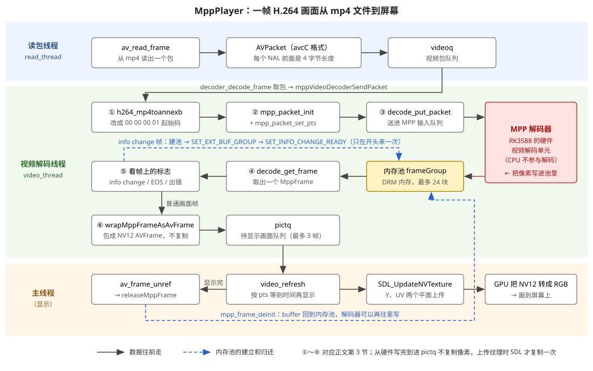

# MppPlayer 是怎么用 MPP 硬解出画面的

> 2026-11-23 · day9_mpp_ffplayer
> 代码：[src/video/mpp_video_decoder.c](../src/video/mpp_video_decoder.c)（MPP 硬解全部在这一个文件里）、[src/video/mpp_video_decoder.h](../src/video/mpp_video_decoder.h)（接口说明）
> 官方文档：`rk_code/external/mpp/doc/Rockchip_Developer_Guide_MPP_CN.md` 第 3.1～3.3 节（解码器，第 296 行起）

## 1. 一句话说清楚

ffplay 原来用 `avcodec_send_packet` / `avcodec_receive_frame` 在 **CPU 上软解**；MppPlayer 把这两个函数换成了自己写的 `mppVideoDecoderSendPacket` / `mppVideoDecoderReceiveFrame`，里面把压缩包交给 **RK3588 的硬件解码单元**，硬件把画面直接写进一块 DRM 内存，再把这块内存**原样（不复制）**包成 FFmpeg 的 `AVFrame` 交回给 ffplay。ffplay 后面的排队、音画同步、显示代码一行都没改。



图里分三个线程看：

| 线程 | 干什么 | 和 MPP 有关的部分 |
|---|---|---|
| 读包线程 `read_thread` | `av_read_frame` 从 mp4 里读出一个个压缩包，放进 `videoq` | 没有，和软解时一样 |
| 视频解码线程 `video_thread` | 从 `videoq` 取包 → 解码 → 把画面放进 `pictq` | **全部在这里**：①～⑥ |
| 主线程 | 到时间了就把 `pictq` 里的画面传给 GPU 显示；显示完释放 | 释放时把 buffer 还给 MPP |

## 2. 输入和输出

| | 是什么 | 例子（yequ_640x480.mp4） |
|---|---|---|
| **输入** | mp4 拆出来的 H.264 / H.265 压缩包（`AVPacket`），**avcC 格式**：每个 NAL 前面是 4 字节的长度，SPS/PPS 不在包里，单独放在 `extradata` | 一个包几百到几万字节 |
| **输出** | `AV_PIX_FMT_NV12` 的 `AVFrame`，`data[0]` / `data[1]` **直接指向 MPP 的 buffer** | 640×480，每行 640 字节，Y 平面 480 行，UV 平面 240 行 |

只接 H.264 和 H.265（[mpp_video_decoder.c:57-66](../src/video/mpp_video_decoder.c#L57-L66)），其他格式照旧走 FFmpeg 软解。用不用 MPP 在打开流的时候决定（[stream.c:173-180](../src/demux/stream.c#L173-L180)）：H.264 / H.265、没写 `-nomppdec`、没用 `-vcodec` 指定解码器，三个条件都满足就创建 MPP 解码器；创建失败自动退回软解。

## 3. 一帧画面经过的 6 步

| 步骤 | 做什么 | 代码 |
|---|---|---|
| 0 | 创建：`mpp_create` → `mpp_init(MPP_CTX_DEC, AVC)` → 关掉 `split_parse` | [mpp_video_decoder.c:137-168](../src/video/mpp_video_decoder.c#L137-L168) |
| ① | 码流过滤器 `h264_mp4toannexb`：avcC 改成 Annex B（起始码 `00 00 00 01`），SPS/PPS 插到关键帧前面 | [:109-128](../src/video/mpp_video_decoder.c#L109-L128)、[:282-293](../src/video/mpp_video_decoder.c#L282-L293) |
| ② | `mpp_packet_init` 把包的地址、长度包成 `MppPacket`，`mpp_packet_set_pts` 带上 pts | [:228-235](../src/video/mpp_video_decoder.c#L228-L235) |
| ③ | `decode_put_packet` 送进 MPP 的输入队列；队列满了返回 `MPP_ERR_BUFFER_FULL`，包先留着下次再送 | [:236-247](../src/video/mpp_video_decoder.c#L236-L247) |
| （硬件） | 硬件解码单元解码，把 NV12 像素写进内存池里的一块 buffer | 看不到代码，在 MPP 和内核驱动里 |
| ④ | `decode_get_frame` 取出一个 `MppFrame`；没有就马上返回 NULL（不等待） | [:443-450](../src/video/mpp_video_decoder.c#L443-L450) |
| ⑤ | 看帧上的标志：info change → 建内存池；EOS → 结束；errinfo / discard → 丢掉；格式不是 NV12 → 报错 | [:452-492](../src/video/mpp_video_decoder.c#L452-L492) |
| ⑥ | `wrapMppFrameAsAvFrame`：同步 cache → 拿到虚拟地址 → `av_buffer_create` 包成 `AVFrame`，不复制像素 | [:374-428](../src/video/mpp_video_decoder.c#L374-L428) |
| 归还 | 主线程显示完 `av_frame_unref` → 回调 `releaseMppFrame` → `mpp_frame_deinit`，buffer 回到内存池 | [:356-363](../src/video/mpp_video_decoder.c#L356-L363) |

这些函数在 ffplay 的解码循环里的调用位置（[pipeline/decoder.c](../src/pipeline/decoder.c)，改动处都标了 `MppPlayer`）：

| ffplay 原来调用的 | 换成 | 位置 |
|---|---|---|
| `avcodec_receive_frame` | `mppVideoDecoderReceiveFrame` | [decoder.c:35-48](../src/pipeline/decoder.c#L35-L48) |
| `avcodec_send_packet` | `mppVideoDecoderSendPacket` | [decoder.c:122-131](../src/pipeline/decoder.c#L122-L131) |
| `avcodec_flush_buffers`（seek、播完） | `mppVideoDecoderFlush` | [decoder.c:74-78](../src/pipeline/decoder.c#L74-L78)、[:95-99](../src/pipeline/decoder.c#L95-L99) |
| `avcodec_free_context` 之后 | `mppVideoDecoderRelease` | [decoder.c:146](../src/pipeline/decoder.c#L146) |

下面按步骤展开讲。

### 3.0 创建解码器

```c
mpp_create(&decoder->decoderCtx, &decoder->decoderApi);          // :139
mpp_init(decoder->decoderCtx, MPP_CTX_DEC, codingType);           // :145
```

- `mpp_create` 写回**两个**东西：`MppCtx`（解码器实例，相当于一个句柄）和 `MppApi *`（函数表）。以后送包、取帧、控制都是 `decoderApi->xxx(decoderCtx, ...)` 这样调用。
- `mpp_init` 的第 2 个参数 `MPP_CTX_DEC` 表示"做解码器"（编码器是 `MPP_CTX_ENC`），第 3 个参数是编码格式。H.264 在 MPP 里叫 `MPP_VIDEO_CodingAVC`，H.265 叫 `MPP_VIDEO_CodingHEVC`。

然后把 `split_parse` 设成 0（[:150-166](../src/video/mpp_video_decoder.c#L150-L166)）：

- `split_parse` 的字面意思是"MPP 自己在码流里找帧的边界、把码流切成一帧一帧"。用在裸 `.h264` 文件这种"一大串字节、不知道哪里是一帧"的场景。
- mp4 拆出来的每个包本来就是完整的一帧，还各带一个 pts。要是让 MPP 再切一次，它可能把两个包拼起来再切开，**pts 就和帧对不上了**，所以关掉。
- 写法是"先读、改一项、再写回"：`control(MPP_DEC_GET_CFG)` → `mpp_dec_cfg_set_u32("base:split_parse", 0)` → `control(MPP_DEC_SET_CFG)`。

### 3.1 ① 为什么要先过一遍 mp4toannexb

H.264 码流有两种"包装"方式：

| | 每个 NAL 前面是什么 | SPS / PPS 放在哪 | 谁用 |
|---|---|---|---|
| **avcC**（mp4 用的） | 4 字节的长度，比如 `00 00 1A 2B` | 单独放在文件头的 `extradata` 里，只存一份 | mp4、mkv |
| **Annex B** | 起始码 `00 00 00 01` | 和画面数据放在一起，每个关键帧前面都有 | 裸 `.h264` 文件、`.ts`、RTSP |

MPP 只认 Annex B。所以要用 FFmpeg 自带的码流过滤器（bitstream filter，简称 bsf）`h264_mp4toannexb` 转一下：

- `av_bsf_get_by_name("h264_mp4toannexb")` 找到过滤器，`avcodec_parameters_copy` 把流参数（含 `extradata`）交给它（[:112-122](../src/video/mpp_video_decoder.c#L112-L122)）
- 每来一个包：`av_bsf_send_packet` 送进去，`av_bsf_receive_packet` 取出转好的包（[:293](../src/video/mpp_video_decoder.c#L293)、[:215](../src/video/mpp_video_decoder.c#L215)）
- 输入已经是 Annex B 时（比如 `.ts` 文件），过滤器原样放行

### 3.2 ② ③ 送包：`decode_put_packet`

```c
mpp_packet_init(&mppPacket, annexbPacket->data, annexbPacket->size);  // :228 只记地址和长度，不复制
mpp_packet_set_pts(mppPacket, packetPts);                             // :235
decoderApi->decode_put_packet(decoderCtx, mppPacket);                 // :236 这里面才把数据复制进 MPP
mpp_packet_deinit(&mppPacket);                                        // :237
```

- **pts 是跟着包走的**：送包时带进去，解码后从对应的帧上用 `mpp_frame_get_pts` 取回来。MPP 不管 pts 的单位，原样带过去。有 B 帧时，帧的输出顺序和送包顺序不一样，靠 pts 才能知道每一帧该什么时候显示。
- **返回 `MPP_ERR_BUFFER_FULL` 不是错误**，意思是 MPP 的输入队列满了。这时包留在 `annexbPacket` 里（`hasPendingAnnexbPacket = 1`），先去取几帧，下一次 receive 开头再送（[:434-438](../src/video/mpp_video_decoder.c#L434-L438)）。
- 因为这一点，MPP 和 avcodec 的规则不完全一样：avcodec 保证"receive 返回 EAGAIN 时一定能 send"，MPP 做不到。所以多了一个 `mppVideoDecoderIsWaitingForOutput`，`decoder.c` 遇到"手里还有包没送进去"时睡 1 ms 再取，而不是去拿新包（[decoder.c:38-46](../src/pipeline/decoder.c#L38-L46)）。
- 播到文件尾时，ffplay 送一个 `data` 为 NULL 的空包。MppPlayer 把它换成 MPP 的结束包：`mpp_packet_init(NULL, 0)` + `mpp_packet_set_eos`（[:250-268](../src/video/mpp_video_decoder.c#L250-L268)）。

### 3.3 ④ ⑤ 取帧：`decode_get_frame` 和帧上的标志

`decode_get_frame` 取出来的 `MppFrame` 不一定是一张画面。MPP 用同一个结构顺带报告别的事情（官方文档第 352 行："MppFrame 结构也是 MPP 实例输出信息的管道"）。所以取到以后要按顺序看标志：

| 标志 | 什么意思 | 怎么处理 | 代码 |
|---|---|---|---|
| `mpp_frame_get_info_change` 为真 | 没有画面，只是告诉你"宽高、stride、一帧要多大的 buffer 定下来了（或者变了）" | 建内存池，告诉 MPP"准备好了"，接着取 | [:453-460](../src/video/mpp_video_decoder.c#L453-L460) |
| `mpp_frame_get_eos` 为真 | 码流结束，后面没有帧了 | 记下来，以后 receive 都返回 `AVERROR_EOF` | [:463-466](../src/video/mpp_video_decoder.c#L463-L466) |
| `mpp_frame_get_buffer` 为 NULL | 空帧，没有像素 | 丢掉 | [:467-473](../src/video/mpp_video_decoder.c#L467-L473) |
| `errinfo` 或 `discard` 不为 0 | 解坏了（码流错误），或者缺参考帧（seek 后第一个关键帧之前的帧） | 丢掉，不显示，不然会花屏 | [:476-484](../src/video/mpp_video_decoder.c#L476-L484) |
| 格式不是 `MPP_FMT_YUV420SP`（NV12） | 比如 10 bit 片源输出的是 NV15 | SDL 不认识，报错 | [:487-492](../src/video/mpp_video_decoder.c#L487-L492) |
| 都不是 | 正常的一帧画面 | 包成 `AVFrame` 交出去 | [:493](../src/video/mpp_video_decoder.c#L493) |

`decode_get_frame` 默认**不等待**：MPP 手里没有解好的帧就马上返回，`mppFrame` 是 NULL，这时返回 `AVERROR(EAGAIN)`，让 ffplay 去送下一个包（[:441-450](../src/video/mpp_video_decoder.c#L441-L450)）。

### 3.4 info change 和内存池：硬件把画面写到哪

这是 MPP 解码和软解最不一样的地方。

**为什么会有 info change**：解码器解析完第一个 SPS 之前，不知道视频多大，也就不知道一帧要多大的内存。所以第一帧画面之前，MPP 一定会先吐一个"info change 帧"，上面写着宽高、stride 和 `buf_size`；用户准备好内存再告诉它继续。播放中分辨率变了，还会再来一次。

**内存池是什么**：一组大小相同的 buffer（这里最多 24 块，每块 `buf_size` 字节）。硬件解码时从池里拿一块空的写画面；用户用完还回去，硬件再拿来写下一帧。全程不新申请内存，也不复制。

处理 info change 的 3 步（[handleInfoChange，:312-346](../src/video/mpp_video_decoder.c#L312-L346)）：

```c
// 第 1 步 读新参数（:314-318）
width     = mpp_frame_get_width(frame);       // 画面宽，640
horStride = mpp_frame_get_hor_stride(frame);  // 每行实际占多少字节（≥ 宽，硬件要求对齐）
verStride = mpp_frame_get_ver_stride(frame);  // Y 平面实际有多少行（≥ 高，1080 → 1088）
bufSize   = mpp_frame_get_buf_size(frame);    // 一块 buffer 要多大

// 第 2 步 建池（:328、:332）
mpp_buffer_group_get_internal(&frameGroup, MPP_BUFFER_TYPE_DRM | MPP_BUFFER_FLAGS_CACHABLE);
mpp_buffer_group_limit_config(frameGroup, bufSize, 24);   // 每块 bufSize 字节，最多 24 块

// 第 3 步 交给解码器，说“好了”（:336、:339）
control(ctx, MPP_DEC_SET_EXT_BUF_GROUP, frameGroup);
control(ctx, MPP_DEC_SET_INFO_CHANGE_READY, NULL);
```

- `MPP_BUFFER_TYPE_DRM`：从内核的 DRM 分配器申请内存。硬件能直接读写这种内存，它也能导出成 dma-buf fd 交给 RGA、GPU 用。
- `MPP_BUFFER_FLAGS_CACHABLE`：CPU 访问这块内存时走 cache。显示时 SDL 要用 CPU 把像素读出来上传给 GPU，不带 cache 的内存 CPU 读起来很慢。代价是读之前要做 cache 同步，见 3.5。
- `limit_config` 的 24 块：H.264 解码器自己最多要留 16 个参考帧，ffplay 手里同时还拿着几帧（`pictq` 3 帧 + 正在显示的 1 帧 + 滤镜里可能有 1 帧），24 块够用（[:14-18](../src/video/mpp_video_decoder.c#L14-L18)）。池子用光时硬件停下来等，不会无限申请。
- 这种"MPP 告诉 buffer 多大、用户建池交给它"的方式，就是官方文档 3.3.2 节的**模式二：半内部分配模式**（第 484 行），也是 `mpi_dec_test` 的默认模式。

**实测**（2026-11-23，板子上跑 MppPlayer 打印的日志）：

| 片源 | info change 日志 | Y + UV 实际要的大小 | MPP 给的 `buf_size` |
|---|---|---|---|
| sync_test_1080p.mp4 | `1920x1080，stride 1920x1088，buf_size 4177920` | 1920 × 1088 × 1.5 = 3133440 | 4177920 = 1920 × 1088 × **2** |
| yequ_640x480.mp4 | `640x480，stride 640x480，buf_size 614400` | 640 × 480 × 1.5 = 460800 | 614400 = 640 × 480 × **2** |

- 1080 不是 16 的倍数，所以 `verStride` 对齐到了 1088；480 本来就是 16 的倍数，不变。
- 两次 `buf_size` 都是 stride 面积的 2 倍，比 NV12 实际需要的 1.5 倍大。多出来的空间 MPP 拿去做什么，我**没有核对源码**，不清楚。用法上只要记住：**内存池按 `buf_size` 建，不要自己算**。

### 3.5 ⑥ 不复制，把 MppFrame 包成 AVFrame

ffplay 后面的代码只认 `AVFrame`。最省事的做法是把像素 `memcpy` 到一个新的 `AVFrame` 里，但 1080p 一帧 3 MB、每秒 30 帧，全靠 CPU 复制太浪费。MppPlayer 的做法是**让 `AVFrame` 直接指向 MPP 的 buffer**（[wrapMppFrameAsAvFrame](../src/video/mpp_video_decoder.c#L374-L428)）：

```c
mpp_buffer_sync_ro_begin(frameBuffer);                       // :395 CPU 读之前同步 cache
uint8_t *pixelAddress = mpp_buffer_get_ptr(frameBuffer);    // :397 buffer 在本进程里的虚拟地址
frame->buf[0] = av_buffer_create(pixelAddress, size,         // :401 包成 AVBufferRef，不复制
                                 releaseMppFrame, holder, AV_BUFFER_FLAG_READONLY);
frame->data[0] = pixelAddress;                               // :411 Y 平面
frame->data[1] = pixelAddress + horStride * verStride;       // :412 UV 平面
frame->linesize[0] = frame->linesize[1] = horStride;         // :413-414
frame->pts = mpp_frame_get_pts(mppFrame);                    // :418 送包时带进去的 pts
```

逐条说明：

- **`mpp_buffer_sync_ro_begin`**：硬件解码器写内存时不经过 CPU 的 cache，CPU cache 里可能还留着这块内存上一帧的旧数据。这个调用让 CPU 丢掉这些旧的 cache 行，接下来读到的才是新画面。`ro` 是 read only，表示 CPU 只读不写。用完在 `releaseMppFrame` 里调 `mpp_buffer_sync_ro_end` 配对（[:359](../src/video/mpp_video_decoder.c#L359)）。
- **`mpp_buffer_get_ptr`**：MPP 分配 buffer 时已经 mmap 到了本进程，这里直接拿虚拟地址，不用自己 mmap。
- **`av_buffer_create`**：把"别人管理的内存"包成 FFmpeg 的引用计数对象。最后一个引用释放时，FFmpeg 回调 `releaseMppFrame`，它调 `mpp_frame_deinit` 把 buffer 还给内存池。所以 **`av_frame_unref` 就等于把 buffer 还给 MPP**。
- **UV 平面的起点是 `horStride × verStride`，不是 `宽 × 高`**。NV12 的内存布局是：先是 Y 平面（`verStride` 行，每行 `horStride` 字节），紧跟着 UV 平面（U、V 交替存放，每行也是 `horStride` 字节）。1080p 时 Y 平面有 1088 行，如果按 1080 行算 UV 的起点，会差 8 行，颜色就错位了。

| 1080p 帧 | 起始偏移（字节） | 行数 | 每行字节数 |
|---|---|---|---|
| Y 平面 `data[0]` | 0 | 1088（只显示前 1080 行） | 1920 |
| UV 平面 `data[1]` | 1920 × 1088 = 2088960 | 544（只显示前 540 行） | 1920 |

**生命周期**：画面在 `pictq` 里还要排一会儿队；ffplay 关闭视频流时，又是先销毁解码器、后清帧队列。如果解码器一销毁就 `mpp_destroy`、释放内存池，`pictq` 里的帧就指向了已经释放的内存。所以解码器本身也做了引用计数（[:181-183](../src/video/mpp_video_decoder.c#L181-L183)）：每个没释放的 `AVFrame` 都持有解码器的一份引用（[:386](../src/video/mpp_video_decoder.c#L386)），最后一帧释放后才真正 `mpp_destroy` 和 `mpp_buffer_group_put`（[:80-98](../src/video/mpp_video_decoder.c#L80-L98)）。

### 3.6 显示：NV12 直接交给 GPU

这部分不属于 MPP，但决定了硬解的结果怎么上屏：

- [sdl_texture_format.h:37](../src/video/sdl_texture_format.h#L37) 加了一行 `AV_PIX_FMT_NV12 → SDL_PIXELFORMAT_NV12`。不加的话，ffplay 的滤镜会在 CPU 上用 swscale 把 NV12 转成 YUV420P，等于每帧白做一次转换。
- [video_render.c:121-127](../src/video/video_render.c#L121-L127) 用 `SDL_UpdateNVTexture` 分两个平面上传，**Y 和 UV 各给一个地址**。不能用 SDL 默认的 `SDL_UpdateTexture`：它假定 UV 紧挨着 Y、从 `每行字节数 × 高` 处开始，和 MPP 的 `horStride × verStride` 对不上。
- 上传纹理时 SDL 会把像素复制一份给 GPU，YUV → RGB 的颜色转换在 GPU 上做。整条链路里，只有这一步复制像素。

### 3.7 seek 和播完：`reset`

拖动进度条后，`videoq` 里会换成新位置的包（`serial` 变了）。ffplay 原来调 `avcodec_flush_buffers`，MppPlayer 换成 `mppVideoDecoderFlush`（[:504-514](../src/video/mpp_video_decoder.c#L504-L514)）：

- `decoderApi->reset(decoderCtx)`：丢掉还没解的码流和还没取走的帧，解码器回到"等关键帧"的状态。
- 内存池和宽高设置保留，**不会再来一次 info change**。
- 已经交出去的 `AVFrame` 不受影响，照常显示、照常释放。
- seek 后到下一个关键帧之前的帧缺参考帧，会带上 `discard` 标志，被 3.3 的第 4 行丢掉，所以拖动后不花屏。

## 4. 用到的技术点

### MPP

| 调用 | 位置 | 在这里做什么 |
|---|---|---|
| `mpp_create` / `mpp_init(MPP_CTX_DEC, ...)` | [:139](../src/video/mpp_video_decoder.c#L139)、[:145](../src/video/mpp_video_decoder.c#L145) | 创建解码器实例和函数表 |
| `mpp_dec_cfg_init` + `MPP_DEC_GET_CFG` / `SET_CFG` | [:152-161](../src/video/mpp_video_decoder.c#L152-L161) | 关掉 `split_parse` |
| `mpp_packet_init` / `set_pts` / `set_eos` / `deinit` | [:228-237](../src/video/mpp_video_decoder.c#L228-L237)、[:253-258](../src/video/mpp_video_decoder.c#L253-L258) | 包装输入包，带 pts，标记结束 |
| `decode_put_packet` | [:236](../src/video/mpp_video_decoder.c#L236) | 送包；`MPP_ERR_BUFFER_FULL` 表示队列满 |
| `decode_get_frame` | [:443](../src/video/mpp_video_decoder.c#L443) | 取帧，不等待 |
| `mpp_frame_get_info_change` / `eos` / `errinfo` / `discard` / `fmt` | [:453-488](../src/video/mpp_video_decoder.c#L453-L488) | 判断这一帧是什么 |
| `mpp_frame_get_width` / `hor_stride` / `ver_stride` / `buf_size` | [:314-318](../src/video/mpp_video_decoder.c#L314-L318) | info change 时读参数 |
| `mpp_buffer_group_get_internal` / `limit_config` / `clear` / `put` | [:326-332](../src/video/mpp_video_decoder.c#L326-L332)、[:92](../src/video/mpp_video_decoder.c#L92) | 建、限制、清空、释放内存池 |
| `MPP_DEC_SET_EXT_BUF_GROUP` / `SET_INFO_CHANGE_READY` | [:336-339](../src/video/mpp_video_decoder.c#L336-L339) | 把池交给解码器，通知继续 |
| `mpp_buffer_sync_ro_begin` / `ro_end` | [:395](../src/video/mpp_video_decoder.c#L395)、[:359](../src/video/mpp_video_decoder.c#L359) | CPU 读之前、读完之后同步 cache |
| `mpp_buffer_get_ptr` / `get_size` | [:397](../src/video/mpp_video_decoder.c#L397)、[:401](../src/video/mpp_video_decoder.c#L401) | 拿虚拟地址和大小 |
| `mpp_frame_deinit` | [:360](../src/video/mpp_video_decoder.c#L360) | 释放帧，buffer 回到池里 |
| `reset` | [:507](../src/video/mpp_video_decoder.c#L507) | seek 后清空 |
| `mpp_destroy` | [:88](../src/video/mpp_video_decoder.c#L88) | 销毁解码器 |

### FFmpeg

| 调用 | 位置 | 在这里做什么 |
|---|---|---|
| `av_bsf_get_by_name` / `alloc` / `init` | [:112-127](../src/video/mpp_video_decoder.c#L112-L127) | 创建 `h264_mp4toannexb` 过滤器 |
| `av_bsf_send_packet` / `receive_packet` / `flush` | [:293](../src/video/mpp_video_decoder.c#L293)、[:215](../src/video/mpp_video_decoder.c#L215)、[:508](../src/video/mpp_video_decoder.c#L508) | avcC → Annex B |
| `av_buffer_create` | [:183](../src/video/mpp_video_decoder.c#L183)、[:401](../src/video/mpp_video_decoder.c#L401) | 借引用计数：解码器的生命周期、MPP buffer 的归还 |

### Linux

| 概念 | 在这里 |
|---|---|
| DRM 内存 | 内存池的类型，硬件能直接读写，能导出成 dma-buf fd（MppPlayer 没用到 fd） |
| CPU cache 同步 | 硬件写、CPU 读同一块内存，读之前要 `sync_ro_begin`，否则可能读到旧数据 |

### 这次的重点

1. **送包 / 取帧是两个独立的动作**：送一个包不一定马上出一帧（B 帧要攒几个包），取帧也不等待；输入队列满了要先取再送。
2. **info change 是 MPP 解码一定会碰到的第一件事**：先拿 `buf_size` 建池、交给解码器，才会出画面。
3. **零拷贝靠引用计数**：`AVFrame` 直接指向 MPP 的 buffer，`av_frame_unref` 就是把 buffer 还给 MPP。
4. **NV12 的 UV 起点是 `horStride × verStride`**：stride 是硬件对齐后的尺寸，和画面宽高不一定一样。

## 5. 实际业务场景

| 场景 | 和这套流程的关系 |
|---|---|
| 本地播放器、广告机、车机多媒体 | 就是 MppPlayer 本身：mp4 → MPP 硬解 → 显示，解码不占 CPU，1080p 实测能流畅放（4K 没测过） |
| NVR / 监控回放 | 一路换成多路，每路一个 MPP 解码器；输入从 mp4 换成 RTSP 拉流（RTSP 本来就是 Annex B，过滤器原样放行） |
| 转码、AI 分析 | 解出来的 NV12 buffer 不交给 SDL，而是把 dma-buf fd 交给 RGA 缩放、交给 MPP 编码器或 NPU，全程零拷贝 |

## 6. 怎么运行、怎么对比

```bash
cd 1_base_work/day9_mpp_ffplayer
ADB_SERIAL=3a6aff9a20ba7de4 ./run_on_board_with_mac.sh                     # 默认：-autoexit 播 yequ_640x480.mp4（MPP 硬解）
ADB_SERIAL=3a6aff9a20ba7de4 ./run_on_board_with_mac.sh -nomppdec -an -autoexit /userdata/day8_media/yequ_640x480.mp4   # 强制软解，对比用
```

看日志确认走的是硬解：

```
[MppVideoDecoder] 使用 MPP 硬解 h264，640x480
[MppVideoDecoder] info change：640x480，stride 640x480，buf_size 614400
```

`ADB_SERIAL` 是板子的 adb 序列号，只连了板子一台 adb 设备时可以不写。

2026-11-23 实测：yequ_640x480.mp4（3 分 54 秒）从头播到尾，自动退出，退出码 0，A-V 一直在 -0.031～-0.034 秒；sync_test_1080p.mp4（60 秒）A-V 在 -0.015～-0.018 秒。
