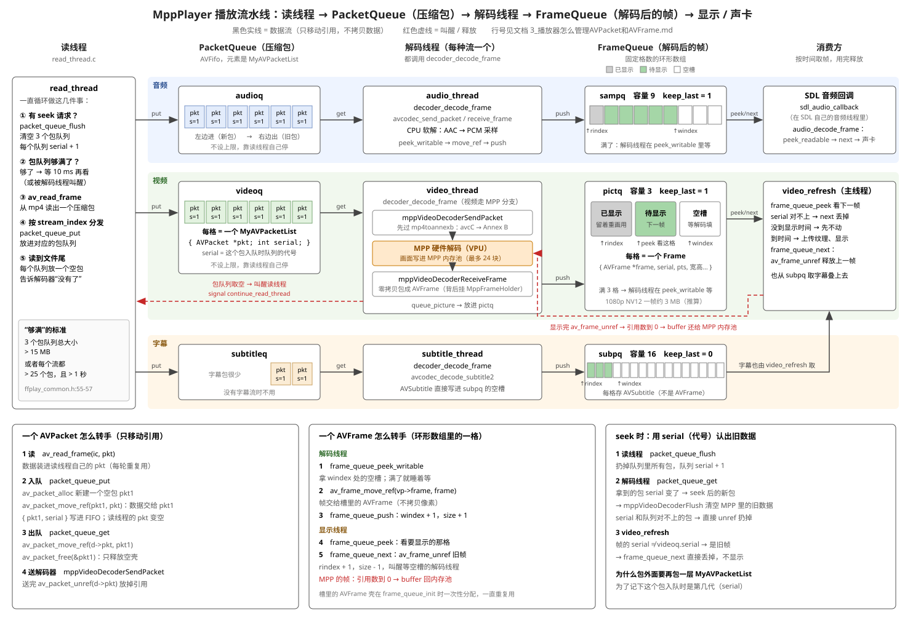

# 播放器是怎么管理 AVPacket 和 AVFrame 的

> 2026-11-25 · day9_mpp_ffplayer
> 代码：[src/pipeline/packet_queue.h](../src/pipeline/packet_queue.h)（包队列）、[src/pipeline/frame_queue.h](../src/pipeline/frame_queue.h)（帧队列）、[src/pipeline/decoder.c](../src/pipeline/decoder.c)（解码线程取包、送包、取帧）、[src/demux/read_thread.c](../src/demux/read_thread.c)（读线程）
> 相关文档：[2_使用mpp硬件解流程.md](2_使用mpp硬件解流程.md)（MPP 硬解那一段的细节）、[我不理解的代码.md](我不理解的代码.md) 第 1 条（`MppVideoDecoder` 的引用计数）
> 行号是 2026-11-25 工作区的样子（clang-format 格式化改动还没提交，提交后可能偏一两行）

## 1. 一句话说清楚

先分清两样东西：

| | 是什么 | 从哪来 |
|---|---|---|
| **AVPacket** | **压缩数据**（H.264 码流、AAC 码流），一个通常几 KB 到几十 KB | 读线程用 `av_read_frame` 从文件里**读**出来的，不是解码出来的 |
| **AVFrame** | **解码后的数据**（YUV 画面、PCM 采样） | 解码线程**解码**出来的 |

播放器用两种队列分别装它们：**PacketQueue 装压缩包，FrameQueue 装解码后的帧**。读线程、解码线程、显示 / 声卡三方通过这两种队列接力。东西在队列之间转手时只移动引用，数据本身不拷贝。

## 2. 整条流水线



图从左到右分 5 列，每一列是一个环节；从上到下是音频、视频、字幕 3 条泳道，每种流各走各的，互不等待。

| 环节 | 谁在跑 | 干什么 | 代码 |
|---|---|---|---|
| 读包 | 读线程 `read_thread` | `av_read_frame` 读出一个压缩包，按 `stream_index` 放进对应的包队列 | [read_thread.c:306](../src/demux/read_thread.c#L306)、[:339-344](../src/demux/read_thread.c#L339-L344) |
| 包队列 | —（数据结构） | `audioq` / `videoq` / `subtitleq`，线程安全的 FIFO | [video_state.h:66](../src/player/video_state.h#L66)、[:107](../src/player/video_state.h#L107) |
| 解码 | 3 个解码线程 `audio_thread` / `video_thread` / `subtitle_thread` | 都调用 `decoder_decode_frame`：从包队列取包 → 解码 → 把帧放进帧队列。**视频走 MPP 硬解**，音频和字幕还是 FFmpeg 软解 | [decoder.c:24](../src/pipeline/decoder.c#L24) |
| 帧队列 | —（数据结构） | `sampq`（音频 9 格）/ `pictq`（视频 3 格）/ `subpq`（字幕 16 格），固定格数的环形数组 | [frame_queue.h:13-15](../src/pipeline/frame_queue.h#L13-L15)、[stream.c:302-306](../src/demux/stream.c#L302-L306) |
| 消费 | 主线程 `video_refresh`；SDL 的音频线程 `sdl_audio_callback` | 到时间了取帧显示 / 声卡要数据时取帧，用完释放 | [video_refresh.c](../src/video/video_refresh.c)、[audio_output.c:129](../src/audio/audio_output.c#L129) |

图里的两条红色虚线：

- **包队列取空 → 叫醒读线程**：解码线程发现包队列空了，就 `SDL_CondSignal(d->empty_queue_cond)`（[decoder.c:88](../src/pipeline/decoder.c#L88)），叫醒正在等待的读线程，不用等满 10 ms 再读。
- **显示完 → buffer 还给 MPP 内存池**：见第 7 节。

## 3. MyAVPacketList 和 PacketQueue：一个元素和整个队列

```c
// packet_queue.h:12 —— 一个元素：一个包 + 它入队时的“代号”
typedef struct MyAVPacketList {
    AVPacket *pkt;
    int serial;           // 入队时队列的 serial
} MyAVPacketList;

// packet_queue.h:17 —— 整个队列
typedef struct PacketQueue {
    AVFifo *pkt_list;     // 先进先出的容器，一个个存的是 MyAVPacketList
    int nb_packets;       // 包个数
    int size;             // 总字节数（含 MyAVPacketList 自身）
    int64_t duration;     // 总时长（流的 time_base）
    int abort_request;    // 1 = 要退出了，所有阻塞的 get 立即返回 -1
    int serial;           // 当前代号，seek（flush）一次 +1
    SDL_mutex *mutex;     // 读线程和解码线程同时访问，要加锁
    SDL_cond *cond;       // 队列空时，取包的线程在这里睡着等
} PacketQueue;
```

| | MyAVPacketList | PacketQueue |
|---|---|---|
| 是什么 | 队列里的**一个元素** | **整个队列** |
| 有几个 | 队列里有几个包就有几个 | 每种流一个：`audioq`、`videoq`、`subtitleq` |
| 管什么 | 包本身，加上这个包是哪一“代”的 | 先进先出的顺序、线程安全、统计（个数 / 字节 / 时长）、退出、seek 换代 |

**为什么包外面要再包一层**：为了记下 `serial`，也就是这个包**入队时**队列的代号。seek 之后队列的代号加 1，解码线程拿包时一比较，就知道这个包是 seek 之前读进来的旧包（见第 8 节）。

**名字里为什么有 `List`**（推断，没有核对 FFmpeg 的提交记录）：旧版 ffplay 用链表存包，结构体里有一个 `next` 指针；后来改成了 `AVFifo`，名字没跟着改。现在它就是“一个元素”的意思，和链表没有关系。

## 4. 一个 AVPacket 怎么转手：只移动引用，不拷贝数据

`av_packet_move_ref(dst, src)`：把 src 持有的数据引用**交给** dst，src 被清空（变成一个空包）。压缩数据本身一个字节都不复制。

| 步骤 | 位置 | 发生了什么 |
|---|---|---|
| 1. 读 | [read_thread.c:306](../src/demux/read_thread.c#L306) | `av_read_frame(ic, pkt)` 把数据装进读线程自己的 `pkt`。这个 `pkt` 每轮循环都重复用 |
| 2. 入队 | [packet_queue.c:30](../src/pipeline/packet_queue.c#L30) `packet_queue_put` | `av_packet_alloc` 新建一个空包 `pkt1`；`av_packet_move_ref(pkt1, pkt)` 把数据交给它；`{ pkt1, serial }` 作为一个 `MyAVPacketList` 写进 FIFO，然后 `SDL_CondSignal` 叫醒等包的解码线程。读线程的 `pkt` 变空，下一轮接着用 |
| 3. 出队 | [packet_queue.c:121](../src/pipeline/packet_queue.c#L121) `packet_queue_get` | 队列空时在 `SDL_CondWait` 里睡着等。取到后 `av_packet_move_ref(pkt, pkt1.pkt)` 把数据交给解码器的 `d->pkt`，再 `av_packet_free` 释放队列里那个空壳 |
| 4. 送解码器 | [decoder.c](../src/pipeline/decoder.c) 的 MPP 分支 | `mppVideoDecoderSendPacket(d->mppDecoder, d->pkt)`，送完 `av_packet_unref(d->pkt)` 放掉引用。MPP 输入队列满时返回 `EAGAIN`，设 `packet_pending = 1`，下一轮重送同一个包 |

读到文件尾时，读线程给每个包队列放一个**空包**（`packet_queue_put_nullpacket`，[read_thread.c:310-314](../src/demux/read_thread.c#L310-L314)），告诉解码器“后面没有包了，把缓存里剩下的帧都吐出来”。

## 5. 一个 AVFrame 怎么转手：固定格数的环形数组

```c
// frame_queue.h —— 一格
typedef struct Frame {
    AVFrame *frame;       // 解码后的帧（音视频）
    AVSubtitle sub;       // 字幕（字幕队列才用）
    int serial;           // 解码这一帧用的包是哪一代的
    double pts;           // 显示时间（秒）
    double duration;      // 估计的显示时长（秒）
    int64_t pos;          // 在文件里的字节位置
    int width, height, format;
    ...
} Frame;

// frame_queue.h —— 整个队列
typedef struct FrameQueue {
    Frame queue[FRAME_QUEUE_SIZE];  // 固定大小的数组
    int rindex;           // 读位置
    int windex;           // 写位置
    int size;             // 当前有几格有帧
    int max_size;         // 容量：视频 3、音频 9、字幕 16
    int keep_last;        // 1 = 显示过的最后一帧先不释放
    int rindex_shown;     // 1 = rindex 那一格已经显示过了
    SDL_mutex *mutex;
    SDL_cond *cond;
    PacketQueue *pktq;    // 对应的包队列，用它的 abort_request 判断要不要退出
} FrameQueue;
```

`rindex`、`windex` 走到数组末尾就回到 0，所以叫**环形**数组。

帧的生命周期是“取空槽 → 填 → 提交 → 读 → 释放”：

| 步骤 | 谁 | 位置 | 发生了什么 |
|---|---|---|---|
| 1 | 解码线程 | [frame_queue.c:68](../src/pipeline/frame_queue.c#L68) `frame_queue_peek_writable` | 拿 `windex` 处的空槽。满了（`size >= max_size`）就在 `SDL_CondWait` 里睡着等 |
| 2 | 解码线程 | [video_decoder_thread.c:37](../src/video/video_decoder_thread.c#L37) `av_frame_move_ref(vp->frame, src_frame)` | 帧的引用交给槽里的 AVFrame，像素不拷贝；同时填好 pts、serial、宽高 |
| 3 | 解码线程 | [frame_queue.c:100](../src/pipeline/frame_queue.c#L100) `frame_queue_push` | `windex` 前进一格，`size + 1`，叫醒等帧的一方 |
| 4 | 显示线程 | [frame_queue.c:53](../src/pipeline/frame_queue.c#L53) `frame_queue_peek` | 看要显示的那一格（`rindex + rindex_shown`），不移动下标 |
| 5 | 显示线程 | [frame_queue.c:110](../src/pipeline/frame_queue.c#L110) `frame_queue_next` | `av_frame_unref` 释放 `rindex` 处的旧帧（[:116](../src/pipeline/frame_queue.c#L116)），`rindex` 前进，`size - 1`，叫醒等空槽的解码线程 |

槽里的 AVFrame **壳**在 `frame_queue_init` 时一次性分配好（[frame_queue.c:13](../src/pipeline/frame_queue.c#L13)），一直重复用。每一轮只是往壳里交引用、再放掉引用。

**`keep_last = 1`（视频、音频用）**：显示过的最后一帧不马上释放，留在 `rindex` 处，`rindex_shown` 设成 1。图里 pictq 灰色那一格就是它。留着它有两个用处：暂停时窗口需要重画，算下一帧该显示多久也要用到上一帧的 pts。所以第一次调用 `frame_queue_next` 只是把 `rindex_shown` 设成 1，不释放（[frame_queue.c:112-115](../src/pipeline/frame_queue.c#L112-L115)）。

**音频的取法不一样**：声卡要数据时，SDL 在自己的音频线程里调用 `sdl_audio_callback` → `audio_decode_frame`。这里用的是 `frame_queue_peek_readable`（[audio_output.c:38](../src/audio/audio_output.c#L38)），没有帧时会**等**；视频的 `video_refresh` 在主线程里跑，主线程不能卡住，所以它先看 `frame_queue_nb_remaining`，没有帧就直接返回。

## 6. 两种队列对比

| | PacketQueue | FrameQueue |
|---|---|---|
| 存什么 | 压缩包 | 解码后的帧：一帧 1080p 的 NV12 约 3 MB（1920 × 1080 × 1.5，推算） |
| 容器 | `AVFifo`，满了自动扩容 | 固定数组，`rindex` / `windex` 轮着转 |
| 元素 | `MyAVPacketList`：包 + serial | `Frame`：AVFrame + serial + pts + 宽高等 |
| 容量 | **不设上限**，靠读线程自己停：3 个包队列总大小超过 15 MB，或者每个流都超过 25 个包且超过 1 秒，读线程就等 10 ms 再看（[read_thread.c:285-293](../src/demux/read_thread.c#L285-L293)，常量在 [ffplay_common.h:55-57](../src/common/ffplay_common.h#L55-L57)） | 视频 3、音频 9、字幕 16。满了解码线程就在 `peek_writable` 里等 |
| 谁写 | 读线程 | 解码线程 |
| 谁读 | 解码线程 | 主线程（视频、字幕）、SDL 音频线程（音频） |

**谁等谁**（流量控制）：

- 帧队列满了 → 解码线程等，不再取包 → 包队列越积越多 → 积到“够满” → 读线程等
- 显示了一帧 → 帧队列空出一格 → 解码线程醒来取包 → 包队列少了 → 读线程接着读
- 包队列取空了 → 解码线程叫醒读线程（图里的红色虚线）

所以内存占用有上限：包最多约 15 MB，帧最多 3 + 9 + 16 格。

## 7. 接上 MPP 以后：释放 AVFrame = 把 buffer 还给 MPP

这一节把第 5 节和 [2_使用mpp硬件解流程.md](2_使用mpp硬件解流程.md) 串起来。

MPP 解出来的帧是**零拷贝**包成 AVFrame 的：AVFrame 背后挂着一个 `MppFrameHolder`（[mpp_video_decoder.c:44](../src/video/mpp_video_decoder.c#L44)），里面就是 MPP 内存池里的那块 buffer。所以：

- 显示线程调 `frame_queue_next` → `av_frame_unref` → 引用计数降到 0 → FFmpeg 调 `releaseMppFrame`（[mpp_video_decoder.c:356](../src/video/mpp_video_decoder.c#L356)）→ buffer **还给 MPP 内存池**，MPP 才能拿它去解下一帧
- 内存池最多 24 块（`kFrameBufferCount`，[mpp_video_decoder.c:17](../src/video/mpp_video_decoder.c#L17)）。显示线程一直不释放帧，MPP 就没有 buffer 可写，解码会停下来等
- 帧没释放之前，它还持有解码器的一份引用（`selfRef`，见 [我不理解的代码.md](我不理解的代码.md) 第 1 条），所以解码器和内存池不会被提前销毁

## 8. seek 时：用 serial 认出旧数据

seek 之后，包队列、MPP 内部、帧队列里都还留着 seek 之前的数据，要全部扔掉。播放器用 **serial（代号）** 来区分新旧：

| 步骤 | 谁 | 位置 | 发生了什么 |
|---|---|---|---|
| 1 | 读线程 | [read_thread.c:257-261](../src/demux/read_thread.c#L257-L261) `packet_queue_flush` | 扔掉 3 个包队列里的所有包，每个队列 `serial + 1`（[packet_queue.c:79](../src/pipeline/packet_queue.c#L79)） |
| 2 | 解码线程 | [decoder.c:95](../src/pipeline/decoder.c#L95) | 取到的包 serial 和上一个包不一样 → 这是 seek 之后的新包 → `mppVideoDecoderFlush` 清空 MPP 里的旧数据。serial 和队列当前代号对不上的包，直接 `av_packet_unref` 扔掉 |
| 3 | 主线程 | [video_refresh.c:65-67](../src/video/video_refresh.c#L65-L67) | 帧的 `serial` ≠ `videoq.serial` → 是 seek 之前解出来的旧帧 → `frame_queue_next` 直接丢掉，不显示 |

这就是包外面要再包一层 `MyAVPacketList`、帧的格子里也要记 `serial` 的原因：不记下“这是第几代”，seek 之后就分不清哪些数据该扔。
