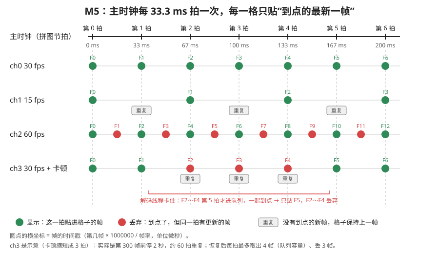

# M5 4 路不同帧率，按主时钟对齐拼图

> **n0 说明（2026-11-20）**：代码在 `claude_reference/第02周_N0_Day6的M4和Day8上板/`，**已经交叉编译通过（0 警告），还没上板**（板子不在身边）。两个输入文件已经在 Mac 上生成（帧数是实测的），还没 `adb push`。文中标“推断”的数字都是按代码算出来的预期，上板后在第 6 节补日期和实测结果。

> 架构见 [m1流程.md](m1流程.md) 第 2 节；拼图见 [m2流程.md](m2流程.md)；编码见 [m3流程.md](m3流程.md)；上屏见 [m4流程.md](m4流程.md)。本篇只讲 M5 新加的东西：**时间戳、主时钟、按时间取帧**。

下文代码路径都相对于 `claude_reference/第02周_N0_Day6的M4和Day8上板/`；`src/` 下的文件省略 `src/`。

## 0. 学完能回答的问题

1. 15 fps 那一路为什么每帧要显示两次？60 fps 那一路丢掉的帧去哪了？（第 02 周问题 5）
2. 主时钟为什么要等 4 路都拿到第一帧才开始走？
3. 一路卡住 2 秒、恢复以后，为什么每一拍最多丢 3 帧，而不是一下子把积压的 60 帧全丢掉？
4. M5 的“丢帧”和 Day 8 播放器的“丢帧”判断有什么不同？

答案在第 4 节，第 4.8 节汇总。

## 1. 干了什么

M2～M4 的拼图是“每一路各 pop 一帧就拼一张”，大图的速度跟着最慢的那一路走，**和时间无关**。4 路帧率不一样时，这样拼出来就不对了：15 fps 的那一路会被拼成 30 fps（快了一倍），60 fps 的那一路会被拼成 30 fps（慢了一半）。

M5 改成**按时间**拼：

- 每一帧带一个**时间戳**（这一帧应该在第几微秒显示）。
- 有一个**主时钟**，每 1/30 秒“拍”一次，每拍拼一张大图。
- 每一拍，每一格只取“时间戳 ≤ 现在”的帧；到点的帧有好几个，只贴最新的那个，其余的**丢弃**；一帧都没到点，格子保持上一帧，算**重复**。

```
解码线程 0：aaa.264            30 fps ─ 打时间戳 → 队列 0 ┐
解码线程 1：n0_ch1_15fps.h264  15 fps ─ 打时间戳 → 队列 1 ┤   主线程：
解码线程 2：n0_ch2_60fps.h264  60 fps ─ 打时间戳 → 队列 2 ┤ → ① 第 0 张：每路阻塞取一帧拼（同 M2），然后时钟从 0 开始走
解码线程 3：aaa.264            30 fps ─ 打时间戳 → 队列 3 ┘   ② 第 k 张：睡到 k × 33333 微秒，每格取到点的最新帧，RGA 贴
            （第 300 帧前人为停 2 秒）                           ③ 编码、写文件（同 M3）
                                                             ……4 路都解完 → ④ 排空编码器
```



图里每一行是一路，圆点的横坐标是帧的时间戳，竖虚线是主时钟的每一拍。绿色 = 那一拍贴进格子的帧，红色 = 丢弃，灰框 = 那一拍重复上一帧。ch3 那一行是示意（卡顿缩短成 3 拍）。

## 2. 输入

4 路内容都来自 `aaa.264`（H.264 1920×1080，30 fps，1803 帧，约 60 秒），帧率不同（`app/app_config.h:67-72`）：

| 格子 | 文件 | 帧率 | 帧数 | 怎么来 | 要演示的 |
|---|---|---|---|---|---|
| ch0 | `/userdata/av/aaa.264` | 30 | 1803 | 原文件 | 和时钟同速：每拍都换新帧 |
| ch1 | `/userdata/av/n0_ch1_15fps.h264` | 15 | 902（2026-11-20 Mac 上 ffprobe 实测） | 隔一帧取一帧 | 比时钟慢：每帧显示两拍 |
| ch2 | `/userdata/av/n0_ch2_60fps.h264` | 60 | 3606（同上实测） | 每帧复制一次 | 比时钟快：一半的帧丢弃 |
| ch3 | `/userdata/av/aaa.264` | 30 | 1803 | 原文件，第 300 帧前停 2000 ms | 一路卡住：先重复，恢复后丢帧追上 |

每一路的配置是一个 `AlignedChannelInput`（`app/app_config.h:54-60`）：路径、格式、帧率 `framesPerSecond`、在第几帧前停 `stallAtFrameIndex`（-1 = 不停）、停多久 `stallDurationMs`。拼图节拍 `kM5MosaicFps = 30`（:73）。

**两个转码文件怎么来的**：`make_m5_inputs.sh`，在 Mac 上用 ffmpeg 转（本机 ffmpeg 没有 libx264，用 `h264_videotoolbox` 硬件编码）：

```sh
# make_m5_inputs.sh:19-20  15 fps：select 只留偶数帧，setpts 按新的序号重排时间戳
-vf "select='not(mod(n\,2))',setpts=N/(15*TB)" -vsync passthrough
# make_m5_inputs.sh:23-24  60 fps：先按 30 fps 重排时间戳，再恒定 60 fps 输出，每帧被复制一次
-vf "setpts=N/(30*TB)" -r 60 -vsync cfr
```

为什么不直接 `-vf fps=15`：`aaa.264` 是裸码流，ffmpeg 读出来的时间戳是乱的，`fps` 滤镜按乱的时间戳补帧，2026-11-20 实测输出变成几百 MB（脚本 :7 的注释）。`setpts=N/(帧率*TB)` 的意思是“第 N 帧的时间戳 = N / 帧率 秒”，不管原来的时间戳。

## 3. 输出

| 输出 | 预期（**推断，待上板**） |
|---|---|
| `/userdata/av/mosaic_m5.h265`（`app/app_config.h:74`） | H.265 裸码流，1920×1080，和 M3 同样的编码参数（`app/m5_aligned_mosaic.cpp:103-113`） |
| 大图张数 | 约 1804：第 0 张 + 第 1～1803 拍（最后一帧是 ch2 的第 3605 帧，时间戳 3605 × 1000000 / 60 = 60083333 微秒，第 1803 拍是 60100000 微秒） |
| 用时 | 约 60 秒（实时速度）。日志 `拼了 … 张大图，编码 … 帧，用时 … ms（实时速度，预期约 60000 ms）`（`app/m5_aligned_mosaic.cpp:149-150`） |
| 每一路 | `ch0 30 fps：解出 1803 帧（错误 0），显示 …，重复 …，丢弃 …`（:141-144），预期数字见 6.2 |

## 4. 技术点

### 4.1 MPP：给每一帧打时间戳

裸码流里没有可靠的时间戳（M4 的 4.5 讲过），只能按“第几帧 + 帧率”自己算：

```cpp
// pipeline/decode_stage.cpp:57-61
if (ptsFrameRate > 0) {
    // 第几帧（从 0 开始）× 每帧多少微秒。先乘后除，用 int64_t：3600 × 1000000 超过 int 的范围
    const int64_t ptsUs = static_cast<int64_t>(decodedFrameCount) * 1000000 / ptsFrameRate;
    mpp_frame_set_pts(rawFrame, ptsUs); // 写进帧里，拼图线程用 mpp_frame_get_pts 读
}
```

- **`mpp_frame_set_pts` / `mpp_frame_get_pts`**：字面意思是写 / 读 MppFrame 里的 `pts` 字段（RK_S64，显示时间戳 presentation time stamp）。MPP 不规定单位，**谁打谁定**，这里定成微秒。作用：时间戳跟着帧走，帧从解码线程经过队列到拼图线程，不用另外再传一个数。
- **先乘后除、用 int64_t**：ch2 有 3606 帧，3605 × 1000000 ≈ 3.6 × 10⁹，超过 `int` 的上限（约 2.1 × 10⁹）。先除后乘（`1000000 / 60 = 16666`，余数丢掉）每帧少 0.67 微秒，帧多了会累积偏差。
- **设置入口**：`DecodeStage::setPtsFrameRate`（`pipeline/decode_stage.h:40`），由 `DecodeChannel::setPtsFrameRate` 转过来（`pipeline/decode_channel.h:39`），`openAlignedChannels` 在起线程前调用（`app/m5_aligned_mosaic.cpp:31`）。默认 0 = 不打，所以 M1～M4 行为不变。
- `decodedFrameCount` 只数**交出去的正常帧**，错误帧不算（:51-55 先 `continue` 了），所以时间戳是连续的。
- 转码出来的文件 ffprobe 显示 `has_b_frames=2`，但 MPP 输出的帧已经是显示顺序，按输出顺序编号就对（`make_m5_inputs.sh:11`）。

### 4.2 Linux：主时钟 `MasterClock`

`sync/master_clock.h:13`，三个函数：

| 函数 | 代码 | 字面意思 → 作用 |
|---|---|---|
| `start` | `master_clock.cpp:11-14` | 记下此刻的单调时钟读数 `startMonotonicUs` → 从这一刻起“位置”是 0 |
| `getPositionUs` | :21-26 | `现在的单调时钟 - startMonotonicUs` → 从开始到现在过了多少微秒；没 start 时返回 0 |
| `sleepUntilPositionUs` | :34-45 | 循环：算还差多少 `remainingUs`，≤ 0 就返回，否则 `usleep(remainingUs)` → “早了就等” |

**`clock_gettime(CLOCK_MONOTONIC, &now)`**（:55）：

- 字面意思：读一个时钟，结果写进 `timespec`（`tv_sec` 秒 + `tv_nsec` 纳秒，两个字段合起来才是完整时间，:56 换算成微秒）。
- `CLOCK_MONOTONIC`：单调时钟，开机以来的时间（大致），**只往前走**，有人改系统时间（`date -s`、NTP 校时）也不会跳。作用：算“过了多久”必须用它；如果用 `CLOCK_REALTIME`（墙上时间），校时往回拨一下，`remainingUs` 就会突然变大，拼图停住。

**为什么 `sleepUntilPositionUs` 是循环**：`usleep` 可能被信号提前叫醒，醒来要重新算还差多少（:32 的注释）。另外每次都是“睡到第 k 拍的绝对时间”，不是“睡 33333 微秒”：如果某一拍拼图编码用了 20 ms，下一次只睡剩下的 13 ms，**误差不会一拍拍累积**。

M5 没有音频，主时钟就是系统时间。Day 8 播放器的主时钟由音频推着走（`master_clock.h:10-11` 的注释），为什么播放器通常拿音频当主时钟，是第 02 周读 Day 8 代码时回答的问题，不在 M5 里。

### 4.3 主时钟的起点（问题 2）

```cpp
// app/m5_aligned_mosaic.cpp:49-61（省略出错处理）
ComposeResult composeResult = composeStage.composeNextMosaic(channelPtrs); // 第 1 步 每路阻塞 pop 一帧
...
encodeStage.encodePicture(composeStage.getMosaicPicture());
MasterClock clock;                                                          // 第 2 步 开始计时
clock.start();
```

第 0 张大图用 M2 的 `composeNextMosaic` 拼：它对每一路调用阻塞的 `pop`，**4 路都解出第一帧才返回**。拼完、编完，时钟才从 0 开始走。

**为什么不一开始就计时**：4 个 MPP 解码器初始化、读码流、解出第一帧要花时间（推断几十到几百毫秒），而且 4 路快慢不一样。如果程序一启动就开始计时：

- 第一帧的时间戳是 0，等它解出来时钟已经走到比如 200 ms，**一开始所有帧都是“晚了”**：ch0 第一拍就有好几帧到点，丢掉前面几帧；ch2 丢得更多。统计数字一开始就偏了，和预期对不上。
- 解得慢的那一路，开头几拍队列是空的，格子是黑的。

等 4 路都有第一帧再计时，相当于“把 4 路的第 0 帧对齐到时钟的 0”，启动的耗时不算进来。第 0 张大图对应时间 0，第 k 张对应 `k × 1000000 / 30` 微秒（:65）。

### 4.4 队列：不阻塞地“到点才取” `tryPopIfDue`

M1～M4 的 `pop` 是阻塞的：没帧就等。M5 的拼图线程**不能等**某一路 —— 一路卡住，其他三路也得照常按时刷新。所以 `FrameQueue` 加了一个不阻塞的版本，阻塞的 `pop` 一点不改（`pipeline/frame_queue.h:28` 的注释）：

```cpp
// pipeline/frame_queue.cpp:72-88（节选）
std::unique_lock<std::mutex> lock(mutex); // 不 wait，只是为了安全地读写 frames
...
if (frames.empty()) {
    return isInputClosed ? TryPopResult::EndOfStream : TryPopResult::Empty;
}
const int64_t frontPtsUs = mpp_frame_get_pts(frames.front().get());
if (frontPtsUs > nowUs) {
    return TryPopResult::NotDue;
}
framePtr = std::move(frames.front());
frames.pop_front();
lock.unlock();
notFull.notify_one(); // 腾出了一个空位，叫醒可能在 push 里等的解码线程
```

五种结果（`pipeline/frame_queue.h:29-35`）：

| 结果 | 字面意思 | 拼图线程怎么做 |
|---|---|---|
| `Frame` | 队首到点了（时间戳 ≤ nowUs），已经取出 | 先拿着，接着再取一次，看后面还有没有到点的 |
| `NotDue` | 队首有帧，但还没到点 | 不取了，这一拍这一路就到这里 |
| `Empty` | 队列暂时空，解码线程还会再放 | 同上（ch3 卡住时就是这种） |
| `EndOfStream` | 解码线程 `closeInput` 过，而且队列空了 | 这一路结束，格子停在最后一帧 |
| `Aborted` | 有人叫停了 | 整个流程退出 |

- **只看队首**：帧是按时间戳从小到大进队列的，队首没到点，后面的更不会到点（:69 的注释）。
- **取走以后 `notify_one`**：解码线程可能正在 `push` 里等空位（队列满），不叫醒它就一直睡着。和 `pop` 一样。
- 这里用 `unique_lock` 而不用 `lock_guard`，是因为中途要 `lock.unlock()`：先解锁再通知，被叫醒的解码线程马上就能拿到锁。

### 4.5 每一格的规则 `composeAlignedMosaic`（问题 1、3）

`pipeline/mosaic_compose_stage.cpp:113-169`。每一拍、每一格独立做：

```cpp
// pipeline/mosaic_compose_stage.cpp:123-144（节选）
MppFramePtr latestDueFramePtr; // 这一拍要贴的帧：到点的帧里最新的那一帧
while (true) {
    MppFramePtr dueFramePtr;
    const TryPopResult tryPopResult = channelPtr->getFrameQueue().tryPopIfDue(nowUs, dueFramePtr);
    ...
    if (tryPopResult != TryPopResult::Frame) {
        break; // NotDue / Empty：后面的帧还没到点，或者还没解出来
    }
    if (latestDueFramePtr) {
        droppedFrameCounts[channelIndex]++; // 被更新的帧顶掉；赋值时旧帧析构，buffer 还给解码器
    }
    latestDueFramePtr = std::move(dueFramePtr);
}
```

然后（:147-158）：取到了 → RGA 贴进格子，**显示 +1**；没取到、这一路也没结束 → 格子不动，**重复 +1**。4 路都结束才返回 `AllChannelsEnded`（:164-166）。

**问题 1 的前半：15 fps 为什么每帧显示两次**

ch1 的第 i 帧时间戳是 `i × 66666` 微秒，时钟每 33333 微秒一拍。第 2i 拍时第 i 帧到点，贴上；第 2i+1 拍时第 i+1 帧（66666 微秒以后）还没到点，`tryPopIfDue` 返回 `NotDue`，格子保持第 i 帧 → 重复。所以每帧在屏幕上停两拍。**重复不是 bug，是“帧率低于输出帧率”的正常表现**：画面就是 15 fps 的，不能凭空多出画面。

**问题 1 的后半：60 fps 丢掉的帧去哪了**

ch2 每拍有两帧到点（例如第 1 拍：第 1 帧 16666 微秒、第 2 帧 33333 微秒）。取第 2 帧时 `latestDueFramePtr` 里已经有第 1 帧，`latestDueFramePtr = std::move(dueFramePtr)` 这一句让旧的 `unique_ptr` 析构 → 删除器调用 `mpp_frame_deinit` → 这一帧占的 buffer **回到 ch2 解码器的内存池**，下次解码接着用。

也就是说丢掉的帧**解码了，但没有经过 RGA、没有编码、没有进文件**，在内存里待了不到一拍就还回去了。解码的工作白做了 —— 真实 NVR 如果预览不需要那么高的帧率，会让摄像头直接出低帧率的子码流，或者用解码器的跳帧功能，而不是解出来再丢（推断）。

**问题 3：卡住恢复后，为什么每拍最多丢 3 帧**

ch3 的解码线程在第 300 帧放进队列之前睡 2 秒（`pipeline/decode_channel.cpp:53-57`）。这期间：

1. **卡住时**：队列里提前存着的几帧（最多 4 帧）按时间戳一一显示完，然后队列空了，`tryPopIfDue` 返回 `Empty` → 每拍重复，格子停住。
2. **恢复时**：时钟已经走到约 11.8 秒（推断，见下），第 300 帧（时间戳 10 秒）到第 355 帧左右都已经“到点”。但队列容量只有 4（`kFrameQueueCapacity`，`app/app_config.h:29`），解码线程一次最多塞进 4 帧，满了就在 `push` 里等。
3. 所以每一拍，拼图线程最多取出 4 帧：贴最新的 1 帧，丢 3 帧。取走之后解码线程接着往队列里塞，下一拍又是最多 4 帧……每拍能比时钟多追 3 帧，大约 20 拍（不到 1 秒）追平，之后恢复每拍 1 帧。

所以“积压的帧”不是一下子全丢，而是**分 20 拍左右、每拍最多丢 3 帧**逐渐追上。屏幕上看是 ch3 那格停住约 2 秒，然后快进不到 1 秒，再恢复正常（推断）。如果哪一拍丢的超过 3 帧，说明取帧那一小段时间里解码线程又塞进了新帧（推断很少见：取 4 帧只要几微秒，解一帧 1080p 要几毫秒）。

**为什么卡顿约 56 拍而不是正好 60 拍（推断）**：解码线程比显示超前，队列满着的时候，第 299 帧在第 295 拍左右才进队列，紧接着解出第 300 帧、开始睡。也就是从约 9.83 秒睡到约 11.83 秒。第 296～299 帧照常在第 296～299 拍显示，第 300～354 拍左右是重复（约 55 拍）；恢复时第 300～355 帧都到点了（约 56 帧），追的过程中丢掉约 56 帧。设计里写的“约 60”是没算队列超前的粗略值，实测在 55～60 之间都说得通。

### 4.6 和 Day 8 播放器对照（问题 4）

Day 8 播放器的视频线程（`1_base_work/day8_qt_player/src/pipeline/video_worker.cpp:224-241`）：

```cpp
const int64_t earlyUs = ptsUs - clock.getPositionUs(); // 正数 = 画面比时钟早，要等
if (earlyUs <= 0) { break; }
sleepForUs(std::min(earlyUs, kMaxWaitSliceUs));        // 最多睡 10 ms 就醒来看看
...
const int64_t lateUs = clock.getPositionUs() - ptsUs;
if (lateUs > kMaxLateUs) {                              // kMaxLateUs = 100 ms（video_worker.h:124）
    droppedLateFrameCount++;
    return;
}
```

两边都是“画面追时钟：早了等、晚了丢”，区别在于**谁等、丢的标准是什么**：

| | Day 8 播放器 | M5 拼图 |
|---|---|---|
| 路数 | 1 路视频 | 4 路，共用一个输出节拍 |
| 谁在等 | 视频线程拿着**一帧**，睡到这一帧的时间戳 | 拼图线程睡到**下一拍**的时间（`sleepUntilPositionUs`），不为任何一路的帧等 |
| 什么时候丢 | 这一帧比时钟晚了 **超过 100 ms** 才丢；晚 50 ms 照样显示 | 同一拍里**有更新的帧也到点了**就丢旧的，不管晚了多少 |
| 为什么这样定 | 单路播放，每帧都显示最流畅；稍微晚一点人看不出来，丢了反而跳 | 每拍只能贴一帧，多出来的帧没有地方显示，只能留最新的 |
| 没有新帧时 | 屏幕上保留上一帧（界面不刷新） | 格子保持上一帧，记一次“重复” |

### 4.7 自测 `m5test`

`app/m5_self_test.cpp` 不需要输入文件，先单独检查两个新零件：

- `checkMasterClock`（:52-64）：没 start 时位置是 0；睡 100 ms 后位置在 [100000, 110000]；`sleepUntilPositionUs(200000)` 返回后位置 ≥ 200000。
- `checkTryPopIfDue`（:72-112）：用 `mpp_frame_init` + `mpp_frame_set_pts` 造 3 个只有时间戳、没有画面的帧（0、33333、66666）。`nowUs=0` 取到第 1 帧；再取 `NotDue`；`nowUs=70000` 连取两次都是 `Frame`，第 3 帧时间戳 66666；再取 `Empty`；`closeInput` 后 `EndOfStream`；另一个队列 `abort` 后 `Aborted`。

全部通过打印 `M5 自测全部通过`，返回 0。

### 4.8 本篇重点（汇总四个问题）

1. **15 fps 显示两次、60 fps 丢一半**：每拍只看“时间戳 ≤ 现在”的帧。15 fps 每隔一拍才有新帧到点，另一拍重复；60 fps 每拍有两帧到点，只贴新的，旧的 `unique_ptr` 析构，buffer 还给解码器内存池（解了但没用上）。
2. **时钟起点**：等 4 路都解出第一帧再计时，解码器启动的耗时不算“晚”，开头不会一上来就丢帧、也不会有黑格子。
3. **每拍最多丢 3 帧**：队列容量 4，解码线程一次最多存 4 帧；每拍贴 1 丢 3，约 20 拍追平时钟。
4. **和 Day 8 对比**：都是早了等、晚了丢。Day 8 单路，晚超过 100 ms 才丢；M5 多路固定节拍，同一拍有更新的帧就丢。

## 5. 业务场景：NVR 多路摄像头帧率不一致

- 真实 NVR 接的摄像头五花八门：有的 25 fps、有的 30 fps、有的夜里自动降到 15 fps，网络摄像头还会因为网络抖动卡一下再一股脑来一堆帧。M5 的 4 路正好对应这几种情况。
- 多画面预览、合成录像只能有**一个**输出帧率，所以必须有一个主时钟，每一路按时间对齐：慢的重复、快的丢弃、卡住的停住再追上。如果像 M2～M4 那样“每路取一帧就拼”，快的那路会被拖慢、慢的那路会被加快，而且一路卡住全体卡住。
- 网络摄像头的帧本来就带时间戳（RTP 时间戳），不用像 M5 这样按帧率自己算；但要先换算到同一个时间基准，思路一样（推断，N2 做 RTSP 接收时会碰到）。

## 6. 怎么运行和验收

### 6.1 运行（Mac，板子用 USB 连好，先 `adb devices` 确认）

```bash
cd claude_reference/第02周_N0_Day6的M4和Day8上板
# 第 1 步 把两个转码文件推到板子（文件已经在 /Users/dev/Documents/AV/rk_test_data/，脚本会重新转一次再 push）
./make_m5_inputs.sh
# 第 2 步 自测，不需要输入文件
BUILD_DIR=build ./run_on_board_with_mac.sh m5test
# 第 3 步 输出到文件，约 60 秒
BUILD_DIR=build ./run_on_board_with_mac.sh m5
adb pull /userdata/av/mosaic_m5.h265 /tmp/mosaic_m5.h265
# 第 4 步 上屏看实时效果（同 M4 的脚本）
BUILD_DIR=build ./run_m4_on_board_with_mac.sh m5screen
```

### 6.2 验收

**每一路的数字**（按第 4.5 节推算，允许几帧误差；和推断差超过 5 帧的，要能说出原因）：

| 格子 | 显示 | 重复 | 丢弃 | 推算依据 |
|---|---|---|---|---|
| ch0 30 fps | 1803 | 0 | 0 | 第 0 张 + 第 1～1802 拍各 1 帧。如果某一拍拼图编码超过 33 ms 或解码没跟上，会出现“重复 1 + 下一拍丢弃 1”成对出现 |
| ch1 15 fps | 902 | 901 | 0 | 第 i 帧在第 2i 拍显示，第 1～1802 拍里一半重复 |
| ch2 60 fps | 1804 | 0 | 1802 | 第 1～1802 拍各丢 1 显示 1；第 1803 拍只剩第 3605 帧 |
| ch3 30 fps + 停 2 秒 | 约 1747（设计粗算 1743） | 约 55（设计粗算 60） | 约 56（设计粗算 60） | 见 4.5 最后一段 |

**其他检查：**

| 检查 | 命令 | 预期（**推断，待上板**） |
|---|---|---|
| 自测 | `run_on_board_with_mac.sh m5test` | 每条都是 `通过：…`，最后 `M5 自测全部通过` |
| 用时、张数 | `m5` 的日志 | 用时约 60100 ms 加启动时间；大图约 1804 张，`编码 N 帧` 和张数相同 |
| ch3 停顿 | `m5` 的日志 | 有一行 `人为停顿 2000 ms（第 300 帧之前）` |
| 文件帧数 | `ffprobe -v error -count_frames -select_streams v:0 -show_entries stream=nb_read_frames /tmp/mosaic_m5.h265` | 等于日志里的大图张数 |
| 能完整解码 | `ffmpeg -v error -i /tmp/mosaic_m5.h265 -f null - 2>&1 \| wc -l` | `0` |
| 停顿画面 | `ffmpeg -v error -i /tmp/mosaic_m5.h265 -vf "select=eq(n\,330)" -frames:v 1 /tmp/m5_330.jpg`，再抽第 30 帧对照 | 第 330 张（11 秒，ch3 正在卡）ch3 那格停在第 299 帧（卡住前最后一帧），其他三格在动 |
| 上屏 | `run_m4_on_board_with_mac.sh m5screen`，用户看屏幕 | 速度正常，约 60 秒播完；ch3 那格在第 10 秒左右停 2 秒，然后快进一下追上 |

实测记录（上板后补）：

```
日期：待补
m5test：?
ch0 30 fps：解出 ? 帧（错误 ?），显示 ?，重复 ?，丢弃 ?
ch1 15 fps：解出 ? 帧（错误 ?），显示 ?，重复 ?，丢弃 ?
ch2 60 fps：解出 ? 帧（错误 ?），显示 ?，重复 ?，丢弃 ?
ch3 30 fps：解出 ? 帧（错误 ?），显示 ?，重复 ?，丢弃 ?
拼了 ? 张大图，编码 ? 帧，用时 ? ms
ffprobe 帧数：?
m5screen：屏幕上大约 ? 秒播完
```

和推断差得多的数字，原因写在这里，并作为一条候选写进问题案例库。

## 7. 自己要敲的文件

| 文件 | 要练的点 |
|---|---|
| `sync/master_clock.h/.cpp` | `clock_gettime(CLOCK_MONOTONIC)`、`timespec` 换算微秒；`sleepUntilPositionUs` 为什么是循环、为什么睡到绝对时间 |
| `pipeline/frame_queue.cpp` 的 `tryPopIfDue`（:71-89） | 只看队首；`mpp_frame_get_pts`；五种返回值；取走后 `notify_one` |
| `pipeline/mosaic_compose_stage.cpp` 的 `composeAlignedMosaic`（:113-169） | 到点的帧全取、只留最新；`std::move` 赋值时旧帧析构算丢弃；没取到算重复；全部结束的条件 |

照着复制、能读懂即可的：`DecodeStage::setPtsFrameRate` 和打时间戳那几行（`pipeline/decode_stage.cpp:57-61`）、`DecodeChannel::setDecodeStall`（`pipeline/decode_channel.h:48-51`、`decode_channel.cpp:53-57`）、`app/m5_aligned_mosaic.cpp`（结构和 M3 的 `runMosaicEncodePipeline` 一样，只多了第 1～2 步的“先阻塞拼一张、再开始计时”）、`app/m5_self_test.cpp`。

敲的顺序：先 `master_clock` 和 `tryPopIfDue`，跑 `m5test` 全部通过；再敲 `composeAlignedMosaic`，跑 `m5` 对数字。
