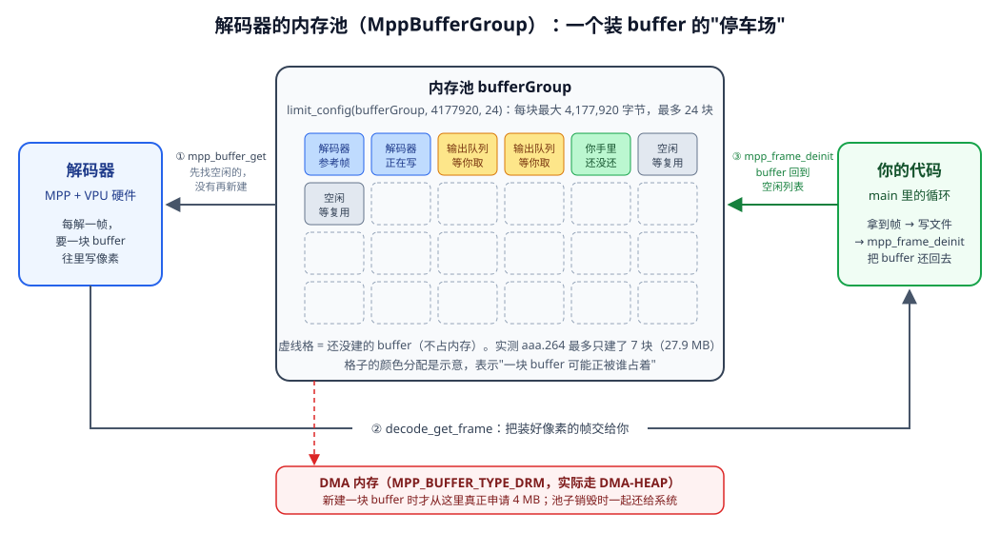
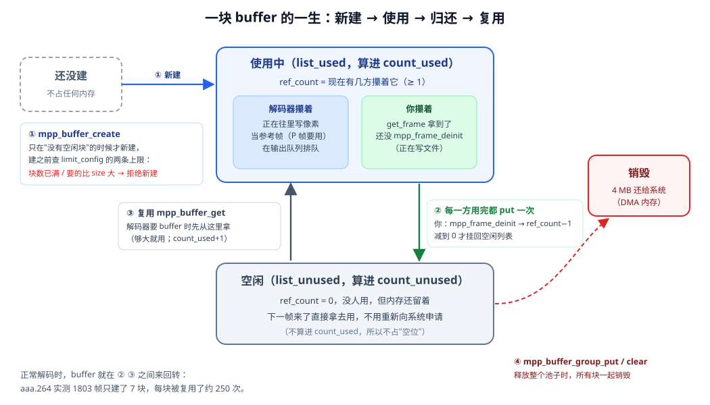
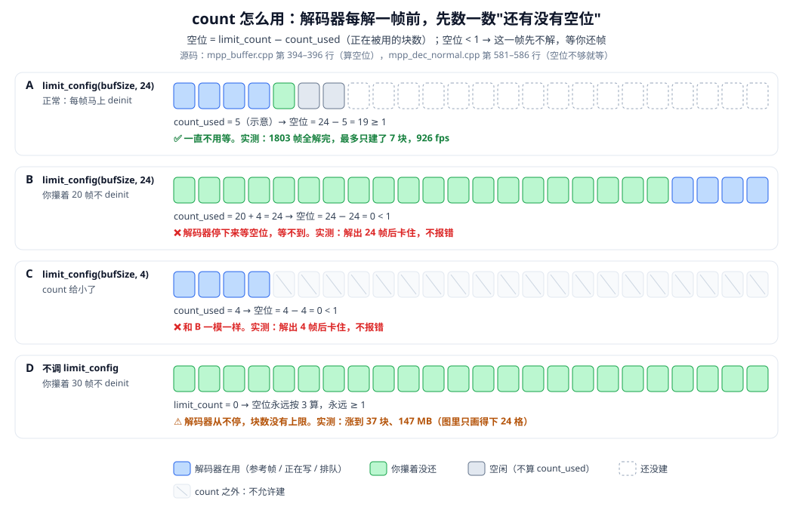
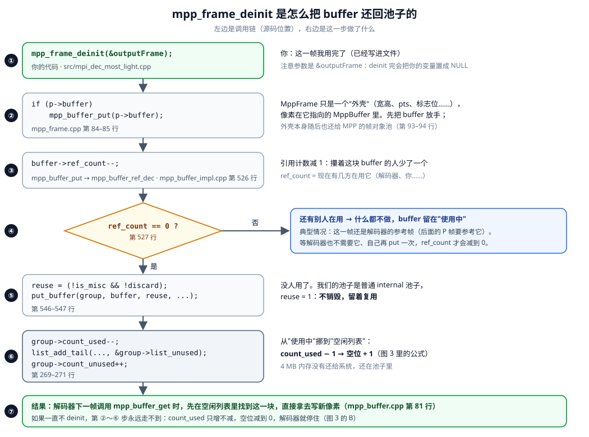

# mpp_buffer_group_limit_config：给解码器的内存池设上限

> 一句话：`mpp_buffer_group_limit_config(group, size, count)` **不分配任何内存**，它只是给内存池定两条规矩——**每块最大 `size` 字节、最多 `count` 块**。解码器按需一块一块地建 buffer、用完回收复用；建满 `count` 块、又没有空闲的，解码器就**停下来等你还帧**。

我们代码里的这一句（`src/mpi_dec_most_light.cpp`，info change 分支里）：

```cpp
mpp_buffer_group_get_internal(&bufferGroup, MPP_BUFFER_TYPE_DRM);   // 建一个"内部分配"的空池子
mpp_buffer_group_limit_config(bufferGroup, bufSize, 24);            // 每块最大 4,177,920 字节，最多 24 块
mpp_api->control(mpp_ctx, MPP_DEC_SET_EXT_BUF_GROUP, bufferGroup);  // 交给解码器用
```

要看懂这一句，先要搞懂三件事：**内存池是什么**（第 1、2 节）、**count 是怎么用的**（第 3 节）、**`mpp_frame_deinit` 怎么把帧还回去**（第 4 节）。

---

## 1. 先搞懂：解码器的内存池是什么

### 1.1 为什么需要"池子"

解码 1080p，每一帧都要一块 **4 MB** 的内存来装像素（`buf_size = 4,177,920`）。`aaa.264` 有 1803 帧，如果每帧都向系统**新申请** 4 MB、用完再**还给系统**：

- 申请 / 释放 DMA 内存要进内核，很慢；
- 1803 次申请、1803 次释放，全是重复劳动——上一帧写完文件，那 4 MB 明明可以直接拿来装下一帧。

所以 MPP 的做法是：**申请来的 buffer 用完不还给系统，放进一个"池子"里，下一帧直接拿出来复用。** 这个池子就是 `MppBufferGroup`，我们代码里的 `bufferGroup`。

可以把它想成一个**停车场**：

| 停车场 | 内存池 |
|---|---|
| 一个车位 | 一块 buffer（4 MB DMA 内存） |
| 停车场最多 24 个车位 | `limit_config(..., 24)`：最多 24 块 |
| 车位只在有车来、又没空位时才现画 | buffer **按需新建**，不是一开始就建 24 块 |
| 车开走了，车位空出来给下一辆用 | 帧 `mpp_frame_deinit` 后，buffer 回到空闲列表给下一帧用 |
| 24 个车位都停满了，后面的车只能在门口等 | 24 块都被占着，解码器停下来等 |

### 1.2 池子里有什么，谁在用它



一块 buffer 在池子里，要么**正在被人用**（解码器在写、当参考帧、在输出队列里等你取、在你手里还没还），要么**空闲**（没人用，等下一帧复用），要么**还没建**（不占内存）。

池子内部用这几个变量记账（结构体 `MppBufferGroupImpl`，`mpp/base/inc/mpp_buffer_impl.h` 第 145–163 行）：

| 变量 | 意思 | 谁改它 |
|---|---|---|
| `limit_size` | 每块最大多少字节 | `limit_config` 的第 2 个参数 |
| `limit_count` | 最多建多少块 | `limit_config` 的第 3 个参数 |
| `buffer_count` | 现在**总共建了**多少块（使用中 + 空闲） | 新建 +1，销毁 −1 |
| `list_used` / `count_used` | **使用中**的块，和它的个数 | 被拿去用 +1，还回来 −1 |
| `list_unused` / `count_unused` | **空闲**的块，和它的个数 | 还回来 +1，被复用 −1 |
| 每块 buffer 的 `ref_count` | 这一块**现在有几方攥着** | 多一方用 +1，一方用完 −1 |

### 1.3 "帧"和"buffer"不是一回事

这一点很容易混：

- **MppFrame** 是一个小小的"外壳"：宽、高、stride、pts、eos / info_change 这些标志位……
- **MppBuffer** 才是装像素的那 4 MB 内存。
- 外壳里有一根指针指向 buffer：`mpp_frame_get_buffer(frame)`。

`decode_get_frame` 每次交给你的都是一个**新的外壳**，但它指向的 buffer 是从池子里**反复复用**的那几块。`mpp_frame_deinit` 释放的是外壳，同时把外壳对 buffer 的"占用"放掉（第 4 节）。

---

## 2. 一块 buffer 的一生



| 步骤 | 发生了什么 | 源码 |
|---|---|---|
| ① 新建 | 解码器要 buffer、空闲列表里又没有合适的，才**新建一块**。新建前检查 `limit_config` 的两条上限：块数满了、或者要的比 `limit_size` 大，**拒绝新建** | `mpp_buffer_impl.cpp` 第 397–408 行 |
| 使用中 | 解码器往里写像素；写完后它可能还要当**参考帧**（P 帧要参考前面的帧）；再交给你 | |
| ② 归还 | **每一个**攥着它的人用完都要 put 一次，`ref_count` 减 1。你这边的 put 就是 `mpp_frame_deinit`。减到 0（谁都不用了）才挂回空闲列表 | `mpp_buffer_impl.cpp` 第 526–547 行 |
| ③ 复用 | 解码器下一次要 buffer，**先从空闲列表里拿**（够大就直接用），不向系统重新申请 | `mpp_buffer.cpp` 第 81 行 |
| ④ 销毁 | 只有释放整个池子（`mpp_buffer_group_put`）或者清空（`mpp_buffer_group_clear`）时，内存才真正还给系统 | |

正常解码时，buffer 就在 ② ③ 之间来回转。**实测 `aaa.264` 1803 帧只建了 7 块**（见第 11 节），平均每块被复用了约 250 次。

---

## 3. count 是怎么用的

### 3.1 规则：解码器每解一帧前，先数空位



`count`（也就是 `limit_count`）**不是**"预先分配 24 块"，而是在两个地方被用到：

**用法一：新建 buffer 时的上限**（`mpp_buffer_impl.cpp` 第 397 行）

```cpp
if (group->limit_count && group->buffer_count >= group->limit_count) {
    ret = MPP_NOK;          // 已经建满 count 块：不许再建
```

**用法二：解码器开工前算"空位"**（`mpp_buffer.cpp` 第 394–396 行 + `mpp_dec_normal.cpp` 第 581–586 行）

```cpp
unused = p->limit_count - p->count_used;      // 空位 = 上限 − 正在被用的块数

task->wait.dec_pic_unusd = (unused < 1);       // 一个空位都没有
if (task->wait.dec_pic_unusd)
    return MPP_ERR_BUFFER_FULL;                // → 这一帧先不解，等
```

注意公式里减的是 **`count_used`（使用中的块）**，不是"已经建了多少块"。空闲的块不算占位——它随时可以被复用。

### 3.2 四种情况（都是板子实测）

| 图里 | 情况 | 空位怎么算 | 结果 |
|---|---|---|---|
| A | count = 24，每帧马上 deinit | 24 − 少数几块 = 很多 | ✅ 一直不用等，1803 帧全解完，最多只建了 7 块 |
| B | count = 24，**你攥着 20 帧不 deinit** | 20 块在你手里 + 解码器自己要用的 4 块 = 24 → **0** | ❌ 解出 24 帧后卡住，**不报错** |
| C | **count = 4** | 解码器自己就要用掉 4 块 → **0** | ❌ 解出 4 帧后卡住，**不报错** |
| D | **不调 `limit_config`**，攥着 30 帧 | `limit_count = 0` 时空位永远按 3 算（`mpp_buffer.cpp` 第 397–398 行） | ⚠️ 不会卡，但池子一直涨，实测到了 37 块、147 MB |

**B 和 C 的现象完全一样**：解码器在等一个永远不会空出来的位置。所以程序"卡住不动、也不报错"的时候，先查有没有帧忘了 `mpp_frame_deinit`。

**D 说明了 count 存在的意义**：不设上限，解码器就不会停下来等你，你攥多少帧它就新建多少块，内存没有尽头。设了上限，它宁可停下来，也不让内存失控——这就是"背压"：下游处理慢，上游自动跟着慢下来。

### 3.3 count 设多少合适

`aaa.264` 实测：count ≥ 6 全速，5 能跑完但慢一半，≤ 4 卡死（第 11.1 节）。但这个码流的 DPB（参考帧缓冲）只有 4 帧（第 9 节）；**有 B 帧的码流、H.265 要的块数多得多**。官方 demo 的建议是 H.264 / H.265 给 20 以上，`mpi_dec_test` 用的是 24，我们照抄 24 就好（第 7.2 节）。真实项目里怎么按场景配，见第 9 节。

---

## 4. mpp_frame_deinit 是怎么把帧还回来的



逐步对照源码：

**① 你调用**

```cpp
mpp_frame_deinit(&outputFrame);      // 传的是 &outputFrame：deinit 完会把 outputFrame 置成 NULL
```

**② 先放掉外壳指向的 buffer**（`mpp/base/mpp_frame.cpp` 第 84–85 行）

```cpp
if (p->buffer)
    mpp_buffer_put(p->buffer);       // info change 帧没有 buffer，这一步跳过
...
mpp_mem_pool_put(mpp_frame_pool, *frame);   // 第 93 行：外壳本身还给帧对象池
*frame = NULL;                              // 第 94 行：你的 outputFrame 变成 NULL
```

**③ 引用计数减 1**（`mpp_buffer_put` → `mpp_buffer_ref_dec`，`mpp/base/mpp_buffer_impl.cpp` 第 526 行）

```cpp
buffer->ref_count--;
```

**④ 减到 0 了吗？**（第 527 行）

```cpp
if (buffer->ref_count == 0)
    release = 1;
```

- **没到 0**：还有别人在用。最典型的是：这一帧还是解码器的**参考帧**，后面的 P 帧要参考它。这时 buffer 继续留在"使用中"，等解码器也用完、自己再 put 一次，`ref_count` 才会到 0。所以**你 deinit 了一帧，不一定马上空出一个位置**——这也是为什么 count 要留余量。
- **到 0 了**：往下走。

**⑤ 决定复用还是销毁**（第 546–547 行）

```cpp
reuse = (!group->is_misc && !buffer->discard);   // 我们的池子是普通 internal 池子 → reuse = 1
put_buffer(group, buffer, reuse, caller);
```

**⑥ 挪到空闲列表**（`put_buffer` 里，第 269–271 行）

```cpp
group->count_used--;                                     // 使用中 −1  →  空位 +1
list_add_tail(&buffer->list_status, &group->list_unused);
group->count_unused++;                                   // 空闲 +1
```

4 MB 内存**没有**还给系统，还在池子里。

**⑦ 下一帧复用**：解码器下一次 `mpp_buffer_get`，先在空闲列表里找到这一块（`mpp_buffer.cpp` 第 81 行 `mpp_buffer_get_unused`），直接拿去写新像素。

反过来看：**如果一直不 deinit，② ～ ⑥ 一步都不会发生**，`count_used` 只增不减，空位减到 0，解码器停住——就是图 3 里的 B。

---

## 5. 它解决什么问题：不加限制，解码器会"吃掉"所有内存

解码器每解一帧，都要一块 buffer 来装像素（1080p 一块 4MB）。这些 buffer 从哪来、最多能要多少，取决于**内存分配模式**。官方《MPP 开发参考》3.3.2 节（`rk_code/external/mpp/doc/Rockchip_Developer_Guide_MPP_CN.md` 第 455 行起）列了三种：

| 模式 | 怎么做 | 内存上限 | 我们用的？ |
|---|---|---|---|
| 一、纯内部分配 | 不调 `SET_EXT_BUF_GROUP`，info change 时只回 `SET_INFO_CHANGE_READY` | **没有上限** | |
| 二、**半内部分配** | 自己建 internal 池子 + `limit_config` + `SET_EXT_BUF_GROUP` | **由 `limit_config` 决定** | ✅ mpi_dec_test 的默认模式 |
| 三、纯外部分配 | 建空的 external 池子，把外部（显示系统）分配好的 dmabuf 一块块 `commit` 进去 | 你 commit 了多少就是多少 | |

模式一的缺点，官方原话：

> 无法控制解码器的内存使用量。解码器可以不受限制地使用内存，如果码流输入的速度很快，用户又没有及时释放内存，解码器会很快消耗掉全部的可用内存。

模式二就是为了解决这个问题：

> 用户可以通过mpp_buffer_group_limit_config接口来限制解码器的内存使用量。

**所以 `limit_config` 解决的问题是：给解码器的内存用量封顶。** 送码流的速度比你处理图像（写文件、显示、编码转发）的速度快时，解码器不会无限地往前解、无限地要内存，而是攒满 `count` 块就停下来，等你处理完、把帧还回来。这也是一种**流量控制（背压）**：下游慢，上游自动跟着慢。

---

## 6. 源码细节

### 6.1 limit_config 本身：只记两个数

`rk_code/external/mpp/mpp/base/mpp_buffer.cpp` 第 438 行：

```cpp
MPP_RET mpp_buffer_group_limit_config(MppBufferGroup group, size_t size, RK_S32 count)
{
    ...
    MppBufferGroupImpl *p = (MppBufferGroupImpl *)group;
    mpp_assert(p->mode == MPP_BUFFER_INTERNAL);   // 只对 internal 池子有意义
    p->limit_size     = size;                     // 每块最大多少字节
    p->limit_count    = count;                    // 最多多少块
    return MPP_OK;
}
```

注意：**没有任何分配动作**。调完这一句，池子里还是 0 块 buffer，一个字节都没占。

### 6.2 解码器要 buffer 时：先复用，没有再新建

`mpp/base/mpp_buffer.cpp` 第 80–92 行（`mpp_buffer_get` 的实现）：

```cpp
// try unused buffer first
MppBufferImpl *buf = mpp_buffer_get_unused(p, size, caller);   // ① 先找池子里空闲的、够大的
if (NULL == buf && MPP_BUFFER_INTERNAL == p->mode) {
    ...
    // if failed try init a new buffer
    mpp_buffer_create(tag, caller, p, &info, &buf);            // ② 没有空闲的，才新建一块
}
```

所以 buffer 是**按需创建、用完回收**的：你 `mpp_frame_deinit` 一帧，这帧的 buffer 就回到池子的空闲列表，下一帧直接复用，不用重新分配。

### 6.3 新建时检查上限

`mpp/base/mpp_buffer_impl.cpp` 第 397–408 行（`mpp_buffer_create` 开头）：

```cpp
if (group->limit_count && group->buffer_count >= group->limit_count) {
    ...                                   // 已经建满 count 块了
    ret = MPP_NOK;                        // 不再新建
    goto RET;
}

if (group->limit_size && info->size > group->limit_size) {
    mpp_err_f("required size %d reach group size limit %d\n", info->size, group->limit_size);
    ret = MPP_NOK;                        // 要的这块比 size 上限还大，拒绝
    goto RET;
}
```

### 6.4 解码器开工前：没有空闲 buffer 就等

`mpp/codec/mpp_dec_normal.cpp` 第 581–586 行，解码器每解一帧之前先问一句"池子里还有空位吗"：

```cpp
RK_S32 unused = mpp_buffer_group_unused(mpp->mFrameGroup);

// NOTE: When dec post-process is enabled reserve 2 buffer for it.
task->wait.dec_pic_unusd = (dec->vproc) ? (unused < 3) : (unused < 1);
if (task->wait.dec_pic_unusd)
    return MPP_ERR_BUFFER_FULL;           // 没空位：这一帧先不解，等
```

`mpp_buffer_group_unused` 怎么算空位（`mpp/base/mpp_buffer.cpp` 第 383–399 行）：

```cpp
if (p->mode == MPP_BUFFER_INTERNAL) {
    if (p->limit_count)
        unused = p->limit_count - p->count_used;   // 设了上限：上限 - 正在被用的块数
    else
        unused = 3;                                // 没设上限：永远说"还有 3 个空位"
}
```

两种情况对比：

| | 设了 `limit_count = 24` | 没调 `limit_config` |
|---|---|---|
| 空位怎么算 | `24 - 正在用的块数` | 永远是 3 |
| 解码器什么时候停 | 24 块全被占着（参考帧 + 你还没 deinit 的帧） | **永远不停**，一直新建 |
| 内存最多用多少 | 24 × 4,177,920 = **100,270,080 字节（约 95.6 MB）** | 没有上限 |

### 6.5 "正在被用"的块，都是谁在用

一块 buffer 被算作"正在用"，是因为有人还持有它：

1. **解码器自己**：H.264 的 P 帧要参考前面的帧，这些参考帧（DPB，解码图像缓冲）必须留在内存里，不能复用。
2. **在路上的帧**：已经解好、在解码器输出队列里还没被你 `get_frame` 取走的帧。
3. **你手里的帧**：`get_frame` 拿到、还没 `mpp_frame_deinit` 的帧。

`count` 要够这三方加起来用，解码器才不会停。

---

## 7. 两个参数怎么填

### 7.1 size：填 info change 给的 `buf_size`

```cpp
size_t bufSize = mpp_frame_get_buf_size(outputFrame);   // aaa.264 实测 4,177,920 = 1920 × 1088 × 2
```

`buf_size` 是解码器按芯片和视频格式算好的"每块至少要多大"（像素 + 额外信息，见 [具体写day2_h2642yuv的流程.md](../具体写day2_h2642yuv的流程.md) M2）。直接用它，不要自己算。

### 7.2 count：H.264 / H.265 给 20 以上

官方 demo 的说明（`rk_code/external/mpp/utils/mpi_dec_utils.h` 第 79–85 行）：

```
 * The required buffer size caculation:
 * hor_stride * ver_stride * 3 / 2 for pixel data
 * hor_stride * ver_stride / 2 for extra info
 * Total hor_stride * ver_stride * 2 will be enough.
 *
 * For H.264/H.265 20+ buffers will be enough.
 * For other codec 10 buffers will be enough.
```

`mpi_dec_test` 用的就是 24（`dec_buf_mgr_setup(..., buf_size, 24, ...)`）。为什么要这么多：H.264 标准里参考帧最多 16 帧，再加上解码器正在写的、输出队列里排着的、你手里还没还的，20 多块才稳。

---

## 8. 内存池最多能建多大

`limit_config` 只是上限，那上限能不能随便设、设多大就能占多大？分三层看。

### 8.1 limit_config 只限制，不分配

- **count 设大，内存不会变多**：实测 count = 24 只建了 7 块；写成 1000 也一样，解码器只建它需要的那几块。
- **size 设大，每块也不会变大**：新建 buffer 用的是解码器请求的大小（`buf_size` = 4,177,920），`limit_size` 只用来检查"请求有没有超过上限"（6.3 节，`mpp_buffer_impl.cpp` 第 404 行），不会按 `limit_size` 去分配。

所以：

```
理论最坏占用 = count × buf_size                                          （24 × 4 MB ≈ 96 MB）
实际占用    ≈（解码器自己要用的块数 + 你手里还没 deinit 的块数）× buf_size   （aaa.264：7 × 4 MB ≈ 28 MB）
```

### 8.2 MPP 自己没有总量上限

MPP 有一个全局计数 `MppBufferService::total_size`，每新建一块就加上它的大小（`mpp_buffer_impl.cpp` 第 471 行调用 `inc_total`，实现在第 827 行）。但它**只做统计**（当前总量、历史峰值），不会因为超过某个数就拒绝分配。MPP 这一层的上限只有你给的 `limit_config`；不调，就完全没有上限。

### 8.3 真正的天花板：板子的物理内存

内存最后是向内核的 DMA-HEAP 要的。Day 1 用 strace 实测过，MPP 打开的是 `/dev/dma_heap/system-uncached`（[DRM缓冲区.md](../../day1_yuv2h264/doc/DRM缓冲区.md) 第 5.3 节）。板子上查到的情况：

```
$ adb shell "grep -E 'MemTotal|MemAvailable|CmaTotal' /proc/meminfo; ls /dev/dma_heap/"
MemTotal:     16335732 kB      ← 16 GB 内存
MemAvailable: 15740392 kB      ← 约 15 GB 可用
CmaTotal:       131072 kB      ← 另有 128 MB 的 CMA（物理连续内存）
cma  cma-uncached  system  system-dma32  system-uncached  system-uncached-dma32
```

| heap | 内存从哪来 | 能要多少 |
|---|---|---|
| `system-uncached`（MPP 实际用的） | 普通内存页，物理上分散 | 大致就是那 **15 GB 可用内存** |
| `cma` / `cma-uncached` | 开机预留的物理连续内存 | 只有 128 MB |

物理上分散的页，硬件为什么能用：RK3588 的 VPU 有 **IOMMU**，能把分散的页映射成一段连续的地址给硬件。

按 1080p 一块 4 MB 算，理论上能建将近 3700 块；但系统和别的进程也要用内存，真吃光了会触发内核 **OOM**，进程被杀。

### 8.4 小结

| 参数 | 给小了 | 给大了 |
|---|---|---|
| `size` | 小于 `buf_size`：**一帧都解不出来**（实测 `buf_size / 2` 解出 0 帧） | 没坏处，每块还是按 `buf_size` 分配；只是失去了"拦住异常大请求"的作用 |
| `count` | 小于解码器最低需要：**卡死**（实测 aaa.264 count ≤ 4 卡住） | 平时不多占内存；但**你攥帧不还时**，池子会一直涨到 count 块，等于上限形同虚设 |

---

## 9. 真实项目里怎么配 count

### 9.1 count 由哪几部分组成

```
count = DPB（参考帧缓冲） + 1（正在解的帧） + 应用最多同时攥着的帧数 + 流水线余量
```

| 组成 | 是什么 | aaa.264 | 依据 |
|---|---|---|---|
| **DPB** | 解后面的帧时要留着当参考的帧数 | **4** | 码流 SPS 里 `max_num_ref_frames = 4`、`max_dec_frame_buffering = 4`；MPP 也会按 Level 推算：Level 4.0 → `12582912 ÷ (120 × 68 × 384) = 4`（`mpp/codec/dec/h264/h264d_dpb.c` 的 `getDpbSize`） |
| **+1** | 硬件正在往里写的那一帧 | 1 | |
| **应用攥着的** | 你拿到还没 deinit 的帧 | 0～1（写完文件马上还） | |
| **流水线余量** | 输出队列里排着的、硬件并行解的 | 1～2 | |

和第 11 节的实测**完全对得上**：

| count | 拆开看 | 实测 |
|---|---|---|
| 4 | 4 块全被 DPB 占着，新帧没地方写 | ❌ 卡死 |
| 5 | 4 + 1 | ✅ 能跑完，但 430 fps（解一帧等一次） |
| 6 | 4 + 1 + 1 余量 | ✅ 全速 |
| 7 | 实测峰值 | 再多就用不上了 |

aaa.264 的 SPS 是这样读出来的（Mac 上用 FFmpeg 打印码流头）：

```bash
ffmpeg -i aaa.264 -c copy -bsf:v trace_headers -frames:v 1 -f null - 2>&1 \
  | grep -E "level_idc|max_num_ref_frames|max_dec_frame_buffering|max_num_reorder_frames"
#   level_idc                = 40
#   max_num_ref_frames       = 4
#   max_num_reorder_frames   = 0      ← 没有 B 帧重排
#   max_dec_frame_buffering  = 4
```

**DPB 是码流定的，不是解码器定的。** H.264 / H.265 标准里 DPB 最大都是 16 帧。aaa.264 是 4，High Profile、带 B 帧的码流常见 4～16。

### 9.2 官方为什么给 24

24 是一个**不看码流也够用**的保守值：

```
16（标准里 DPB 的最大值） + 1（正在解） + 几块（应用攥着的 + 流水线） ≈ 20～24
```

这就是 demo 注释说 "For H.264/H.265 20+ buffers will be enough" 的来历。MPP 内部给帧槽位定的数量也是这个量级：H.265 是 `mpp_buf_slot_setup(s->slots, 25)`（`mpp/codec/dec/h265/h265d_parser.c` 第 2201 行），H.264 是 `MAX_MARK_SIZE = 35`（`mpp/codec/dec/h264/h264d_global.h`）。

### 9.3 按场景配

原则：**先看"最坏占多少内存"能不能接受，再决定要不要往小了抠。** count 大了平时不多占内存，它只决定你攥帧不还时最多涨到多大。

| 场景 | 应用攥帧情况 | 建议 count | 单路最坏内存（1080p） |
|---|---|---|---|
| **单路解码 → 写文件 / 转码**（我们现在的代码） | 每次 1 帧，处理完马上 deinit | **24**，照搬 demo | 24 × 4 MB ≈ 96 MB |
| **解码 → 送显示**（DRM plane / 零拷贝送屏） | 屏上正在显示 1 帧 + 排队 1～2 帧 | **24**；自己算就是 DPB + 1 + 3 + 2 | 同上 |
| **解码 → RGA / 编码器异步流水线** | 中间队列多深，就攥多少帧 | DPB + 1 + **队列深度** + 2 | 按公式 |
| **多路解码（NVR，比如 16 路）** | 每路 1～2 帧 | **按码流算，不要每路都 24**。例：DPB 4 → 4 + 1 + 2 + 2 = 9 | 9 × 4 MB = 36 MB/路，16 路约 580 MB；每路 24 的话要 1.5 GB |
| **开了去隔行**（`enable_vproc`） | 解码器自己要多留 2 块 | 在上面基础上 **+2** | 依据：`mpp_dec_normal.cpp` 第 584 行，开了 vproc 时判断的是 `unused < 3` 而不是 `< 1` |

### 9.4 落地时要注意的几点

1. **DPB 要自己从码流里读，MPP 不告诉你。** info change 帧只给宽高、stride、`buf_size`，不给 DPB 大小。两种做法：
   - 省事：一律 24（H.264 / H.265 都够），只有内存紧张时才往小了调；
   - 精细：自己解析 SPS 的 `max_dec_frame_buffering`（H.264）/ `sps_max_dec_pic_buffering`（H.265）再套公式；或者像 9.1 那样，先用 FFmpeg `trace_headers` 离线看一眼要接的码流。
2. **"应用攥着的"必须有上限。** 解码后面如果接了队列（送 RGA、送编码），队列要**有界**，而且它的容量要算进 count。否则下游一卡，count 被攥光，解码器就停（图 3 的 B）。真要长时间保留某一帧，就把像素拷出来，马上 deinit 原帧。
3. **count 太大会把泄漏藏起来。** 忘了 deinit 时，count = 24 的程序很快就卡住，问题当场暴露；count = 1000 或不设上限的程序，内存慢慢涨，几个小时后才被 OOM 杀掉，更难查。**count 是保险丝，不是越大越好。**
4. **上线前用实测验证。** 照第 11 节探针的做法：用 `mpp_buffer_group_usage(group) / buf_size` 记录峰值块数，加"3 秒没有新帧就报警"的卡死检测，拿**真实要接入的码流**跑。峰值离 count 很远 → 还能往小调；峰值贴着 count → count 偏小，或者有地方攥着帧不还。
5. **分辨率变了要重配。** 每次 info change：已有池子先 `mpp_buffer_group_clear`，再用新的 `buf_size` 调 `limit_config`。新分辨率的 DPB 可能不同，count 也要重新算（我们 M4 待补的就是这一步）。

---

## 10. 风险

| 风险 | 什么时候发生 | 现象（第 11 节有实测） | 怎么避免 |
|---|---|---|---|
| **count 给小了** | count 不够"参考帧 + 在路上的 + 你手里的" | 解码器一直等空位，`get_frame` 再也拿不到新帧，**程序看起来卡死**（不报错） | H.264/H.265 至少 20，照 demo 用 24 |
| **拿了帧不还**（最常见） | 漏写 `mpp_frame_deinit`，或者把帧存起来慢慢处理 | 同上：24 块被你攥光，解码器停住。**和 count 给小的现象一模一样** | 每个 `get_frame` 拿到的帧，处理完立刻 `mpp_frame_deinit`；要缓存就拷出来再还 |
| **size 给小了** | 自己算 size、算错了；或者换了分辨率还用旧的 size | 新建 buffer 被拒，日志里有 `required size ... reach group size limit ...`，解不出帧 | 永远用 info change 里的 `buf_size` |
| **换分辨率没重新配置** | 码流中途 info change（比如 720p → 1080p），没对池子重新 `limit_config` | 同上，新分辨率要的 size 比旧上限大 | 每次 info change：已有池子就 `mpp_buffer_group_clear` 再 `limit_config(新 buf_size, 24)` |
| **内存占用比想象的大** | 多路解码（NVR）时每路一个池子 | 每路最多约 96 MB（1080p），16 路就是 1.5 GB 的 DMA 内存 | 多路时根据实际需要调小 count，或者降低分辨率 |
| **上限"不准"** | 官方说的缺点："内存空间的限制并不准确，内存的使用量不是100%固定的，会有波动" | 实际用量在 0 到 count 块之间变化，不是一开始就占满 | 这是按需分配的正常现象，不是 bug；规划内存时按 count 块算最坏情况 |
| **对 external 池子调用** | `get_external` 建的池子 | `mpp_assert(p->mode == MPP_BUFFER_INTERNAL)` 断言；限制不起作用 | 只对 `get_internal` 的池子用 |

最要记住的一条：**"解码卡住、不报错"时，先查是不是有帧没 `mpp_frame_deinit`**。count 给小和帧不还，表现完全一样：解码器在等一个永远不会出现的空位。

---

## 11. 板子实测：aaa.264 到底要几块

写了一个探针程序，在 RK3588 上解完整个 `aaa.264`（不写文件），每次只改一个条件，记录解出的帧数、池子峰值用量和速度。"卡住"的判定：连续 3 秒没有新帧输出。

### 11.1 改 count：最少要 5 块，6 块以上才全速

| `limit_config(bufSize, N)` | 解出帧数 | 走到 EOS | 峰值用量 | 耗时 | fps |
|---|---|---|---|---|---|
| **N = 24**（我们的写法） | **1803** | ✅ | 7 块（27.9 MB） | 1.95 s | 926 |
| 不调 `limit_config` | 1803 | ✅ | 7 块（27.9 MB） | 2.04 s | 883 |
| N = 8 | 1803 | ✅ | 7 块 | 1.84 s | 979 |
| N = 7 | 1803 | ✅ | 7 块 | 1.90 s | 950 |
| N = 6 | 1803 | ✅ | 6 块 | 1.99 s | 906 |
| N = 5 | 1803 | ✅ | 5 块 | **4.19 s** | **430**（慢了一半多） |
| N = 4 | **4** | ❌ **卡住** | 4 块 | — | — |
| N = 3 | **3** | ❌ 卡住 | 3 块 | — | — |
| N = 2 | **2** | ❌ 卡住 | 2 块 | — | — |

看出来的规律：

- **按需分配是真的**：上限给 24，解码器实际最多只用了 7 块（27.9 MB），没有一上来就占满 95.6 MB。
- **N ≤ 4 直接卡死，而且不报错**：解出 N 帧之后，`get_frame` 再也拿不到新帧。这就是第 10 节说的"count 给小了"。
- **N = 5 能跑完，但速度掉到 430 fps**：块数刚好够，解码器经常要停下来等空位。
- **N ≥ 6 全速**；超过 7 块对这个码流已经没有用了。
- 这些数字只对 **aaa.264**（Constrained Baseline，只有 I/P 帧）成立。有 B 帧、参考帧多的码流（比如 High Profile、H.265）要的块数会多得多，所以 demo 的建议是 20 以上，不要按这里的 7 去抠。

### 11.2 改 size：给小了一帧都出不来

| 写法 | 解出帧数 | 结果 |
|---|---|---|
| `limit_config(bufSize / 2, 24)` | **0** | ❌ 卡住：每次新建 buffer 都因为超过 size 上限被拒绝（6.3 节那段检查） |

### 11.3 拿帧不还：和 count 给小一模一样

上限保持 24，但应用把前 H 个图像帧攥在手里不 `mpp_frame_deinit`（模拟"忘了释放"或"存起来慢慢处理"）：

| 攥住不还的帧数 H | 解出帧数 | 走到 EOS | 峰值用量 | fps |
|---|---|---|---|---|
| 16 | 1803 | ✅ | 23 块 | 962 |
| 17 / 18 | 1803 | ✅ | 24 块（满） | ≈ 920 |
| 19 | 1803 | ✅ | 24 块（满） | **430**（剩 5 块，和 11.1 的 N = 5 一样慢） |
| **20** | **24** | ❌ **卡住** | 24 块（满） | — |
| 30 | 24 | ❌ 卡住 | 24 块（满） | — |
| 30，且**不调** `limit_config` | 1803 | ✅ | **37 块（147.4 MB）** | 908 |

对照 11.1 就能看懂：

- 24 块里被应用攥走 H 块，解码器实际能用的就是 `24 − H` 块。
- `24 − H ≥ 6` 全速，`= 5` 变慢，`≤ 4` 卡死——和直接把 count 设成 `24 − H` 的结果**完全一样**。
- 不设上限时同样攥 30 帧，解码器不会卡，但池子涨到 37 块、147 MB。**这就是官方说的"解码器会很快消耗掉全部的可用内存"**：应用攥得越多，它就建得越多，没有尽头。`limit_config` 宁可让解码器停下来，也不让内存失控。

### 11.4 结论

| 问题 | 答案（aaa.264 实测） |
|---|---|
| 24 块会不会一开始就占满内存？ | 不会，实际最多 7 块（27.9 MB） |
| 最少几块能解完？ | 5 块（但速度掉一半多），6 块全速 |
| count 给小了是什么现象？ | 解出 count 帧左右就卡住，**不报错** |
| 拿帧不还是什么现象？ | 和 count 给小完全一样 |
| 不设上限有什么后果？ | 应用攥帧时池子无限增长（实测涨到 147 MB 还在涨） |

自己想复现：在代码里用 `mpp_buffer_group_usage(bufferGroup)` 查池子当前用了多少字节，除以 `buf_size` 就是块数。

---

## 12. 对照我们的代码

| 写法 | 是否正确 | 说明 |
|---|---|---|
| `get_internal(&bufferGroup, MPP_BUFFER_TYPE_DRM)` | ✅ | 半内部模式必须是 internal 池子（M2 一开始误写成 `get_external`，那样 limit 不起作用，解码器也没有 buffer 可用） |
| `limit_config(bufferGroup, bufSize, 24)` | ✅ | size 用 info change 的 `buf_size`，count 照 demo 用 24 |
| `SET_EXT_BUF_GROUP` 在 `limit_config` 之后 | ✅ | 先定规矩再交给解码器 |
| 每帧处理完 `mpp_frame_deinit` | ✅ | buffer 回到池子复用，24 块不会被攥光 |
| 第二次 info change 时 | ⚠️ M4 待补 | 现在会再 `get_internal` 一个新池子（旧的泄漏）。应该：已有池子就 `mpp_buffer_group_clear` 再 `limit_config` |
| `mpp_buffer_group_put` 在 `mpp_destroy` 之后 | ✅ | 解码器销毁前，参考帧还在用池子里的 buffer |

相关文档：

- info change 帧本身：[decode_get_frame拿到的几种帧.md](decode_get_frame拿到的几种帧.md)
- DRM / DMA-HEAP 缓冲区是什么：[../../day1_yuv2h264/doc/DRM缓冲区.md](../../day1_yuv2h264/doc/DRM缓冲区.md)
