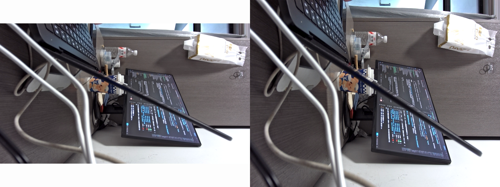

# FindCamera 输出的每个字段是什么

> `FindCamera::printAllCameraInfo()` 在板子上打印出来的这几行，每一行是什么意思、解决了什么问题、怎么用。
> 本文的数据都是 2026-10-17 在板子上实测的（IMX415 装在 MIPI CSI3）。
> 相关：[程序里怎么找到摄像头节点.md](程序里怎么找到摄像头节点.md)（FindCamera 是怎么找的）、[v4l2-ctl和media-ctl用法.md](v4l2-ctl和media-ctl用法.md)（命令用法）

```
找到 1 个摄像头：
  摄像头      : m00_b_imx415 3-001a（子设备 /dev/v4l-subdev2）
  链路        : /dev/media1 → /dev/media2
  main path  : /dev/video22   ← 录像用这个
  self path  : /dev/video23
```

---

## 0. 总表

| 字段 | 一句话 | 谁会用到 | 怎么用 |
|---|---|---|---|
| `m00_b_imx415 3-001a` | 摄像头在链路图里的名字 | 看日志、用 media-ctl 查它的时候 | `3-001a` = I2C 总线 3、地址 0x1a，就是插在 MIPI CSI3 上的那个（底板原理图：CSI3 走 I2C3）<br>`dmesg \| grep "imx415 3-001a"` 看它的驱动日志 |
| `/dev/v4l-subdev2` | 摄像头芯片本身的"旋钮"，不出画面，用来调曝光、翻转 | 3A 服务（一直开着它）；你想翻转画面的时候 | 看有哪些旋钮：`v4l2-ctl -d /dev/v4l-subdev2 --list-ctrls`<br>读当前曝光、增益：`v4l2-ctl -d /dev/v4l-subdev2 -C exposure,analogue_gain`（实测 2025 / 77）<br>画面倒了，让摄像头翻转：`-c vertical_flip=1`（未实测）<br>⚠️ 曝光、增益不要改，3A 会改回去 |
| `/dev/media1 → /dev/media2` | 数据从哪张图进来、被哪张图里的 ISP 处理 | 判断该用哪个 video 节点；出问题时排查 | 摄像头的数据从 **media1**（CIF，负责接收）进来，送到 **media2**（ISP0）处理。所以：<br>出图节点去 media2 里找：`media-ctl -d /dev/media2 -e rkisp_mainpath` → `/dev/video22`<br>查摄像头和 CSI 那一段：`media-ctl -d /dev/media1 -p`<br>查 ISP 输出的格式：`media-ctl -d /dev/media2 --get-v4l2 '"rkisp-isp-subdev":2'` |
| `/dev/video22` | ISP0 的**主出口**，真正拿画面的地方（大图） | 你的录像程序 | 摄像头的数据被送到 ISP0（media2）处理后，从这里出来：<br>代码：`open("/dev/video22")` → S_FMT 1920×1080 NV12 → REQBUFS → QBUF/DQBUF（M2 的 `kDevice` 写它）<br>命令行抓一帧：`v4l2-ctl -d 22 --set-fmt-video=width=1920,height=1080,pixelformat=NV12 --stream-mmap=4 --stream-count=1 --stream-to=a.nv12` |
| `/dev/video23` | 同一个 ISP0 的**副出口**（小图，最宽 1920） | 预览、子码流、AI 小图 | 和 video22 **同时用**，各设各的分辨率（实测两路都是 30 fps）：<br>`v4l2-ctl -d 23 --set-fmt-video=width=640,height=480,pixelformat=NV12 --stream-mmap=4 --stream-count=1 --stream-to=b.nv12`<br>代码里再 `open` 一次，单独 REQBUFS / DQBUF |

下面每一节展开讲一个字段。

---

## 1. `/dev/v4l-subdev2`：摄像头"本人"

### 1.1 是什么

设备文件有两种（guide/04 第 2、3 节）：

| 设备文件 | 干什么 | 例子 |
|---|---|---|
| `/dev/videoN` | **取画面**：程序从这里 DQBUF 拿一帧帧图像 | video22 |
| `/dev/v4l-subdevN` | **控制链路中间的某个部件本身**，不出画面（subdev = sub-device，子设备） | v4l-subdev2 = IMX415 芯片 |

对 `/dev/v4l-subdev2` 发 ioctl，驱动就通过 **I2C** 去改摄像头芯片里的寄存器。打个比方：**video22 是相机的"取片口"，v4l-subdev2 是相机机身上的"旋钮"**。

### 1.2 上面有哪些旋钮（实测）

```bash
v4l2-ctl -d /dev/v4l-subdev2 --list-ctrls
```

| 旋钮 | 实测当前值 | 干什么 |
|---|---|---|
| `exposure` | 2025（范围 4～2242） | 曝光时间：越大越亮，运动时越容易拖影 |
| `analogue_gain` | 77（范围 0～240） | 模拟增益：放大信号，越大越亮，噪点越多 |
| `horizontal_flip` / `vertical_flip` | 0 / 0 | 水平 / 垂直翻转 |
| `vertical_blanking` | 58 | 每帧之间的空白行数，改它能改帧率 |
| `link_frequency`、`pixel_rate` | — | MIPI 传输速率，只读或者别动 |

### 1.3 解决了什么问题：画面以外的事，都通过它做

1. **3A 靠它调曝光**。实测：3A 服务（pid 809）一直打开着 `/dev/v4l-subdev2`（`ls -l /proc/809/fd` 能看到），同时还开着 `video29`（ISP 统计）和 `video30`（ISP 参数）。它每一帧读统计、算参数，再通过 subdev2 改曝光和增益 —— `dmesg` 里一长串 `set exposure`、`set analog gain` 就是这么来的
2. **你可以直接控制摄像头**：画面装反了，让摄像头翻转输出（`-c vertical_flip=1`，未实测），不用编码器去转
3. **查摄像头的状态**：画面太暗、噪点太多时，看看曝光和增益是多少

⚠️ 曝光、增益不要手动改：3A 每一帧都在调，改了马上被改回去。

---

## 2. `/dev/media1 → /dev/media2`：画面走哪条路

### 2.1 是什么

摄像头的数据**先进哪张接线图、再被哪张图里的 ISP 处理**：

```
/dev/media1（CIF 那张图：负责"接收"）                    /dev/media2（ISP0 那张图：负责"处理"）
IMX415 → MIPI 物理层 → CSI-2 接收 → CIF（rkcif-mipi-lvds2） ──→ ISP0 → mainpath（video22）
  RAW10 3864×2192                                                RAW → YUV  └→ selfpath（video23）
```

板子上 4 张图（实测）：

| 图 | 是什么 | 和这个摄像头有没有关系 |
|---|---|---|
| `/dev/media0` | 另一组 CIF | ❌ 没接摄像头 |
| **`/dev/media1`** | CIF（`rkcif-mipi-lvds2`），摄像头插在 CSI3 上就进这里 | ✅ 接收 |
| **`/dev/media2`** | ISP0 | ✅ 处理，出图 |
| `/dev/media3` | ISP1 | ❌ 收不到数据 |

### 2.2 解决了什么问题

1. **说明了为什么用 video22，不用 video31**：数据被送到 ISP0（media2），ISP1（media3）收不到，所以 ISP1 的 video31 一 STREAMON 就报 `Operation not permitted`（实测）。**链路决定了哪些 video 节点能出图**
2. **出问题时只查这两张图**：没画面先看 media1 里摄像头和 CSI 是否接通，再看 media2 里 ISP 是否接通，不用把 4 张都翻一遍
3. **知道每一站的格式去哪查**：摄像头输出（RAW10 3864×2192）在 media1 里查，ISP 输出（YUV 3840×2160）在 media2 里查

---

## 3. `/dev/video22` 和 `/dev/video23`：一个摄像头同时出两路

### 3.1 能不能同时用（实测）

video22（主出口）设 1920×1080、video23（副出口）设 640×480，两个 `v4l2-ctl` 同时跑：

| | `/dev/video22`（mainpath） | `/dev/video23`（selfpath） |
|---|---|---|
| 设的格式 | 1920×1080 NV12 | 640×480 NV12 |
| 一帧多大 | 3,110,400 字节 | 460,800 字节 |
| 同时跑的帧率 | 30.00 fps | 30.00 fps |
| 画面 | 同一个场景、同一时刻 | 同一个场景、同一时刻 |

**两路可以同时出图，互不影响，都是满帧 30fps。**



> 2026-10-17 实测拍的同一时刻的两帧：**左**是主出口 video22（1920×1080，16:9，为了并排缩小成 640×360，上下白边是补的），**右**是副出口 video23（640×480，4:3）。
> 内容、亮度、颜色都一样；右边左右两侧少了一截（4:3 比 16:9 窄）。生成这张图的命令见 3.4 节。

### 3.2 两路"一样"吗？

**同源，但不是一模一样的两份数据**：

| | 一样吗 | 说明 |
|---|:---:|---|
| 拍的内容、时刻 | ✅ | 同一个摄像头的同一帧，经过同一个 ISP |
| 亮度、颜色 | ✅ | 3A 只有一套 |
| 分辨率 | ❌ 各设各的 | 主出口最宽 3840，副出口最宽 1920（实测） |
| 像素格式 | ❌ 各设各的 | 副出口还支持 RGB565、灰度 |
| 画面比例 / 视野 | ❌ 可能不同 | 副出口设成 640×480（4:3），主出口是 16:9；对比两张图，副出口左右少了一截，看起来是裁掉而不是压扁（肉眼判断，没逐像素核对） |
| 缓冲区 | ❌ 各有各的 | 每一路自己 open、REQBUFS、QBUF/DQBUF |

就像一台复印机，同一张原稿同时印一份 A3、一份 A5。

### 3.3 有什么用：双码流

- **主出口**：1920×1080（或 4K）→ 编码录像
- **副出口**：640×480 → 预览、网络传输的低码率子码流、给 AI 检测的小图

总计划 Day 4 打算用 RGA 把 1080p 缩成 720p 做子码流。实测证明副出口本身就能同时直接出小图（ISP 硬件缩放），Day 4 可以两种做法都试试，比较 CPU 占用和延迟。

### 3.4 程序里怎么同时取两路

两个节点是两个独立的设备：
- 开**两个程序**，一个开 video22、一个开 video23（就像两个 v4l2-ctl 同时跑）
- 或者**一个程序开两个 fd**，各自 REQBUFS、STREAMON；用两个线程分别 DQBUF，或者用 `poll` 同时等两个 fd

自己验证的命令（实测跑过）：
```bash
adb shell 'cd /userdata/av
v4l2-ctl -d 22 --set-fmt-video=width=1920,height=1080,pixelformat=NV12 --stream-mmap=4 --stream-skip=60 --stream-count=1 --stream-to=dual_main.nv12 &
v4l2-ctl -d 23 --set-fmt-video=width=640,height=480,pixelformat=NV12   --stream-mmap=4 --stream-skip=60 --stream-count=1 --stream-to=dual_self.nv12 &
wait'
```
拉回 Mac 拼成一张图对比（左：主出口缩小，右：副出口）：
```bash
cd day3_cam2h264
KEEP=1 ./run_move_file_from_board_via_usb.sh /userdata/av/dual_main.nv12
KEEP=1 ./run_move_file_from_board_via_usb.sh /userdata/av/dual_self.nv12
ffmpeg -y -f rawvideo -pixel_format nv12 -video_size 1920x1080 -i result_from_board/dual_main.nv12 \
          -f rawvideo -pixel_format nv12 -video_size 640x480   -i result_from_board/dual_self.nv12 \
          -filter_complex "[0:v]scale=640:360,pad=640:480:0:60:white[a];[a][1:v]hstack" dual.png
open dual.png
```

---

## 4. 自测

- [ ] `/dev/videoN` 和 `/dev/v4l-subdevN` 有什么区别？
- [ ] `/dev/v4l-subdev2` 是谁？上面有哪些旋钮？谁一直开着它？
- [ ] 为什么不要手动改曝光和增益？
- [ ] `/dev/media1 → /dev/media2` 是什么意思？它说明了为什么要用 video22 而不是 video31 吗？
- [ ] video22 和 video23 能同时用吗？两路数据哪些一样、哪些不一样？
- [ ] 副出口能用来做什么？和 Day 4 的 RGA 子码流有什么关系？
