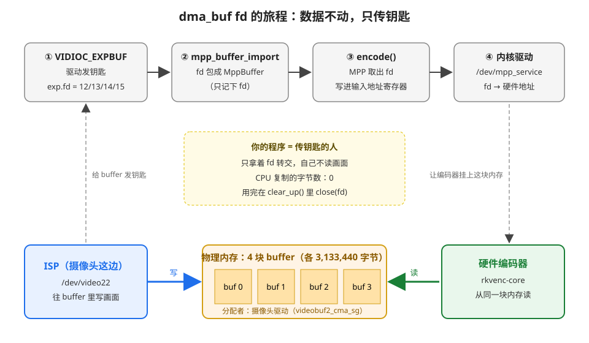

# dma_buf fd 给了谁：从 VIDIOC_EXPBUF 到硬件编码器

> 问题：`main.cpp` 里 `V4L2_CHECK(VIDIOC_EXPBUF, &exp);` 把第 i 块 buffer 换成了一个 dma_buf fd。**这个 fd 最后给谁用了？**
> 答案：给了 **RK3588 的硬件编码器**（`rkvenc-core`）。中间经过你的程序、MPP、内核驱动转了 4 手，每一手都有源码，最后一步还在板子上抓到了内核的记录。
> 本文的源码行号和实测数据都是 2026-10-21 核对的（IMX415 接在 MIPI CSI3，`/dev/video22`）。

---

## 1. 一张图看完



- **下面一排是数据**：ISP 往 4 块 buffer 里写画面，编码器从**同一块**内存读。数据从头到尾没有挪过地方。
- **上面一排是钥匙（fd）**：从 EXPBUF 发出来，经过 MPP、内核驱动，最后交到编码器手里。
- **你的程序**只负责传钥匙，自己不读画面。CPU 复制的字节数是 0，这就是"零拷贝"。

---

## 2. 先说人话：fd 是什么，为什么要"钥匙"

### 2.1 fd 是什么

fd（file descriptor，文件描述符）就是一个小整数，比如 12。在 Linux 里，你 `open` 一个东西，内核就给你一个号码，以后用这个号码代表它。`open("/dev/video22")` 得到的 `g_videoFd` 是 fd，`fopen` 打开的文件底下也是 fd。

dma_buf fd 也是一个号码，只是它代表的不是文件，而是**一块内存**。

### 2.2 为什么不直接给地址

`mmap` 已经拿到了 `g_bufs[i].start`，为什么还要再弄一个 fd？

**打个比方**：buffer 是仓库里的一个货架。
- `mmap` 拿到的 `start` 像是"**我家**到货架的路线图"。这是本进程的虚拟地址，只有本程序的 CPU 能用。编码器是另一块硬件，它看不懂这张路线图。
- dma_buf fd 像是"货架的**钥匙**"。谁拿到钥匙，内核就能帮它找到这个货架。编码器、RGA、显示控制器都认这把钥匙。

所以要把内存交给另一块硬件，就要交 fd，不能交指针。

### 2.3 EXPBUF 做了什么、没做什么

| | 说明 |
|---|---|
| **做了** | 让摄像头驱动给第 i 块 buffer 发一把钥匙（新的 fd），写回 `exp.fd` |
| **没做** | 没分配新内存（内存在 REQBUFS 时已经分好了），没复制任何数据 |

导出前后，摄像头写的、mmap 看到的、编码器读的，都是**同一块物理内存**。

---

## 3. 逐步跟踪：fd 走过的 4 站

### 第 ① 站：VIDIOC_EXPBUF —— 驱动发钥匙

`src/main.cpp` 第 239～246 行：

```cpp
v4l2_exportbuffer exp = {};
exp.type              = kBufType;   // 多平面采集，和 REQBUFS 一样
exp.index             = i;          // 第几块 buffer
exp.plane             = 0;          // 第几个 plane（NV12 只有 1 个）
exp.flags             = O_CLOEXEC;  // 新 fd 的属性
V4L2_CHECK(VIDIOC_EXPBUF, &exp);
g_bufs[i].dmaFd = exp.fd;           // 驱动写回来的钥匙
```

**实测**：4 块 buffer 拿到的 fd 是 12、13、14、15（日志 `buffer 0: length 3133440, dma_buf fd 12` 等）。

### 第 ② 站：mpp_buffer_import —— 钥匙包进 MppBuffer

`src/main.cpp` 第 249～254 行：

```cpp
MppBufferInfo bufInfo = {};
bufInfo.type          = MPP_BUFFER_TYPE_EXT_DMA;  // 外面来的 dma_buf
bufInfo.fd            = exp.fd;                   // ⭐ 钥匙交给 MPP
bufInfo.size          = planes[0].length;         // 3,133,440
bufInfo.index         = i;
mpp_buffer_import(&g_bufs[i].mppBuf, &bufInfo);
```

MPP 里面做了什么？`EXT_DMA` 类型的 import 在 `rk_code/external/mpp/osal/allocator/allocator_ext_dma.c` 第 74～85 行：

```c
static MPP_RET allocator_ext_dma_import(void *ctx, MppBufferInfo *info)
{
    ...
    if (info->ptr) {
        mpp_err_f("The ext_dma is not used for userptr\n");
        return MPP_ERR_VALUE;
    }
    return ((info->fd < 0) ? MPP_ERR_VALUE : MPP_OK);
}
```

**只检查了 fd 是不是 >= 0**，没有分配内存，也没有复制数据。MPP 只是把这个 fd 记在 MppBuffer 里。

`EXT_DMA` 的含义见 `inc/mpp_buffer.h` 第 121 行：`ext_dma : the DMABUF(DMA buffers) come from the application`，也就是"内存是应用带进来的"。

### 第 ③ 站：encode() —— MPP 把钥匙写进编码器寄存器

**3a. 你的程序把 MppBuffer 送进去**

`src/main.cpp` 第 320 行：`encoder.encode(g_bufs[index].mppBuf, false, packet)`

`src/encoder/mpp_encoder.cpp` 第 154 行和第 159 行：

```cpp
mpp_frame_set_buffer(inputFrame, frameBuffer);              // MppBuffer 挂到 MppFrame 上
CHECK(encoderApi_->encode_put_frame(encoderCtx_, inputFrame)); // 送进 MPP
```

**3b. MPP 的硬件抽象层把 fd 取出来，写进寄存器**

RK3588 的 H.264 编码器叫 VEPU580。对应的代码在 `rk_code/external/mpp/mpp/hal/rkenc/h264e/hal_h264e_vepu580.c` 的 `setup_vepu580_io_buf()` 函数里（第 1324 行起）：

```c
MppBuffer buf_in = mpp_frame_get_buffer(frm);       // 第 1329 行：从 MppFrame 拿回 MppBuffer
...
RK_S32 fd_in = mpp_buffer_get_fd(buf_in);           // 第 1334 行：⭐ 取出 fd（就是 12～15 之一）
...
regs->reg_base.adr_src0   = fd_in;                  // 第 1342～1344 行：⭐ fd 写进"输入图像地址"寄存器
regs->reg_base.adr_src1   = fd_in;
regs->reg_base.adr_src2   = fd_in;
```

注意，这里寄存器里填的**是 fd，不是真正的硬件地址**。真正的地址要到第 ④ 站才换出来。

**3c. Y 和 UV 用同一个 fd，靠偏移量区分**

`adr_src0` 是 Y，`adr_src1` 是 UV。两个都填同一个 fd，那编码器怎么知道 UV 在哪？靠偏移量。同一个文件第 1365～1369 行：

```c
case VEPU541_FMT_YUV420SP :           // NV12 就是 YUV420SP
case VEPU541_FMT_YUV422SP : {
    off_in[0] = hor_stride * ver_stride;   // ⭐ UV 的偏移 = hor_stride × ver_stride
    off_in[1] = hor_stride * ver_stride;
} break;
```

第 1400～1401 行把偏移量登记到第 161、162 号寄存器上：

```c
mpp_dev_multi_offset_update(offsets, 161, off_in[0]);
mpp_dev_multi_offset_update(offsets, 162, off_in[1]);
```

> 💡 **这就是 ver_stride 填错会出绿条的根源**：编码器找 UV 的位置就是 `hor_stride × ver_stride`。填 1080 时是 1920 × 1080 = 2,073,600，正好是驱动写 UV 的位置；填 1088 时变成 2,088,960，晚了 8 行 UV。见 [面试会问的问题.md](面试会问的问题.md) 第 2 题。

### 第 ④ 站：内核驱动 —— 把钥匙换成硬件地址

MPP 通过 `/dev/mpp_service` 把寄存器和偏移量交给内核（同一个文件第 2249 行：`mpp_dev_ioctl(ctx->dev, MPP_DEV_REG_OFFS, ctx->offsets)`）。内核里的编码器驱动拿到 fd 以后：
1. 通过 fd 找到这块 dma_buf
2. 把这块内存"挂"到编码器上（attach）
3. 算出编码器能用的硬件地址，加上偏移量，替换掉寄存器里的 fd
4. 启动编码器，编码器通过 DMA 直接读内存

> ⚠️ 工程里没有内核源码，上面 4 步是**按 MPP 源码推断的**。不过第 2 步（挂上）在板子上能直接看到证据，见下一节。

---

## 4. 板子实测：亲眼看到 fd 交给了编码器

2026-10-21 让程序在板子上编码，运行到第 4 秒左右时，看了两样东西。

### 4.1 程序打开了哪些 fd

```bash
adb shell 'ls -l /proc/$(pidof day3_cam2h264)/fd'
```

实测（只列相关的）：

```
11 -> /dev/video22                       ← g_videoFd：摄像头节点
12 -> /dmabuf:2543-day3_cam2h264         ← ⭐ EXPBUF 导出的 4 个 fd
13 -> /dmabuf:2543-day3_cam2h264
14 -> /dmabuf:2543-day3_cam2h264
15 -> /dmabuf:2543-day3_cam2h264
17 -> /dev/mpp_service                   ← MPP 跟内核编码器驱动说话的通道（第 ④ 站）
18 ~ 27 -> /dmabuf:...                   ← MPP 自己分配的内存（参考帧、码流输出等）
```

- fd 12～15 就是日志里打印的 `dma_buf fd`。它们指向的不是普通文件，而是 `/dmabuf:`，说明代表的是一块内存。
- 12～15 的权限是 `lr-x`（只读），因为 `exp.flags` 只填了 `O_CLOEXEC`，没加 `O_RDWR`。编码器只读不写，只读就够了。MPP 自己分配的 18～27 是 `lrwx`（可读写）。

### 4.2 内核的 dma_buf 记录：谁挂在这块内存上

内核把每一块 dma_buf 的信息记在 `/sys/kernel/debug/dma_buf/bufinfo` 里：

```bash
adb shell 'cat /sys/kernel/debug/dma_buf/bufinfo'
```

实测，摄像头的 4 块 buffer 都长这样（4 块一模一样，只列一块）：

```
size        flags     mode      count     exp_name          ino
03133440    00000000  00080005  00000001  videobuf2_cma_sg  00000482  2543-day3_cam2h264
	Attached Devices:
	fdbd0000.rkvenc-core
Total 1 devices attached
```

| 字段 | 值 | 意思 |
|---|---|---|
| size | 3,133,440 | 就是 QUERYBUF 拿到的 buffer 长度（1920 × 1088 × 1.5） |
| exp_name | `videobuf2_cma_sg` | **谁分配的这块内存**：videobuf2 是 V4L2 驱动的 buffer 管理框架，也就是摄像头驱动 |
| 后面的名字 | `2543-day3_cam2h264` | 哪个进程导出的（2543 是当时的进程号） |
| **Attached Devices** | **`fdbd0000.rkvenc-core`** | ⭐ **哪个硬件挂在这块内存上：RK3588 的硬件编码器**（`fdbd0000` 是它的寄存器地址） |

这就是"fd 给了谁"最直接的证据：**内存是摄像头驱动分配的，挂在上面的是编码器。**

> ISP 为什么不在 Attached Devices 里？因为 ISP 就是这块内存的**主人**（分配者），自己用自己的内存不需要"挂上"。只有借用别人内存的设备才会出现在这里。

### 4.3 程序退出后

再看一次 `bufinfo`，`videobuf2_cma_sg` 的记录数是 **0**：4 块 buffer 都释放了。程序 `clear_up()` 里的 `mpp_buffer_put`、`close(dmaFd)`，加上内核在进程退出时的兜底回收，把钥匙都收回了。

### 4.4 自己试一试

程序要**在运行中**才看得到，所以在一个终端运行程序，另一个终端执行：

```bash
# 终端 1：运行（500 帧大约 17 秒）
./run_on_board_with_mac.sh

# 终端 2：趁它运行时看
adb shell 'ls -l /proc/$(pidof day3_cam2h264)/fd | grep -E "dmabuf|video|mpp"'
adb shell 'cat /sys/kernel/debug/dma_buf/bufinfo' | grep -A3 videobuf2_cma_sg
```

> ⚠️ 不要用 `adb shell './day3_cam2h264 &'` 放到后台再看：adb shell 一结束，后台程序会被一起杀掉（2026-10-21 实测，编到第 60 帧就没了），而且 `/userdata/av/cam_m3.h264` 会只剩半个文件。

---

## 5. 钥匙的一生：申请和归还

| 时刻 | 代码 | 发生了什么 |
|---|---|---|
| REQBUFS | `main.cpp` 第 192 行 | 摄像头驱动分配 4 块内存（还没有 fd） |
| EXPBUF | 第 244 行 | 驱动发钥匙：fd 12～15 |
| import | 第 254 行 | MPP 记下 fd，包成 MppBuffer |
| 每一帧 encode | 第 320 行 | MPP 取出 fd → 内核 → 编码器挂上内存、读画面 |
| `mpp_buffer_put` | 第 369 行 | MPP 不再引用这把钥匙 |
| `munmap` | 第 373 行 | 程序的 CPU 地址也不要了 |
| `close(dmaFd)` | 第 377 行 | 钥匙交回。所有人都不用了，内核才真正回收内存 |

释放顺序和申请顺序相反：后拿到的先还。

> 为什么 `close` 一定要做：fd 是有限的资源（每个进程默认最多 1024 个）。程序跑一次就退出时，内核会自动回收，看不出问题；但以后整理成类、反复打开关闭摄像头时，不关就会越积越多。

---

## 6. 常见疑问

| 疑问 | 答 |
|---|---|
| 同一块 buffer 现在有 3 个"把手"：`start` 指针、`dmaFd`、`mppBuf`，它们是什么关系？ | 都指向同一块物理内存。`start` 给本程序 CPU 用（M2 存 NV12 文件时用），`dmaFd` 是给别的硬件的钥匙，`mppBuf` 是 MPP 对这把钥匙的包装 |
| M3 编码根本没用 `start`，为什么还要 mmap？ | 编码确实用不到它。保留它是为了需要 CPU 看画面时能用，比如存一帧 NV12 调试。不做 mmap，EXPBUF 和编码也能正常工作（按原理推断，未实测） |
| import 时填 `MPP_BUFFER_TYPE_DRM` 行不行？ | 2026-10-18 实测也能编，因为 fd 是通用的钥匙。但语义上内存是外面来的，应该写 `EXT_DMA` |
| 编码器是在 `encode()` 里读的，还是后台慢慢读？ | `encode()` 里用的是阻塞模式，`encode_put_frame` 要等编码器用完这一帧才返回（`mpp_encoder.cpp` 第 156～158 行的注释）。所以 `encode()` 返回以后才能 QBUF |
| 别的硬件也能用这把钥匙吗？ | 能。RGA（Day 4）、显示控制器都认 dma_buf fd。以后"摄像头 → RGA 缩放 → 编码"整条链路都可以零拷贝，传的都是 fd |

---

## 7. 自测

- [ ] dma_buf fd 是什么？它和 `mmap` 拿到的 `start` 指针有什么区别？
- [ ] `VIDIOC_EXPBUF` 分配内存了吗？复制数据了吗？
- [ ] fd 从 EXPBUF 出来以后，经过了哪 4 站才到编码器？
- [ ] MPP 的 `EXT_DMA` import 里面做了什么？
- [ ] 编码器的寄存器里，Y 和 UV 用的是同一个 fd 吗？UV 的位置怎么算？
- [ ] 怎么在板子上亲眼确认"这块内存是摄像头驱动分配的、编码器挂在上面"？
- [ ] 为什么 ISP 不出现在 Attached Devices 里？
- [ ] 为什么 fd 12～15 是只读的？
