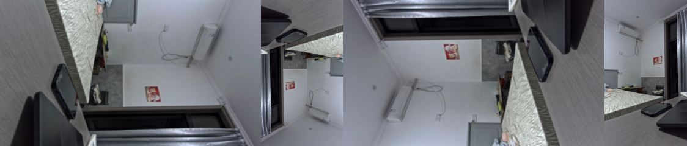

# 画面旋转：编码器的 prep:rotation 和摄像头的 flip

> 问题：编出来的画面方向不对。有两种办法转正：**让编码器在编码前转**（`prep:rotation`），或者**让摄像头自己翻转着输出**（sensor 的 flip）。
> 本文的结果都是 2026-10-18 在板子上实测的（IMX415 装在 MIPI CSI3，video22）。

---

## 1. 先确认：画面到底转了多少度

一开始以为画面是"倒着的"（180°），实测四个方向一对比才发现：**摄像头是侧着装的，画面转了 90°**。



从左到右是 `prep:rotation` = 0、1、2、3 时编出来的第一帧（缩小显示）：

| rotation | 意思（MPP 开发参考第 658 行） | 输出分辨率（ffprobe 实测） | 画面 |
|:---:|---|---|---|
| 0 | 不转 | 1920×1080 | 侧着（这就是原来的样子） |
| 1 | 逆时针 90° | **1080×1920** | 倒着的竖屏 |
| 2 | 180° | 1920×1080 | 反方向侧着 |
| **3** | **逆时针 270°（= 顺时针 90°）** | **1080×1920** | ✅ **正的**（空调在上、桌子在下、墙上的画是正的） |

> ⚠️ 正确的值取决于**板子现在怎么放**：板子转了，答案就变了。所以先像上面这样四个都试一遍，看哪个是正的。

**怎么判断转了多少度**：看画面里"一定朝上"的东西（天花板、墙上挂的画、文字）在画面的哪一边——在左边或右边就是 90°，在下面就是 180°。

---

## 2. 方法一：编码器旋转 `prep:rotation`

### 2.1 是什么

MPP 编码器在**编码之前**有一个预处理阶段（prep = preprocess），可以对输入图像做旋转、镜像，再去压缩。由硬件做，**不占 CPU**。

### 2.2 怎么用

day3 的 `MppEncoder` 已经支持了（`src/encoder/mpp_encoder.cpp` 里 `CFG_SET("prep:rotation", cfg.rotation);`），只要设置 `EncoderConfig` 的 `rotation`：

```cpp
EncoderConfig cfg;
cfg.width     = width;          // 1920：仍然填摄像头的宽高
cfg.height    = height;         // 1080
cfg.horStride = bytesPerLine;   // stride 也还是摄像头的（输入图像的排布没变）
cfg.verStride = ...;
cfg.rotation  = 3;              // ⭐ 逆时针 270°，把侧着的画面转正
```

| 值 | 宏（`rk_venc_cmd.h`） | 意思 |
|:---:|---|---|
| 0 | `MPP_ENC_ROT_0` | 不转 |
| 1 | `MPP_ENC_ROT_90` | 逆时针 90° |
| 2 | `MPP_ENC_ROT_180` | 180° |
| 3 | `MPP_ENC_ROT_270` | 逆时针 270° |

### 2.3 实测要点

| 要点 | 实测结果 |
|---|---|
| `width` / `height` / `stride` 要不要跟着交换？ | **不用**。仍然填摄像头的 1920×1080（描述的是**输入**）；转 90° / 270° 时，**MPP 自己**把输出改成 1080×1920（ffprobe 实测） |
| 日志里的 `encoder ready` | 4 种都是 `stride 1920x1080`（输入的排布没变） |
| 编码能不能正常完成 | 4 种都正常：30 帧、退出码 0 |
| 码流大小 | 30 帧 38～41 万字节，四种差不多 |

### 2.4 特点

- ✅ 能转 90° / 180° / 270°，**任意装法都能转正**
- ✅ 硬件做，不占 CPU
- ⚠️ **只影响这一路编码的输出**。ISP 的副出口（video23，预览用）、抓帧存的 NV12，都还是侧着的
- ⚠️ 转 90° 以后变成竖屏，播放器、推流对方要能处理竖屏

---

## 3. 方法二：摄像头自己翻转（sensor flip）

### 3.1 是什么

IMX415 芯片内部支持"倒着读像素"：从右往左读就是**水平翻转**（镜像），从下往上读就是**垂直翻转**。两个都开 = **旋转 180°**。

开关在摄像头子设备 `/dev/v4l-subdev2` 上（见 [FindCamera输出的每个字段是什么.md](FindCamera输出的每个字段是什么.md) 第 1 节）：

```bash
adb shell 'v4l2-ctl -d /dev/v4l-subdev2 -C horizontal_flip,vertical_flip'      # 看（默认都是 0）
adb shell 'v4l2-ctl -d /dev/v4l-subdev2 -c horizontal_flip=1,vertical_flip=1'  # 两个都开 = 180°
adb shell 'v4l2-ctl -d /dev/v4l-subdev2 -c horizontal_flip=0,vertical_flip=0'  # 恢复
```

代码里对应 `VIDIOC_S_CTRL`（`V4L2_CID_HFLIP` / `V4L2_CID_VFLIP`），对子设备的 fd 调用（未实测）。

### 3.2 实测（2026-10-18）

两个都设成 1，再用 `v4l2-ctl` 从 video22 抓一帧：
- **画面转了 180°**，和编码器 `rotation = 2` 的结果方向一样
- 颜色正常（翻转后 Bayer 排列会变，驱动 / ISP 处理好了；`media-ctl` 看摄像头输出格式，前后都还是 `SGBRG10_1X10/3864x2192`）
- 测完恢复成 0（3A 服务没有把它改回去，设置后读回来是 1）

### 3.3 特点

- ✅ 在源头翻转，**后面所有的出口都是转好的**：主路、副路、抓帧、编码，全都一样
- ✅ 不花任何算力（只是芯片换个方向读）
- ❌ **只能镜像和 180°，转不了 90°**：flip 是"镜子"，两面镜子合起来最多转 180°
- ⚠️ 是摄像头的全局设置：所有用这个摄像头的程序都受影响；断电、重启后会恢复默认

---

## 4. 对比：用哪个

| | 编码器 `prep:rotation` | 摄像头 flip |
|---|---|---|
| 在链路哪一站 | MPP 编码器（最后一站） | 摄像头芯片（第一站） |
| 能转多少 | 90° / 180° / 270° | 水平镜像、垂直镜像、180° |
| 影响范围 | 只有这一路编码输出 | 所有出口（主路、副路、抓帧） |
| 代价 | 硬件做，不占 CPU | 没有代价 |
| 改在哪 | `EncoderConfig::rotation` | `/dev/v4l-subdev2` 的控制项 |
| **现在这块板子** | ✅ **用 `rotation = 3`**（摄像头侧着装，要转 90°） | ❌ 转不了 90° |

**怎么选：**
- 摄像头**倒着装**（180°）→ 优先用 **flip**：源头就转好，所有输出都对
- 摄像头**侧着装**（90°）→ 只能用 **`prep:rotation`**（或者 Day 4 的 RGA `imrotate`，可以转所有出口的画面，但要多一次处理）
- 摄像头**镜像**了（左右反）→ 用 `horizontal_flip`（编码器也有 `prep:mirroring`，MPP 开发参考第 659 行，未实测）

---

## 5. 自己动手

在 `src/main.cpp` 设置编码器参数的地方加一行：
```cpp
cfg.rotation = 3;
```
跑完拉回来，用 [验证M3代码_零copy导入.md](../验证代码运行结果/验证M3代码_零copy导入.md) 的 ⑤、⑥-0、⑥ 检查：
- `ffprobe` 看到 **width=1080, height=1920**
- `ffplay -f h264 -framerate 30 result_from_board/cam_m3.h264` 画面是**正的竖屏**

---

## 6. 自测

- [ ] 怎么判断画面转了 90° 还是 180°？
- [ ] 用 `prep:rotation` 转 90° 时，`width`、`height`、`stride` 要不要交换？输出分辨率谁来改？
- [ ] 编码器旋转只影响哪一路输出？副出口 video23 会跟着转吗？
- [ ] 摄像头的 flip 为什么转不了 90°？两个 flip 都开等于什么？
- [ ] 摄像头倒着装、侧着装，分别优先用哪种方法？
