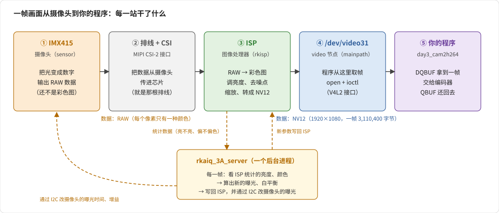
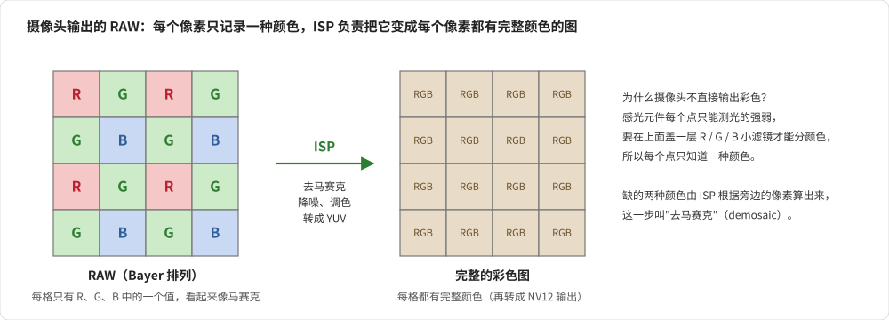
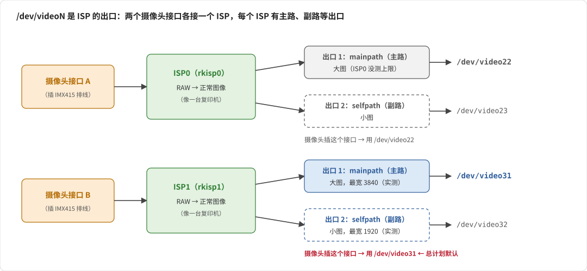
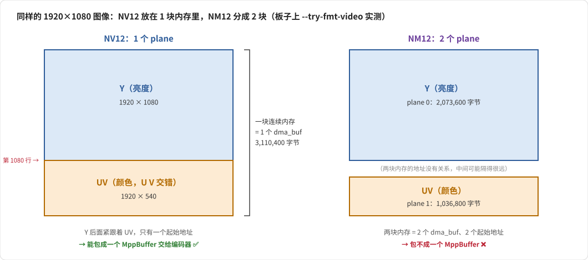
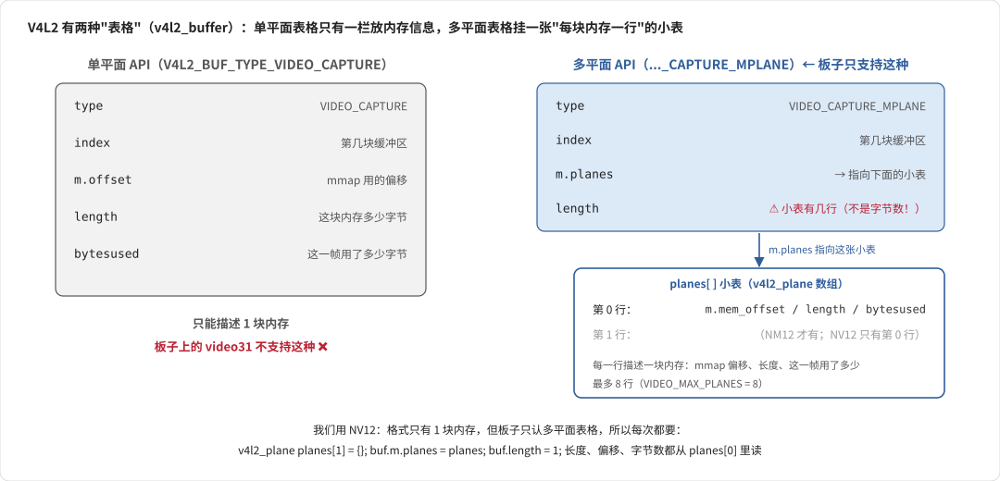
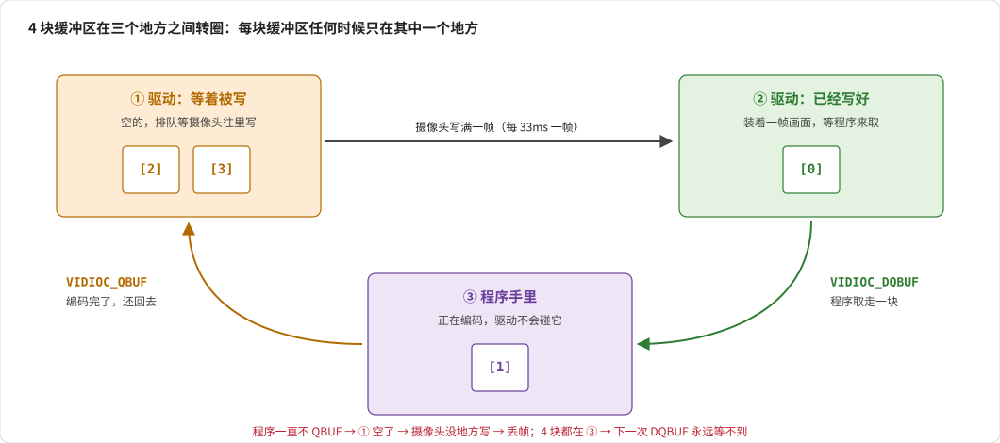

# 04 · 摄像头和 V4L2 知识：结合 camera_source.c

> 读 `camera_source.c`、写 M2 时会碰到的概念，都在这一篇里，按"先说人话 → 再看板子上的实测 → 最后看代码怎么写"的顺序讲。
> 返回总览：[../readme.md](../readme.md)

**怎么读：**
- 第 1、2 节先看：画面是怎么来的、`/dev/video31` 是什么
- 写 M2 之前**必须看懂**的：第 4 节（单平面和多平面）、第 7 节（缓冲区轮转）
- 第 3 节是 V4L2 的基本用法；第 5、6 节遇到再看

> 标了"实测"的数据都是 2026-10-15～16 在板子上测的（**还没装摄像头**，只能查 ISP 节点本身的能力）。行号对应 `rk_code/external/mpp/utils/camera_source.c`。

---

## 1. 一帧画面是怎么到你程序里的

### 1.1 先看全程



一帧画面要经过 5 站，**你的程序只和第 ④ 站打交道**：

| 站 | 是什么 | 干了什么 | 你要不要管 |
|:---:|---|---|---|
| ① | IMX415 摄像头 | 把光变成数字，输出 **RAW 数据**（还不是彩色图，见 1.2） | 不用，装好就行 |
| ② | 排线 + CSI 接口 | 把数据从摄像头传进 RK3588 芯片 | 不用 |
| ③ | ISP（图像处理器） | 把 RAW 变成正常的彩色图，再转成 NV12 | 不用，由驱动和 3A 服务管 |
| ④ | `/dev/video31` | **程序取画面的地方**（第 2 节细讲） | ✅ 用 V4L2 接口打开它、取帧 |
| ⑤ | 你的程序 | 取一帧 → 编码 → 还回去 | ✅ |

所以写代码时，你看到的就是：**打开 `/dev/video31`，从里面一帧一帧拿 NV12 图像**。前面三站都是自动的。

### 1.2 为什么要 ISP：摄像头拍到的不是彩色图



摄像头的感光元件，每个点只能测"这里有多亮"，分不出颜色。为了拍彩色，每个点上面盖了一个小滤镜（红、绿或者蓝），于是**每个点只知道一种颜色**，排成左图那样的马赛克，这叫 **RAW**（或者 Bayer 格式）。

ISP 要做的事情：
1. **去马赛克**：每个点缺的另外两种颜色，根据旁边的点算出来，变成每个点都有完整颜色的图
2. **调画质**：降噪、调亮度、调颜色
3. **转格式、缩放**：转成我们要的 NV12，按我们要的分辨率输出

手机拍照好不好看，很大一部分就看 ISP 调得好不好。

### 1.3 为什么还要 3A 服务

ISP 只会"按参数处理"，但参数（曝光多久、颜色怎么校正）要根据画面实时变：光线暗了要曝光久一点，日光灯下要校正偏绿。

这件事由后台进程 **`rkaiq_3A_server`** 做（图 1 下面那个框）。每一帧它都：
1. 看 ISP 统计出来的"画面亮不亮、偏不偏色"
2. 算出新的曝光、白平衡参数
3. 写回 ISP，同时通过 I2C 改摄像头的曝光时间

**3A** = 自动曝光（AE）+ 自动白平衡（AWB）+ 自动对焦（AF）。它不运行，画面就一直用初始参数：**很暗、发绿或者发紫**。

它需要一个针对这款摄像头调好的参数文件（叫 IQ 文件）。板子上已经有 IMX415 的：`/etc/iqfiles/imx415_CMK-OT2022-PX1_IR0147-50IRC-8M-F20.json`（实测）。

---

## 2. `/dev/video31` 是什么：程序从哪里拿画面

### 2.1 Linux 把设备当成文件

Linux 有个习惯：**每个硬件设备都用一个文件来代表**，这些文件都放在 `/dev/` 目录下：

| 文件 | 代表什么 |
|---|---|
| `/dev/ttyS0` | 一个串口 |
| `/dev/sda` | 一块硬盘 |
| `/dev/video31` | **一个能取视频画面的地方** |

所以程序"打开摄像头"，写的就是：

```cpp
int fd = open("/dev/video31", O_RDWR);   // 和打开普通文件差不多，拿到一个 fd
```

打开以后，再用 `ioctl` 跟它说"给我 1920×1080 的 NV12""给我一帧"（第 3 节）。

**31 这个数字没有特别的意思**，只是开机时驱动按顺序编的号：每创建一个视频节点就编一个，video0、video1……一直往下。RK3588 上和图像有关的模块很多，节点也很多，编到我们要的那个刚好是 31。所以**换系统版本、换摄像头接口，号码都可能变**，每次用之前要查一下（2.4 节）。

### 2.2 video 节点开在 ISP 上，不是开在摄像头上

第 1 节说过，摄像头出来的是 RAW，要先经过 ISP 变成正常的图像，程序才能用。所以**程序拿到的画面，其实是 ISP 处理完吐出来的**。video 节点是 ISP 的"出口"，不是摄像头本身。

### 2.3 mainpath 和 selfpath：一个 ISP 有两个出口



ISP 处理完一帧画面后，**可以同时从两个出口送出去，每个出口给一份不同大小的拷贝**。就像一台复印机，同一张原稿，一边印一份 A3 的大图，一边印一份 A5 的小图：

| | mainpath | selfpath |
|---|---|---|
| 中文意思 | **主路** | **副路**（self 是"自己看"，原来是给预览用的） |
| ISP1 上的节点 | `/dev/video31` | `/dev/video32`（实测：节点名字是 `rkisp_selfpath`） |
| 最大能出多大（实测） | 请求 3840×2160 → 给 3840×2160 | 请求 3840×2160 → 只给 1920×2160，**最宽 1920** |
| 支持的格式（实测） | NV12、NV21、NV16、NV61、UYVY、NM12、NM21 | 上面这些 + 黑白（`GREY`）、RGB565（`RGBP`） |
| 典型用途 | 录像主码流、拍照 | 预览、子码流、给 AI 用的小图 |

每个出口在系统里就是一个 video 节点。我们要录 1080p 主码流，**所以打开 mainpath**：摄像头装在 MIPI CSI3 时它在 ISP0 上，是 **`/dev/video22`**（2026-10-17 实测）；装在接 ISP1 的接口上才是 `/dev/video31`。两个出口可以同时打开、各自设不同的分辨率。

> **和 Day 4 的关系**：总计划 Day 4 用 RGA 把 1080p 缩成 720p 做子码流。其实 selfpath 本身就能直接出一路小图（ISP 自己缩放），也可以试试，比较两种做法的 CPU 占用和延迟。

### 2.4 为什么还有 `/dev/video22`：RK3588 有两个 ISP

板子有两个摄像头接口，每个接口接一个 ISP，每个 ISP 都有自己的一套出口（见上图）。`v4l2-ctl --list-devices` 打印出来是这样的（2026-10-15 实测）：

```
rkisp_mainpath (platform:rkisp0-vir0):   ← ISP0 的出口
	/dev/video22                          ← ISP0 的 mainpath
	/dev/video23
	/dev/video24
rkisp_mainpath (platform:rkisp1-vir0):   ← ISP1 的出口
	/dev/video31                          ← ISP1 的 mainpath ← 总计划默认用这个
	/dev/video32                          ← ISP1 的 selfpath
```

所以**摄像头插在哪个接口，决定了用哪个节点**：插在接 ISP1 的接口上用 `/dev/video31`，插在另一个上用 `/dev/video22`。装好摄像头以后，用 [01_环境准备.md](01_环境准备.md) 第 2.3 节的 `media-ctl` 命令查它接在哪个 ISP 上。

> ⚠️ `/dev/video31` 存在，**不代表摄像头存在**：节点是 ISP 驱动创建的，没装摄像头它也在（2026-10-15 就是这样）。
>
> ⚠️ 没装摄像头时，`v4l2-ctl --list-formats-ext` 显示的尺寸范围是 `32x32 - 800x600`（实测），这是没有 sensor 时的默认值，**不可信**。装好以后会变成 IMX415 的分辨率（800 万像素，约 4K）。

**一句话**：`/dev/video31` = ISP1 的主出口（mainpath），程序打开它，就能拿到 ISP 处理好的大图。

---

## 3. V4L2：程序怎么跟摄像头说话

### 3.1 一句话

**V4L2（Video for Linux 2）是 Linux 内核给所有摄像头定的一套统一规矩**。不管是 USB 摄像头、手机摄像头还是我们的 IMX415，程序都用同样的方式操作。

它不是一个库，没有 `.so` 要链接。全部操作只有三个系统调用：

| 调用 | 干什么 |
|---|---|
| `open("/dev/video31", O_RDWR)` | 打开摄像头，拿到一个 fd |
| `ioctl(fd, 命令, &结构体)` | **所有操作都靠它**：设格式、要缓冲区、取帧、还帧…… |
| `mmap` | 把驱动的缓冲区映射成 CPU 能读的地址 |

### 3.2 ioctl 的套路：填表 → 交表 → 看回执

每一个 V4L2 操作都是同一个套路，就像去窗口办事：

```cpp
v4l2_capability cap = {};                   // 1. 拿一张空表（结构体清零）
                                            //    （有的命令要先填几栏，比如告诉驱动"我要 1920x1080"）
ioctl(fd, VIDIOC_QUERYCAP, &cap);           // 2. 交给驱动：VIDIOC_QUERYCAP = "查询能力"这个业务
                                            //    返回 -1 表示失败，原因在 errno 里
printf("%s\n", cap.card);                   // 3. 驱动把结果填回同一张表，读出来就行
```

命令（`VIDIOC_xxx`）和表格（`v4l2_xxx` 结构体）都定义在 `<linux/videodev2.h>`。Day 3 用到的命令一共 10 个左右，见 [02_读源码.md](02_读源码.md) 第 1 节的表。

`camera_source.c` 第 91～108 行的 `camera_source_ioctl` 只是在 `ioctl` 外面包了一层：被信号打断（`EINTR`）时自动重试。我们的代码里对应 `xioctl`。

### 3.3 第一件事：问它"你能干什么"

打开设备后，先用 `VIDIOC_QUERYCAP` 问它支持什么（`camera_source.c` 第 145～158 行）。`/dev/video31` 的回答是（实测）：

| 问题 | 回答 | 对我们的影响 |
|---|:---:|---|
| 能不能采集视频（**单平面**方式）？ | ❌ 不能 | 不能用单平面的写法 |
| 能不能采集视频（**多平面**方式）？ | ✅ 能 | ⭐ **只能用多平面的写法**（第 4 节） |
| 能不能用 streaming（QBUF / DQBUF 轮转）？ | ✅ 能 | 我们就是用这种方式取帧 |

> 这些回答是按位存在 `cap.capabilities` 里的，板子上的值是 `0x84201000`。不用记这个数，代码里这样判断就行：
> ```cpp
> if (!(cap.capabilities & V4L2_CAP_VIDEO_CAPTURE_MPLANE)) { /* 不支持多平面采集 */ }
> if (!(cap.capabilities & V4L2_CAP_STREAMING))            { /* 不支持 streaming */ }
> ```

"单平面""多平面"是什么，就是下一节要讲的。

---

## 4. ⭐ 单平面和多平面

这一节是 Day 3 最容易晕的地方。我们分四步来：先搞懂 plane 是什么，再看两种格式，再看两种写法，最后看代码。

### 4.1 plane 是什么：一块独立的内存

回忆 Day 1：NV12 图像在内存里是**先放 Y（亮度），紧跟着放 UV（颜色）**。

**plane（平面）就是"一块独立的内存"**：有自己的起始地址、自己的长度，能单独 mmap、单独导出成 dma_buf。

一帧图像可以放在 1 块内存里，也可以拆成几块放。拆成几块，就叫有几个 plane。

### 4.2 同一张图，两种放法：NV12 和 NM12

板子的 ISP 两种都能输出，我们用 `--try-fmt-video` 问了驱动 1080p 各自怎么放（实测）：



| | NV12 | NM12 |
|---|---|---|
| 图像内容 | 完全一样：Y 1920×1080 + UV 1920×540 | 完全一样 |
| 几块内存（plane） | **1 块**：Y 后面紧跟着 UV | **2 块**：Y 一块、UV 另一块，地址没关系 |
| 每块多大 | 3,110,400 字节 | 2,073,600 + 1,036,800 字节 |
| 能不能交给 MPP 编码器 | ✅ 一块内存包成一个 MppBuffer | ❌ 两块内存包不成一个 MppBuffer |

NM12 的 M 是 Multi-plane 的意思，正式名字叫 `NV12M`。**我们用 NV12**，因为 MPP 编码器要的是"一块内存，Y 在前、UV 在后"，和 Day 1 一样。

到这里记住：**NV12 = 1 个 plane。**

### 4.3 V4L2 的两种"表格"：单平面写法和多平面写法

问题来了：程序和驱动交换缓冲区信息时（第几块、mmap 偏移、多长、这一帧用了多少字节），用的表格是 `v4l2_buffer`。V4L2 有两种填法：



- **单平面写法**（老的）：表格里只有一栏放内存信息，所以只能描述 1 块内存
- **多平面写法**（新的）：表格本身不放内存信息，而是**挂一张小表**（`planes` 数组），小表里每一行描述一块内存。NV12 就 1 行，NM12 就 2 行

打个比方：寄快递时，单平面写法是"一张快递单只能写一个包裹"；多平面写法是"快递单后面附一张包裹清单，有几个包裹就写几行"。只寄一个包裹时，两种单子都能用，但**有的快递点只收带清单的那种**。

**我们的板子就是"只收带清单的"**（3.3 节：只支持多平面）。所以虽然 NV12 只有 1 块内存，也必须用多平面写法，附一张只有 1 行的清单。

这就是为什么代码里到处都是这三行：

```cpp
v4l2_plane planes[1] = {};   // 准备一张只有 1 行的清单
buf.m.planes = planes;       // 挂到表格上
buf.length   = 1;            // 告诉驱动：清单有 1 行
```

### 4.4 两种写法在代码里的区别

同一件事，两种写法对照着看（我们只写右边那列）：

| 要干的事 | 单平面写法（板子不支持） | ⭐ 多平面写法（我们用的） |
|---|---|---|
| 类型 | `V4L2_BUF_TYPE_VIDEO_CAPTURE` | `V4L2_BUF_TYPE_VIDEO_CAPTURE_MPLANE` |
| 设格式 | `fmt.fmt.pix.width = 1920;` | `fmt.fmt.pix_mp.width = 1920;` |
| 读每行字节数 | `fmt.fmt.pix.bytesperline` | `fmt.fmt.pix_mp.plane_fmt[0].bytesperline` |
| 读一帧多大 | `fmt.fmt.pix.sizeimage` | `fmt.fmt.pix_mp.plane_fmt[0].sizeimage` |
| QUERYBUF / QBUF / DQBUF 之前 | 什么都不用加 | `buf.m.planes = planes; buf.length = 1;` |
| mmap 偏移 | `buf.m.offset` | `planes[0].m.mem_offset` |
| 缓冲区多长 | `buf.length` | `planes[0].length` |
| 这一帧用了多少字节 | `buf.bytesused` | `planes[0].bytesused` |

规律就一条：**单平面写法里直接放在表格上的内存信息，多平面写法里都挪到了 `planes[0]` 里。**

⚠️ 最坑的是 `buf.length`：
- 单平面写法里，它是"这块内存多少字节"
- 多平面写法里，它是"清单有几行"，我们填 1

多平面写法忘了设 `buf.m.planes` 或者 `buf.length`，`ioctl` 就会返回 `EINVAL`（Invalid argument）。

### 4.5 camera_source.c 为什么看起来那么乱

因为它想**两种写法都支持**（不同的板子可能只支持其中一种），所以每个地方都写了 `if (多平面) {...} else {...}`。拿 mmap 那段举例（第 241～258 行），去掉注释是这样：

```c
if (V4L2_BUF_TYPE_VIDEO_CAPTURE_MPLANE == buf.type) {       // 多平面：信息在 planes[0] 里
    buf_len = buf.m.planes[0].length;
    ctx->fbuf[i].start = mmap(NULL, buf.m.planes[0].length, ..., ctx->fd, buf.m.planes[0].m.mem_offset);
} else {                                                     // 单平面：信息直接在 buf 上
    buf_len = buf.length;
    ctx->fbuf[i].start = mmap(NULL, buf.length, ..., ctx->fd, buf.m.offset);
}
```

我们的板子只支持多平面，所以**读的时候只看 if 那一支**。所有这种分支的位置：

| 行号 | 干什么 | 多平面那一支做了什么 |
|:---:|---|---|
| 164～165 | 选写法 | 支持多平面就用多平面 |
| 229～234 | QUERYBUF 前 | 挂上 `planes`，`length = 1` |
| 241～258 | mmap | 从 `planes[0]` 读长度和偏移 |
| 296～299 | QBUF 前 | 挂上 `planes` |
| 377～381 | DQBUF 前 | 挂上 `planes` |
| 393～394 | DQBUF 后 | 从 `planes[0].bytesused` 读这一帧多少字节 |
| 414～418 | 还帧（QBUF）前 | 挂上 `planes` |

第 88 行 `#define FMT_NUM_PLANES 1` 表示它只支持 1 个 plane 的格式（清单永远 1 行），所以它用不了 NM12。

> **（深入，可以跳过）第 167～168 行的一个小问题**
> 设格式时它写的是 `vfmt.fmt.pix.width`（单平面的字段），即使走的是多平面。为什么没出错？因为 `fmt.pix` 和 `fmt.pix_mp` 是同一块内存的两种解读（C 语言的 union），而两者开头的 width、height、pixelformat 三个字段位置刚好一样（实测：都在第 0、4、8 字节）。但再往后就不一样了，所以它从 `fmt.pix` 读不到多平面的 `bytesperline`，这也是它完全没用驱动给的 stride 的原因。我们的代码老老实实写 `pix_mp`。

---

## 5. 像素格式（fourcc）

V4L2 用 4 个字符表示像素格式，叫 **fourcc**，例如 `V4L2_PIX_FMT_NV12 = v4l2_fourcc('N','V','1','2')`，就是把 4 个字符拼成一个 32 位整数（小端，第一个字符在最低字节）。`camera_source.c` 第 177～179 行把它拆回 4 个字符打印。

两个 path 支持的格式（`v4l2-ctl --list-formats` 实测）：

| fourcc | 名字 | 采样 | plane 数 | mainpath（video31） | selfpath（video32） |
|---|---|---|:---:|:---:|:---:|
| `UYVY` | UYVY 4:2:2 | 4:2:2，打包（U Y V Y 交错） | 1 | ✅ | ✅ |
| `NV16` / `NV61` | Y/CbCr 4:2:2 | 4:2:2，Y + UV 交错（NV61 是 VU） | 1 | ✅ | ✅ |
| **`NV12`** / `NV21` | Y/CbCr 4:2:0 | **4:2:0，Y + UV 交错**（NV21 是 VU，安卓相机默认） | 1 | ✅ | ✅ |
| `NM12` / `NM21` | Y/CbCr 4:2:0 (N-C) | 同 NV12 / NV21 | **2** | ✅ | ✅ |
| `GREY` | 8-bit Greyscale | 只有 Y（黑白） | 1 | ❌ | ✅ |
| `RGBP` | 16-bit RGB 5-6-5 | RGB565 | 1 | ❌ | ✅ |

> 用 NV12 的原因：MPP 编码器原生支持（`MPP_FMT_YUV420SP`），1 个 plane，数据量最小（每像素 1.5 字节）。

### 5.1 bytesperline、sizeimage、缓冲区长度

| 名字 | 从哪来 | 1080p NV12 实测 | 说明 |
|---|---|---:|---|
| `bytesperline` | G_FMT：`plane_fmt[0].bytesperline` | 1920 | 内存里一行占多少字节（含行尾填充），就是 **hor_stride** |
| `sizeimage` | G_FMT：`plane_fmt[0].sizeimage` | 3,110,400 | 一帧图像有效数据多少字节 = 1920 × 1080 × 3/2，UV 从第 1080 行开始 → **ver_stride = 1080** |
| 缓冲区长度 | QUERYBUF：`planes[0].length` | **3,133,440** | 驱动实际分配的内存 = 1920 × 1088 × 3/2，高度按 16 对齐多分配了 8 行 |
| `bytesused` | DQBUF：`planes[0].bytesused` | （未实测，应该 = sizeimage） | 这一帧实际写了多少字节，存文件时用它 |

为什么分配的比用的多、stride 该填多少，见 [具体编码day3_cam2h264的流程.md](../具体编码day3_cam2h264的流程.md) 第 3.1 节。

---

## 6. 缓冲区的内存从哪来：MMAP 和 DMABUF

### 6.1 问题：摄像头往哪块内存里写？

摄像头要有地方放画面，这块内存要么**驱动出**，要么**程序出**。`VIDIOC_REQBUFS` 时用 `req.memory` 选：

| 方式 | 谁出内存 | 打个比方 | 板子支持吗（实测） |
|---|---|---|:---:|
| **MMAP** | 驱动 | 照相馆自己准备托盘，借给你看 | ✅ |
| USERPTR | 程序（普通 `malloc`） | 你自己拿个塑料袋去装 —— 硬件用不了普通内存，一般不用 | ✅ |
| DMABUF | 程序（硬件能用的内存，比如 MPP 申请的） | 你带着印刷厂的专用托盘，请照相馆直接放进去 | ✅ |

> 实测方法：`REQBUFS` 时 `count = 0`，驱动在 `req.capabilities` 里回答它支持哪几种，板子返回 `0x57`，三种都支持。

### 6.2 我们用 MMAP：驱动出内存，再"复印钥匙"给编码器

`camera_source.c` 和我们的代码都用 MMAP（第 212 行）。驱动分配好 4 块内存后，对每一块做两件事：

| 做什么 | 调用 | 得到 | 给谁用 |
|---|---|---|---|
| 映射成 CPU 地址 | `mmap`（第 244 行） | `start` 指针 | **只有本程序的 CPU**（M2 存文件用它） |
| 导出成 dma_buf | `VIDIOC_EXPBUF`（第 271 行） | 一个 fd | **任何硬件**：编码器、RGA、显示…… |

dma_buf fd 就像这块内存的"钥匙"：谁拿到钥匙，谁就能直接访问同一块物理内存。把钥匙交给 MPP（`mpp_buffer_import`，第 282 行），编码器就能直接读摄像头写的那块内存。

**这就是零拷贝**：从摄像头写进去，到编码器读出来，始终是同一块内存，中间没有任何人搬数据。

### 6.3 另一种零拷贝：DMABUF（以后可以试试）

反过来做也行：先用 `mpp_buffer_get` 从 MPP 申请 4 块内存，`REQBUFS` 时选 `V4L2_MEMORY_DMABUF`，每次 QBUF 时把 `mpp_buffer_get_fd()` 填进 `planes[0].m.fd`，摄像头就直接写进 MPP 的内存。

两种效果一样，区别只是"内存归谁"。Day 3 先用 MMAP（和官方一致）。

---

## 7. 缓冲区轮转：4 块缓冲区怎么转圈



### 7.1 三个地方，两个动作

4 块缓冲区，任何时候每一块都只在三个地方之一：

| 地方 | 状态 | 谁能碰 |
|---|---|---|
| ① 驱动：等着被写 | 空的，排队 | 摄像头会往里写 |
| ② 驱动：已经写好 | 装着一帧画面 | 等程序来取 |
| ③ 程序手里 | 正在用（编码） | **只有程序**，驱动不会碰 |

程序只做两个动作：
- **`VIDIOC_DQBUF`**：从 ② 取走一块到 ③（D = de，"出队"）。② 是空的就**一直等**，等摄像头写好下一帧
- **`VIDIOC_QBUF`**：从 ③ 还回 ①（"入队"）

开始采集前，要先把 4 块全部 QBUF 到 ①，再 `VIDIOC_STREAMON`（第 287～311 行）。

### 7.2 常见问题

| 问题 | 答案 |
|---|---|
| 为什么要 4 块，1 块不行吗？ | 1 块的话，程序拿着它编码时，摄像头没地方写，这段时间的画面就丢了。多块能让"摄像头写"和"程序编码"同时进行 |
| 那越多越好？ | 不是。1080p 每块 3MB，太多占内存；而且 ② 里排队的帧越多，拿到的画面越旧，延迟越大。官方用 4 块（`mpi_enc_test.c` 第 190 行） |
| 程序一直不 QBUF 会怎样？ | ① 空了，摄像头没地方写，新画面被丢掉；4 块都在 ③ 时，下一次 DQBUF 永远等不到 |
| 一帧编码完之前，能先 QBUF 吗？ | **不能**（零拷贝时）。QBUF 后摄像头随时可能往这块写下一帧，编码器读到的就是新旧混合的画面（撕裂） |
| 拷贝方式（M6）呢？ | 数据已经拷走了，拷完就能 QBUF。这是拷贝方式唯一的好处 |

DQBUF 返回的 `v4l2_buffer` 里还有两个有用的字段（未实测）：
- `sequence`：帧序号，**跳号就说明丢帧了**
- `timestamp`：这一帧采集的时间，可以用来测延迟

---

## 8. 调试命令速查

| 想知道 | 命令 |
|---|---|
| 摄像头驱动认到芯片没有 | `dmesg \| grep imx415` |
| 链路里有没有摄像头 | `media-ctl -d /dev/mediaN -p`，找有没有 imx415 |
| 某个节点是什么、支持什么 | `v4l2-ctl -d /dev/video31 --all` |
| 支持哪些格式 | `v4l2-ctl -d /dev/video31 --list-formats-ext` |
| 不改设置，问驱动某个格式会怎么放 | `v4l2-ctl -d /dev/video31 --try-fmt-video=width=1920,height=1080,pixelformat=NV12` |
| 现在设的是什么格式 | `v4l2-ctl -d /dev/video31 --get-fmt-video` |
| 不写代码抓一帧 | `v4l2-ctl -d /dev/video31 --set-fmt-video=... --stream-mmap=4 --stream-skip=30 --stream-count=1 --stream-to=xxx.nv12` |
| 实际帧率 | `v4l2-ctl -d /dev/video31 --stream-mmap=4 --stream-count=300`（会打印 fps） |
| 3A 在不在 | `pidof rkaiq_3A_server`；日志：`grep rkaiq_3A /var/log/messages` |
| 有哪些 IQ 文件 | `ls /etc/iqfiles` |

---

## 9. 自测

- [ ] 摄像头直接输出的为什么不是彩色图？ISP 做了哪几件事？
- [ ] `rkaiq_3A_server` 不运行，画面会怎样？为什么？
- [ ] V4L2 所有操作都靠哪个系统调用？它的"填表 → 交表 → 看回执"是什么意思？
- [ ] plane 是什么？NV12 有几个 plane？NM12 呢？为什么编码选 NV12？
- [ ] 板子只支持多平面写法，可 NV12 只有 1 个 plane，代码里要怎么写？
- [ ] 多平面写法里 `buf.length` 是什么意思？和单平面写法有什么不同？
- [ ] 多平面写法里，mmap 偏移、缓冲区长度、这一帧用了多少字节，分别从哪读？
- [ ] `sizeimage` 3,110,400 和缓冲区长度 3,133,440 为什么不一样？
- [ ] mmap 拿到的地址和 EXPBUF 拿到的 fd 有什么区别？零拷贝靠的是哪个？
- [ ] 4 块缓冲区都在程序手里时，会发生什么？
- [ ] 为什么零拷贝时一定要编码完才能 QBUF？
- [ ] `/dev/video31` 是什么？31 这个数字有特别的意思吗？为什么每次要先查一下？
- [ ] mainpath 和 selfpath 有什么区别？我们为什么用 mainpath？
- [ ] 板子上为什么还有 `/dev/video22`？摄像头插的接口不同，代码要改什么？
