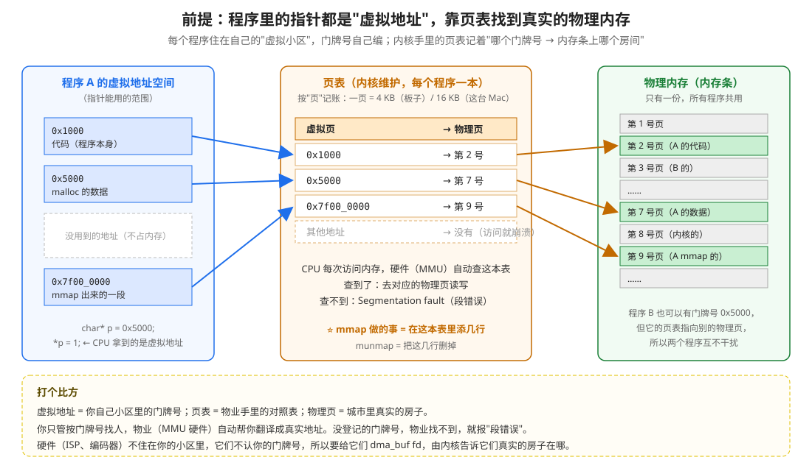
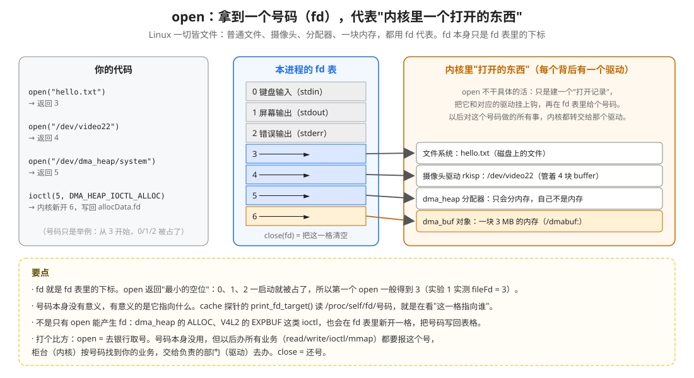
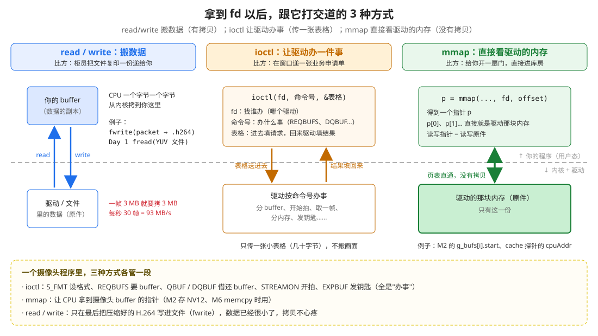
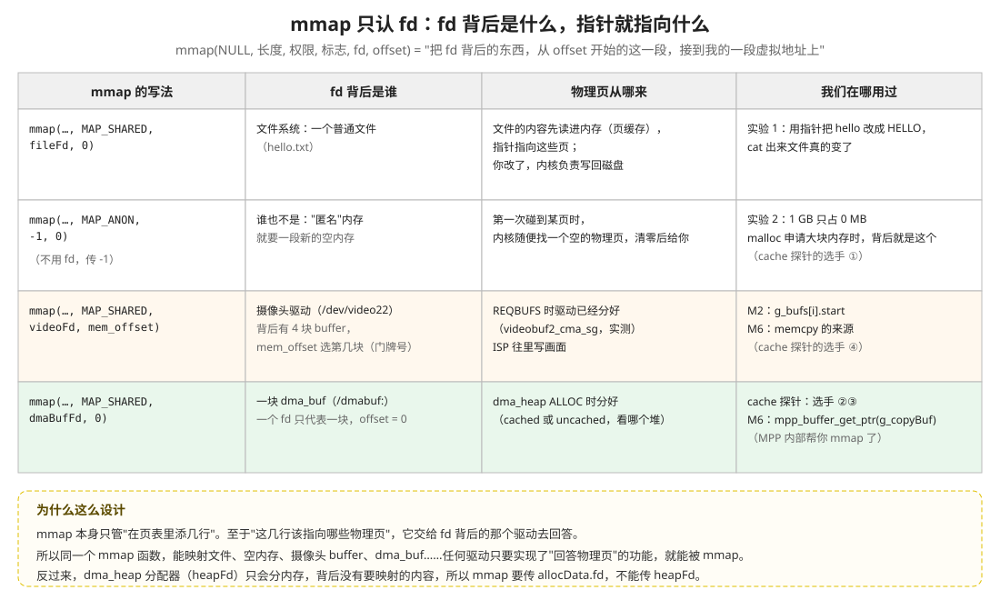
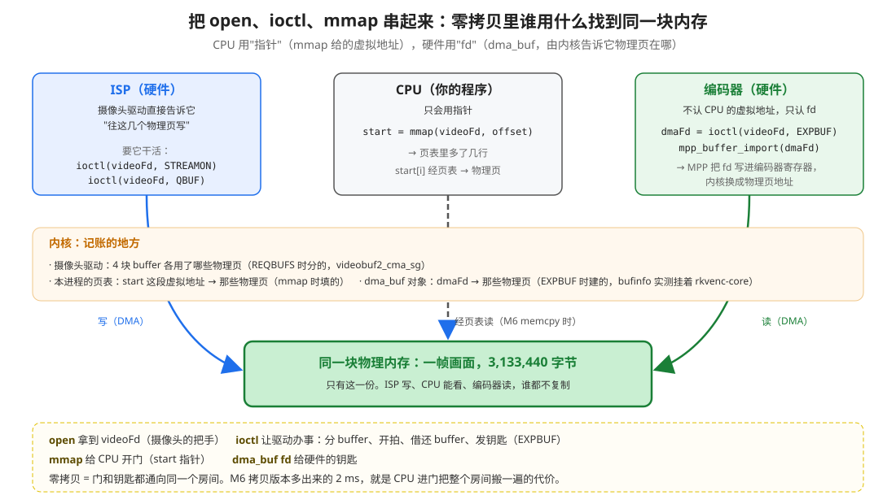

# open、ioctl、mmap 是什么（重点讲 mmap）

> 写这篇的原因（2026-10-23）：用户读 cache 探针时问"heapFd 和 allocData.fd 是什么关系？mmap 居然要传 allocData.fd，这是什么操作？"，又说"对 open、ioctl、mmap 的理解太浅了，特别是 mmap"。
> 这三个函数是 Linux 跟驱动打交道的基本功。Day 1～3 的每一个程序都在用它们，Day 4 的 RGA、以后的显示、推流也一样。
> 两个实验程序在 `../demo/`，在 Mac 上就能跑。实验结果是 2026-10-23 在这台 Mac（Apple Silicon，一页 16 KB）上实测的；板子上一页是 4 KB，道理一样。

---

## 0. 先看结论

| 函数 | 一句话 | 打个比方 | 我们在哪用过 |
|---|---|---|---|
| `open` | 拿到一个号码（fd），代表内核里一个"打开的东西" | 去银行**取号** | `open("/dev/video22")`、`open("/dev/dma_heap/system")` |
| `read` / `write` | 把数据**复制**进来 / 复制出去 | 柜员把文件**复印一份**递给你 | `fwrite` 写 .h264 |
| `ioctl` | 让驱动**办一件事**，用一张表格传参数和结果 | 在窗口**递业务申请单** | S_FMT、REQBUFS、QBUF、DQBUF、STREAMON、EXPBUF、ALLOC |
| `mmap` | 让一段虚拟地址**直接对应** fd 背后的东西，不复制 | **开一扇门**直通库房 | 摄像头 buffer 的 `start`、dma_buf 的 `cpuAddr` |
| `munmap` | 把那扇门封上 | 封门 | 释放时 |
| `close` | 交回号码 | 还号 | 释放时 |

要真正懂 mmap，得先懂一个前提：**程序里的指针不是真实地址**（第 1 节）。

---

## 1. 前提：指针是"虚拟地址"，靠页表找到物理内存



### 1.1 先说人话

你在程序里写 `char* p = 0x5000; *p = 1;`，这个 `0x5000` **不是内存条上的位置**。它是这个程序自己的"门牌号"，叫**虚拟地址**。

内核给每个程序准备了一本**对照表**，叫**页表**，记着"这个程序的门牌号 X → 内存条上的房间 Y"。CPU 每次访问内存，硬件（MMU，内存管理单元）都会**自动查这本表**，再去真实的房间读写。

### 1.2 为什么要这样

- **互不干扰**：程序 A 和程序 B 都可以有 `0x5000`，但它们的页表指向不同的物理页。A 写坏了自己的内存，碰不到 B 的。
- **按需分配**：页表里登记了，不一定马上分物理内存，用到了再给（第 6 节的实验 2）。
- **可以共享**：两个页表指向**同一个**物理页，就能共享同一块内存。零拷贝就是靠这个（第 9 节）。

### 1.3 "页"是什么

页表不是一个字节一个字节记账的，那样表就太大了。它按**页**记账：一页是一段固定大小的连续内存。

| 机器 | 一页多大 | 怎么知道的 |
|---|---|---|
| RK3588 板子 | 4 KB | M6 的 dma_buf 3,110,400 字节被凑成 3,112,960 = 760 × 4096 |
| 这台 Mac | 16 KB | `getconf PAGESIZE` 输出 16384；实验 2 也打印了 |

### 1.4 查不到会怎样

页表里没有登记的门牌号，CPU 一访问，MMU 查不到，内核就把程序杀掉：**Segmentation fault（段错误）**。用野指针、访问已经 `free` / `munmap` 的内存，崩溃的原因都是这个。

**记住这一句**：**mmap 做的事，就是在页表里添几行。** munmap 就是把这几行删掉。

---

## 2. open：拿到一个号码



### 2.1 一切皆文件

Linux 的设计是"**一切皆文件**"：普通文件、摄像头、编码器、内存分配器、一块内存，全都用同一种方式代表：**fd**（file descriptor，文件描述符），一个小整数。

```cpp
int fileFd  = open("hello.txt", O_RDWR);              // 一个普通文件
int videoFd = open("/dev/video22", O_RDWR);           // 摄像头
int heapFd  = open("/dev/dma_heap/system", O_RDWR);   // 内存分配器
```

### 2.2 open 做了什么

**open 本身不干具体的活。** 它只做三件事：
1. 在内核里建一个"打开记录"
2. 把这个记录和对应的**驱动**挂上钩（文件系统、摄像头驱动 rkisp、dma_heap……）
3. 在本进程的 **fd 表**里找一个空位，把号码返回给你

以后你对这个号码做的所有事（read、write、ioctl、mmap），内核都**转交给那个驱动**去办。

### 2.3 fd 就是 fd 表的下标

- 每个程序一启动，0、1、2 就被占了：0 是键盘输入，1 是屏幕输出，2 是错误输出。
- open 返回**最小的空位**，所以第一个 open 一般得到 3。实验 1 实测：`step 1 open: fileFd = 3`。
- 号码本身没有意义，**有意义的是它指向什么**。在 Linux 上可以读 `/proc/self/fd/<号码>` 看它指向谁。cache 探针的 `print_fd_target()` 就是这么做的。

### 2.4 不是只有 open 能产生 fd

有些 ioctl 也会在 fd 表里**新开一格**，把号码写回表格：

| 谁 | 产生的新 fd | 代表什么 |
|---|---|---|
| `ioctl(heapFd, DMA_HEAP_IOCTL_ALLOC, &allocData)` | `allocData.fd` | 新分的一块内存（dma_buf） |
| `ioctl(videoFd, VIDIOC_EXPBUF, &exportBuf)` | `exportBuf.fd` | 摄像头第 i 块 buffer（dma_buf） |

这就是为什么 cache 探针里会同时有 `heapFd` 和 `allocData.fd`：一个是 open 来的，一个是 ioctl 来的，**指向的东西不一样**。

### 2.5 打个比方

open = 去银行**取号**。号码本身没用，但以后办所有业务都要报这个号。柜台（内核）按号码找到你的业务，交给负责的部门（驱动）去办。close = 还号。

---

## 3. 拿到 fd 以后：3 种打交道的方式



| 方式 | 干什么 | 有没有复制数据 | 一个摄像头程序里用在哪 |
|---|---|---|---|
| **read / write** | 搬数据 | **有**：CPU 把数据从内核复制到你这里，或者反过来 | 最后把压缩好的 H.264 写进文件（数据已经很小了） |
| **ioctl** | 办事 | 只复制一张**几十字节的表格**，不搬画面 | 设格式、要 buffer、借还 buffer、开拍、发钥匙 |
| **mmap** | 直接看驱动的内存 | **没有** | CPU 要看画面时（M2 存 NV12、M6 memcpy） |

为什么摄像头不用 read 取画面？因为一帧 3 MB，每秒 30 帧，用 read 就是每秒复制 93 MB。用 mmap 拿到指针，画面就在原地，CPU 想看哪里就看哪里。

---

## 4. ioctl：让驱动办一件事


### 4.1 为什么需要 ioctl

read / write 只能"搬数据"。可是摄像头要做的事远不止这些：设格式、要 buffer、开始拍、取一帧、停止……这些都不是"读写数据"。Linux 不可能给每件事都加一个新函数，于是统一用一个"**万能业务窗口**"：

```cpp
ioctl(fd,  命令号,  &表格);
      谁   办什么事  申请单（进去时填请求，回来时驱动填结果）
```

### 4.2 命令号：一个装了 4 样东西的数字

命令号看起来像个名字，其实是用宏拼出来的一个 32 位整数：

```c
#define VIDIOC_DQBUF  _IOWR('V', 17, struct v4l2_buffer)   // videodev2.h 第 5130 行
```

2026-10-21 在板子上实测打印：`VIDIOC_DQBUF = 0xc0585611`，拆开是：

| 部分 | 值 | 意思 |
|---|---|---|
| 方向 | `c`（二进制 11） | 读 + 写：表格要送进去，也要拿回来（`_IOWR` 的 WR） |
| 大小 | `0x058` = 88 | 表格多大：`sizeof(struct v4l2_buffer)` = 88 字节 |
| 类别 | `0x56` = `'V'` | 视频设备这一类 |
| 编号 | `0x11` = 17 | 这一类里的第 17 号业务：DQBUF |

别的命令也一样：`VIDIOC_QBUF` 是 `_IOWR('V', 15, …)` = `0xc058560f`；`VIDIOC_STREAMON` 是 `_IOW('V', 18, int)`，只有 W，表示表格只送进去、不拿回来。

### 4.3 一次 ioctl 在内核里经过哪些地方

2026-10-22 做"不 QBUF 就 STREAMON"实验时，程序卡在 DQBUF，用 `cat /proc/<pid>/stack` 抓到了它在内核里的调用链（从下往上调用）：

```
video_ioctl2          ← 内核收到 ioctl，交给 V4L2 框架
video_usercopy        ← ① 按命令号里的"大小 88"，把你的表格复制进内核
__video_do_ioctl      ← ② 按命令号里的"编号 17"，找到处理函数
v4l_dqbuf
vb2_ioctl_dqbuf
vb2_dqbuf
vb2_core_dqbuf        ← ③ 真正办事：从"已写好"队列拿一块；没有就在这里等（当时就卡在这）
```

办完以后，再由 `video_usercopy` 把填好结果的表格复制回你的程序（④）。

**为什么表格要复制进内核**：内核不能直接信任、直接使用你程序里的地址（那是你的虚拟地址，可能是错的、可能被别的线程改着）。所以先复制一份到内核自己的内存里再处理。表格只有几十字节，复制两次几乎不花时间。**画面本身不在表格里**，表格只告诉你"第几块 buffer"。

### 4.4 fd 决定交给哪个驱动

同一个 `ioctl()` 函数，fd 不同，内核就转交给不同的驱动：

| fd | 背后的驱动 | 认哪些命令 |
|---|---|---|
| `videoFd`（/dev/video22） | 摄像头驱动 rkisp | `VIDIOC_*` |
| `heapFd`（/dev/dma_heap/system） | dma_heap | `DMA_HEAP_IOCTL_ALLOC` |
| `/dev/mpp_service` | 编码器驱动 | MPP 内部用的命令（你没直接调过，MPP 替你调了） |

### 4.5 ioctl 失败时：errno 告诉你原因

ioctl 返回 -1 表示失败，原因在 `errno` 里（`strerror(errno)` 变成文字）。我们实测见过的：

| 错误 | 什么时候 | 实测日期 |
|---|---|---|
| `EBUSY` Device or resource busy | 相机 App 或别的程序占着 video22，再 S_FMT / REQBUFS | 2026-10-21、22 |
| `EINVAL` Invalid argument | 没 REQBUFS 就 QBUF；index 越界；同一块重复 QBUF | 2026-10-21 |
| `EPERM` Operation not permitted | 对没接摄像头的 video31 做 STREAMON | 2026-10-18 |
| 不报错但一直等 | 一块 buffer 都没交给驱动就 DQBUF（阻塞模式） | 2026-10-22 |

---

## 5. mmap（一）：让一段内存"就是"fd 背后的东西

### 5.1 实验 1：mmap 一个普通文件，用指针改它

代码：`../demo/mmap_file_demo.c`

```bash
cc -o /tmp/mmap_file_demo mmap_file_demo.c && cd /tmp && ./mmap_file_demo && cat hello.txt
```

核心几行：

```c
int fileFd = open("hello.txt", O_RDWR | O_CREAT | O_TRUNC, 0644);
write(fileFd, "hello world\n", 12);                                  // 先用 write 写进去

char* fileAddr = mmap(NULL, 12, PROT_READ | PROT_WRITE, MAP_SHARED, fileFd, 0);
printf("%.5s", fileAddr);           // 不用 read()，直接用指针读文件
memcpy(fileAddr, "HELLO", 5);       // 用指针"写内存"
```

2026-10-23 在 Mac 上实测：

```
step 1 open:  fileFd = 3
step 2 mmap:  fileAddr = 0x100870000
step 3 read through pointer: "hello"          ← 指针直接读到了文件内容
step 4 memcpy(fileAddr, "HELLO", 5)
step 5 munmap + close. now run: cat hello.txt
HELLO world                                    ← 文件真的被改了
```

**这就是 mmap 的本质**：它让 fd 背后的东西（这里是文件），**看起来就像一段普通内存**。你用指针读写这段"内存"，实际上就是在读写那个东西。中间没有 read，没有 write，也没有复制。

### 5.2 mmap 的 6 个参数

```c
void* addr = mmap(NULL, length, prot, flags, fd, offset);
```

| 参数 | 意思 | 我们的写法 | 说明 |
|---|---|---|---|
| `NULL` | 希望放在哪个虚拟地址 | 永远写 `NULL`（`nullptr`） | 让内核自己挑一个空位置，最省事 |
| `length` | 映射多长 | buffer 长度 / 文件长度 | 按页凑整：不满一页也占一整页 |
| `prot` | 允许怎么访问 | `PROT_READ \| PROT_WRITE` | 只读就只写 `PROT_READ`，违反了会段错误 |
| `flags` | 映射的方式 | `MAP_SHARED` | 见下表 |
| `fd` | **映射谁** | `videoFd`、`allocData.fd`、`fileFd` | ⭐ 最关键：决定指针指向什么 |
| `offset` | 从 fd 背后的哪里开始 | `mem_offset`、`0` | 必须是页大小的整数倍 |

`flags` 常见的三种：

| flags | 意思 | 什么时候用 |
|---|---|---|
| `MAP_SHARED` | 你改的内容，别人（文件、驱动、硬件）也能看到 | 摄像头 buffer、dma_buf、想改文件时：**我们一直用这个** |
| `MAP_PRIVATE` | 你改的是自己的私有副本，别人看不到 | 只想读文件、不想改它 |
| `MAP_ANON`（`MAP_ANONYMOUS`） | 不对应任何 fd，要一段新的空内存（fd 传 -1） | 实验 2；malloc 申请大块内存时，背后就是这个 |

**返回值**：成功返回虚拟地址；失败返回 **`MAP_FAILED`**，不是 `NULL`。所以 M2 里判断写的是 `if (g_bufs[i].start == MAP_FAILED)`，写成 `if (!start)` 就判断错了。

### 5.3 mmap 到底做了什么

内核收到 mmap，只做 3 件事：

1. 在你的虚拟地址空间里**找一段空位置**（`length` 那么长）
2. **记一笔账**："这段地址 → fd 背后那个东西的 offset 处"
3. 把这段地址的开头返回给你

**它不复制任何数据。** 复制的是"对应关系"，不是内容。

---

## 6. mmap（二）：先"预留"，用到才"给"（缺页）


### 6.1 实验 2：mmap 1 GB，内存却一点没涨

代码：`../demo/mmap_lazy_demo.c`

```bash
cc -o /tmp/mmap_lazy_demo mmap_lazy_demo.c && /tmp/mmap_lazy_demo
```

它做了三件事：mmap 1 GB 匿名内存 → 什么都不做，看占用 → 每一页写 1 个字节，只写前 256 MB，再看占用。

2026-10-23 在 Mac 上实测：

```
page size: 16384 bytes
start:                 max RSS    0 MB, page faults     274
after mmap 1024 MB:    max RSS    0 MB, page faults     274   (mapAddr 0x120000000)
after touching 256 MB: max RSS  256 MB, page faults   16658   (256 MB / 16384 = 16384 pages)
```

（RSS = 程序真正占用的物理内存；page faults = 缺页次数）

| 看到的 | 说明 |
|---|---|
| mmap 1 GB 后，RSS 还是 0 MB，缺页次数没变 | mmap 只**预留**了地址，一页物理内存都没分 |
| 写了前 256 MB 后，RSS 变成 256 MB | 碰到哪一页，才分配哪一页；没碰的 768 MB 一直不占内存 |
| 缺页次数从 274 涨到 16658，正好多了 **16,384** 次 | 256 MB ÷ 16 KB = 16,384 页，**每碰到一个新页，就缺页一次** |

### 6.2 缺页（page fault）是怎么回事

第一次访问某一页时，一瞬间发生了这些事：

1. **CPU 访问** `mapAddr[0]`，MMU 查页表：这页还没有物理页 → 暂停程序，交给内核处理
2. **内核查账**：这一页是 mmap 登记过的，归这个程序，来源是 X（匿名 / 文件 / 设备）→ 向来源要一个物理页
3. **填页表**：把"这一页 → 那个物理页"写进页表 → 让程序接着跑
4. **程序完全没察觉**：只是这一次访问慢了一点。下次再访问同一页，页表里已经有了，直接命中

如果访问的地址**根本没 mmap 登记过**，第 2 步查账查不到，就是段错误。

### 6.3 这和我们的程序有什么关系

- **cache 探针为什么要先 memset 一遍**：让每一页都提前"缺页"补好。不然测速时，第一次读会把补页的时间也算进去。
- **摄像头 buffer、dma_buf 不一样**：它们的物理页在 REQBUFS / ALLOC 时**就已经分好了**。mmap 后第一次访问只是"把已经存在的页填进页表"，不用新分配。
- **malloc 大块内存不占内存**：`malloc(1 GB)` 背后就是 MAP_ANON 的 mmap，没写之前不占物理内存。

---

## 7. mmap（三）：fd 背后是谁，指针就指向什么



### 7.1 mmap 把"给哪些物理页"交给驱动回答

mmap 本身只管"在页表里添几行"。至于"这几行指向哪些物理页"，它交给 **fd 背后的那个驱动**去回答：

| mmap 的 fd | 背后是谁 | 物理页从哪来 | 我们在哪用过 |
|---|---|---|---|
| `fileFd` | 文件系统 | 文件内容读进内存（页缓存）的那些页；你改了，内核负责写回磁盘 | 实验 1 |
| `-1` + `MAP_ANON` | 谁也不是 | 第一次碰到时，内核随便找一个空的物理页，清零后给你 | 实验 2、malloc |
| `videoFd` + `mem_offset` | 摄像头驱动 | REQBUFS 时分好的第 i 块 buffer（`videobuf2_cma_sg`） | M2 的 `g_bufs[i].start` |
| `dmaBufFd` + `0` | 一块 dma_buf | dma_heap ALLOC（或 EXPBUF）时那块内存 | cache 探针的 `cpuAddr`；M6 的 `mpp_buffer_get_ptr()` 内部 |

**所以 mmap 是一个"通用接口"**：任何驱动只要实现了"回答物理页"的功能，就能被 mmap。

### 7.2 回到你的问题：heapFd、allocData.fd、mmap


```cpp
const int heapFd = open("/dev/dma_heap/system", O_RDWR | O_CLOEXEC);    // ① fd 指向"分配器"
ioctl(heapFd, DMA_HEAP_IOCTL_ALLOC, &allocData);                         // ② 内核分内存，新 fd 写回 allocData.fd
close(heapFd);                                                           // ③ 离开窗口，内存还在
void* cpuAddr = mmap(nullptr, size, PROT_READ | PROT_WRITE, MAP_SHARED,
                     allocData.fd, 0);                                   // ④ 把那块内存接到 CPU 的地址上
```

- **heapFd 背后是分配器**：它只会分内存，自己不是内存，**背后没有可以映射的东西**。所以 mmap 不能传 heapFd。
- **allocData.fd 背后是一块 dma_buf**：有 3 MB 实实在在的物理页。所以 mmap 传它。
- 和 `mmap(fileFd)`、`mmap(videoFd, mem_offset)` 是同一回事："把这个 fd 背后的东西，给我一个指针"。

更多见 cache 探针 readme 的第 9 节，以及这张对比图：


### 7.3 为什么有的要 offset，有的不要

| fd | 背后有几块 | offset |
|---|---|---|
| `allocData.fd`、`exportBuf.fd` | 1 块 | 永远是 0 |
| `videoFd` | 4 块 | `mem_offset` 选第几块。就像**门牌号**：同一栋楼（videoFd），不同的房间 |
| `fileFd` | 1 个文件 | 想从文件的第几页开始映射，就写多少（必须是页大小的倍数） |

`mem_offset` 是驱动在 QUERYBUF 时告诉你的。它不是真实的物理地址，只是驱动自己约定的"门牌号"，你原样交给 mmap 就行。

---

## 8. munmap、close 和它们的顺序

### 8.1 munmap：把门封上

```c
munmap(addr, length);   // 把页表里那几行删掉
```

- `addr` 和 `length` 要和 mmap 时**一样**（`length` 用当时的长度，所以 M2 才要把 `planes[0].length` 存进 `g_bufs[i].length`）。
- munmap 以后再用这个指针，就是访问没登记的地址：**段错误**。
- 程序退出时，内核会自动 munmap 所有映射。但长期运行的程序（以后整理成类、反复开关摄像头）必须自己 munmap，不然虚拟地址和内存会越用越多。

### 8.2 mmap 以后，关掉 fd 会怎样

一个容易误会的地方：**mmap 成功以后，就算 close 掉那个 fd，映射也还在**，指针照样能用（`man mmap` 里写着：关闭 fd 不会解除映射）。因为 mmap 时内核自己又记了一份对那个东西的引用。

所以释放的顺序其实是"后拿到的先还"，习惯上写成：

```
munmap(地址)  →  close(fd)
```

cache 探针的 `free_dma_heap()`、day3_cam2h264 的 `release_resources()` 都是这个顺序。

### 8.3 一块内存什么时候才真正释放

以 dma_buf 为例，它可能同时被好几个人"拿着"：

| 谁拿着 | 什么时候放手 |
|---|---|
| fd 表里的 allocData.fd / exportBuf.fd | close 时 |
| CPU 的 mmap 映射 | munmap 时 |
| 编码器（MPP import 后，内核里 attach 着） | mpp_buffer_put、编码器释放时 |

**所有人都放手了，内核才真正回收内存。** 2026-10-21 用 `/sys/kernel/debug/dma_buf/bufinfo` 看过：程序退出后，摄像头那 4 块 buffer 的记录全部消失了。

---

## 9. 串起来：零拷贝里谁用什么找到同一块内存



一帧画面在 day3_cam2h264 里的一生：

| 谁 | 用什么找到这块内存 | 是怎么来的 |
|---|---|---|
| **ISP**（硬件） | 摄像头驱动直接告诉它物理页 | `open(video22)` → `ioctl(REQBUFS)` 分配 → `ioctl(QBUF)` 交给它 → `ioctl(STREAMON)` 开拍 |
| **CPU**（你的程序） | 指针 `start`（虚拟地址，经页表到物理页） | `ioctl(QUERYBUF)` 拿 mem_offset → `mmap(videoFd, mem_offset)` |
| **编码器**（硬件） | dma_buf fd（内核把它换成物理页地址） | `ioctl(EXPBUF)` 发钥匙 → `mpp_buffer_import` → MPP 写进编码器寄存器 |

**硬件不住在你的"虚拟小区"里**，它们不认你的门牌号（虚拟地址），所以要给它们 **fd**；**CPU 只会用指针**，所以要 **mmap**。门（mmap）和钥匙（dma_buf fd）都通向同一个房间（物理内存），这就是零拷贝。

M6 拷贝版本多出来的 2 ms，就是 CPU 进门把整个房间搬一遍的代价。

---

## 10. 常见错误

| 错误写法 | 后果 | 正确写法 |
|---|---|---|
| `if (!addr)` 判断 mmap 失败 | 失败时返回的是 `MAP_FAILED`（-1），`!addr` 判断不出来 | `if (addr == MAP_FAILED)` |
| mmap 传了 heapFd | 分配器背后没有要映射的内存，映射不出东西 | 传 `allocData.fd` |
| munmap 的长度和 mmap 时不一样 | 只解除了一部分映射，或者报错 | 把 mmap 时的长度存起来（`g_bufs[i].length`） |
| munmap 以后还用指针 | 段错误 | munmap 后把指针置空（`cameraBuf.start = MAP_FAILED`） |
| CPU 写了 cached 的 dma_buf，没有 sync 就交给硬件 | 硬件读到旧数据，花屏 | `mpp_buffer_sync_begin / end`（M6） |
| 以为 ioctl 的表格里有画面 | 表格只有几十字节，只告诉你第几块 | 画面在 `g_bufs[index]` 那块内存里，用 mmap 的指针或 dma_buf fd 去访问 |

---

## 11. 自测

- [ ] 程序里的指针 `0x5000` 是内存条上的位置吗？CPU 怎么找到真正的内存？
- [ ] 页表按什么单位记账？板子上一页多大？
- [ ] open 本身干了什么活？第一个 open 一般返回几？为什么？
- [ ] 除了 open，还有什么能产生新的 fd？举两个我们用过的例子。
- [ ] read/write、ioctl、mmap 三种方式，哪个会复制数据？摄像头取画面为什么不用 read？
- [ ] `VIDIOC_DQBUF = 0xc0585611`，拆开是哪 4 样东西？
- [ ] ioctl 的表格为什么要复制进内核？画面在表格里吗？
- [ ] 实验 1 里，为什么用指针改了内存，文件就变了？
- [ ] mmap 的 6 个参数分别是什么？`MAP_SHARED` 和 `MAP_PRIVATE` 有什么区别？
- [ ] mmap 失败返回什么？为什么不能用 `if (!addr)` 判断？
- [ ] 实验 2 里，mmap 1 GB 为什么不占内存？缺页次数为什么正好多了 16,384？
- [ ] 缺页时发生了哪 4 步？什么情况下会变成段错误？
- [ ] mmap 为什么要传 allocData.fd，不能传 heapFd？
- [ ] 为什么 `mmap(videoFd, mem_offset)` 要 offset，`mmap(allocData.fd, 0)` 不要？
- [ ] mmap 以后 close 了 fd，指针还能用吗？
- [ ] 零拷贝里，ISP、CPU、编码器分别用什么找到同一块内存？
