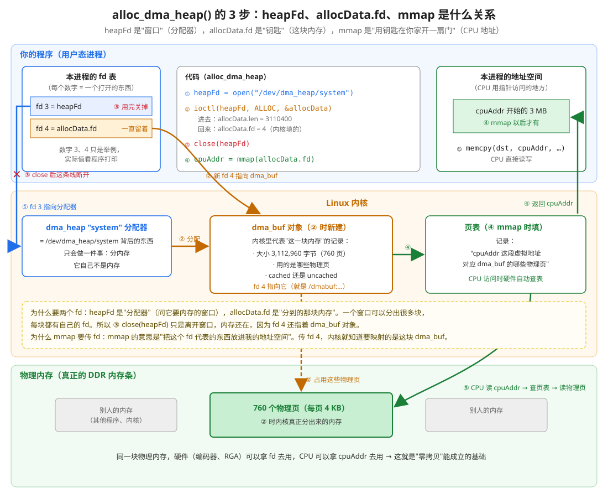
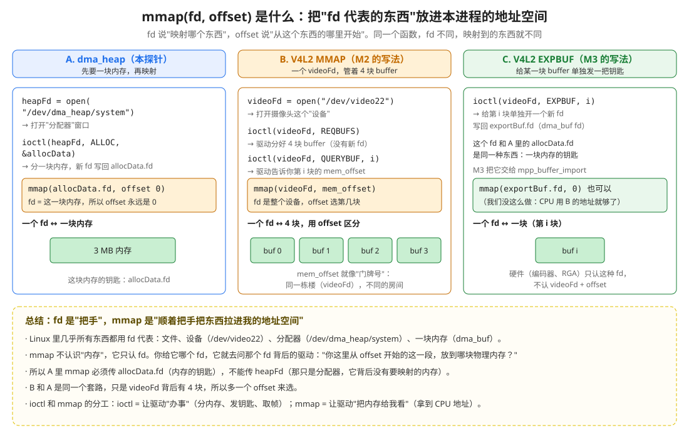

# day3_camera_cache_test：摄像头的 buffer 是 cached 还是 uncached？

> M6 里有一个猜测："摄像头的 buffer 是 uncached 的，CPU 用 memcpy 读它会特别慢"。这个探针用来验证它。
> 结论（2026-10-23 实测）：**猜错了，摄像头的 buffer 是 cached 的**，CPU 读它和读普通内存一样快。
> 📖 看不懂 open / ioctl / mmap 的，先读 [doc/open_ioctl_mmap是什么.md](doc/open_ioctl_mmap是什么.md)（9 张图，两个 Mac 上就能跑的实验在 `demo/`）。

## 1. cached 和 uncached

CPU 旁边有一块很小但很快的存储，叫缓存（cache）。
- **cached 内存**：CPU 读的时候，会顺便把附近的数据搬进缓存，下次读附近的数据直接从缓存拿，快。
- **uncached 内存**：CPU 每次都直接读内存，不经过缓存，慢。好处是硬件写进内存的新数据，CPU 一定能马上看到，不用做缓存同步。

打个比方：内存是图书馆书库，缓存是你的书桌。cached = 借书时顺手把旁边几本也抱回书桌；uncached = 每次都亲自跑一趟书库，一次只拿一本。

## 2. 怎么测

同样读 3,110,400 字节（一帧 1080p NV12），只换"从哪块内存读"：

| # | 内存 | 作用 |
|:---:|---|---|
| 1 | `malloc` 的普通内存 | 一定是 cached，当"快"的标准 |
| 2 | dma_heap `/dev/dma_heap/system` | cached 的 dma_buf，和 M6 里 MPP 申请的 `g_copyBuf` 是同一种（M6 实测它来自 system 堆） |
| 3 | dma_heap `/dev/dma_heap/system-uncached` | 一定是 uncached，当"慢"的标准 |
| 4 | 摄像头的 buffer（`/dev/video22` mmap 出来的地址） | **要测的** |

每块内存测两种读法，各重复 30 次取平均：
- **memcpy**：整块拷到 malloc 内存（M6 拷贝版本的读法）
- **逐 8 字节读求和**：模拟 CPU 自己一个一个处理像素（以后做 OSD、图像分析时的读法）

摄像头那块：STREAMON 后跳过 10 帧，第 11 帧 DQBUF 出来**先不还**，测完再 QBUF，这样测试期间摄像头不会往里写。

两轮测试，第二轮倒过来测：排除"第一个测的吃亏"（CPU 刚开始干活时频率还低）。

## 3. 怎么运行

```bash
cd /Users/dev/Documents/AV/rk_work/day3_camera_cache_test
./run_on_board_with_mac.sh
```

和 day3_cam2h264 一样：交叉编译（`cmake-build-rk3588-debug/`）→ `adb push` → 板子上运行。运行前确认没有别的程序占着 `/dev/video22`（相机 App、day3_cam2h264）。

## 4. 结果（2026-10-23）

```
read 3110400 bytes, average of 30 runs:
round 1:
  1 malloc (cached, reference)       memcpy   1.23 ms ( 2.53 GB/s)   read-sum    0.89 ms ( 3.50 GB/s)
  2 dma_heap system (cached)         memcpy   0.45 ms ( 6.91 GB/s)   read-sum    0.46 ms ( 6.69 GB/s)
  3 dma_heap system-uncached         memcpy   3.02 ms ( 1.03 GB/s)   read-sum    5.30 ms ( 0.59 GB/s)
  4 camera buffer (video22 mmap)     memcpy   0.32 ms ( 9.78 GB/s)   read-sum    0.29 ms (10.71 GB/s)
round 2 (reverse order):
  4 camera buffer (video22 mmap)     memcpy   0.35 ms ( 8.90 GB/s)   read-sum    0.29 ms (10.56 GB/s)
  3 dma_heap system-uncached         memcpy   3.07 ms ( 1.01 GB/s)   read-sum    5.30 ms ( 0.59 GB/s)
  2 dma_heap system (cached)         memcpy   0.31 ms ( 9.93 GB/s)   read-sum    0.30 ms (10.53 GB/s)
  1 malloc (cached, reference)       memcpy   0.35 ms ( 8.94 GB/s)   read-sum    0.30 ms (10.45 GB/s)
```

| 看到的 | 说明 |
|---|---|
| 第二轮里 1、2、4 都是 0.3 ms 左右，3 是 3～5 ms | **摄像头的 buffer 和 cached 内存一样快**，比 uncached 快 9～18 倍 → 是 cached 的 |
| uncached 的"逐 8 字节读"（5.30 ms）比 memcpy（3.07 ms）还慢 | uncached 内存最怕"一点一点地读"：每次都要跑一趟内存。CPU 要逐像素处理画面时，千万别直接在 uncached 内存上做 |
| 第一轮 malloc 比第二轮慢 3 倍 | 第一个测的吃亏：CPU 频率还没升上去。所以要测两轮、倒序 |

## 5. 和 M6 的 2.12 ms 怎么对上

探针里拷一帧只要 0.35 ms，M6 拷贝版本却要 2.12 ms，原因（按原理推断，未单独测量）：
- 探针把**同一块**内存反复读 30 次，数据大多已经在 CPU 缓存里（RK3588 的 L3 缓存 3 MB，一帧刚好放得下）
- M6 每一帧都是 ISP **刚写进内存的新画面**，缓存里没有，必须真的从内存读；还要写 `g_copyBuf`，再 `sync_end` 把 3 MB 缓存刷回内存

所以探针说明的是"这块内存是不是 cached"，而"拷一帧新画面要多久"要看 M6 的 2.12 ms。

## 6. 对以后写代码的意义

- 摄像头的 buffer 是 cached 的：以后 CPU 要直接读画面（叠加水印、简单分析），可以直接在 `mmap` 出来的地址上读，不用先拷出来
- 但 CPU **写**了摄像头的 buffer，再交给硬件（编码器）之前，要记得做缓存同步，道理和 M6 的 `sync_end` 一样
- 遇到 uncached 内存（比如 MPP 内部的 buffer，M3 时 bufinfo 里看到的 `system-uncached`），不要让 CPU 逐像素处理，先整块拷到 cached 内存再处理，或者交给 RGA（Day 4）

---

## 7. 代码结构讲解（`main.cpp`）

> 2026-10-23 按用户要求把 `main()` 拆成了小函数。行号是拆分后的 `main.cpp`。

### 7.1 一句话：它要干什么

**准备 4 块内存，用同一种方法各读一遍，看谁快谁慢。**

就像测 4 个人的跑步速度：跑**同样的距离**（3,110,400 字节），用**同一块秒表**（`now_ms()`），看谁用时短。

| 选手 | 是什么 | 为什么要它 |
|---|---|---|
| ① malloc 的内存 | 普通内存 | **已知是快的**（cached），当"快"的标准 |
| ② dma_heap `system` | 硬件能用的内存，cached | 也是已知快的，而且和 M6 的 `g_copyBuf` 是同一种 |
| ③ dma_heap `system-uncached` | 硬件能用的内存，uncached | **已知是慢的**，当"慢"的标准 |
| ④ 摄像头的 buffer | 就是 day3_cam2h264 里 mmap 出来的 `start` | **不知道快慢，这就是要测的** |

**为什么一定要 ① 和 ③ 两个"标准"**：只测 ④ 得到一个数（比如 0.35 毫秒），不知道算快还是慢。有了 ①（0.33）和 ③（3.05）做对比，一眼就看出来了。这叫**对照实验**。

### 7.2 main() 只有 5 步，每一步调一个函数

```cpp
int main() {                                                   // 第 363 行
    // 第 1 步：准备 ①，以及 memcpy 的目的地
    dstAddr    = alloc_touched_malloc(...);
    mallocAddr = alloc_touched_malloc(...);

    // 第 2 步：准备 ②③
    alloc_dma_heap("/dev/dma_heap/system", ..., cachedHeapBuf);
    alloc_dma_heap("/dev/dma_heap/system-uncached", ..., uncachedHeapBuf);

    // 第 3 步：准备 ④
    open_camera_and_map_buffers(camera);   // 打开摄像头，4 块 buffer mmap + QBUF
    start_and_hold_one_frame(camera);      // STREAMON，取一帧拿在手里不还

    // 第 4 步：测速
    run_all_measurements(...);             // 4 块内存 × 2 种读法 × 2 轮

    // 第 5 步：收尾（和申请的顺序相反）
    close_camera(camera);
    free_dma_heap(...);
    free(...);
}
```

所有函数一览（从上到下）：

| 函数 | 行号 | 干什么 | 属于第几步 |
|---|---|---|---|
| `now_ms()` | 67 | 秒表：取当前时间（毫秒） | 测速用 |
| `print_fd_target()` | 79 | 打印"这个 fd 背后是什么"（读 `/proc/self/fd/N`） | 帮你看懂 fd |
| `alloc_touched_malloc()` | 95 | malloc + 先写一遍 | 第 1 步 |
| `alloc_dma_heap()` | 118 | ⭐ 从 dma_heap 申请内存并 mmap（见第 9 节） | 第 2 步 |
| `free_dma_heap()` | 165 | munmap + close | 第 5 步 |
| `open_camera_and_map_buffers()` | 183 | open → S_FMT → REQBUFS → QUERYBUF + mmap → QBUF | 第 3 步 |
| `start_and_hold_one_frame()` | 248 | STREAMON → 跳 10 帧 → 第 11 帧拿着不还 | 第 3 步 |
| `close_camera()` | 280 | 还帧 → STREAMOFF → munmap → close | 第 5 步 |
| `measure_read_speed()` | 308 | ⭐ 对一块内存测 2 种读法 | 第 4 步 |
| `run_all_measurements()` | 348 | 4 块内存各测一遍，测两轮 | 第 4 步 |

还有两个结构体，把相关的东西装在一起，函数之间传起来方便：

| 结构体 | 行号 | 装了什么 |
|---|---|---|
| `DmaHeapBuffer` | 46 | 一块 dma_heap 内存的钥匙 `dmaBufFd` + CPU 地址 `cpuAddr` + 大小 |
| `CameraSession` | 53 | 摄像头的 `videoFd`、4 块 buffer 的地址和长度、手里拿着的那一帧 `heldBuf` |

### 7.3 第 1 步：`alloc_touched_malloc()`

```cpp
void* addr = malloc(sizeBytes);
memset(addr, fillByte, sizeBytes);    // 先写一遍
```

**为什么先写一遍**：Linux 在 `malloc` 时只是"答应"给你内存，**第一次真正写进去时才分配**。不先写一遍，第一次测速会把"分配内存"的时间也算进去。

`dstAddr` 是 memcpy 的目的地：4 个选手都往这同一块里拷，公平。

### 7.4 第 2 步：`alloc_dma_heap()`

这是你问得最多的地方，单独放在**第 9 节**，配了两张图。

### 7.5 第 3 步：摄像头的两个函数

**`open_camera_and_map_buffers()`（第 183 行）** 基本就是 day3_cam2h264 main.cpp 的前半段：open → S_FMT → REQBUFS 4 → QUERYBUF + mmap → QBUF ×4，没有新东西。多了一行打印，让你看到每块 buffer 的 `mem_offset` 和映射出来的地址（第 9.4 节会用到）。

**`start_and_hold_one_frame()`（第 248 行）** 先 STREAMON，然后：

```cpp
for (int frameIndex = 0; frameIndex <= kSkipFrameCount; ++frameIndex) {   // 0～10，一共 11 次
    DQBUF 取一帧
    const bool isLastFrame = (frameIndex == kSkipFrameCount);
    if (!isLastFrame) {
        QBUF 还回去          // 前 10 帧：取到就还（跳过）
    }
}
// 第 11 帧：拿着不还
```

- **为什么第 11 帧不还**：还回去的话，摄像头会往这块里写新画面，我们一边读、它一边写，测速不准。**拿在手里，摄像头就碰不到它**。`close_camera()` 里再还。
- **为什么先跳过 10 帧**：刚开始几帧 3A（自动曝光等）还没调好，画面可能是黑的。

### 7.6 第 4 步：测速

`run_all_measurements()`（第 348 行）让 4 个选手**依次上场**，再倒过来测一轮（4、3、2、1）：第一个上场的总吃亏，因为 CPU 刚开始干活时频率还没升上去（第 4 节的结果里，第一轮 malloc 慢了 2～3 倍）。

每个选手上场就调一次 `measure_read_speed()`（第 308 行），测**两种读法**，每种重复 30 次取平均：

**读法 1：memcpy**

```cpp
double startMs = now_ms();                         // 按下秒表
for (30 次) {
    memcpy(dstAddr, srcAddr, 3110400);             // 整块拷走
    g_sink = g_sink + dstAddr[repeatIndex];        // 防止被编译器优化掉，见下面
}
const double memcpyMs = (now_ms() - startMs) / 30; // 停表，除以 30 = 平均一次多久
```

这就是 M6 拷贝版本的读法：整块搬。

**读法 2：逐 8 字节读，加起来**

```cpp
const uint64_t* words = srcAddr;          // 把内存看成"一串 8 字节的数"
for (30 次) {
    uint64_t sum = 0;
    for (每一个 8 字节) {                  // 3110400 ÷ 8 = 388,800 个
        sum += words[wordIndex];           // 读一个，加进去
    }
    g_sink = g_sink + sum;
}
```

模拟"CPU 自己一个一个处理像素"（加水印、做图像分析时的读法）。uncached 内存最怕这种读法：每读一小块都要跑一趟内存，实测 5.30 ms，比 memcpy 的 3.05 ms 还慢。

**`g_sink` 是干什么的**（第 43 行 `static volatile uint64_t g_sink`）：编译器开了优化（`-O2`）以后，看到你读了一大堆内存、算出的 `sum` 谁也没用，就会认为这段代码白干了，**直接删掉**，测出来就是 0 毫秒。把结果倒进 `g_sink`（sink = 水槽），编译器就认为"结果有人用"，不敢删。`volatile` 的意思是"这个变量可能被外面改动，别自作聪明地优化它"。这是写测速程序的常用技巧。

**GB/s 怎么算**（第 334 行）：`字节数 ÷ (毫秒 × 100 万)`。例：3,110,400 ÷ (0.33 × 1,000,000) ≈ 9.4 GB/秒。

### 7.7 第 5 步：收尾

和申请的顺序相反：先 `close_camera()`（还帧 → STREAMOFF → munmap → close），再 `free_dma_heap()`（munmap → close 钥匙），最后 `free()`。跟 day3_cam2h264 的 `release_resources()` 一个道理。

---

## 8. 自测

- [ ] 这个程序为什么要测 4 块内存，而不是只测摄像头那一块？
- [ ] 为什么 malloc 之后要先 `memset` 一遍再测？
- [ ] 摄像头那一帧为什么取出来不还？什么时候还？
- [ ] 为什么要测两轮、第二轮倒过来？
- [ ] "逐 8 字节读求和"模拟的是什么场景？uncached 内存为什么最怕它？
- [ ] `g_sink` 不写会怎样？
- [ ] heapFd 和 allocData.fd 分别代表什么？为什么申请完可以 close(heapFd)？
- [ ] mmap 为什么要传 allocData.fd，不传 heapFd？
- [ ] 摄像头的 mmap 用 `videoFd + mem_offset`，dma_heap 的 mmap 用 `allocData.fd + 0`，为什么一个要 offset、一个不要？

---

## 9. ⭐ heapFd、allocData.fd、mmap 是什么关系

> 用户的问题（2026-10-23）："`ioctl()` 用到的 heapFd 和 allocData.fd 是什么关系？调用 mmap 的时候居然用到 allocData.fd，这是什么操作方式？"

### 9.1 先说结论

| 东西 | 代表什么 | 打个比方 |
|---|---|---|
| `heapFd` | **分配器**（`/dev/dma_heap/system` 这个"窗口"） | 银行的**服务窗口** |
| `ioctl(heapFd, ALLOC, &allocData)` | 对窗口提申请："给我 3 MB" | 在窗口**递申请单** |
| `allocData.fd` | **分到的那一块内存** | 窗口发给你的**保险箱钥匙** |
| `close(heapFd)` | 离开窗口 | 办完事离开窗口，钥匙还在你手里，保险箱也还在 |
| `mmap(allocData.fd)` | 把这块内存放进本进程的地址空间 | 按钥匙**在你家开一扇门，直通保险箱** |
| `cpuAddr` | mmap 返回的地址 | 那扇门的**门牌号**，CPU 按门牌号进出 |

**关键**：heapFd 和 allocData.fd 是**两个不同的东西**。heapFd 是"问谁要"，allocData.fd 是"要到了什么"。

### 9.2 一张图看完 3 步



图分三层：上面是你的程序，中间是 Linux 内核，下面是物理内存条。按编号看：

**① `heapFd = open("/dev/dma_heap/system")`**

- 程序的 fd 表里多了一个号码（图里举例是 3），它指向内核里的"dma_heap system 分配器"。
- 分配器**只会做一件事：分内存**。它自己不是内存，背后也没有可以给你看的内存。

**② `ioctl(heapFd, DMA_HEAP_IOCTL_ALLOC, &allocData)`**

还是"填表 → 交表 → 看回执"的套路（和 V4L2 一样）：

```cpp
dma_heap_allocation_data allocData = {};
allocData.len      = 3110400;                // 填表：我要多大
allocData.fd_flags = O_RDWR | O_CLOEXEC;     // 填表：新 fd 要什么属性
ioctl(heapFd, DMA_HEAP_IOCTL_ALLOC, &allocData);   // 交给窗口
// 回执：allocData.fd 被内核填上了一个新号码（图里举例是 4）
```

内核在这一步做了三件事：
1. 从物理内存里分出 760 页（每页 4 KB，一共 3,112,960 字节，比要的 3,110,400 多一点，因为按整页分）
2. 在内核里建一个 **dma_buf 对象**，记下"这块内存用了哪些物理页、多大、cached 还是 uncached"
3. 在你的 fd 表里**新开一个号码**指向这个 dma_buf 对象，把号码写进 `allocData.fd`

所以 `allocData.fd` 不是你传进去的，是**内核传回来的**，就像 V4L2 的 `VIDIOC_EXPBUF` 把新 fd 写回 `exportBuf.fd` 一样。

**③ `close(heapFd)`**

窗口用完就可以关。关掉 heapFd 只是断开"fd 3 → 分配器"这条线（图里的红 ✕），**内存还在**，因为 fd 4 还指着 dma_buf 对象。

一个窗口可以分出很多块内存，每块都有自己的 fd。这个程序就是用两个窗口（`system` 和 `system-uncached`）各分了一块。

**④ `cpuAddr = mmap(nullptr, size, ..., allocData.fd, 0)`**

到这一步，你手里只有一把钥匙（fd 4），还**没有 CPU 能用的地址**，不能直接 `memcpy`。mmap 做的是：

1. 内核顺着 fd 4 找到 dma_buf 对象，知道它用了哪些物理页
2. 在本进程的地址空间里找一段 3 MB 的空位置（虚拟地址）
3. 在**页表**里记下"这段虚拟地址 → 这些物理页"
4. 把这段虚拟地址的开头返回给你，就是 `cpuAddr`

**⑤ `memcpy(dst, cpuAddr, ...)`**

CPU 访问 `cpuAddr` 时，硬件自动查页表，找到对应的物理页去读写。你只管用指针，不用关心物理地址。

### 9.3 为什么 mmap 要传 fd？这是什么操作方式？

**mmap 不认识"内存"，它只认 fd。** 它的意思是：

> "把 **这个 fd 代表的东西**，从 **offset** 开始的 **length** 字节，放进我的地址空间。"

Linux 里几乎所有东西都用 fd 代表：普通文件、设备（`/dev/video22`）、分配器（`/dev/dma_heap/system`）、一块内存（dma_buf）。你给 mmap 哪个 fd，它就去问那个 fd 背后的驱动："你这里从 offset 开始的这一段，对应哪些物理内存？"

- 传 `allocData.fd`：背后是 dma_buf，有 3 MB 物理内存可以映射 ✅
- 传 `heapFd`：背后是分配器，**没有要映射的内存**，这么做是不对的

**ioctl 和 mmap 的分工**：
- `ioctl`：让驱动**办事**（分内存、发钥匙、取一帧、开始采集……）
- `mmap`：让驱动**把内存给我看**（拿到 CPU 能用的地址）

### 9.4 和 M2、M3 对比：你其实已经用过 3 次 mmap / fd 了



| | A. dma_heap（本探针） | B. V4L2 MMAP（M2） | C. V4L2 EXPBUF（M3） |
|---|---|---|---|
| 先打开什么 | `/dev/dma_heap/system` → heapFd | `/dev/video22` → videoFd | （用 B 的 videoFd） |
| 谁分配内存 | `ioctl(heapFd, ALLOC)` | `ioctl(videoFd, REQBUFS)`，一次分 4 块 | 不分配，用 B 分好的 |
| 拿到什么 | 一个**新 fd**（allocData.fd） | **没有新 fd**，只有每块的 `mem_offset` | 一个**新 fd**（exportBuf.fd） |
| mmap 怎么写 | `mmap(allocData.fd, 0)` | `mmap(videoFd, mem_offset)` | `mmap(exportBuf.fd, 0)` 也行（我们没用） |
| 一个 fd 对应 | 一块内存 | 4 块内存，用 offset 区分 | 一块内存（第 i 块） |

**为什么 B 要 offset，A 不要**：
- A 的 `allocData.fd` 本身就**只代表一块**内存，所以 offset 永远是 0。
- B 的 `videoFd` 代表**整个摄像头设备**，背后有 4 块 buffer。`mem_offset` 就像**门牌号**：同一栋楼（videoFd），不同的房间（第几块 buffer）。驱动在 QUERYBUF 时告诉你每块的门牌号。

**C 和 A 拿到的是同一种东西**：都是 dma_buf fd（一块内存的钥匙）。M3 把它交给 `mpp_buffer_import`，因为编码器、RGA 这些硬件**只认 dma_buf fd**，不认"videoFd + offset"。

### 9.5 在板子上亲眼看：程序会打印每个 fd 背后是什么

拆分后的程序在第 2、3 步会打印 fd 和地址（`print_fd_target()` 读的是 `/proc/self/fd/<号码>`，这个链接指向 fd 背后的东西）。输出大概是这样：

```
step 2: dma_heap
  /dev/dma_heap/system:
    step 1 open  -> heapFd     fd 3 -> /dev/dma_heap/system      ← heapFd 指向分配器
    step 2 ioctl -> allocData.fd fd 4 -> /dmabuf:                ← 新 fd 指向一块 dma_buf
    step 3 mmap  -> cpuAddr    cpuAddr 0x7f...                   ← CPU 能用的地址
  /dev/dma_heap/system-uncached:
    ...（heapFd 关掉后，号码 3 会被重新用掉）
step 3: camera
    videoFd                    fd 5 -> /dev/video22
    camera buffer 0: mmap(videoFd 5, mem_offset 0x...) -> cpuAddr 0x7f...
    camera buffer 1: mmap(videoFd 5, mem_offset 0x...) -> cpuAddr 0x7f...
    ...
```

> ⬜ 上面的号码和地址是示意。2026-10-23 拆分代码后板子没连上（adb 连的是一台手机），实测输出等板子连上后补在这里。

> 想更系统地理解 open、ioctl、mmap（虚拟地址、页表、缺页、fd 表、命令号怎么拼的），见 [doc/open_ioctl_mmap是什么.md](doc/open_ioctl_mmap是什么.md)。
