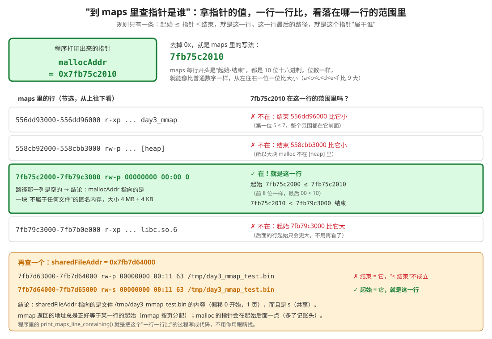
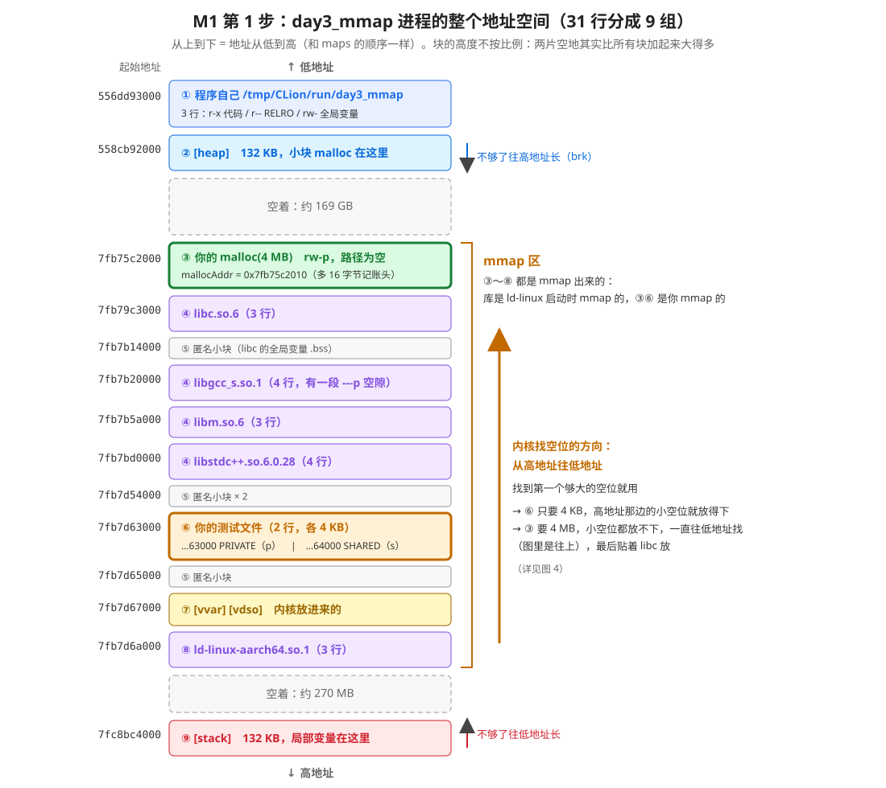
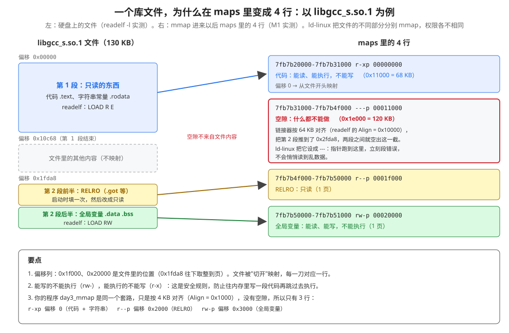
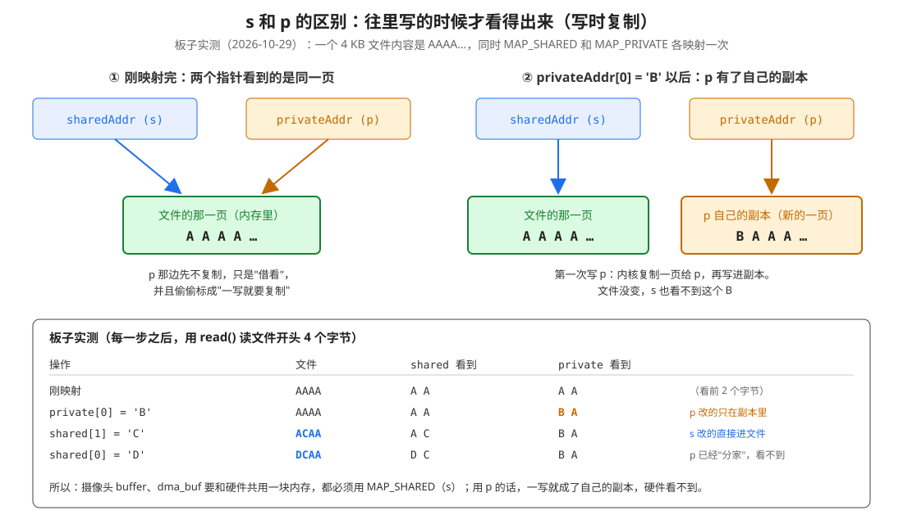
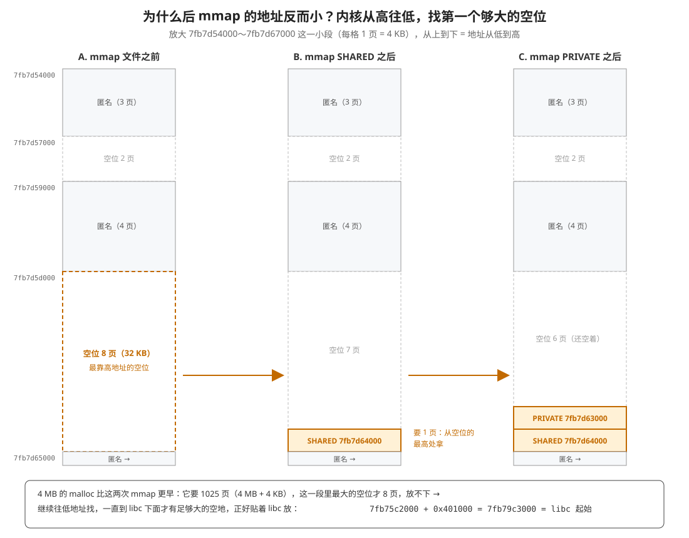

# 1 - 理解 M1 的运行结果：到 /proc/self/maps 里查指针是谁

> 数据来源：2026-10-29 在 RK3588 上跑 day3_mmap 的 M1 第 1 步（malloc 4 MB + 同一个文件 mmap 两次），完整输出见文末附录。
> 另外两份实测：`readelf -l` 看库文件和程序文件的段（第 4.1 节），一个写时复制小探针（第 4.4 节）。
>
> 相关文档：[readme.md](../readme.md)（M1～M4 的计划）、[具体编码day3_mmap的流程.md](../具体编码day3_mmap的流程.md)（代码）

---

## 0. 先看这里：M1 的目的（一张表）

**M1 的目的：程序运行起来以后，拿每个指针到 `/proc/self/maps` 里查一查，看它背后映射的是谁。**

| 指针从哪来 | maps 里那一行的路径 | 状态 |
|---|---|---|
| `malloc(4 MB)` | 空 → 普通内存 | ✅ 已验证（2026-10-29） |
| `mmap(文件的 fd)` | `/tmp/day3_mmap_test.bin` → 那个文件 | ✅ 已验证（2026-10-29） |
| `mmap(videoFd)` | 应该是 `/dev/video22` → 摄像头 | ⬜ 第 2 步 |
| `mmap(dma_heap 的 fd)` | 待实测 | ⬜ 第 3 步 |

有一点要注意：**malloc 也算在里面**。它不是你直接调的 mmap，但 glibc 在内部替你调了 mmap（超过 128 KB 就这样做，见第 4.3 节），所以 maps 里同样有它的一行。

**理解 M1 只需要会三件事**，本文其他部分当字典，用到再查：

1. 找到指针那一行：`起始 ≤ 指针 < 结束`（第 1.3 节）
2. 看路径：这个指针属于谁
3. 看权限最后一个字母：`s` 共享，`p` 私有（第 4.4 节）

---

## 1. 先说清楚：M1 到底在干什么

### 1.1 一句大白话

**程序里打印出来的指针，只是一个数字。光看这个数字，不知道它指向的是什么。`/proc/self/maps` 是一张表，能查出这个数字"属于谁"。**

### 1.2 打个比方：门牌号和登记簿

- 指针 `0x7fb75c2010` 就像一个**门牌号**。看门牌号，你不知道里面住的是谁。
- 物业有一本**登记簿**，一行一行写着："1～3 号：张家；4～9 号：李家；10～12 号：空着……"
- 你拿着门牌号 **5** 去翻登记簿，看到"4～9 号：李家"，5 在 4～9 之间，于是知道：5 号住的是李家。

`/proc/self/maps` 就是这本登记簿：

| 登记簿 | maps |
|---|---|
| 门牌号 | 指针的值，例如 `0x7fb75c2010` |
| 一行"4～9 号：李家" | 一行 `7fb75c2000-7fb79c3000 ... （路径）` |
| "李家" | 这一行最后的**路径**：一个文件、一个设备（比如 `/dev/video22`）、或者空的 |

### 1.3 "整个 maps 原样打印，用眼睛找"是什么意思

第 1 步的程序做了两件事：

1. 打印三个指针：`mallocAddr`、`sharedFileAddr`、`privateFileAddr`
2. 把 `/proc/self/maps` 整个打印出来（31 行）

"用眼睛找"就是：**拿第 1 件事打印的指针，到第 2 件事打印的 31 行里，一行一行比，找出它落在哪一行的范围里。**



具体做法，拿 `mallocAddr = 0x7fb75c2010` 举例：

1. 去掉 `0x`，写成 `7fb75c2010`。maps 里的地址也是这样写的（10 位十六进制，不带 0x）。
2. 从 maps 第一行往下看，每一行开头是"起始-结束"。
3. 规则只有一条：**起始 ≤ 指针 < 结束**，就是这一行。
4. 比大小的方法：位数一样，就从左往右一位一位比，和比普通数字一样（十六进制里 `a`～`f` 比 `9` 大）。

| maps 的行 | 比较 | 结果 |
|---|---|---|
| `556dd93000-556dd96000 ... day3_mmap` | 第一位 5 < 7，整段都比指针小 | ✗ |
| `558cb92000-558cbb3000 ... [heap]` | 同上 | ✗ |
| `7fb75c2000-7fb79c3000 rw-p 00000000 00:00 0` | `7fb75c2000 ≤ 7fb75c2010`（前 8 位一样，最后 `00 < 10`），并且 `7fb75c2010 < 7fb79c3000` | ✓ **就是这行** |
| `7fb79c3000-... libc.so.6` | 起始比指针大，后面的行只会更大 | ✗ 不用再看 |

找到以后，看这一行的路径列：**空的**。结论：`mallocAddr` 指向一块"不属于任何文件"的内存。

再查一个，`sharedFileAddr = 0x7fb7d64000`：

```
7fb7d63000-7fb7d64000 rw-p 00000000 00:11 63   /tmp/day3_mmap_test.bin   ✗ 结束 = 指针，"< 结束"不成立
7fb7d64000-7fb7d65000 rw-s 00000000 00:11 63   /tmp/day3_mmap_test.bin   ✓ 起始 = 指针
```

结论：`sharedFileAddr` 指向的是文件 `/tmp/day3_mmap_test.bin` 的内容，权限里是 `s`（共享）。

> **小规律**：mmap 返回的地址，总是**正好等于**某一行的起始，因为 mmap 是一页一页分配的。malloc 返回的地址会在起始**后面一点**，因为 glibc 在前面放了一个记账头（第 4.3 节）。

### 1.4 程序替你找：print_maps_line_containing()

用眼睛找很累。第 2、3 步的代码里有 `print_maps_line_containing(label, address)`，做的就是上面这件事：一行一行读 maps，用 `parse_hex` 把"起始""结束"变成数字，判断 `起始 <= address < 结束`，找到就打印那一行。代码见 [具体编码day3_mmap的流程.md](../具体编码day3_mmap的流程.md) 第 2.4 节。

### 1.5 为什么要学这个

你之前问过："mmap 就是把一个 fd 变成一个能操作的指针？"
M1 就是这句话的**证据**：mmap 返回的指针，在登记簿里那一行写着 fd 背后的东西。

| 现在（第 1 步） | 第 2、3 步会看到 |
|---|---|
| mmap 文件 → 那一行写着 `/tmp/day3_mmap_test.bin` | mmap 摄像头 → 那一行写着 `/dev/video22` |
| malloc → 那一行是空的 | mmap dma_buf → 那一行写着什么？（等实测） |

---

## 2. 一行的 6 列


| 列 | 例子 | 意思 |
|---|---|---|
| ① 地址范围 | `7fb7d64000-7fb7d65000` | 这一段占的虚拟地址。大小 = 结束 − 起始 = `0x1000` = 4096 字节 = 1 页 |
| ② 权限 | `rw-s` | 读 / 写 / 执行 / 共享或私有，见下面 |
| ③ 文件偏移 | `00000000` | 从文件的第几个字节开始映射，就是 mmap 的最后一个参数 |
| ④ 设备号 | `00:11` | 文件在哪个盘。`00:00` 表示不是文件 |
| ⑤ inode | `63` | 文件在这个盘上的编号。④⑤ 都一样 = 同一个文件 |
| ⑥ 路径 | `/tmp/day3_mmap_test.bin` | 这一段属于谁。空 = 匿名内存；`[heap]` 这类方括号 = 内核起的名字 |

权限列 4 个字母，每个位置只有两种可能：

| 位置 | 字母 | 对应 mmap 的参数 |
|---|---|---|
| 第 1 位 | `r` 能读 / `-` 不能 | `PROT_READ` |
| 第 2 位 | `w` 能写 / `-` 不能 | `PROT_WRITE` |
| 第 3 位 | `x` 能执行 / `-` 不能 | `PROT_EXEC` |
| 第 4 位 | `s` 共享 / `p` 私有 | `MAP_SHARED` / `MAP_PRIVATE` |

你代码里写的 `PROT_READ | PROT_WRITE, MAP_SHARED`，在这一列就变成 `rw-s`。

**设备号 `00:11` 是什么**：在板子上查过 `mount`：

```
tmpfs on /tmp type tmpfs (rw,relatime,size=8167340k,...)
```

`/tmp` 是 **tmpfs**，也就是放在内存里的文件系统，断电就没了。`/usr/lib` 里的库在 eMMC 上，所以设备号是 `b3:06`。

---

## 3. 31 行分成 9 组

31 行看起来很乱，其实按**路径**分组，只有 9 组：

| 组 | 路径 | 行数 | 是什么 |
|:---:|---|:---:|---|
| ① | `/tmp/CLion/run/day3_mmap` | 3 | 你的程序自己 |
| ② | `[heap]` | 1 | 小块 malloc 用的堆 |
| ③ | 空，4 MB | 1 | **你的 malloc(4 MB)** |
| ④ | `libc.so.6`、`libgcc_s.so.1`、`libm.so.6`、`libstdc++.so.6.0.28` | 3 或 4 行一个 | 动态库 |
| ⑤ | 空，零碎小块 | 4 | 动态库的全局变量等 |
| ⑥ | `/tmp/day3_mmap_test.bin` | 2 | **你 mmap 的文件** |
| ⑦ | `[vvar]`、`[vdso]` | 2 | 内核放进来的两小段 |
| ⑧ | `ld-linux-aarch64.so.1` | 3 | 动态加载器 |
| ⑨ | `[stack]` | 1 | 栈 |

3 + 1 + 1 + (3+4+3+4) + 4 + 2 + 2 + 3 + 1 = **31 行** ✓

画成图，从上到下就是地址从低到高：



---

## 4. 一组一组看

### 4.1 ① 程序自己、④ 动态库：一个文件被"切开"映射成好几行

**大白话**：程序文件和库文件里，有的部分是代码（只能执行），有的部分是变量（要能写）。为了安全，它们要用不同的权限。可是一行 maps 只能有一种权限，所以一个文件被切成几段，分别 mmap，就变成了几行。

先看你的程序：

```
556dd93000-556dd96000 r-xp 00000000 00:11 73   /tmp/CLion/run/day3_mmap
556dd96000-556dd97000 r--p 00002000 00:11 73   /tmp/CLion/run/day3_mmap
556dd97000-556dd98000 rw-p 00003000 00:11 73   /tmp/CLion/run/day3_mmap
```

三行的路径都是程序文件，**偏移列分别是 0、0x2000、0x3000**：从文件的不同位置开始映射。

用 `readelf -l` 看程序文件里分了哪几段（2026-10-29 实测）：

```
  LOAD  0x000000 ... R E 0x1000     ← 第 1 段：能读、能执行
  LOAD  0x002c30 ... RW  0x1000     ← 第 2 段：能读、能写
  GNU_RELRO 0x002c30 ... R          ← 第 2 段的前一部分：启动后改成只读

 Section to Segment mapping:
   02  ... .init .plt .text .fini .rodata .eh_frame_hdr .eh_frame   ← 第 1 段里有什么
   03  .init_array .fini_array .data.rel.ro .dynamic .got .data .bss ← 第 2 段里有什么
   08  .init_array .fini_array .data.rel.ro .dynamic .got            ← RELRO 包含什么
```

对应起来：

| maps 的行 | 里面是什么 | 为什么是这个权限 |
|---|---|---|
| `r-xp` 偏移 0 | `.text` 代码 + `.rodata` 字符串常量（比如 `"mallocAddr      = %p"`） | 代码要执行；都不需要改 |
| `r--p` 偏移 0x2000 | RELRO：`.got` 等，存放"函数在哪"的表 | ld-linux 启动时要填一次地址，填完改成只读，防止被人篡改 |
| `rw-p` 偏移 0x3000 | `.data .bss`：全局变量 | 程序运行时要改 |

> ⚠️ **更正**：之前聊天里我说 `r--p` 那行是"字符串常量"，说错了。readelf 显示 `.rodata`（字符串常量）在第 1 段，也就是 `r-xp` 那行里。`r--p` 那行是 RELRO。

三行都是 `p`（私有）：改全局变量只改内存里的副本，不能写回硬盘上的程序文件。

**动态库是同一个套路，但 libgcc_s 和 libstdc++ 多了一行 `---p`**：



```
7fb7b20000-7fb7b31000 r-xp 00000000 b3:06 2337  /usr/lib/libgcc_s.so.1   ← 代码
7fb7b31000-7fb7b4f000 ---p 00011000 b3:06 2337  /usr/lib/libgcc_s.so.1   ← 空隙！
7fb7b4f000-7fb7b50000 r--p 0001f000 b3:06 2337  /usr/lib/libgcc_s.so.1   ← RELRO
7fb7b50000-7fb7b51000 rw-p 00020000 b3:06 2337  /usr/lib/libgcc_s.so.1   ← 全局变量
```

从板子上拉下 libgcc_s.so.1，用 `readelf -l` 看（2026-10-29 实测）：

```
  LOAD  0x000000 0x0000000000000000 ... 0x010c68 0x010c68 R E 0x10000
  LOAD  0x01fda8 0x000000000002fda8 ... 0x000408 0x0006c0 RW  0x10000
```

- 最后一列 `0x10000` 是对齐：**64 KB**。（你的程序是 `0x1000` = 4 KB。）
- 链接器为了让代码段和数据段不落在同一个 64 KB 块里，把第 2 段推到了地址 `0x2fda8`。
- 第 1 段到 `0x11000` 就结束了（`0x10c68` 往上取整到页），第 2 段从 `0x2f000` 开始（`0x2fda8` 往下取整到页）。中间 `0x2f000 − 0x11000 = 0x1e000` = 120 KB，就是 `---p` 那一行：`7fb7b4f000 − 7fb7b31000 = 0x1e000` ✓
- ld-linux 把这段空隙设成"不能读、不能写、不能执行"。万一指针跑到这里，程序立刻段错误，不会悄悄读到乱数据。

**规律**：能写的不能执行（`rw-`），能执行的不能写（`r-x`）。这是一条安全规则：防止有人往内存里写一段代码，再跳过去执行。

**为什么有 libstdc++ 和 libm**：你写的是 C++（用了 `<iostream>`），需要 libstdc++；libstdc++ 自己又用到 libm（数学库）。libgcc_s 是 C++ 异常等功能要用的。

### 4.2 ② [heap]：小块 malloc 在这里

```
558cb92000-558cbb3000 rw-p 00000000 00:00 0    [heap]        ← 0x21000 = 132 KB
```

- 程序里的小块内存，比如 `fopen` 返回的 `FILE`、printf 的输出缓冲区，都从这里分。
- 不够了，glibc 会让它**往高地址长**（系统调用 `brk`）。
- **你的 4 MB 不在这里**，见下一节。

### 4.3 ③ 你的 malloc(4 MB)：匿名映射

```
7fb75c2000-7fb79c3000 rw-p 00000000 00:00 0                  ← 路径空，设备号 00:00
mallocAddr = 0x7fb75c2010
```

**为什么不在 [heap] 里**：glibc 有个规矩，**超过 128 KB 的 malloc 不走堆，直接调 mmap 单独映射一块**（这个界限叫 `M_MMAP_THRESHOLD`，默认 128 KB）。因为大块单独映射，free 的时候可以整块还给系统；放在堆中间的话，还回去很麻烦。

**为什么路径是空的**：这块用的是 `mmap(..., MAP_PRIVATE | MAP_ANONYMOUS, -1, 0)`，没有 fd，不对应任何文件，叫**匿名映射**。

**为什么指针比起始多 16 字节**：

```
起始       7fb75c2000  ┌──────────────────────┐
                       │ 16 字节记账头          │ ← glibc 记"这块有多大"，free 时要用
mallocAddr 7fb75c2010  ├──────────────────────┤
                       │ 你能用的 4 MB          │
                       │                      │
结束       7fb79c3000  └──────────────────────┘
```

**为什么是 4 MB + 4 KB**：4 MB + 16 字节的头，比 4 MB 多了一点点；mmap 只能按页（4 KB）给，所以向上取整，多了一整页。`0x7fb79c3000 − 0x7fb75c2000 = 0x401000` = 4 MB + 4 KB ✓

### 4.4 ⑥ 你 mmap 的文件：s 和 p

```
7fb7d63000-7fb7d64000 rw-p 00000000 00:11 63   /tmp/day3_mmap_test.bin   ← privateFileAddr
7fb7d64000-7fb7d65000 rw-s 00000000 00:11 63   /tmp/day3_mmap_test.bin   ← sharedFileAddr
```

路径、偏移、设备号、inode 全一样，**只有权限第 4 个字母不同**。

光看 maps 看不出 `s` 和 `p` 用起来有什么区别。为了看清楚，我在板子上跑了一个小探针（2026-10-29）：一个 4 KB 文件，内容是 `AAAA…`，同时用 SHARED 和 PRIVATE 各映射一次，然后往里写，每写一次就用 `read()` 读文件开头：



| 操作 | 文件开头 | shared 看到 | private 看到 |
|---|---|---|---|
| 刚映射 | `AAAA` | `A A` | `A A` |
| `private[0] = 'B'` | `AAAA` | `A A` | **`B A`** |
| `shared[1] = 'C'` | **`ACAA`** | `A C` | `B A` |
| `shared[0] = 'D'` | **`DCAA`** | `D C` | `B A` |

- **`s`（MAP_SHARED）**：改了就是改文件本身。别的进程映射同一个文件，也能马上看到。
- **`p`（MAP_PRIVATE）**：第一次写的时候，内核悄悄复制一页给你，你改的是副本，文件不变。这叫**写时复制**（copy-on-write）。
- 第 3 行很有意思：private 已经有了自己的副本，所以 shared 后来写的 `C`，private **看不到**（它的第 2 个字节还是 `A`）。复制以后两边就"分家"了。

**和摄像头有什么关系**：摄像头 buffer、dma_buf 要和硬件**共用同一块内存**，所以都必须用 `MAP_SHARED`。如果用 `MAP_PRIVATE`，CPU 一写就变成自己的副本，编码器硬件根本看不到。

探针代码（不在工程里，只是验证用）：

```c
char *sharedAddr  = mmap(0, 4096, PROT_READ | PROT_WRITE, MAP_SHARED,  fd, 0);
char *privateAddr = mmap(0, 4096, PROT_READ | PROT_WRITE, MAP_PRIVATE, fd, 0);
privateAddr[0] = 'B';   // 然后 read() 文件 → 还是 AAAA
sharedAddr[1]  = 'C';   // 然后 read() 文件 → ACAA
```

### 4.5 ⑦ [vvar] 和 [vdso]：内核送的小礼物

```
7fb7d67000-7fb7d69000 r--p 00000000 00:00 0    [vvar]
7fb7d69000-7fb7d6a000 r-xp 00000000 00:00 0    [vdso]
```

- 平时调用 `gettimeofday` 这类函数，要"进内核"一趟，比较慢。
- 内核把一小段代码（`[vdso]`，能执行 `r-x`）和当前时间等数据（`[vvar]`，只读 `r--`）直接映射进每个进程。这样读时间**不用进内核**，很快。
- 你的 `log.h` 每打一条日志都调一次 `gettimeofday`（取时间戳 `00:24:19.894`），用的就是这里的代码。

### 4.6 ⑧ ld-linux-aarch64.so.1：搬运工

程序一启动，先运行的不是你的 `main()`，而是它。它读你的程序文件，看要用哪些库，然后把 libc、libstdc++ 这些库一个一个 mmap 进来（第 4.1 节那些行都是它映射的），全部弄好以后才跳到 `main()`。

### 4.7 ⑨ [stack]：栈

```
7fc8bc4000-7fc8be5000 rw-p 00000000 00:00 0    [stack]     ← 0x21000 = 132 KB
```

- 局部变量都在这里，比如 `print_whole_maps()` 里的 `char line[512]`、`create_test_file()` 里的 `char content[4096]`。
- 不够用时**往低地址长**（和 heap 方向相反）。
- 它在最高处，和 mmap 区之间隔了约 270 MB 的空地，给它留出长大的地方。

### 4.8 ⑤ 零碎的匿名小块

4 行路径为空的小块（`7fb7b14000`、`7fb7d54000`、`7fb7d59000`、`7fb7d65000` 开头的）。一般是动态库的 `.bss`（没有初值的全局变量，不需要从文件里读，所以是匿名的）、ld-linux 自己用的内存等。不用记，知道"路径空 + 很小 = 库或加载器自己用的"就行。

---

## 5. 整体布局，和"后 mmap 的地址反而小"

### 5.1 从低到高

```
低地址  ① 程序自己          556dd93000
        ② [heap]          558cb92000   ↓ 往高地址长
        ……空着约 169 GB……
        ③～⑧ mmap 区       7fb75c2000 ～ 7fb7d8f000
        ……空着约 270 MB……
高地址  ⑨ [stack]          7fc8bc4000   ↑ 往低地址长
```

### 5.2 为什么后 mmap 的地址反而小

你代码里先 mmap SHARED，后 mmap PRIVATE，可是 PRIVATE 的地址（`7fb7d63000`）比 SHARED（`7fb7d64000`）小。

规则：**每次 mmap，内核从高地址往低地址，找第一个够大的空位**。



- mmap 文件之前，libstdc++ 后面有一个 8 页（32 KB）的空位 `7fb7d5d000～7fb7d65000`，它是 mmap 区里最靠高地址、又放得下 1 页的空位。
- SHARED 要 1 页 → 从这个空位的**最高处**拿 → `7fb7d64000`。
- PRIVATE 也要 1 页 → 还是这个空位，最高处那页已经被拿走了 → 拿下面一页 → `7fb7d63000`。

**4 MB 的 malloc 为什么在库的下面**：它比文件早。它要 1025 页，上面这些小空位都放不下，内核只好一直往低地址找，直到 libc 下面才有足够大的空地，于是正好贴着 libc 放：

```
7fb75c2000 + 0x401000 = 7fb79c3000 = libc 的起始地址 ✓
```

---

## 6. M1 的问题，第 1 步能回答的

| # | 问题 | 答案（2026-10-29 实测） |
|---|---|---|
| 1 | malloc 那一行，路径为什么是空的？ | 4 MB 超过 128 KB，glibc 直接用匿名 mmap 拿内存，不对应任何文件 |
| 5 | SHARED 和 PRIVATE 两行，只有哪一列不一样？ | 权限列第 4 个字母：`s` / `p`。区别要写的时候才看得出来（第 4.4 节） |
| 2 | 摄像头 4 块 buffer 是 4 行还是 1 行？ | 等第 2 步 |
| 3 | 摄像头那几行的偏移，和 mem_offset 一样吗？ | 等第 2 步 |
| 4 | dma_heap 那一行的路径是什么？ | 等第 3 步 |

---

## 7. 自己动手练一练（可选）

在 `run_m1_maps()` 里加几行，打印下面这些地址，再到 maps 里找它们在哪一组。先猜，再看：

```cpp
static int g_globalCounter = 0;          // 放在函数外面
...
int localValue = 0;
const char* messageText = "hello";
LOGI(kTag, "&g_globalCounter = %p", static_cast<void*>(&g_globalCounter));
LOGI(kTag, "&localValue      = %p", static_cast<void*>(&localValue));
LOGI(kTag, "messageText      = %p", static_cast<const void*>(messageText));
LOGI(kTag, "run_m1_maps      = %p", reinterpret_cast<void*>(&run_m1_maps));
void* smallAddr = malloc(100);
LOGI(kTag, "malloc(100)      = %p", smallAddr);
```

| 地址 | 你猜在哪一组、哪一行？ |
|---|---|
| `&g_globalCounter` | |
| `&localValue` | |
| `messageText`（字符串常量） | |
| `run_m1_maps`（函数本身） | |
| `malloc(100)` | |

<details>
<summary>答案（先猜再点开）</summary>

- `&g_globalCounter`：① 程序自己的 `rw-p` 那行（`.bss`）
- `&localValue`：⑨ `[stack]`
- `messageText`：① 程序自己的 `r-xp` 那行（`.rodata`，和代码在一起）
- `run_m1_maps`：① 程序自己的 `r-xp` 那行（`.text`）
- `malloc(100)`：② `[heap]`（100 字节远小于 128 KB）

</details>

---

## 附录：完整输出（2026-10-29 00:24:19，去掉了时间前缀和空行）

```
mallocAddr      = 0x7fb75c2010
sharedFileAddr  = 0x7fb7d64000
privateFileAddr = 0x7fb7d63000

556dd93000-556dd96000 r-xp 00000000 00:11 73      /tmp/CLion/run/day3_mmap
556dd96000-556dd97000 r--p 00002000 00:11 73      /tmp/CLion/run/day3_mmap
556dd97000-556dd98000 rw-p 00003000 00:11 73      /tmp/CLion/run/day3_mmap
558cb92000-558cbb3000 rw-p 00000000 00:00 0       [heap]
7fb75c2000-7fb79c3000 rw-p 00000000 00:00 0
7fb79c3000-7fb7b0e000 r-xp 00000000 b3:06 2236    /usr/lib/libc.so.6
7fb7b0e000-7fb7b12000 r--p 0014a000 b3:06 2236    /usr/lib/libc.so.6
7fb7b12000-7fb7b14000 rw-p 0014e000 b3:06 2236    /usr/lib/libc.so.6
7fb7b14000-7fb7b20000 rw-p 00000000 00:00 0
7fb7b20000-7fb7b31000 r-xp 00000000 b3:06 2337    /usr/lib/libgcc_s.so.1
7fb7b31000-7fb7b4f000 ---p 00011000 b3:06 2337    /usr/lib/libgcc_s.so.1
7fb7b4f000-7fb7b50000 r--p 0001f000 b3:06 2337    /usr/lib/libgcc_s.so.1
7fb7b50000-7fb7b51000 rw-p 00020000 b3:06 2337    /usr/lib/libgcc_s.so.1
7fb7b5a000-7fb7bce000 r-xp 00000000 b3:06 2524    /usr/lib/libm.so.6
7fb7bce000-7fb7bcf000 r--p 00073000 b3:06 2524    /usr/lib/libm.so.6
7fb7bcf000-7fb7bd0000 rw-p 00074000 b3:06 2524    /usr/lib/libm.so.6
7fb7bd0000-7fb7d3e000 r-xp 00000000 b3:06 2846    /usr/lib/libstdc++.so.6.0.28
7fb7d3e000-7fb7d45000 ---p 0016e000 b3:06 2846    /usr/lib/libstdc++.so.6.0.28
7fb7d45000-7fb7d50000 r--p 00175000 b3:06 2846    /usr/lib/libstdc++.so.6.0.28
7fb7d50000-7fb7d54000 rw-p 00180000 b3:06 2846    /usr/lib/libstdc++.so.6.0.28
7fb7d54000-7fb7d57000 rw-p 00000000 00:00 0
7fb7d59000-7fb7d5d000 rw-p 00000000 00:00 0
7fb7d63000-7fb7d64000 rw-p 00000000 00:11 63      /tmp/day3_mmap_test.bin
7fb7d64000-7fb7d65000 rw-s 00000000 00:11 63      /tmp/day3_mmap_test.bin
7fb7d65000-7fb7d67000 rw-p 00000000 00:00 0
7fb7d67000-7fb7d69000 r--p 00000000 00:00 0       [vvar]
7fb7d69000-7fb7d6a000 r-xp 00000000 00:00 0       [vdso]
7fb7d6a000-7fb7d8b000 r-xp 00000000 b3:06 1890    /usr/lib/ld-linux-aarch64.so.1
7fb7d8b000-7fb7d8d000 r--p 00020000 b3:06 1890    /usr/lib/ld-linux-aarch64.so.1
7fb7d8d000-7fb7d8f000 rw-p 00022000 b3:06 1890    /usr/lib/ld-linux-aarch64.so.1
7fc8bc4000-7fc8be5000 rw-p 00000000 00:00 0       [stack]
```

每次运行地址都会变（ASLR：地址空间随机化，防止被攻击时猜到地址），但**各组的相对顺序、大小、权限、路径都一样**。对比 2026-10-29 的第一次运行：mallocAddr 是 `0x7f8d162010`，末尾同样是 `010`，所在那一行同样是 `0x401000` 大。
