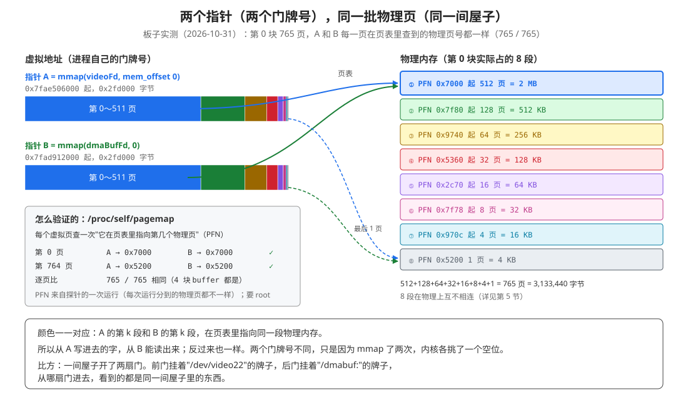
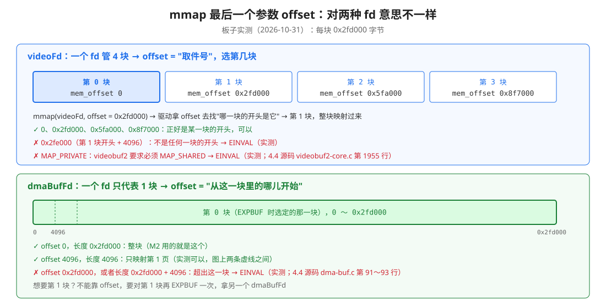
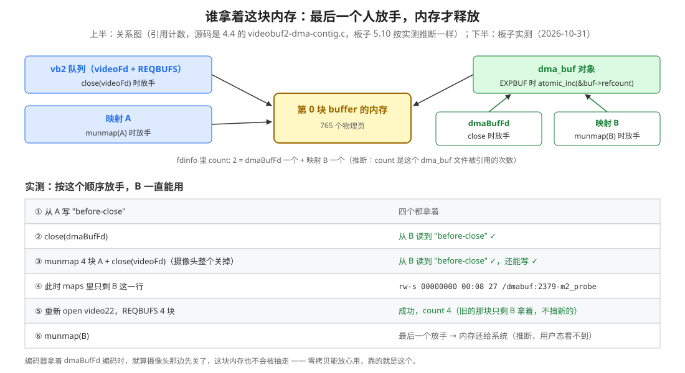

# 2 - 理解 M2 的运行结果：同一块内存，两个指针

> 数据来源：2026-10-31 在 RK3588（内核 5.10.160）上跑 day3_mmap 的 `run_m2_two_pointers()`，完整输出见文末附录 A。
> 另外跑了两个探针程序，补充了几项实测：pagemap 查物理页、fdinfo、只读 EXPBUF、offset 边界、关掉摄像头以后 B 还能不能用（附录 B）。
>
> 代码看不懂怎么串起来的，先看 [5-理解M2代码的串联流程.md](5-理解M2代码的串联流程.md)（7 步流程图）。
>
> 相关文档：[readme.md](../readme.md)（M1～M4 的计划）、[具体编码day3_mmap的流程.md](../具体编码day3_mmap的流程.md) 第 4 节（M2 代码）、[1-理解M1的运行结果.md](1-理解M1的运行结果.md)（maps 每一列的意思）、[open_ioctl_mmap是什么.md](../../day3_camera_cache_test/doc/open_ioctl_mmap是什么.md) 第 1 节（虚拟地址和页表）

---

## 0. 先看这里：M2 的目的和结论

**M2 的目的：证明 `mmap(videoFd, mem_offset)` 拿到的指针 A，和 `mmap(EXPBUF 的 dmaBufFd, 0)` 拿到的指针 B，背后是同一块物理内存。**

为什么要证明这个？day3_cam2h264 里，CPU 用指针 A 看画面，编码器拿 EXPBUF 的 fd 去编码，我们一直说这是"零拷贝"。零拷贝成立的前提就是：**这两个东西指的是同一块内存**。以前是看 bufinfo 间接推出来的，这次直接动手验证。

| 实验 | 结果 | 说明 |
|---|---|---|
| A、B 两个地址 | `0x7fae506000`、`0x7fad912000`，不一样 | 两次 mmap，内核各挑了一个空位（第 2 节） |
| 从 A 开头写，从 B 开头读 | 读到 `丝袜A` ✅ | |
| 从 B 末尾写，从 A 末尾读 | 读到 `丝袜B at the end` ✅ | 开头和末尾都一样 → 整块都是同一块 |
| pagemap 逐页查物理页号 | 765 页里 765 页相同 ✅（4 块 buffer 都是） | 最直接的证据（第 2.3 节） |
| maps 里 A 那一行 | `/dev/video22` | |
| maps 里 B 那一行 | `/dmabuf:2349-day3_mmap` | 同一块内存，在登记簿里登记成了两个"文件"（第 3 节） |
| 程序退出码 | 0 | `run_m2_two_pointers()` 两个方向都通过才返回 0 |

**理解 M2 只需要会三件事**：

1. 指针是虚拟地址，靠页表找到物理内存；**两个虚拟地址可以指向同一批物理页**（第 2 节）
2. videoFd 管 4 块，offset 用来选第几块；dmaBufFd 只代表 1 块，offset 是块里的位置（第 4 节）
3. 内存由引用计数管着，**最后一个人放手才释放**，所以编码器拿着 dmaBufFd 时，内存不会被抽走（第 7 节）

---

## 1. 运行结果

```
pointerA = 0x7fae506000  （mmap(videoFd 3, mem_offset 0x00000000)
pointerB = 0x7fad912000  （mmap(dmaBufFd 4, 0)
pointerA 0x7fae506000 -> 7fae506000-7fae803000 rw-s 00000000 00:05 182   /dev/video22
pointerB 0x7fad912000 -> 7fad912000-7fadc0f000 rw-s 00000000 00:08 24    /dmabuf:2349-day3_mmap
A pointer 写入：丝袜A
B pointer 读取：丝袜A
isAToBSame :1
B pointer尾部 写入：丝袜B at the end
A pointer尾部 读取：丝袜B at the end
isBToASame :1
```

（这是改代码前的第一次运行，行尾少了一个右括号 `）`；改完以后又跑了一次，结果一样，见附录 A。）

代码一共 7 步，和输出对应起来：

| 步 | 代码做了什么 | 输出 |
|:---:|---|---|
| 1 | `open_camera_and_map_buffers()`：open → S_FMT → REQBUFS → 4 块 QUERYBUF + mmap | 第 0 块的地址就是 **pointerA** |
| 2 | `VIDIOC_EXPBUF` 第 0 块，flags = `O_RDWR \| O_CLOEXEC` | 拿到 `dmaBufFd 4` |
| 3 | `mmap(dmaBufFd, 偏移 0)` | **pointerB** |
| 4 | 打印 A、B，到 maps 里各找一行 | 两个地址、两行 |
| 5 | A 开头清零 64 字节，写 `丝袜A`，从 B 开头读 | `isAToBSame :1` |
| 6 | B 末尾 64 字节清零，写 `丝袜B at the end`，从 A 末尾读 | `isBToASame :1` |
| 7 | munmap B → close dmaBufFd → close_camera | |

> 第 5、6 步为什么要先 `memset(…, 0, 64)`：还没 STREAMON，buffer 里是上次留下的随机内容。先清零，`strcpy` 写进去的字后面就一定跟着 `\0`，`strcmp` 和 `%s` 读到这里就会停下。

---

## 2. 两个地址不一样，为什么读写的是同一块

### 2.1 一句大白话

**指针是"门牌号"（虚拟地址）。CPU 拿着门牌号，到页表里查"这个门牌号对应哪间屋子（物理页）"。A 和 B 是两个门牌号，但页表里写的是同一批屋子。**

### 2.2 打个比方：一间屋子开两扇门

- 一间屋子开了两扇门：前门挂"/dev/video22"的牌子，后门挂"/dmabuf:"的牌子
- 从前门进去放一张纸条（从 A 写），从后门进去就能看到这张纸条（从 B 读）
- 门牌号不同，只是因为 mmap 了两次，每次内核都另挑一个空位当门



### 2.3 直接证据：/proc/self/pagemap

读写实验只能说明"写进去的东西对面能看到"。想直接看到"是同一批物理页"，可以用 `/proc/self/pagemap`。

**pagemap 是什么**：内核提供的另一张表。maps 是"按段登记"（这一段来自哪个文件），pagemap 是"按页登记"（第几个虚拟页对应第几个物理页）。每个虚拟页占 8 个字节，低 55 位就是物理页号（PFN，Page Frame Number）。

查法：

```cpp
// 虚拟地址 → 第几个虚拟页 → 在 pagemap 里的位置（每页 8 字节）
const off_t entryOffset = (reinterpret_cast<uintptr_t>(address) / 4096) * 8;
uint64_t entry = 0;
pread(pagemapFd, &entry, 8, entryOffset);
const uint64_t pfn = entry & ((1ULL << 55) - 1);   // 低 55 位 = 物理页号
```

探针把 4 块 buffer 的每一页都查了一遍，A 和 B 逐页比：

```
buf 0: pages 765  A==B pages 765/765
buf 1: pages 765  A==B pages 765/765
buf 2: pages 765  A==B pages 765/765
buf 3: pages 765  A==B pages 765/765
```

**4 块 × 765 页，每一页 A 和 B 查到的物理页号都相同。** 这就是"同一块内存"最直接的证据。

> 注意两点：
> - 要 root 才能读到真的 PFN（adb shell 默认就是 root）。不是 root 时，内核会把 PFN 填成 0。
> - 要先碰一下这一页（读或写一个字节），页表项才会建立。没碰过的页 `present = 0`，查不到 PFN（缺页懒分配，见 open_ioctl_mmap是什么.md）。

---

## 3. maps 里两行对比


| 列 | A | B | 说明 |
|---|---|---|---|
| 地址范围 | `7fae506000-7fae803000` | `7fad912000-7fadc0f000` | 起点不同，大小都是 `0x2fd000` = 3,133,440 = QUERYBUF 的 length |
| 权限 | `rw-s` | `rw-s` | 都是共享映射。摄像头写、CPU 读，必须是 `s` |
| 偏移 | `00000000` | `00000000` | A 传的 mem_offset 本来就是 0（第 0 块），B 传的也是 0 |
| 设备 | `00:05` | `00:08` | `00:05` 是 /dev 所在的 devtmpfs；`00:08` 是 dma_buf 自己的小文件系统 |
| inode | `182` | `24` | `stat /dev/video22` 实测 st_ino 182；dma_buf 每新建一个，inode 就加 1 |
| 路径 | `/dev/video22` | `/dmabuf:2349-day3_mmap` | **同一块内存，登记成了两个"文件"** |

**B 那一行的路径怎么读**：

- `/dmabuf:` 是固定的前缀，说明"这一段来自一个 dma_buf"
- `2349-day3_mmap` 是这个 dma_buf 的名字，等于 **进程号-程序名**。探针里 `/proc/self/fdinfo/<dmaBufFd>` 的 `name` 一栏也是这个格式（`2379-m2_probe`）
- 名字是谁起的：代码里没有调过设置名字的 ioctl（`DMA_BUF_SET_NAME`），所以**推断**是板子的内核导出时自动起的（手上没有 5.10 的源码，没核对）

**maps 能说明什么、不能说明什么**：

- 能说明：A 是从摄像头设备映射来的，B 是从一个 dma_buf 映射来的。这正好回答了 M2 的问题 2
- 不能说明：A 和 B 是同一块。maps 只登记"这一段从哪个文件来"，不登记物理页。所以第 2 节要靠读写实验和 pagemap

### 3.1 fd 背后是谁（探针实测）

```
fd 3 -> /dev/video22             st_dev 0:5  st_ino 182  st_size 0
fd 4 -> /dmabuf:2379-m2_probe    st_dev 0:8  st_ino 27   st_size 3133440
```

`/proc/self/fd/4` 指向的名字，和 maps 里 B 那一行的路径一模一样。dma_buf 文件的 `st_size` 就是 buffer 大小；设备文件的 `st_size` 是 0。

`/proc/self/fdinfo/4`：

```
pos:      0
flags:    02000002          ← 八进制：02000000 = O_CLOEXEC，2 = O_RDWR，正是 EXPBUF 时填的 flags
mnt_id:   9
ino:      27
size:     3133440
count:    2
exp_name: videobuf2_cma_sg  ← 导出者（exporter）：Rockchip 的 videobuf2 分配器
name:     2379-m2_probe
```

- **exp_name = videobuf2_cma_sg**：说明这个 dma_buf 是摄像头驱动（videobuf2）导出的，用的是 Rockchip 自己的 `cma_sg` 分配器。M1 第 6.1 节说"板子用的是 videobuf2_cma_sg"，这里就是出处
- **count = 2**：**推断**是这个 dma_buf 文件被引用了 2 次：dmaBufFd 一次，映射 B 一次（第 7 节）

---

## 4. 为什么 A 传 mem_offset，B 传 0

这是 M2 的问题 3。两种 fd，mmap 最后一个参数 offset 的意思不一样。



### 4.1 videoFd：一个 fd 管 4 块，offset 是"取件号"

videoFd 背后有 4 块 buffer。mmap 只有一个 fd 参数，驱动怎么知道你要第几块？靠 offset。QUERYBUF 给每块发了一个"取件号"（mem_offset：0、0x2fd000、0x5fa000、0x8f7000），mmap 时把它填进 offset，videobuf2 用它找到对应的那一块（4.4 源码 `videobuf2-core.c` 第 1978 行 `__find_plane_by_offset`）。

探针实测：

| 调用 | 结果 |
|---|---|
| `mmap(videoFd, offset = 0x2fe000)`（第 1 块开头 + 4096） | **EINVAL**：不是任何一块的开头，找不到 |
| `mmap(videoFd, …, MAP_PRIVATE, …)` | **EINVAL**：videobuf2 要求必须 MAP_SHARED（4.4 源码 `videobuf2-core.c` 第 1955～1957 行） |

所以 offset 在这里只能填 mem_offset，**不能当"块里第几个字节"用**。

### 4.2 dmaBufFd：一个 fd 只代表 1 块，offset 是块里的位置

EXPBUF 时已经指定了 `index = 0`，拿到的 dmaBufFd 只代表第 0 块。这时 offset 恢复了普通文件的意思：从这一块的第几个字节开始映射。

探针实测：

| 调用 | 结果 |
|---|---|
| offset 0，长度 0x2fd000 | ✅ 整块（M2 用的就是这个） |
| offset 4096，长度 4096 | ✅ 只映射第 1 页 |
| offset 0x2fd000，长度 0x2fd000 | **EINVAL**：超出这一块 |
| offset 0，长度 0x2fd000 + 4096 | **EINVAL**：超出这一块 |

EINVAL 的出处，4.4 源码 `drivers/dma-buf/dma-buf.c` 第 90～93 行：

```c
/* check for overflowing the buffer's size */
if (vma->vm_pgoff + ((vma->vm_end - vma->vm_start) >> PAGE_SHIFT) >
    dmabuf->size >> PAGE_SHIFT)
	return -EINVAL;
```

意思是：起点（第几页）+ 长度（几页）不能超过 buffer 的总页数。

**想映射第 1 块怎么办？** 不能靠 offset，要对第 1 块再 EXPBUF 一次，拿另一个 dmaBufFd。

---

## 5. 意外发现：这块内存在物理上不连续

用 pagemap 查物理页号时，顺便看了一下 765 页是不是挨着的。结果**不是**：第 0 块分成了 8 段。

```
buf 0: [0x7000 x512] [0x7f80 x128] [0x9740 x64] [0x5360 x32] [0x2c70 x16] [0x7f78 x8] [0x970c x4] [0x5200 x1]
buf 1: [0x9400 x512] [0x5180 x128] [0x7540 x64] [0x50c0 x32] [0x2c80 x16] [0x2c68 x8] [0x2c64 x4] [0x5201 x1]
buf 2: [0x7600 x512] [0x7580 x128] [0x7380 x64] [0x5100 x32] [0x5170 x16] [0x5358 x8] [0x7d7c x4] [0x5202 x1]
buf 3: [0x7800 x512] [0x7d80 x128] [0x73c0 x64] [0x7360 x32] [0x9710 x16] [0x5120 x12] [0x5203 x1]
```

（`[0x7000 x512]` = 从物理页号 0x7000 开始，连续 512 页。）

**有意思的规律**：765 = 512 + 128 + 64 + 32 + 16 + 8 + 4 + 1，正好是 765 的二进制 `10_1111_1101` 拆开。也就是说，分配器先拿一整块 2 MB，剩下的再按 512 KB、256 KB……一块一块拿，每一块单独都是连续的，但块和块之间不挨着。（buf 3 的 `x12` 是 8 页和 4 页两段刚好挨在一起，被合成了一段。）

**这说明什么**：

- 名字 `cma_sg` 里的 **sg = scatter-gather**（分散 / 聚集），意思就是"一块 buffer 由好几段物理内存拼起来"
- 对 CPU 来说没关系：页表把 8 段拼成了一段连续的虚拟地址，所以 A、B 看起来都是连续的 3 MB
- 对硬件（ISP 往里写、编码器从里读）来说，也需要有东西把 8 段拼起来。**推断**是 RK3588 的 IOMMU（给硬件用的"页表"）在做这件事，这次没有实测
- 每次运行分到的物理页都不一样（图 1 里的 PFN 来自其中一次）

---

## 6. EXPBUF 的两个细节

### 6.1 flags 要带 O_RDWR（实测）

day3_cam2h264 的 EXPBUF 只写了 `flags = O_CLOEXEC`（[day3_cam2h264/src/main.cpp:342](../../day3_cam2h264/src/main.cpp#L342)），拿到的是**只读**的 dma_buf fd。交给编码器没问题，因为编码器只读。M2 要从 B 写，所以要加 `O_RDWR`。

探针用只读的 fd 试了一下：

| 调用 | 结果 |
|---|---|
| `mmap(只读 fd, PROT_READ \| PROT_WRITE, MAP_SHARED)` | **Permission denied（EACCES）** |
| `mmap(只读 fd, PROT_READ, MAP_SHARED)` | ✅ 可以，能读到 A 写进去的内容 |

这条检查不在摄像头驱动里，而是内核通用的 mmap 代码，对所有文件都一样（4.4 源码 `mm/mmap.c` 第 1344～1346 行）：

```c
case MAP_SHARED:
	if ((prot&PROT_WRITE) && !(file->f_mode&FMODE_WRITE))
		return -EACCES;
```

意思是：**打开时没要写权限的文件，不能做"可写的共享映射"**。就像拿着一把只能看的钥匙，想进去搬东西，门卫不让。

EXPBUF 的 flags 是怎么变成 fd 的读写权限的：4.4 源码 `videobuf2-core.c` 第 1896～1904 行，`flags & O_ACCMODE`（读写那部分）交给导出函数决定 dma_buf 的权限，`flags & ~O_ACCMODE`（O_CLOEXEC 那部分）交给 `dma_buf_fd()` 设到 fd 上。

### 6.2 每 EXPBUF 一次，就新建一个 dma_buf（实测）

对同一块（第 0 块）EXPBUF 了 3 次（RW、只读、又一次 RW），对第 1 块 EXPBUF 了 1 次：

```
第 0 块 第 1 次  fd 4 -> /dmabuf:2379-m2_probe   st_ino 27
第 0 块 第 2 次  fd 5 -> /dmabuf:2379-m2_probe   st_ino 28
第 0 块 第 3 次  fd 6 -> /dmabuf:2379-m2_probe   st_ino 29
第 1 块          fd 7 -> /dmabuf:2379-m2_probe   st_ino 30
```

同一块导出 3 次，得到 3 个不同的 dma_buf（inode 不同），但背后是同一块内存。这和 4.4 源码一致：`vb2_dc_get_dmabuf()` 每次都调 `dma_buf_export()` 新建一个（`videobuf2-dma-contig.c` 第 399 行）。

所以：**day3_cam2h264 里每块只 EXPBUF 一次、把 fd 存起来反复用，是对的**；要是每帧都 EXPBUF 一次，就会每帧多出一个 dma_buf 和一个 fd。

---

## 7. 谁拿着这块内存：关掉摄像头以后，B 还能用

探针最后做了一个实验：按顺序一个个放手，看 B 什么时候不能用。



| 步 | 做了什么 | 结果 |
|:---:|---|---|
| ① | 从 A 写 `before-close` | |
| ② | `close(dmaBufFd)` | 从 B 读到 `before-close` ✅ |
| ③ | munmap 4 块 A + `close(videoFd)`（摄像头整个关掉） | 从 B 读到 `before-close` ✅，还能往 B 写 ✅ |
| ④ | 看 maps | 只剩 B 那一行 `/dmabuf:2379-m2_probe` |
| ⑤ | 重新 open video22，REQBUFS 4 块 | 成功，count 4 |
| ⑥ | munmap(B) | 最后一个放手（内存什么时候真的释放，用户态看不到） |

**为什么关了摄像头 B 还能用**：内存有一个引用计数，谁要用就 +1，用完就 −1，减到 0 才释放。EXPBUF 时，dma_buf 给这块 buffer 的计数 +1（4.4 源码 `videobuf2-dma-contig.c` 第 403～404 行）：

```c
/* dmabuf keeps reference to vb2 buffer */
atomic_inc(&buf->refcount);
```

dma_buf 被释放时才 −1（同一文件第 322～325 行 `vb2_dc_dmabuf_ops_release` → `vb2_dc_put`）；`vb2_dc_put` 里减到 0 才真正 `dma_free_coherent`（第 127～134 行）。而 dma_buf 自己，又要等 dmaBufFd 关掉、映射 B 也 munmap 以后才释放。

> 板子用的是 `videobuf2_cma_sg`，不是 4.4 的 `videobuf2-dma-contig`。上面的源码只是同一个思路的参考；**板子上是按实测结果推断一样**，没有逐行核对。

**这件事对零拷贝很重要**：编码器拿着 dmaBufFd 编码的时候，就算摄像头那边先 REQBUFS 0 或者 close 了，这块内存也不会被抽走，编码器不会读到已经还给系统的内存。第 ⑤ 步也说明：旧的那块被 B 拿着，并不妨碍摄像头重新申请新的 buffer（4-理解v4l2_requestbuffers.md 里的 `ORPHANED_BUFS` 能力，说的就是这种"孤儿 buffer"）。

---

## 8. 和 day3_cam2h264 的关系

| day3_cam2h264 里 | 对应 M2 的哪一步 | M2 证明了什么 |
|---|---|---|
| `mmap(videoFd, mem_offset)` 拿到 CPU 指针（保存帧、看画面） | 指针 A | |
| `VIDIOC_EXPBUF` 拿到 dma_buf fd，导入 MPP 给编码器 | dmaBufFd | 背后和 A 是同一批物理页（765/765） |
| 编码器读 buffer，CPU 不用拷贝 | 从 B 读到 A 写的内容 | 零拷贝成立 |
| 只 EXPBUF 一次，fd 反复用 | 第 6.2 节 | 每 EXPBUF 一次就多一个 dma_buf，所以只导一次是对的 |
| EXPBUF flags 只写 `O_CLOEXEC` | 第 6.1 节 | 编码器只读，够用；要 CPU 通过这个 fd 写，才需要 `O_RDWR` |

**还没回答的问题（留给 M3）**：这次 A 写、B 读都是 CPU，走的是同一个 CPU 缓存，所以一定一致。如果是**硬件写、CPU 读**（摄像头 ISP 写一帧，CPU 读），CPU 缓存里可能还是旧数据，这就是 M3 的 `DMA_BUF_IOCTL_SYNC` 要解决的事。

---

## 9. M2 的问题和实测答案

| 问题（来自 流程.md 第 4.5 节） | 答案 |
|---|---|
| 1. 两个地址不一样，为什么读写的是同一块？ | 指针是虚拟地址。A、B 的页表项指向同一批物理页。pagemap 逐页实测 765/765 相同（第 2 节） |
| 2. maps 里 A 那行是 `/dev/video22`，B 那行是什么？说明了什么？ | `/dmabuf:2349-day3_mmap`（进程号-程序名）。说明 B 来自一个 dma_buf，exporter 是 `videobuf2_cma_sg`；同一块内存在登记簿里登记成了两个"文件"（第 3 节） |
| 3. 为什么 A 传 mem_offset，B 传 0？ | videoFd 管 4 块，offset 是选第几块的取件号；dmaBufFd 只代表 1 块，offset 是块里的位置，0 = 从头映射整块（第 4 节） |
| 流程.md 第 4.4 节的猜测：B 的路径是 `/dmabuf:` | ✅ 对了一半：后面还跟着名字 `2349-day3_mmap` |
| 流程.md 第 4.2 节：只读 fd 做可写共享映射会 EACCES | ✅ 实测 Permission denied（第 6.1 节） |
| 流程.md 第 4.4 节的担心：mmap dmaBufFd 会不会失败 | 没失败，videobuf2_cma_sg 导出的 dma_buf 支持 CPU mmap |

---

## 10. 自己动手练一练（可选）

1. **不加 O_RDWR**：把 `exportBuf.flags` 改成只有 `O_CLOEXEC`，跑一下，看 mmap B 报什么错。再把 B 的 mmap 改成只有 `PROT_READ`，把第 6 步（从 B 写）删掉，看能不能跑通。
2. **换一块**：把 `mmapAddresses[0]`、`lengths[0]`、`exportBuf.index = 0` 都改成第 2 块，maps 里 A 那一行的地址会变，B 那一行的 inode 会变，结果还应该是两个 `:1`。
3. **只映射一页**：`mmap(nullptr, 4096, …, dmaBufFd, 4096)` 拿到指针 C，从 A + 4096 写，从 C 读。想一想 C 在 maps 里那一行的偏移列会是多少？（提示：这次不是 videobuf2 管的 offset 了）

---

## 附录 A：day3_mmap 两次运行的完整输出

**第一次**（2026-10-31 00:33:57，进程号 2349，代码修改前）：

```
D DAY3_MMAP: run_m2_two_pointers()
D DAY3_MMAP: ===== M2：同一块内存，两个指针 =====
D DAY3_MMAP: openCameraAndMapBuffers()
I DAY3_MMAP:       pointerA = 0x7fae506000  （mmap(videoFd 3, mem_offset 0x00000000)
I DAY3_MMAP:       pointerB = 0x7fad912000  （mmap(dmaBufFd 4, 0)
I DAY3_MMAP:       pointerA 0x7fae506000 -> 7fae506000-7fae803000 rw-s 00000000 00:05 182                            /dev/video22
I DAY3_MMAP:       pointerB 0x7fad912000 -> 7fad912000-7fadc0f000 rw-s 00000000 00:08 24                             /dmabuf:2349-day3_mmap
I DAY3_MMAP:       A pointer 写入：丝袜A
I DAY3_MMAP:       B pointer 读取：丝袜A
I DAY3_MMAP:      isAToBSame :1
I DAY3_MMAP:       B pointer尾部 写入：丝袜B at the end
I DAY3_MMAP:       A pointer尾部 读取：丝袜B at the end
I DAY3_MMAP:      isBToASame :1
```

**第二次**（2026-10-31 00:42:10，进程号 2367，代码修改后，退出码 0）：

```
D DAY3_MMAP: run_m2_two_pointers()
D DAY3_MMAP: ===== M2：同一块内存，两个指针 =====
D DAY3_MMAP: open_camera_and_map_buffers()
I DAY3_MMAP:       pointerA = 0x7f9cc76000  （mmap(videoFd 3, mem_offset 0x00000000)）
I DAY3_MMAP:       pointerB = 0x7f9c082000  （mmap(dmaBufFd 4, 0)）
I DAY3_MMAP:       pointerA 0x7f9cc76000 -> 7f9cc76000-7f9cf73000 rw-s 00000000 00:05 182                            /dev/video22
I DAY3_MMAP:       pointerB 0x7f9c082000 -> 7f9c082000-7f9c37f000 rw-s 00000000 00:08 25                             /dmabuf:2367-day3_mmap
I DAY3_MMAP:       A pointer 写入：丝袜A
I DAY3_MMAP:       B pointer 读取：丝袜A
I DAY3_MMAP:      isAToBSame :1
I DAY3_MMAP:       B pointer尾部 写入：丝袜B at the end
I DAY3_MMAP:       A pointer尾部 读取：丝袜B at the end
I DAY3_MMAP:      isBToASame :1
```

两次的地址、inode、进程号都不一样，其他完全一样。

## 附录 B：探针（2026-10-31，不在工程里）

两个探针都是临时写的，直接用交叉编译器编译、`adb push` 到 `/tmp` 运行，跑完用 `v4l2-ctl -d /dev/video22 --set-fmt-video=width=3840,height=2160,pixelformat=NV12` 把格式改回去。

**m2_probe**：在 M2 的基础上加了 pagemap（第一页、最后一页）、fd 和 fdinfo、只读 EXPBUF、多次 EXPBUF、offset 边界、按顺序放手。关键输出：

```
== T1 pagemap
  PFN A0=0x7e00 B0=0x7e00  A_last=0x7800 B_last=0x7800
== T2 fd 背后是谁
  fd 3 -> /dev/video22   st_dev 0:5  st_ino 182  st_size 0
  fd 4 -> /dmabuf:2379-m2_probe   st_dev 0:8  st_ino 27  st_size 3133440
  (fdinfo 见第 3.1 节)
  stat /dev/video22: st_dev 0:5 st_ino 182  st_rdev 81:22
== T3 只读 EXPBUF（flags = O_CLOEXEC）
  RW SHARED mmap: Permission denied
  RO SHARED mmap: ok
== T4 同一块 EXPBUF 第二次 / 第 1 块
  fd 6 -> /dmabuf:2379-m2_probe   st_ino 29
  fd 7 -> /dmabuf:2379-m2_probe   st_ino 30
== T5 mmap 的参数边界
  dmaBufFd offset 0x2fd000: Invalid argument
  dmaBufFd offset 4096 len 4096: ok
  dmaBufFd len+4096: Invalid argument
  dmaBufFd MAP_PRIVATE: ok
  videoFd offset 0x2fe000（不是某块开头）: Invalid argument
  videoFd MAP_PRIVATE: Invalid argument
== T6 关掉 fd / 关掉摄像头以后，B 还能不能用
  close(dmaBufFd) 后读 B+100: before-close
  munmap A + close(videoFd) 后读 B+100: before-close
  还能写 B: write-after-camera-closed
  B 还映射着，另开 video22 REQBUFS: ret 0  count 4
```

> T5 里 `dmaBufFd MAP_PRIVATE: ok` 是实测，但私有映射写进去的内容会不会到达 buffer，这次没有测，**不要这样用**；M2 和以后都用 MAP_SHARED。

**pfn_all**：4 块 buffer，每块对 A、B 逐页查 PFN，统计相同的页数和连续段，输出见第 2.3 节和第 5 节。

**源码行号**：全部来自本机 Linux 4.4.94（`/Users/dev/Documents/AV/hai_si_work/hai_si_all_zip/jz/kernel-4.4.94/`）。板子是 5.10.160，行号会不一样，Rockchip 的 `videobuf2_cma_sg` 没有源码。

| 引用 | 文件 | 行 |
|---|---|---|
| vb2 mmap 要求 VM_SHARED | drivers/media/v4l2-core/videobuf2-core.c | 1955～1957 |
| 按 offset 找第几块 | drivers/media/v4l2-core/videobuf2-core.c | 1978（函数定义在 1810） |
| EXPBUF flags 拆成两半 | drivers/media/v4l2-core/videobuf2-core.c | 1896～1904 |
| dma_buf mmap 越界检查 | drivers/dma-buf/dma-buf.c | 90～93 |
| 只读文件不能可写共享映射 | mm/mmap.c | 1344～1346 |
| 每次 EXPBUF 新建 dma_buf，refcount +1 | drivers/media/v4l2-core/videobuf2-dma-contig.c | 399、403～404 |
| dma_buf 释放时 refcount −1 | drivers/media/v4l2-core/videobuf2-dma-contig.c | 322～325 |
| 减到 0 才释放内存 | drivers/media/v4l2-core/videobuf2-dma-contig.c | 127～134 |
