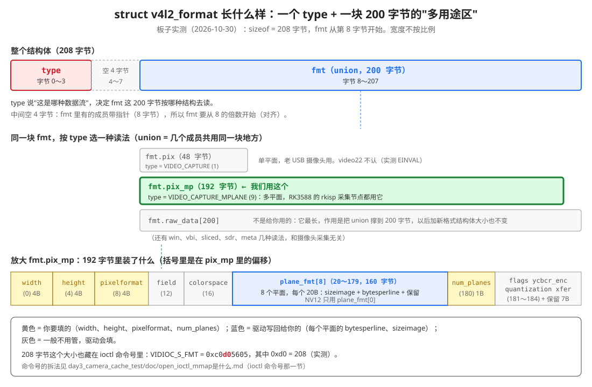
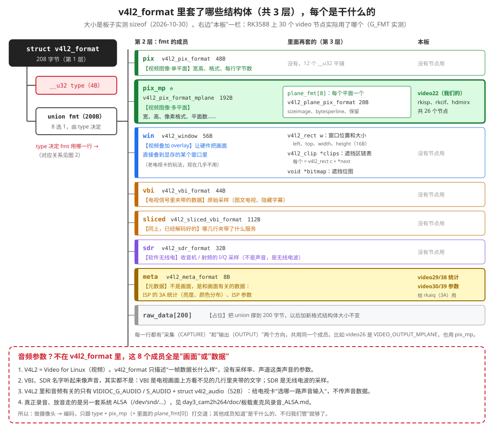
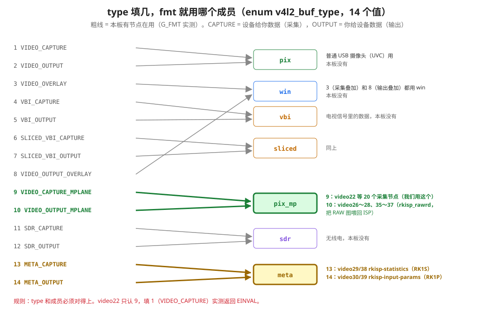
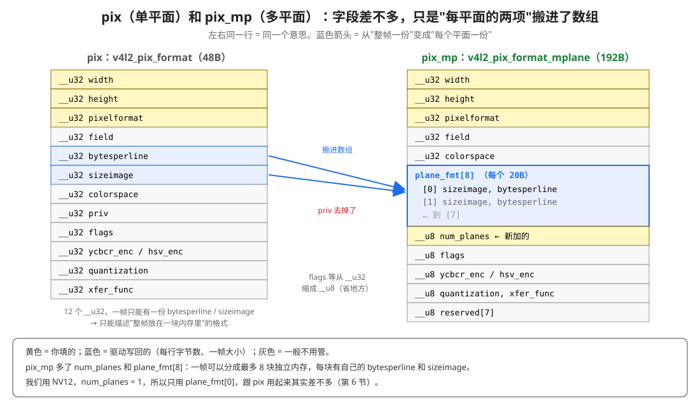
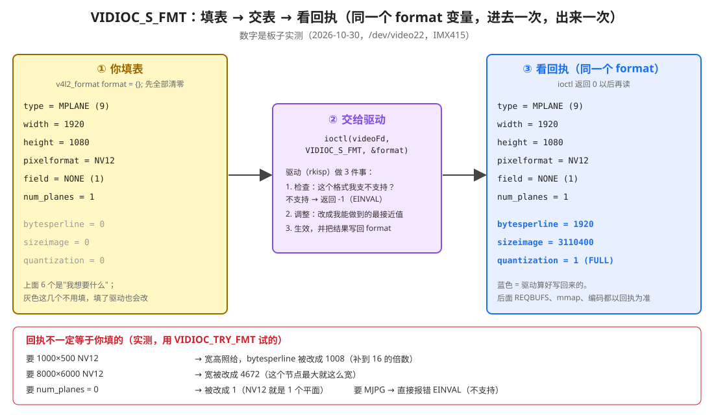
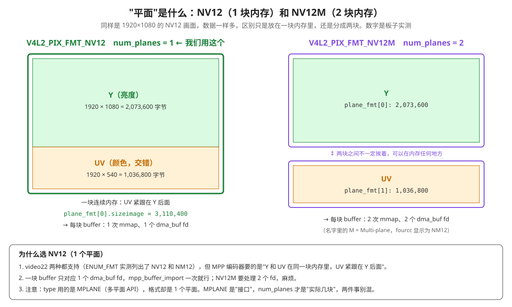
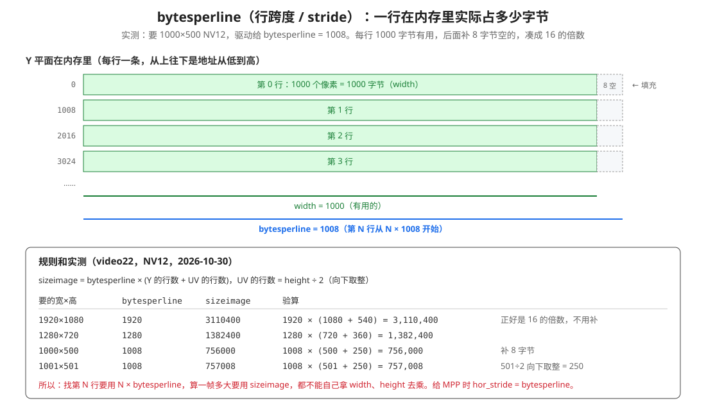

### 理解 v4l2_format 结构体
> v4l2_format 中包含了很多结构体，或者说里面有很多结构体嵌套，仔细讲解一下，也画svg一些图，便于理解，
> 例如：那些是视频参数，那些是设置音频参数，

---

> 数据来源：2026-10-30 在 RK3588 上跑了两个小探针（不在工程里）：
> ① 打印每个结构体的 `sizeof`，并对板子上 30 个 `/dev/videoN` 逐个试 14 种 `type` 的 `VIDIOC_G_FMT`，看每个节点用哪个成员；
> ② 对 `/dev/video22` 调 `ENUM_FMT / G_FMT / TRY_FMT / S_FMT`。完整输出见附录 A，头文件行号见附录 B。
>
> 用到它的代码：day3_mmap 的 `open_camera_and_map_buffers()`（[具体编码day3_mmap的流程.md](../具体编码day3_mmap的流程.md) 第 2.6 节），day3_cam2h264 的 [src/main.cpp:263-286](../../day3_cam2h264/src/main.cpp#L263-L286)。

## 0. 先看结论

**问：哪些是视频参数，哪些是音频参数？**

**答：v4l2_format 里没有音频参数。** 它里面套的 8 个结构体，描述的全是"一帧数据长什么样"，可以分成 5 类：

| 类别 | 成员 | 本板用不用 |
|---|---|---|
| **视频图像** | `pix`（单平面）、**`pix_mp`（多平面）** | `pix_mp`：26 个节点在用，包括我们的 video22 |
| 视频叠加 | `win` | 不用 |
| 电视信号里夹带的数据（VBI） | `vbi`、`sliced` | 不用 |
| 无线电（SDR） | `sdr` | 不用 |
| **元数据** | **`meta`** | 4 个 ISP 统计 / 参数节点在用 |
| 占位 | `raw_data[200]` | 不是给人用的 |

- **VBI、SDR 名字听着像声音，其实都不是**（第 4.4、4.5 节）。
- V4L2 里和音频沾边的只有 `VIDIOC_G_AUDIO` + `struct v4l2_audio`，它**不在 v4l2_format 里**，而且只是给电视卡"选哪一路声音输入"。真正录音用 ALSA（第 5 节）。

**做摄像头 → 编码，只需要会这些：**

| # | 要会的事 | 在哪 |
|---|---|---|
| 1 | `type` 填 `V4L2_BUF_TYPE_VIDEO_CAPTURE_MPLANE`（9），然后只用 `fmt.pix_mp` | 第 3 节 |
| 2 | 你填 4 个：`width`、`height`、`pixelformat`、`num_planes` | 第 6 节 |
| 3 | 驱动写回 2 个：`plane_fmt[0].bytesperline`（每行字节数）、`plane_fmt[0].sizeimage`（一帧大小） | 第 6、7 节 |
| 4 | 以写回的为准 | 第 8 节 |

其他成员知道"是干什么的、不归我们管"就够了。

---

## 1. 第 1 层：一个 type + 一块 200 字节的"多用途区"



去掉注释，定义就这么几行：

```c
struct v4l2_format {
    __u32 type;                                  // 哪种数据流（1～14）
    union {
        struct v4l2_pix_format        pix;       // 视频图像，单平面
        struct v4l2_pix_format_mplane pix_mp;    // 视频图像，多平面 ← 我们用这个
        struct v4l2_window            win;       // 视频叠加
        struct v4l2_vbi_format        vbi;       // VBI 原始采样
        struct v4l2_sliced_vbi_format sliced;    // VBI 已解码
        struct v4l2_sdr_format        sdr;       // 软件无线电
        struct v4l2_meta_format       meta;      // 元数据
        __u8 raw_data[200];                      // 占位
    } fmt;
};
```

### 1.1 union 是什么

**大白话**：union 里列了 8 个成员，但它们**共用同一块 200 字节**。同一时间只用其中一个。

**打比方**：一张表格的背面印了 8 种不同的格子（填视频的、填无线电的、填统计数据的……），你只能挑一种来填。挑哪一种？看正面写的 `type`。

**为什么这样设计**：`VIDIOC_G_FMT / S_FMT / TRY_FMT` 这三个 ioctl 要服务所有种类的设备（摄像头、电视卡、收音机、ISP 统计……）。用 union，**一个结构体、一套 ioctl 就够了**，不用每种设备一套。

### 1.2 实测大小

| 结构体 | sizeof（板子实测） |
|---|---|
| `v4l2_format` | **208** |
| `fmt`（union） | 200 |
| `pix_mp` | 192 |
| `sliced` | 112 |
| `win` | 56 |
| `pix` | 48 |
| `vbi` | 44 |
| `sdr` | 32 |
| `meta` | 8 |

- **union 的大小 = 最大成员的大小**。最大的是 `raw_data[200]`，所以 fmt 正好 200 字节。
- **208 = 4（type）+ 4（空着）+ 200（fmt）**。为什么空 4 字节：`win` 里有指针（8 字节），实测 `alignof(v4l2_window) = 8`，所以 fmt 要从 8 的倍数开始。
- **208 也藏在命令号里**：`VIDIOC_S_FMT = 0xc0d05605`，中间的 `0xd0` = 208。内核靠它知道要从用户空间拷多少字节。

---

## 2. 嵌套总图：一共 3 层



| 层 | 是什么 | 例子 |
|---|---|---|
| 第 1 层 | `struct v4l2_format` 本身 | `type` + `fmt` |
| 第 2 层 | `fmt` 的 8 个成员，每个是一个结构体 | `fmt.pix_mp` |
| 第 3 层 | 成员里面再套的结构体 | `fmt.pix_mp.plane_fmt[0]`（`v4l2_plane_pix_format`） |

8 个成员里，只有两个还有第 3 层：

- `pix_mp` 里有 `plane_fmt[8]`，每个是 `v4l2_plane_pix_format`
- `win` 里有 `v4l2_rect w`、`v4l2_clip *clips`（链表）、`void *bitmap`

我们写代码时访问最深的一个字段，正好穿过 3 层：

```cpp
format.fmt.pix_mp.plane_fmt[0].bytesperline
//  ① ↑       ② ↑       ③ ↑
//  v4l2_format  pix_mp    v4l2_plane_pix_format
```

---

## 3. type 决定用哪个成员



`type` 一共 14 个值（`enum v4l2_buf_type`）。每个成员都有 CAPTURE（设备给你数据）和 OUTPUT（你给设备数据）两个方向：

| type | 值 | 用 fmt 的哪个成员 |
|---|:---:|---|
| `VIDEO_CAPTURE` / `VIDEO_OUTPUT` | 1 / 2 | `pix` |
| `VIDEO_OVERLAY` / `VIDEO_OUTPUT_OVERLAY` | 3 / 8 | `win` |
| `VBI_CAPTURE` / `VBI_OUTPUT` | 4 / 5 | `vbi` |
| `SLICED_VBI_CAPTURE` / `SLICED_VBI_OUTPUT` | 6 / 7 | `sliced` |
| **`VIDEO_CAPTURE_MPLANE`** / `VIDEO_OUTPUT_MPLANE` | **9** / 10 | **`pix_mp`** |
| `SDR_CAPTURE` / `SDR_OUTPUT` | 11 / 12 | `sdr` |
| `META_CAPTURE` / `META_OUTPUT` | 13 / 14 | `meta` |

**type 和成员必须对得上**。type 填 9，却去写 `fmt.pix.width`，写进去的位置对驱动来说是别的意思。video22 只认 9，实测填 1：

```
G_FMT type=VIDEO_CAPTURE(1): ret -1 errno Invalid argument
```

### 3.1 本板实测：30 个节点各用哪个成员

对每个 `/dev/videoN` 把 14 种 type 都试一次 `VIDIOC_G_FMT`，成功的就是它支持的：

| 节点 | 驱动 / 名字 | type | 成员 |
|---|---|---|---|
| video11～21 | rkcif | 9 VIDEO_CAPTURE_MPLANE | `pix_mp` |
| **video22**、31 | rkisp_v6 / **rkisp_mainpath** | 9 | **`pix_mp`** |
| video23、32 | rkisp_v6 / rkisp_selfpath | 9 | `pix_mp` |
| video24、33 | rkisp_v6 / rkisp_fbcpath | 9 | `pix_mp` |
| video25、34 | rkisp_v6 / rkisp_iqtool | 9 | `pix_mp` |
| video26～28、35～37 | rkisp_v6 / rkisp_rawrd… | 10 VIDEO_OUTPUT_MPLANE | `pix_mp` |
| video29、38 | rkisp_v6 / rkisp-statistics | 13 META_CAPTURE | `meta`（RK1S，16172 字节） |
| video30、39 | rkisp_v6 / rkisp-input-params | 14 META_OUTPUT | `meta`（RK1P，10825 字节） |
| video40 | rk_hdmirx | 9 | `pix_mp` |

**结论**：这块板子上，**8 个成员只用到了 `pix_mp` 和 `meta`**。连 `pix`（单平面）都没人用：Rockchip 的驱动全走多平面接口。

（两组 rkisp 节点 22～30 和 31～39，对应 RK3588 的两路 ISP 输入。）

---

## 4. 8 个成员逐个看

### 4.1 pix：视频图像，单平面（48 字节）

普通 USB 摄像头（UVC）用这个。12 个 `__u32`，平铺，没有再套结构体：

| 字段 | 意思 |
|---|---|
| `width`、`height` | 宽、高，单位像素 |
| `pixelformat` | 像素格式，比如 NV12、YUYV、MJPG |
| `field` | 逐行 / 隔行 |
| `bytesperline` | 每行占多少字节 |
| `sizeimage` | 一帧多少字节 |
| `colorspace`、`ycbcr_enc`、`quantization`、`xfer_func` | 颜色怎么解释 |
| `priv`、`flags` | 驱动私用、格式标志 |

它的局限：**一帧只能有一份 bytesperline 和 sizeimage**，只能描述"整帧放在一块内存里"的格式。

### 4.2 pix_mp：视频图像，多平面（192 字节）⭐



和 pix 几乎一样，主要的变化：

1. `bytesperline`、`sizeimage` **搬进了数组** `plane_fmt[8]`，每个平面一份。这就是第 3 层：`struct v4l2_plane_pix_format`（20 字节）= `sizeimage` + `bytesperline` + 保留 12 字节。
2. 多了 `num_planes`：实际用了几个平面。
3. `flags`、`quantization` 这些从 `__u32` 缩成 `__u8`，省出地方放数组。
4. 去掉了 `priv`。

我们用的就是它。具体怎么填、写回什么，见第 6、7 节。

### 4.3 win：视频叠加（56 字节）

**是什么**：让硬件把摄像头画面**直接画到显存的某个窗口里**，不经过程序。老电视卡时代用来在桌面上开个小窗看电视。

它的第 3 层最复杂：

| 字段 | 类型 | 意思 |
|---|---|---|
| `w` | `struct v4l2_rect`（left、top、width、height） | 窗口在屏幕上的位置和大小 |
| `field` | `__u32` | 逐行 / 隔行 |
| `chromakey` | `__u32` | 色键：屏幕上这个颜色的地方才显示视频 |
| `clips` | `struct v4l2_clip *` | 一串"别画在这里"的矩形，是链表：每个 = `v4l2_rect c` + 指向下一个的 `next` |
| `clipcount` | `__u32` | clips 有几个 |
| `bitmap` | `void *` | 用位图指定哪些像素不画 |
| `global_alpha` | `__u8` | 整体透明度 |

**v4l2_format 要 8 字节对齐，就是因为这里的两个指针**（实测 `offsetof(v4l2_window, clips) = 24`）。本板没有节点用它。

### 4.4 vbi、sliced：电视信号里夹带的数据（不是声音）

**VBI 是什么**：老式模拟电视信号，每一帧画面上方有几十行是"看不见"的（Vertical Blanking Interval，场消隐期，电子束从屏幕底部回到顶部的那段时间）。电视台利用这几行**夹带文字数据**：图文电视（Teletext）、隐藏字幕（Closed Caption）、宽屏信号等。

**打比方**：信封的背面。正面是信（画面），背面空白处顺手写了几句附言（字幕）。

| 成员 | 大小 | 意思 |
|---|---|---|
| `vbi`（`v4l2_vbi_format`） | 44B | 原始采样：采样率 `sampling_rate`、每行采样数 `samples_per_line`、从第几行开始 `start[2]`、几行 `count[2]` |
| `sliced`（`v4l2_sliced_vbi_format`） | 112B | 已经解码好的：`service_lines[2][24]` 说明两场各 24 行里，每行夹带的是哪种服务（字幕、图文……） |

**它们不是音频**。电视的声音走另一个通道，不在 VBI 里。本板没有节点用。

### 4.5 sdr：软件无线电（32 字节，不是声音）

**SDR**（Software Defined Radio）：用一个射频芯片把**无线电波**采下来，交给软件去解调（收 FM 广播、对讲机、飞机信号……）。

```c
struct v4l2_sdr_format {
    __u32 pixelformat;   // 采样格式，比如 CU8 = 复数、无符号 8 位的 I/Q 采样
    __u32 buffersize;    // 一个 buffer 多大
    __u8  reserved[24];
};
```

采下来的是**无线电波的 I/Q 采样**，不是声音。软件解调以后才可能变成声音。本板没有节点用。

### 4.6 meta：元数据（8 字节）

**是什么**：不是画面，而是**和画面有关的数据**。

```c
struct v4l2_meta_format {
    __u32 dataformat;    // 数据格式的 4 字符码
    __u32 buffersize;    // 一个 buffer 多大
};
```

**本板实测**有 4 个节点用它：

| 节点 | 方向 | dataformat | buffersize | 是什么 |
|---|---|---|---|---|
| video29、38 | CAPTURE | `RK1S` | 16172 | ISP 每帧的统计数据：画面亮度分布、颜色分布、对焦清晰度…… |
| video30、39 | OUTPUT | `RK1P` | 10825 | 写给 ISP 的参数：曝光、白平衡、降噪强度…… |

**谁在用**：`rkaiq_3A_server`（Day 3 装摄像头时检查过它在不在跑）。它不停地从 video29 读统计，算出"太暗了，加曝光"，再通过 video30 把新参数写回 ISP。这就是画面能自动调亮度、调颜色的原因（3A = 自动曝光 AE、自动白平衡 AWB、自动对焦 AF）。

所以如果相机 App 或 rkaiq 没跑，video22 采出来的画面可能偏暗、偏色。我们的程序不碰这两个节点。

### 4.7 raw_data[200]：占位

不是给人用的。两个作用：

1. 把 union 撑到 200 字节。以后 Linux 加新的格式，只要不超过 200 字节，`v4l2_format` 的大小就不变，老程序不用重新编译。
2. 驱动自定义的 type（`V4L2_BUF_TYPE_PRIVATE`，已经不推荐用）可以把这 200 字节当成自己的格式。

---

## 5. 音频到底在哪

| 想做的事 | 用什么 | 和 v4l2_format 的关系 |
|---|---|---|
| 电视卡：选"声音从哪个输入进来"（比如 Line In、调谐器） | `VIDIOC_G_AUDIO` / `VIDIOC_S_AUDIO` + `struct v4l2_audio` | **没关系**，是另一套 ioctl |
| 真正的录音、放音（拿到声音数据） | **ALSA**（`/dev/snd/…`，`arecord` / `aplay`） | 完全是另一个子系统 |

`struct v4l2_audio`（实测 52 字节）里只有：

```c
struct v4l2_audio {
    __u32 index;         // 第几路声音输入
    __u8  name[32];      // 名字
    __u32 capability;    // 立体声？能调音量？
    __u32 mode;
    __u32 reserved[2];
};
```

**没有采样率、声道数、声音数据**。它只是个"切换开关"，声音本身不经过 V4L2。

板子上录音的做法见 [day3_cam2h264/doc/板载麦克风录音_ALSA.md](../../day3_cam2h264/doc/板载麦克风录音_ALSA.md)。以后做"摄像头画面 + 麦克风声音"一起录，是 V4L2 和 ALSA **分开采**，最后在封装（比如 MP4）时才合到一起。

---

## 6. pix_mp 实际怎么用：填表 → 交表 → 看回执



**打比方：餐厅点菜单**。你写"牛排，1920 克"，交给厨房。厨房看了一下：盘子按 16 克一格算，给你装成 1008 克的盘子（bytesperline）；菜单上没有的菜（MJPG）直接退单（EINVAL）。厨房把结果**写在同一张单子上**还给你。

| 字段 | 谁填 | 我们填 → 实测写回 | 意思 |
|---|---|---|---|
| `width` | **你** | 1920 → 1920 | 宽，像素 |
| `height` | **你** | 1080 → 1080 | 高，像素 |
| `pixelformat` | **你** | NV12 → NV12（`0x3231564e`） | 像素怎么排 |
| `num_planes` | **你**（驱动会改） | 1 → 1 | 分几块内存 |
| `field` | 你（可以不填） | NONE → 1 | 逐行扫描 |
| `plane_fmt[0].bytesperline` | **驱动** | 0 → **1920** | 每行字节数（第 7 节） |
| `plane_fmt[0].sizeimage` | **驱动** | 0 → **3,110,400** | 一帧字节数 |
| `colorspace` | 驱动 | 0 → 0 | 0 = Default |
| `quantization` | 驱动 | 0 → **1** | FULL_RANGE：Y 取 0～255 |
| `ycbcr_enc`、`xfer_func`、`flags` | 驱动 | 0 → 0 | 不用管 |

**一开始要 `v4l2_format format = {};` 全部清零**：保留字段驱动要求是 0，不清零就是栈上的随机值。

**quantization = 1 有什么用**：编码成 H.264 时，码流里有个标志说"亮度是 0～255 还是 16～235"。两边对不上，画面会发灰或者太艳。现在知道 rkisp 给的是全范围就行。

### 6.1 平面：NV12 是 1 块，NV12M 是 2 块



一帧 1920×1080 的 NV12：Y（亮度）1920×1080 = 2,073,600 字节，UV（颜色）1920×540 = 1,036,800 字节，合计 3,110,400。

| pixelformat | num_planes | 怎么放 | 实测 plane_fmt |
|---|:---:|---|---|
| `NV12` | **1** | Y 和 UV 在同一块，UV 紧跟 Y | `[0]`: 1920 / 3,110,400 |
| `NV12M`（显示 `NM12`） | **2** | Y 一块、UV 一块 | `[0]`: 1920 / 2,073,600<br>`[1]`: 1920 / 1,036,800 |

video22 两种都支持（ENUM_FMT 实测 7 种：UYVY、NV16、NV61、NV21、NV12、NM21、NM12）。我们选 NV12：

1. MPP 的一帧只接一块 buffer，UV 位置按 `hor_stride × ver_stride` 往后算，正好是 NV12 的排法。
2. 一块 buffer 只有 1 个 dma_buf fd，EXPBUF、import 各一次就行。
3. QUERYBUF 的 `planes[0]` 就是整帧，mmap 一次。

> **容易混**：type 是 MPLANE（多平面**接口**），格式 NV12 却只有 **1 个平面**。MPLANE 说"用哪套接口"，`num_planes` 说"实际几块内存"。

---

## 7. bytesperline：每行实际占多少字节



`width` 是一行有多少个**有用的**像素；`bytesperline` 是一行在内存里**实际占**多少字节，包括末尾为了对齐补的空字节。也叫 stride，MPP 里叫 `hor_stride`，DRM 里叫 `pitch`。

实测 rkisp 按 **16 字节**对齐：

| 要的宽×高 | bytesperline | sizeimage |
|---|---|---|
| 1920×1080 | 1920 | 3,110,400 |
| 1280×720 | 1280 | 1,382,400 |
| **1000×500** | **1008** | 756,000 |
| **1001×501** | **1008** | 757,008 |

`sizeimage = bytesperline × (height + height / 2)`，height / 2 向下取整。

**为什么一定要用它**：第 N 行的开头 = `N × bytesperline`。按 width 算，1000 宽的画面每行少算 8 字节，越往下错得越多，画面变**斜**。

day3_cam2h264 交给 MPP 时（[main.cpp:402-403](../../day3_cam2h264/src/main.cpp#L402-L403)）：

```cpp
cfg.horStride = bytesPerLine;                                       // 1920
cfg.verStride = static_cast<int>(sizeImage / bytesPerLine * 2 / 3); // 1080
```

> 小提醒：`verStride` 倒推法在 height 是奇数时会少 1（1001×501：757008 ÷ 1008 = 751，751 × 2 ÷ 3 = 500）。我们一直用 1080，不受影响。

---

## 8. 驱动会改你的要求；G / S / TRY 三兄弟

用 `VIDIOC_TRY_FMT`（只试不生效）试了几个请求：

| 你要的 | 驱动给的 |
|---|---|
| 1000×500 NV12 | 宽高照给，**bytesperline 1008** |
| 8000×6000 NV12 | 宽被压到 **4672** |
| 1920×1080 **MJPG** | **-1，EINVAL**（不支持） |
| num_planes **0** | 改成 **1** |

所以：**S_FMT 要检查返回值；成功后以 format 里写回的值为准**。

| ioctl | 做什么 | 改不改驱动的设置 |
|---|---|---|
| `VIDIOC_G_FMT` | 问"现在是什么格式"，只填 type | 不改 |
| `VIDIOC_S_FMT` | 设置并写回实际结果 | **改** |
| `VIDIOC_TRY_FMT` | 和 S_FMT 一样检查、写回，但不生效 | 不改（实测 6 次 TRY 后 G_FMT 还是原样） |

**格式会留在驱动里**：板子开机后 G_FMT 是 3840×2160；探针 S_FMT 成 1920×1080 并退出后，`v4l2-ctl --get-fmt-video` 还是 1920×1080。所以每个程序都要自己 S_FMT，不能假设打开时就是想要的。（探针跑完我已经用 `v4l2-ctl -d /dev/video22 --set-fmt-video=width=3840,height=2160,pixelformat=NV12` 改回去了。）

---

## 9. 在 day3_mmap 里怎么写

```cpp
v4l2_format format = {};                                // 先全部清零：保留字段必须是 0
format.type = V4L2_BUF_TYPE_VIDEO_CAPTURE_MPLANE;      // 第 1 层：选 union 的 pix_mp
format.fmt.pix_mp.width = kWidth;                      // 第 2 层：1920
format.fmt.pix_mp.height = kHeight;                    // 1080
format.fmt.pix_mp.pixelformat = V4L2_PIX_FMT_NV12;     // Y 和 UV 在同一块内存
format.fmt.pix_mp.num_planes = 1;                      // NV12 = 1 个平面
if (ioctl(camera.videoFd, VIDIOC_S_FMT, &format) != 0) {
    // 失败：格式不支持（EINVAL），或者别的程序正在用摄像头（EBUSY）
}
// 成功后，第 3 层里是驱动写回的值：
// format.fmt.pix_mp.plane_fmt[0].bytesperline = 1920
// format.fmt.pix_mp.plane_fmt[0].sizeimage    = 3110400
```

S_FMT 必须在 REQBUFS 前面：**驱动要先知道一帧多大，才知道每块 buffer 分多大**（下一篇 [4-理解v4l2_requestbuffers.md](4-理解v4l2_requestbuffers.md)）。

---

## 10. 常见错误

| 现象 | 原因 |
|---|---|
| S_FMT 返回 EINVAL | type 填了 1（单平面）；或者 pixelformat 不支持（比如 MJPG） |
| S_FMT 返回 EBUSY | 别的程序在用 video22，`fuser /dev/video22` 查 |
| 写了 `fmt.pix.width` 却没效果 | type 是 MPLANE，要写 `fmt.pix_mp` |
| 画面是斜的 | 按 width 算行起点，没用 bytesperline |
| 宽高和自己填的不一样 | 驱动调整了，看回执 |
| 画面偏暗、偏色 | 不是格式的问题：rkaiq（3A）没在跑，video29/30 没人读写（第 4.6 节） |

---

## 附录 A：探针输出（2026-10-30）

**探针 ①：结构体大小 + 每个节点支持的 type**

```
sizeof: pix 48 pix_mp 192 plane_pix 20 win 56 rect 16 vbi 44 sliced 112 sdr 32 meta 8 fmt-union 200 format 208 audio 52
alignof win 8, offsetof win.clips 24
video11 rkcif        rkcif                      G_FMT ok: VIDEO_CAPTURE_MPLANE
  …（video12～21 同上）
video22 rkisp_v6     rkisp_mainpath             G_FMT ok: VIDEO_CAPTURE_MPLANE
video23 rkisp_v6     rkisp_selfpath             G_FMT ok: VIDEO_CAPTURE_MPLANE
video24 rkisp_v6     rkisp_fbcpath              G_FMT ok: VIDEO_CAPTURE_MPLANE
video25 rkisp_v6     rkisp_iqtool               G_FMT ok: VIDEO_CAPTURE_MPLANE
video26 rkisp_v6     rkisp_rawrd0_m             G_FMT ok: VIDEO_OUTPUT_MPLANE
video27 rkisp_v6     rkisp_rawrd2_s             G_FMT ok: VIDEO_OUTPUT_MPLANE
video28 rkisp_v6     rkisp_rawrd1_l             G_FMT ok: VIDEO_OUTPUT_MPLANE
video29 rkisp_v6     rkisp-statistics           G_FMT ok: META_CAPTURE(RK1S,16172)
video30 rkisp_v6     rkisp-input-params         G_FMT ok: META_OUTPUT(RK1P,10825)
  …（video31～39 和 22～30 一一对应）
video40 rk_hdmirx    rk_hdmirx                  G_FMT ok: VIDEO_CAPTURE_MPLANE
```

**探针 ②：video22 的格式**

```
sizeof(v4l2_format) 208, offsetof fmt 8, sizeof(pix_mp) 192, sizeof(plane_pix_format) 20, sizeof(pix) 48
VIDIOC_G_FMT 0xc0d05604 S_FMT 0xc0d05605 TRY_FMT 0xc0d05640

== ENUM_FMT
   [0] UYVY  [1] NV16  [2] NV61  [3] NV21  [4] NV12  [5] NM21  [6] NM12

== G_FMT before S_FMT: 3840x2160 NV12 field 1 colorspace 0 num_planes 1 quant 1
    plane_fmt[0]: bytesperline 3840 sizeimage 12441600
== G_FMT type=VIDEO_CAPTURE(1): ret -1 errno Invalid argument

== TRY_FMT 1000x500 NV12  -> 1000x500, bytesperline 1008 sizeimage 756000
== TRY_FMT 1001x501 NV12  -> 1001x501, bytesperline 1008 sizeimage 757008
== TRY_FMT 8000x6000 NV12 -> 4672x6000, bytesperline 4672 sizeimage 42048000
== TRY_FMT 1920x1080 MJPG -> ret -1 errno 22 Invalid argument
== TRY_FMT 1920x1080 NM12 num_planes 2 -> plane_fmt[0] 1920/2073600, plane_fmt[1] 1920/1036800
== TRY_FMT 1920x1080 NV12 num_planes 0 -> num_planes 1, 1920/3110400
== G_FMT after TRY_FMTs: 3840x2160（TRY 不生效）

== S_FMT 1920x1080 NV12 -> 1920x1080, bytesperline 1920 sizeimage 3110400, quant 1
== S_FMT 1280x720 NV12  -> 1280x720,  bytesperline 1280 sizeimage 1382400
```

## 附录 B：头文件在哪

`/Users/dev/rk-toolchain/atk-dlrk3588-toolchain/aarch64-buildroot-linux-gnu/sysroot/usr/include/linux/videodev2.h`

这个文件已经加了中文注释（原版备份是同目录的 `videodev2.h.orig`），行号不一样：

| 定义 | 加了注释的 videodev2.h | 原版 .orig |
|---|---|---|
| `enum v4l2_buf_type` | 257 | 139 |
| `struct v4l2_pix_format`（pix） | 1014 | 492 |
| `struct v4l2_window`（win） | 2560 | 1159 |
| `struct v4l2_audio` | 4032 | 1945 |
| `struct v4l2_vbi_format`（vbi） | 4283 | 2071 |
| `struct v4l2_sliced_vbi_format`（sliced） | 4339 | 2099 |
| `struct v4l2_plane_pix_format`（第 3 层） | 4527 | 2200 |
| `struct v4l2_pix_format_mplane`（pix_mp） | 4572 | 2220 |
| `struct v4l2_sdr_format`（sdr） | 4649 | 2244 |
| `struct v4l2_meta_format`（meta） | 4670 | 2255 |
| `struct v4l2_format` | 4692 | 2270 |
| `VIDIOC_G_FMT` / `S_FMT` / `TRY_FMT` | 5103 / 5107 / 5220 | 2454 / 2455 / 2499 |
| `VIDIOC_G_AUDIO` | 5174 | 2476 |

videodev2.h 是从哪来的，见 [day3_cam2h264/doc/videodev2.h是从哪来的_内核uapi头文件.md](../../day3_cam2h264/doc/videodev2.h是从哪来的_内核uapi头文件.md)。
