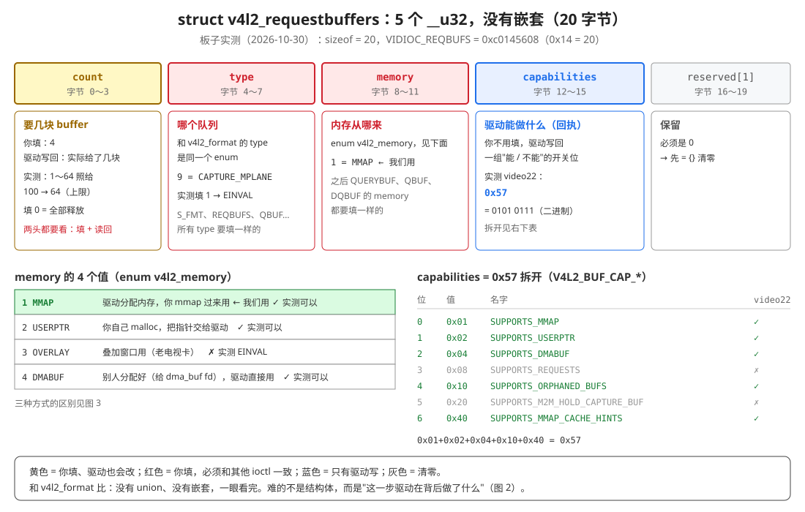
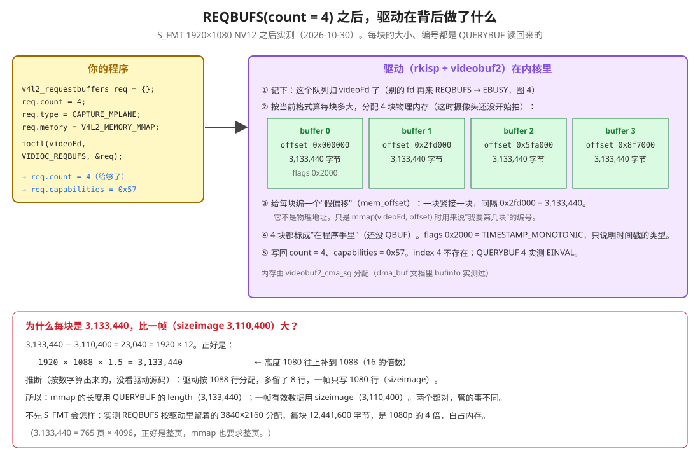
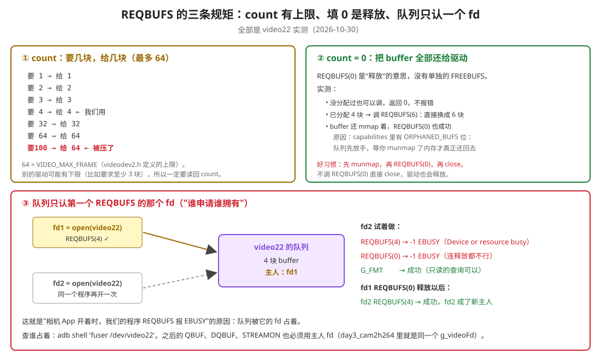

### 理解 v4l2_requestbuffers 结构体

> 数据来源：2026-10-30 在 RK3588 上对 `/dev/video22` 跑了一个小探针（不在工程里）：先不设格式就 REQBUFS、S_FMT 后 REQBUFS 再逐块 QUERYBUF、mmap 着的时候重新 REQBUFS、count 从 1 试到 100、4 种 memory、第二个 fd 来抢。完整输出见附录 A，头文件行号见附录 B。跑完已经把格式改回 3840×2160。
>
> 上一篇：[3-理解v4l2_format.md](3-理解v4l2_format.md)。用到它的代码：day3_cam2h264 [src/main.cpp:287-296](../../day3_cam2h264/src/main.cpp#L287-L296)，day3_mmap 的 `open_camera_and_map_buffers()`（[具体编码day3_mmap的流程.md](../具体编码day3_mmap的流程.md) 第 2.6 节）。

## 0. 先看结论

**一句话**：`v4l2_requestbuffers` 是第二张申请表。上一张（v4l2_format）说"每一帧长什么样"，这一张说"**给我几块 buffer，内存用哪种方式来**"。驱动收到以后，**真的去分配内存**。

**和 v4l2_format 比，它简单得多**：5 个 `__u32`，20 字节，**没有 union，没有嵌套**。所以这一篇的重点不是结构体本身，而是**这个 ioctl 在背后做了什么**。

**只需要会这些：**

| # | 要会的事 | 在哪 |
|---|---|---|
| 1 | 填 3 个：`count = 4`、`type = CAPTURE_MPLANE`、`memory = V4L2_MEMORY_MMAP` | 第 2 节 |
| 2 | **读回 `count`**：驱动可能给的和你要的不一样 | 第 4 节 |
| 3 | REQBUFS 之后，驱动已经分配好了 4 块内存，每块有一个"假偏移"，等你 QUERYBUF + mmap | 第 3 节 |
| 4 | 先 S_FMT 再 REQBUFS；队列只认做了 REQBUFS 的那个 fd | 第 3.2、6 节 |

在采集流程里的位置：

```
open("/dev/video22")
→ ① VIDIOC_QUERYCAP
→ ② VIDIOC_S_FMT      上一篇：每帧长什么样
→ ③ VIDIOC_REQBUFS    ← 本篇：要几块 buffer（驱动这时真的分配内存）
→ ④ VIDIOC_QUERYBUF + mmap   问每块在哪，映射过来
→ ⑤ QBUF → STREAMON → DQBUF / QBUF 循环
```

---

## 1. 打个比方：去仓库租货架

- 上一张申请表（S_FMT）说的是："我的货物是 1920×1080 的 NV12，每件 3,110,400 字节。"
- 这一张（REQBUFS）说的是："**给我 4 个货架**（count），放视频采集的货（type），**货架由仓库出**（memory = MMAP）。"
- 仓库管理员（驱动）照着货物的尺寸，**真的去搬了 4 个货架出来**，编好号（0、1、2、3），记下"这 4 个货架归你这张租单（fd）"，然后在单子上写回："给了你 4 个；我们仓库还支持哪些租法（capabilities）。"
- 你想往货架上看，要先问"3 号货架在哪"（QUERYBUF），再走过去（mmap）。

---

## 2. 结构体：5 个字段，没有嵌套



```c
struct v4l2_requestbuffers {
    __u32 count;          // 要几块（你填），实际给了几块（驱动写回）
    __u32 type;           // 哪个队列：enum v4l2_buf_type，和 v4l2_format 的 type 是同一个
    __u32 memory;         // 内存从哪来：enum v4l2_memory
    __u32 capabilities;   // 驱动写回：它支持哪些方式
    __u32 reserved[1];    // 必须是 0
};
```

实测：`sizeof = 20`，`VIDIOC_REQBUFS = 0xc0145608`（中间的 `0x14` = 20，和 S_FMT 命令号里藏着 208 是一个道理）。

| 字段 | 谁填 | 我们填 → 实测写回 | 说明 |
|---|---|---|---|
| `count` | **你**，驱动也会改 | 4 → 4 | 要几块；0 = 全部释放（第 4 节） |
| `type` | **你** | 9 → 9 | 必须和 S_FMT、QBUF、DQBUF、STREAMON 的 type 一样。填 1 实测 EINVAL |
| `memory` | **你** | 1（MMAP）→ 1 | 必须和后面 QUERYBUF、QBUF、DQBUF 的 memory 一样（第 5 节） |
| `capabilities` | **驱动** | 0 → **0x57** | 下面拆开 |
| `reserved[1]` | 不填 | 0 | 一开始 `= {}` 清零 |

### 2.1 capabilities = 0x57 是什么

`capabilities` 是一组开关，每一位代表"支持 / 不支持"某件事（`V4L2_BUF_CAP_*`）。0x57 写成二进制是 `0101 0111`，从右往左第 0、1、2、4、6 位是 1：

| 位 | 值 | 名字 | video22 | 意思 |
|:---:|---|---|:---:|---|
| 0 | 0x01 | `SUPPORTS_MMAP` | ✓ | 支持 memory = MMAP |
| 1 | 0x02 | `SUPPORTS_USERPTR` | ✓ | 支持 USERPTR |
| 2 | 0x04 | `SUPPORTS_DMABUF` | ✓ | 支持 DMABUF |
| 3 | 0x08 | `SUPPORTS_REQUESTS` | ✗ | 高级的"请求"接口，不用管 |
| 4 | 0x10 | `SUPPORTS_ORPHANED_BUFS` | ✓ | buffer 还 mmap 着也能释放队列（第 4.2 节） |
| 5 | 0x20 | `SUPPORTS_M2M_HOLD_CAPTURE_BUF` | ✗ | 编解码器才用 |
| 6 | 0x40 | `SUPPORTS_MMAP_CACHE_HINTS` | ✓ | mmap 时可以给 cache 方面的提示 |

**它有什么用**：程序可以先用 `count = 0` 调一次 REQBUFS（什么都不分配），只为了读 capabilities，看看驱动支不支持 DMABUF 等，再决定用哪种 memory。实测 count = 0 也会写回 0x57。

---

## 3. REQBUFS 在背后做了什么



### 3.1 实测：S_FMT 1920×1080 之后 REQBUFS(4)，再逐块 QUERYBUF

```
REQBUFS ask count 4 memory 1 type 9 -> ret 0 count 4 caps 0x57
  QUERYBUF 0: length 3133440 mem_offset 0x00000000 flags 0x2000
  QUERYBUF 1: length 3133440 mem_offset 0x002fd000 flags 0x2000
  QUERYBUF 2: length 3133440 mem_offset 0x005fa000 flags 0x2000
  QUERYBUF 3: length 3133440 mem_offset 0x008f7000 flags 0x2000
  QUERYBUF 4: Invalid argument
```

驱动（rkisp + 内核的 videobuf2 框架）做了 5 件事：

1. **记下主人**：这个队列归调用的这个 fd 了（第 6 节）。
2. **分配内存**：按当前格式，分配 4 块物理内存。这时摄像头还没开始拍，内存里没有画面。内存由 `videobuf2_cma_sg` 分配，day3_cam2h264 的 dma_buf 文档里用 bufinfo 实测过。
3. **编假偏移**：每块给一个 `mem_offset`，0、0x2fd000、0x5fa000、0x8f7000，一块接一块，间隔正好等于每块的长度。它**不是物理地址**，只是 `mmap(videoFd, offset)` 时用来说"我要第几块"的编号。
4. **状态**：4 块都"在程序手里"，还没交给驱动去填（QBUF 以后才交）。`flags 0x2000` 是 `V4L2_BUF_FLAG_TIMESTAMP_MONOTONIC`，只说明以后时间戳用的是哪种时钟，不表示状态。QBUF 以后会多出 `0x2`（QUEUED），变成 0x2002，day3_cam2h264 的 QBUF 探针实测过。
5. **写回** count = 4、capabilities = 0x57。只有 4 块，所以 index 4 不存在，QUERYBUF 4 返回 EINVAL。

### 3.2 每块为什么比一帧大一点

| | 字节 | 来自哪 |
|---|---|---|
| 一帧有效数据 | 3,110,400 | S_FMT 写回的 `sizeimage` = 1920 × 1080 × 1.5 |
| 每块 buffer | **3,133,440** | QUERYBUF 写回的 `length` |
| 差 | 23,040 | = 1920 × 12 |

3,133,440 正好等于 `1920 × 1088 × 1.5`。**推断**（按数字算出来的，没看 rkisp 源码）：驱动分配时把高度 1080 往上补到 1088（16 的倍数），多留了 8 行，但一帧只写 1080 行。另外 3,133,440 = 765 × 4096，正好是整页，mmap 要求按页映射。

所以：
- **mmap 的长度**用 QUERYBUF 的 `length`（3,133,440）
- **一帧多大**用 S_FMT 的 `sizeimage`（3,110,400），比如 M6 里 memcpy 一帧

两个都对，管的事不同。day3_cam2h264 里 `encode_with_cpu_copy` 拷的是 `sizeImage`，mmap 用的是 QUERYBUF 的 length，就是这个原因。

### 3.3 不先 S_FMT 会怎样

实测：开机后不 S_FMT，直接 REQBUFS(4)：

```
current format 3840x2160 sizeimage 12441600
REQBUFS ask count 4 ... -> ret 0 count 4
  QUERYBUF 0: length 12441600
```

**不会报错**，但驱动按格式里留着的 3840×2160 去分配，每块 12,441,600 字节，是 1080p 的 4 倍，4 块白白多占约 37 MB。而且画面也是 4K 的，和你以为的 1080p 对不上。

**所以顺序必须是：先 S_FMT，再 REQBUFS。** 驱动在 REQBUFS 这一刻按"当前格式"决定每块多大。

---

## 4. count：要几块、给几块、0 是释放



### 4.1 要几块，给几块

| 要 | 1 | 2 | 3 | 4 | 32 | 64 | **100** |
|---|---|---|---|---|---|---|---|
| 给 | 1 | 2 | 3 | 4 | 32 | 64 | **64** |

- 上限 64 = `VIDEO_MAX_FRAME`（videodev2.h 里定义的）。
- video22 没有下限，要 1 块也给。但**别的驱动可能有下限**（比如至少要 3 块才能连续采集），会给得比你要的多。
- 所以一定要**读回 count**。day3_cam2h264 的做法：不等于 4 就报错退出（[main.cpp:292](../../day3_cam2h264/src/main.cpp#L292)）。

**为什么我们要 4 块**：day3_cam2h264 的丢帧探针实测过（2026-10-21），处理 0 ms 时：1 块只有 10 fps，2 块 20 fps，4 块 30 fps。块太少，驱动拍完一帧没有空 buffer 可写，就只能丢帧。4 块是常用的平衡点：再多只是多占内存。

### 4.2 count = 0：释放

V4L2 没有单独的"释放 buffer"ioctl，**REQBUFS(0) 就是释放**。实测：

| 情况 | 结果 |
|---|---|
| 什么都没分配，调 REQBUFS(0) | 成功，不报错 |
| 已有 4 块，直接 REQBUFS(6) | 成功，换成 6 块（旧的释放、新的分配） |
| 第 0 块还 mmap 着，调 REQBUFS(6) 或 REQBUFS(0) | **也成功** |

最后一行要解释一下。按理说，内存还被 mmap 着（CPU 还可能在读写），队列就不能把它收回去。video22 能这么做，是因为它支持 `ORPHANED_BUFS`（capabilities 第 4 位）：队列先放手，这块内存变成"孤儿"，**等你 munmap 了才真正还给系统**。不支持这一位的驱动，这时会返回 EBUSY。

**好习惯**（顺序和申请相反）：

```
munmap 每一块  →  REQBUFS(0)  →  close(videoFd)
```

不调 REQBUFS(0) 直接 close，驱动也会释放。day3_mmap 的 `close_camera()` 就是 munmap 后直接 close。

---

## 5. memory：内存从哪来


`enum v4l2_memory` 有 4 个值，video22 实测：

| 值 | 名字 | 谁分配内存 | REQBUFS 时分配吗 | QBUF 时填什么 | video22 |
|:---:|---|---|---|---|---|
| 1 | **MMAP** | **驱动** | **分配** | 只填 index | ✓ ← 我们用 |
| 2 | USERPTR | 你（malloc） | 不分配，只准备空位 | `m.userptr` = 指针 | ✓ |
| 3 | OVERLAY | 叠加窗口 | — | — | ✗ EINVAL |
| 4 | DMABUF | 第三方（dma_heap、DRM、MPP） | 不分配，只准备空位 | `m.fd` = dma_buf fd | ✓ |

**我们为什么用 MMAP**：内存由驱动按摄像头的要求（大小、对齐、物理连续）去分配，最省心。CPU 要看就 mmap，编码器要用就 EXPBUF 导出 dma_buf fd。

**DMABUF 和 MMAP + EXPBUF 的区别**：方向相反。

- MMAP + EXPBUF：**摄像头**分配，再把 fd **导出**给编码器（day3_cam2h264 的零拷贝就是这样）
- DMABUF：**别人**（比如 MPP）分配好，把 fd **导入**给摄像头，让摄像头直接往里写

两种都能零拷贝。以后如果要"摄像头直接写进显示用的显存"，就会用到 DMABUF。

**规则**：memory 在 REQBUFS 里定了以后，后面 QUERYBUF、QBUF、DQBUF 里 `v4l2_buffer.memory` 都要填同一个值。

---

## 6. 队列的主人：只认第一个 REQBUFS 的 fd

实测（同一个程序里开两个 fd）：

```
fd1 REQBUFS(4)              -> ret 0 count 4
fd2 REQBUFS(4)              -> ret -1 errno 16 Device or resource busy
fd2 REQBUFS(0)              -> ret -1 errno 16 Device or resource busy   ← 连释放都不行
fd2 G_FMT                   -> ok（只读的查询可以）
fd1 REQBUFS(0)              -> ret 0
fd2 REQBUFS(4)              -> ret 0 count 4                             ← fd1 放手后，fd2 成了新主人
```

**规则：哪个 fd 做的 REQBUFS，队列就归哪个 fd。** 之后的 QUERYBUF、QBUF、DQBUF、STREAMON 都必须用这个 fd，别的 fd 来就是 EBUSY。

这解释了两件以前遇到的事：

- **相机 App 开着时，我们的程序报 EBUSY**：队列被相机 App 的 fd 占着。查谁占着：`adb shell 'fuser /dev/video22'`。
- **day3_cam2h264 里所有 ioctl 都用同一个 `g_videoFd`**：main.cpp 第 140～142 行的注释写过这条（2026-10-21 实测）。

---

## 7. 在 day3_mmap 里怎么写

接在 S_FMT 后面（完整代码见 [具体编码day3_mmap的流程.md](../具体编码day3_mmap的流程.md) 第 2.6 节）：

```cpp
v4l2_requestbuffers requestBufs = {};                  // 先全部清零：reserved 必须是 0
requestBufs.count = kBufCount;                         // 要 4 块
requestBufs.type = V4L2_BUF_TYPE_VIDEO_CAPTURE_MPLANE; // 和 S_FMT 的 type 一样
requestBufs.memory = V4L2_MEMORY_MMAP;                 // 驱动分配，我们 mmap 过来
if (ioctl(camera.videoFd, VIDIOC_REQBUFS, &requestBufs) != 0) {
    // EBUSY：队列被别的 fd 占着；EINVAL：type 或 memory 填错
}
// 读回 count：不一定等于 4
// 这时驱动已经分配好内存，接下来对 0～count-1 每块 QUERYBUF 拿 length 和 mem_offset，再 mmap
```

**和 M1 第 2 步的关系**：M1 要看的"摄像头 buffer 在 maps 里是哪几行"，那 4 块内存就是在 REQBUFS 这一刻分配出来的。mmap 时传的 `mem_offset` 就是第 3.1 节那 4 个编号。到时候可以对一对：maps 里摄像头那几行的"偏移"列，是不是 0、2fd000、5fa000、8f7000。

---

## 8. 常见错误

| 现象 | 原因 |
|---|---|
| REQBUFS 返回 EBUSY | 队列被别的 fd 占着（相机 App、另一个程序、自己开的第二个 fd） |
| REQBUFS 返回 EINVAL | type 填了 1（单平面）；memory 填了 3（OVERLAY） |
| 拿到的 count 和要的不一样 | 驱动有上下限（video22：最多 64） |
| 每块 buffer 大得离谱（12 MB） | 没先 S_FMT，驱动按留着的 4K 格式分配 |
| QUERYBUF 返回 EINVAL | index ≥ count；或者 memory、type 和 REQBUFS 的不一样 |
| mmap 长度不对 | 用了 sizeimage，应该用 QUERYBUF 的 length |

---

## 附录 A：探针输出（2026-10-30，/dev/video22）

```
sizeof(v4l2_requestbuffers) 20, VIDIOC_REQBUFS 0xc0145608
current format 3840x2160 sizeimage 12441600

--- 1. REQBUFS without S_FMT (uses current format)
REQBUFS ask count   4 memory 1 type 9 (no S_FMT) -> ret 0 count 4 caps 0x57 [MMAP USERPTR DMABUF ORPHANED CACHE_HINTS]
  QUERYBUF 0: length 12441600 mem_offset 0x00000000 flags 0x2000
REQBUFS ask count   0 memory 1 type 9 (free) -> ret 0 count 0 caps 0x57

--- 2. S_FMT 1920x1080 then REQBUFS 4
S_FMT 1920x1080 -> ok (sizeimage 3110400)
REQBUFS ask count   4 memory 1 type 9 (normal) -> ret 0 count 4 caps 0x57
  QUERYBUF 0: length 3133440 mem_offset 0x00000000 flags 0x2000
  QUERYBUF 1: length 3133440 mem_offset 0x002fd000 flags 0x2000
  QUERYBUF 2: length 3133440 mem_offset 0x005fa000 flags 0x2000
  QUERYBUF 3: length 3133440 mem_offset 0x008f7000 flags 0x2000
  QUERYBUF 4: Invalid argument

--- 3. change things while buffers exist
S_FMT 1280x720 -> ok (sizeimage 1382400)
mmap buffer 0 -> ok
REQBUFS ask count   6 memory 1 type 9 (realloc while mmapped) -> ret 0 count 6 caps 0x57
REQBUFS ask count   0 memory 1 type 9 (free while mmapped) -> ret 0 count 0 caps 0x57
munmap buffer 0
REQBUFS ask count   6 memory 1 type 9 (realloc after munmap) -> ret 0 count 6 caps 0x57
REQBUFS ask count   0 memory 1 type 9 (free) -> ret 0 count 0 caps 0x57

--- 4. different counts（这时格式是 1280x720）
REQBUFS ask count   1 -> count 1
REQBUFS ask count   2 -> count 2
REQBUFS ask count   3 -> count 3
REQBUFS ask count  32 -> count 32
REQBUFS ask count  33 -> count 33
REQBUFS ask count  64 -> count 64
REQBUFS ask count 100 -> count 64
（每次之后都 REQBUFS(0) 释放）

--- 5. memory types / wrong type
REQBUFS ask count   4 memory 2 type 9 (USERPTR) -> ret 0 count 4
REQBUFS ask count   4 memory 4 type 9 (DMABUF) -> ret 0 count 4
REQBUFS ask count   4 memory 3 type 9 (OVERLAY) -> ret -1 errno 22 Invalid argument
REQBUFS ask count   4 memory 1 type 1 (single-plane type) -> ret -1 errno 22 Invalid argument
REQBUFS ask count   0 memory 1 type 9 (count 0 when nothing allocated) -> ret 0 count 0 caps 0x57

--- 6. second fd while first fd owns the queue
REQBUFS ask count   4 (fd1 owns) -> ret 0 count 4
REQBUFS ask count   4 (fd2 tries) -> ret -1 errno 16 Device or resource busy
REQBUFS ask count   0 (fd2 tries free) -> ret -1 errno 16 Device or resource busy
fd2 G_FMT -> ok (reading is allowed)
REQBUFS ask count   0 (fd1 free) -> ret 0 count 0
REQBUFS ask count   4 (fd2 after fd1 freed) -> ret 0 count 4
REQBUFS ask count   0 (fd2 free) -> ret 0 count 0

--- restore
S_FMT 3840x2160 -> ok (sizeimage 12441600)
```

有一个顺手发现的现象：第 3 段里，**buffer 已经分配着，S_FMT 1280×720 也成功了**。也就是说 rkisp 允许在有 buffer 的时候改格式，但已经分配的 buffer 不会跟着变。所以改格式以后要重新 REQBUFS，不能接着用旧的 buffer。

## 附录 B：头文件在哪

`/Users/dev/rk-toolchain/atk-dlrk3588-toolchain/aarch64-buildroot-linux-gnu/sysroot/usr/include/linux/videodev2.h`（加了中文注释，原版是同目录的 `videodev2.h.orig`）：

| 定义 | 加了注释的 videodev2.h | 原版 .orig |
|---|---|---|
| `enum v4l2_memory` | 364 | 185 |
| `struct v4l2_requestbuffers` | 2065 | 928 |
| `V4L2_BUF_CAP_SUPPORTS_MMAP` 等 7 个 | 2092 起 | 937～943 |
| `VIDEO_MAX_FRAME`（64） | 111 | 71 |
| `V4L2_BUF_FLAG_QUEUED`（0x2） | 2338 | 1053 |
| `V4L2_BUF_FLAG_TIMESTAMP_MONOTONIC`（0x2000） | 2395 | 1078 |
| `VIDIOC_REQBUFS` | 5115 | 2456 |
