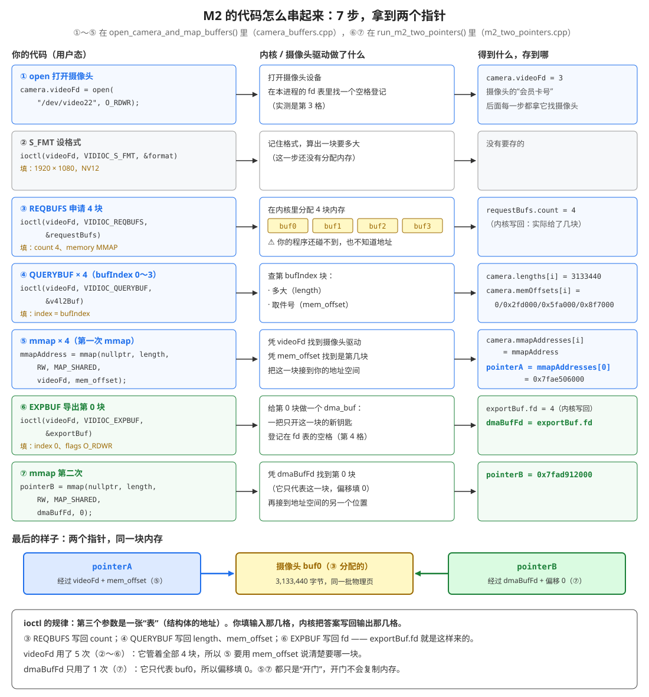

# 5 - 理解 M2 代码的串联流程：videoFd、mmapAddresses、exportBuf.fd、pointerA、pointerB 是怎么串起来的

> 写这篇的原因：M2 的代码里有一堆名字（`CameraBuffers` 的 `videoFd` 和 `mmapAddresses`、`v4l2_requestbuffers`、`v4l2_exportbuffer`、两次 `mmap`、`pointerA`、`pointerB`），单看每一行都认识，串不起来。特别是 `exportBuf.fd` 是从哪来的、mmap 和 V4L2 是怎么连在一起的。
>
> 相关文档：[2-理解M2的运行结果.md](2-理解M2的运行结果.md)（M2 跑出来的结果怎么看）、[4-理解v4l2_requestbuffers.md](4-理解v4l2_requestbuffers.md)（REQBUFS 背后分配了什么）、[open_ioctl_mmap是什么.md](../../day3_camera_cache_test/doc/open_ioctl_mmap是什么.md)（open、ioctl、mmap 三个系统调用本身）

---

## 0. 一张图看完



从上往下 7 步。每一步都是 **左边你调一个函数 → 中间内核做一件事 → 右边你拿到一个值，存起来给下一步用**。

---

## 1. 先打个比方：仓库、柜子、门

| 比方 | 代码里 | 哪一步 |
|---|---|---|
| 仓库（东西都在仓库里，你家里没有） | 摄像头驱动 + 内核 | |
| 办一张**会员卡** | `videoFd = open("/dev/video22")` | ① |
| 告诉仓库：我要放 1920×1080 的东西 | `S_FMT` | ② |
| **租 4 个柜子**（柜子在仓库里，你还看不见） | `REQBUFS count 4` | ③ |
| 问仓库：第 i 个柜子多大、**取件号**是多少 | `QUERYBUF index i` → length、mem_offset | ④ |
| 拿着会员卡 + 取件号，**在你家墙上开一扇门，直通第 i 个柜子** | `mmap(videoFd, mem_offset)` → mmapAddress | ⑤ |
| 门的位置（门牌号） | `camera.mmapAddresses[i]`，第 0 扇门就是 **pointerA** | ⑤ |
| 请仓库给第 0 个柜子**单独配一把钥匙**（这把钥匙只开这一个柜子，可以交给别人，比如编码器） | `EXPBUF index 0` → `exportBuf.fd` | ⑥ |
| 拿这把钥匙，**在墙上另开一扇门**，也通到第 0 个柜子 | `mmap(dmaBufFd, 0)` → **pointerB** | ⑦ |

所以：**pointerA 和 pointerB 是两扇门，通到同一个柜子**。从 A 门放进去的东西，从 B 门能拿出来。

---

## 2. 你理解的那一句是对的

> pointerA 就是 `camera.mmapAddresses[0]`，也就是第 0 块 buffer 的首地址。

对。[m2_two_pointers.cpp:25](../src/experiments/m2_two_pointers.cpp#L25)：

```cpp
char* pointerA = static_cast<char*>(camera.mmapAddresses[0]);
```

`mmapAddresses[0]` 是 ⑤ 第一次 mmap 的返回值（[camera_buffers.cpp:59](../src/camera/camera_buffers.cpp#L59)～[67](../src/camera/camera_buffers.cpp#L67)）。`static_cast<char*>` 只是把 `void*` 换成 `char*`，好按字节读写，地址没有变。

**容易误会的地方**：③ REQBUFS 之后，内存已经分配好了，但**你的程序还拿不到地址**。地址是 ⑤ mmap 才给的。REQBUFS 只是"租柜子"，mmap 才是"开门"。

---

## 3. exportBuf.fd 是怎么得到的：ioctl 的"填表 → 写回"

这是最关键的一点。**ioctl 的第三个参数，是一张"表"（结构体的地址）**。规则是：

1. 你先把表里"输入"的那几格填好
2. 调 ioctl，把表的地址交给内核
3. 内核做完事，把答案**写回同一张表**的"输出"那几格
4. ioctl 返回以后，你从表里读答案

`exportBuf.fd` 就是第 3 步内核写进去的。调 ioctl 之前它是 0（`= {}` 清零的），调完就变成了 4。

M2 用到的 4 个 ioctl，全都是这个规律：

| 步 | ioctl | 表（结构体） | 你填（输入） | 内核写回（输出） | 写回的值存到哪 |
|:---:|---|---|---|---|---|
| ② | `VIDIOC_S_FMT` | `v4l2_format format` | type、width、height、pixelformat、num_planes | 驱动实际用的格式（bytesperline、sizeimage 等） | 这次没存 |
| ③ | `VIDIOC_REQBUFS` | `v4l2_requestbuffers requestBufs` | count 4、type、memory MMAP | **count**（实际给了几块） | 只检查 `>= 4`，没存 |
| ④ | `VIDIOC_QUERYBUF` | `v4l2_buffer v4l2Buf` + `v4l2_plane planes[1]` | type、memory、**index**、m.planes、length 1 | `planes[0].length`、`planes[0].m.mem_offset` | `camera.lengths[i]`、`camera.memOffsets[i]` |
| ⑥ | `VIDIOC_EXPBUF` | `v4l2_exportbuffer exportBuf` | type、**index 0**、plane 0、flags O_RDWR | **fd** | `dmaBufFd` |

对照代码（[m2_two_pointers.cpp:29](../src/experiments/m2_two_pointers.cpp#L29)～[39](../src/experiments/m2_two_pointers.cpp#L39)）：

```cpp
v4l2_exportbuffer exportBuf = {};      // 整张表清零，fd 这一格现在是 0
exportBuf.type  = kBufType;            // 输入：哪个队列
exportBuf.index = 0;                   // 输入：导出第几块
exportBuf.plane = 0;                   // 输入：第几个平面（NV12 只有 1 个）
exportBuf.flags = O_RDWR | O_CLOEXEC;  // 输入：新 fd 要可读可写
ioctl(camera.videoFd, VIDIOC_EXPBUF, &exportBuf);   // 把表的地址 &exportBuf 交给内核
const int dmaBufFd = exportBuf.fd;     // 输出：内核刚写进来的新 fd（实测 4）
```

**为什么是 4**：fd 是本进程 fd 表里的格子编号。0、1、2 是标准输入、输出、错误；① open 拿走了 3；⑥ EXPBUF 新建了一个 dma_buf，内核找下一个空格子，就是 4。

> 对比 open 和 mmap：它们是**用返回值**把结果交给你（`videoFd = open(...)`、`mmapAddress = mmap(...)`）。ioctl 的返回值只表示成功（0）还是失败（-1），**真正的结果都写在表里**。这就是为什么 exportBuf.fd 看起来像是"凭空出现"的。

---

## 4. mmap 和 V4L2 是怎么连起来的

mmap 本身不懂摄像头。它只做一件事：**拿一个 fd 和一个偏移，请"fd 背后的那个驱动"把一段内存接到你的地址空间**。

所以 mmap 和 V4L2 的连接点就是 **fd**：

| | ⑤ 第一次 mmap | ⑦ 第二次 mmap |
|---|---|---|
| 传的 fd | `videoFd`（摄像头设备） | `dmaBufFd`（dma_buf） |
| 内核把请求交给谁 | 摄像头驱动（videobuf2） | dma_buf，它再转给导出它的摄像头驱动 |
| 偏移的意思 | 取件号 mem_offset：4 块里要哪一块（④ QUERYBUF 给的） | 这一块里从哪开始：填 0 = 从头 |
| 为什么这样 | videoFd 管着全部 4 块，必须说清楚要哪块 | dmaBufFd 只代表 buf0，没得选 |
| 长度 | `planes[0].length`（④ 给的） | `camera.lengths[0]`（还是 ④ 给的） |
| 返回 | `mmapAddress` → `camera.mmapAddresses[i]` → 第 0 个就是 pointerA | pointerB |

两次 mmap 用的长度都来自 ④ QUERYBUF。**④ 是两次 mmap 的数据来源**：没有 ④，就不知道 mmap 多长、偏移填什么。

---

## 5. CameraBuffers 里每个字段是哪一步填的

```cpp
struct CameraBuffers {
    int videoFd;                     // ① open 的返回值
    uint32_t memOffsets[kBufCount];  // ④ QUERYBUF 写回的 planes[0].m.mem_offset
    size_t lengths[kBufCount];       // ④ QUERYBUF 写回的 planes[0].length
    void* mmapAddresses[kBufCount];  // ⑤ mmap 的返回值
};
```

它就是"①～⑤ 的成果汇总"：`open_camera_and_map_buffers()` 把这 5 步的结果装进 `camera`，交给 `run_m2_two_pointers()`。M2 从里面取：

- `camera.videoFd` → ⑥ EXPBUF 要对摄像头说话
- `camera.mmapAddresses[0]` → pointerA
- `camera.lengths[0]` → ⑦ mmap 的长度
- `camera.memOffsets[0]` → 只用来打印

> `requestBufs`、`v4l2Buf`、`planes` 都是函数里的局部变量，"填表 → 读答案"用完就扔，需要留下的答案已经抄进了 `camera`。

---

## 6. 用到的号码，一共三种

M2 里容易混的，是这三个"号码"：

| 号码 | 是什么 | 谁给的 | 能干什么 |
|---|---|---|---|
| `videoFd`（3） | fd：会员卡号 | ① open | 对摄像头做任何事（S_FMT、REQBUFS、QUERYBUF、mmap、EXPBUF） |
| `mem_offset`（0、0x2fd000…） | 取件号，**不是地址**，也不是 fd | ④ QUERYBUF | 只在 mmap(videoFd) 时用，告诉驱动要哪一块 |
| `dmaBufFd`（4） | fd：只开 buf0 的钥匙 | ⑥ EXPBUF | mmap 出 pointerB；也可以交给编码器、RGA（day3_cam2h264 就是这样做的） |

还有两个是**地址**，可以直接读写：`pointerA`（⑤）、`pointerB`（⑦）。

**号码不能读写，地址才能读写。** 号码要先交给 mmap 换成地址。

---

## 7. 自己检查一下（答案在上面）

1. 删掉 ④ QUERYBUF，⑤ mmap 会缺哪两个参数？
2. `exportBuf.fd` 在 ioctl 调用之前是多少？调用之后呢？谁改的？
3. ⑦ 的偏移为什么不能像 ⑤ 一样填 `memOffsets[0]`？如果第 0 块恰好 mem_offset 是 0，填了也没事；那要是导出第 1 块，填 0x2fd000 会怎样？（提示：2-理解M2的运行结果.md 第 4.2 节实测 EINVAL）
4. 为什么说"REQBUFS 以后内存已经有了，但程序还碰不到"？
