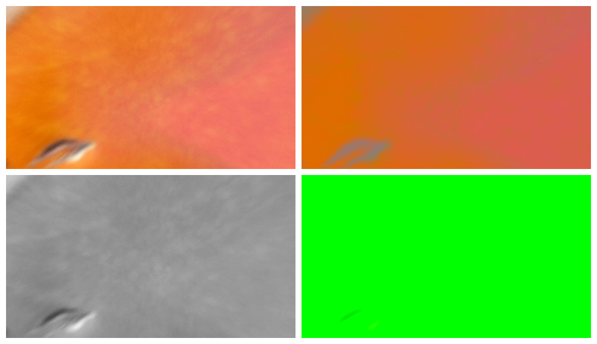
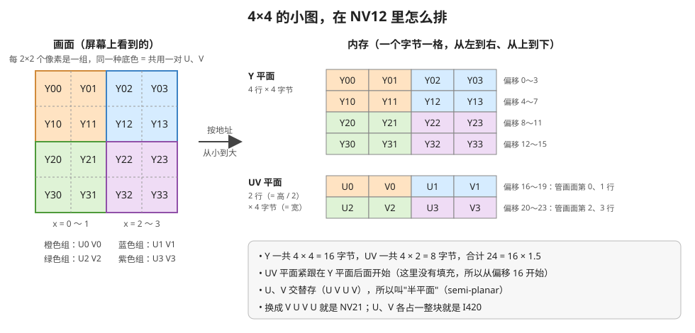
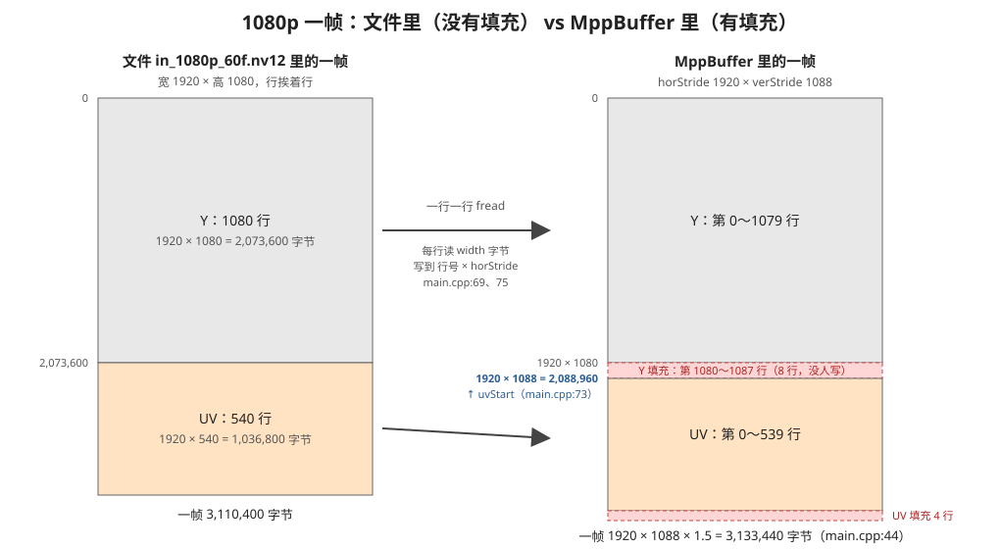

# NV12 内存排布：Y、UV 在内存里怎么放，stride 填充在哪

> 2026-11-06 写。代码行号按 `day4_rga/src/common/nv12_picture.cpp`（2026-11-08 重构后，NV12 的申请和读写搬到了这里）。第 1、4、6 节的数字是 2026-11-06 在 Mac 上用 Python 读文件实测的（读法见第 9 节），没实测的地方写了"推断"。
> 相关：[1_理解M1的需求和代码.md](1_理解M1的需求和代码.md) 第 5 节（verStride 填错，顶部绿边）

## 0. 一句话

**NV12 = 先放一整块 Y（每个像素一个字节，管亮度），再放一整块 UV（每 2×2 个像素共用一对 U、V，管颜色，U、V 交替存）。有 stride 时，UV 从第 `verStride` 行开始，不是从第 `height` 行开始。**

读完能回答：

| 问题 | 答案 | 详见 |
|---|---|---|
| 1080p NV12 一帧为什么是 3,110,400 字节？ | 1920 × 1080 × 1.5，每像素 1.5 字节 | 第 2 节 |
| U、V 在内存里是怎么排的？NV12、NV21、I420 差在哪？ | U V U V 交替；NV21 是 V U 交替；I420 是 U、V 各一整块 | 第 3 节 |
| 为什么 `read_nv12_frame` 要一行一行读，不能一次读一帧？ | 文件没有填充，buffer 有填充，两边大小不同 | 第 5 节 |
| 第 (x, y) 个像素的 Y、U、V 在哪个地址？ | 第 6 节的 3 个公式 | 第 6 节 |
| verStride 填错为什么是绿色？ | U = V = 0 就是绿 | 第 7 节 |

## 1. Y 管亮度，U、V 管颜色

YUV 把一个像素拆成 3 个数，每个数 1 字节（0～255）：

- **Y**：亮度。只看 Y，就是一张黑白照片。
- **U、V**：颜色。U 偏蓝还是偏黄，V 偏红还是偏青。**128 表示"没有颜色"**（灰色），离 128 越远颜色越浓。

打个比方：Y 是一张铅笔素描，U、V 是后来涂上去的水彩。

实测：取 Day 2 解出来的第 1 帧，分别改掉 Y 或 UV，再用 ffmpeg 转成图片看：



| 位置 | 改了什么 | 看到什么 | 说明 |
|---|---|---|---|
| 左上 | 不改 | 原图（橙红色、很模糊） | |
| 右上 | Y 全改成 128 | 颜色还在，明暗细节没了，像一块平平的色块 | 颜色只靠 U、V |
| 左下 | U、V 全改成 128 | 黑白照片，细节都在 | 128 = 没有颜色 |
| 右下 | U、V 全改成 0 | **整片绿色**，几乎看不出内容 | 0 是离 128 最远的值，见第 7 节 |

## 2. 4 个像素共用一对 U、V：所以是 1.5 字节

人眼对亮度敏感，对颜色不敏感。所以 Y 每个像素都存，U、V 只存四分之一：**每 2×2 = 4 个像素共用一个 U、一个 V**。这种做法叫 **YUV 4:2:0**（"4:2:0"是个历史叫法，记住"横竖都减半"就行）。

算一下 1080p 一帧：

| 部分 | 怎么算 | 字节数 |
|---|---|---|
| Y | 1920 × 1080 | 2,073,600 |
| U | 960 × 540（横竖都减半） | 518,400 |
| V | 960 × 540 | 518,400 |
| 合计 | 1920 × 1080 × 1.5 | **3,110,400** |

实测：Day 2 的 `out.nv12` 是 186,624,000 字节，÷ 3,110,400 = 正好 60 帧。RGB 每像素要 3 字节，NV12 只要一半。

## 3. NV12 的排法

用一张 4×4 的小图来看：



1. **先放 Y 平面**：一行一行，每行 `width` 个字节。4×4 的图就是 16 字节。
2. **紧接着放 UV 平面**：一共 `height / 2` 行，每行还是 `width` 个字节——因为一行里有 `width / 2` 对 U、V，每对 2 字节。
3. **UV 平面里 U、V 交替**：`U0 V0 U1 V1 …`。`U0 V0` 管左上角那 4 个像素 Y00、Y01、Y10、Y11。

"平面"（plane）就是"一整块连续内存，只放一种东西"。NV12 有 2 个平面（Y 一块，UV 一块），所以叫"半平面"（semi-planar）。

容易混的几种格式（都是 4:2:0，大小都是 × 1.5，只是排法不同）：

| 格式 | 排法 | 在哪见过 |
|---|---|---|
| **NV12** | Y 一块；UV 一块，**U V U V** | MPP 编码输入、RGA、摄像头（Day 3） |
| NV21 | Y 一块；UV 一块，**V U V U** | Android 相机老接口 |
| I420（也叫 YUV420P） | Y 一块；U 一块；V 一块 | ffmpeg 默认、很多软件编码器 |
## 4. 实测：文件开头的几个字节

Day 2 解出来的第 1 帧（2026-11-06 在 Mac 上读）：

```
Y 平面开头 8 字节（偏移 0～7）：         189 189 188 188 187 187 186 186
UV 平面开头 8 字节（偏移 2,073,600 起）：113 144 113 144 113 144 113 144
                                          U   V   U   V   U   V   U   V
```

- Y 平面里相邻像素的值很接近（这张图很平滑）。
- UV 平面里能直接看到 **U、V 交替**：U ≈ 113（略小于 128，偏黄），V ≈ 144（大于 128，偏红）。合起来就是图里的橙色。
- 这个文件没有填充，所以 UV 从偏移 1920 × 1080 = 2,073,600 开始。

## 5. 加上 stride：UV 从第 verStride 行开始

MPP 编码器要求 buffer 的宽、高对齐到 16 的倍数（H.264 按 16 × 16 的宏块编码），所以 `make_aligned_nv12_picture` 里用 `ALIGN(…, 16)` 算 stride（[nv12_picture.cpp:14-15](../src/common/nv12_picture.cpp#L14-L15)）。1080p 时：

- `horStride = ALIGN(1920, 16) = 1920`：一行在内存里占多少字节。1920 本来就是 16 的倍数，不用加。
- `verStride = ALIGN(1080, 16) = 1088`：Y 平面在内存里占多少行。比画面多 8 行。



| | 文件 `in_1080p_60f.nv12` | `MppBuffer`（M2 的 `pictureMain`） |
|---|---|---|
| Y 平面 | 1080 行 | 1080 行画面 + **8 行填充** |
| UV 从哪开始 | 1920 × 1080 = 2,073,600 | 1920 × **1088** = **2,088,960** |
| UV 平面 | 540 行 | 540 行 + **4 行填充**（1088 / 2 = 544） |
| 一帧大小 | 3,110,400 | 3,133,440 |

对照代码：

- [nv12_picture.cpp:20](../src/common/nv12_picture.cpp#L20)：`frameSizeBytes = horStride * verStride * 3 / 2`，申请的是右边的大小。
- [nv12_picture.cpp:47](../src/common/nv12_picture.cpp#L47)：`uvStart = frameStart + picture.horStride * picture.verStride;` —— **UV 起点用 verStride，不用 height**。这一行就是这篇文档最重要的一点。
- [nv12_picture.cpp:43](../src/common/nv12_picture.cpp#L43)、[nv12_picture.cpp:49](../src/common/nv12_picture.cpp#L49)：每次 `fread` 只读 `width` 字节，写到 `rowIndex * horStride` 的位置。两边一帧大小不一样，所以不能一次 `fread` 一整帧，只能一行一行搬，把填充跳过去。

填充里是什么：没有人写，M1 实测里是 0（见 M1 篇第 5 节）。编码器和 RGA 都不会把填充当成画面，**只要 stride 告诉它们的是对的**。
## 6. 找第 (x, y) 个像素

```
Y 的地址 = frameStart + y * horStride + x
U 的地址 = frameStart + horStride * verStride + (y / 2) * horStride + (x / 2) * 2
V 的地址 = U 的地址 + 1
```

- `y / 2`、`x / 2`：4 个像素共用一对 U、V，所以行号、列号都要除以 2（整数除法，向下取整）。
- `(x / 2) * 2`：一对 U、V 占 2 字节。

实测（没有填充，所以 `horStride = 1920`，`verStride = 1080`）：

| 像素 (x, y) | Y 的偏移 | U 的偏移 | Y, U, V |
|---|---|---|---|
| (0, 0) | 0 | 2,073,600 | 189, 113, 144 |
| (1, 0) | 1 | 2,073,600 | 189, 113, 144 |
| (0, 1) | 1920 | 2,073,600 | 189, 113, 144 |
| (1, 1) | 1921 | 2,073,600 | 189, 113, 144 |
| (2, 0) | 2 | 2,073,602 | 188, 113, 144 |
| (960, 540) 画面中心 | 1,037,760 | 2,592,960 | 143, 93, 180 |
| (1919, 1079) 右下角 | 2,073,599 | 3,110,398 | 151, 100, 184 |

- 前 4 行是同一个 2×2 组，**U 的偏移都一样**，验证了"4 个像素共用一对 U、V"。
- (2, 0) 进了下一组，U 的偏移 +2。
- 右下角的 V 在 3,110,399，正好是一帧的最后一个字节。

## 7. 回头看 M1 的绿边

M1 里把交给 RGA 的 `verStride` 从 1088 改成 1080，RGA 就按第 6 节的公式，把 UV 起点算成 `1920 × 1080`，比实际早了 8 行。那 8 行是 Y 的填充（全是 0），于是被当成了 UV 的前 8 行：**U = V = 0**。

第 1 节右下角的图就是"整张图 U = V = 0"：整片绿。M1 里只有 8 行 UV 是 0，每行 UV 管 2 行像素，所以只有顶部 16 行变绿。

结论和 M1 篇一样：**stride 填错不报错，只是安静地读错位置**。写 buffer、交给 RGA、交给编码器，用的必须是同一组 `horStride`、`verStride`。

## 8. 问题和答案

1. **720p 的 NV12，`verStride` 是多少？要不要填充？** 720 是 16 的倍数，`ALIGN(720, 16) = 720`，不用填充。所以 M1 的输出是 1280 × 720 × 1.5 = 1,382,400 字节，和文件一样大。
2. **把一帧 NV12 的 UV 平面整块换成 128，会得到什么？** 黑白画面（第 1 节左下）。想做"去色"，不用转 RGB，直接改 UV 就行。
3. **为什么摄像头 buffer 的 verStride 是 1080，MPP 自己申请的是 1088？** 对齐要求是谁定的不一样：摄像头 buffer 是 ISP 驱动按它的规则排的，Day 3 实测是 1920 × 1080；`pictureMain` 是我们自己按 `ALIGN(…, 16)` 排的。M3 用摄像头 buffer 时，要按摄像头的 stride 告诉 RGA 和编码器（见 M2 篇第 9 节）。
4. **NV12 一帧能不能直接 `memcpy` 到另一块 NV12 buffer？** 两边 `horStride`、`verStride` 都一样才行；不一样就得像 `read_nv12_frame` 那样分两个平面、一行一行拷。

## 9. 深入，可以跳过：第 1、4、6 节的数是怎么测的

在 Mac 上，读 `day2_h2642yuv/result_from_board/out.nv12` 的第 1 帧（这是 Day 2 解码出来的，和 `in_1080p_60f.nv12` 的第 1 帧画面一样，但经过一次编解码，数值会差一点点）：

```python
# 打印几个像素的 Y、U、V，并生成第 1 节的 4 张对比图的原始数据
import os

kWidth, kHeight = 1920, 1080
kFrameSizeBytes = kWidth * kHeight * 3 // 2      # 文件里一帧没有填充：3,110,400
inputPath = "day2_h2642yuv/result_from_board/out.nv12"

print("一共几帧：", os.path.getsize(inputPath) / kFrameSizeBytes)   # 60.0
with open(inputPath, "rb") as inputFile:
    frameBytes = bytearray(inputFile.read(kFrameSizeBytes))       # 只读第 1 帧

uvStartOffset = kWidth * kHeight                  # 没有填充，所以 verStride = height

def get_yuv_at(x, y):
    """返回像素 (x, y) 的 (Y, U, V)，公式见第 6 节"""
    yOffset = y * kWidth + x
    uOffset = uvStartOffset + (y // 2) * kWidth + (x // 2) * 2
    return frameBytes[yOffset], frameBytes[uOffset], frameBytes[uOffset + 1]

print(get_yuv_at(0, 0), get_yuv_at(960, 540))

# U、V 全改成 0，存成新文件（第 1 节右下角的图）
uvZeroFrame = bytearray(frameBytes)
uvZeroFrame[uvStartOffset:] = bytes([0]) * (kWidth * kHeight // 2)
open("uv0.nv12", "wb").write(uvZeroFrame)
```

再用 ffmpeg 把 NV12 原始数据转成图片看（`-f rawvideo` 告诉它文件里没有文件头，`-pix_fmt nv12 -s 1920x1080` 告诉它怎么排、多大）：

```bash
ffmpeg -f rawvideo -pix_fmt nv12 -s 1920x1080 -i uv0.nv12 -frames:v 1 uv0.png
```
