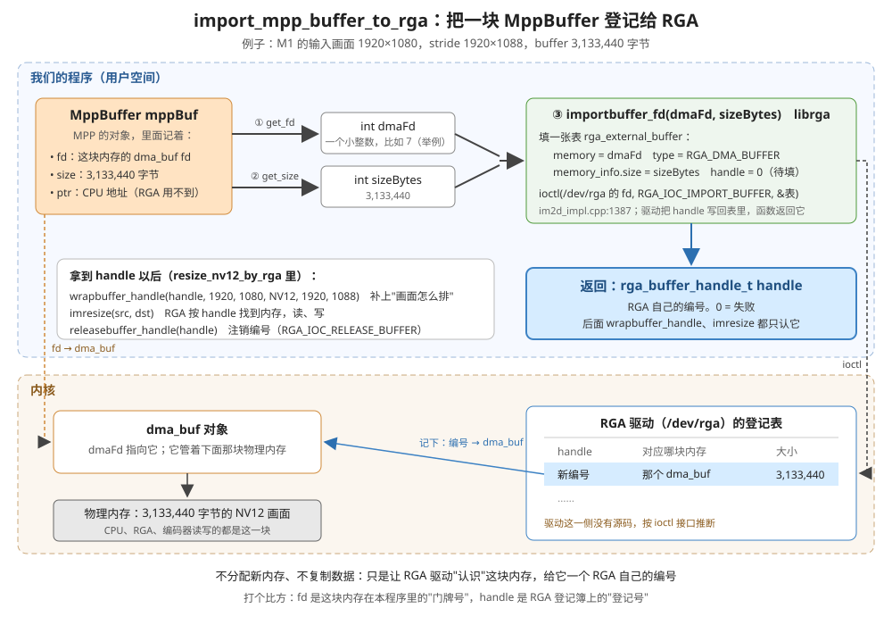

# 理解 M1：RGA 缩放一帧

> 2026-11-08 重写。代码行号按重构后的 `day4_rga/src/`；数字都是 2026-11-05 ～ 11-08 在板子上实测的，没实测的地方写了"推断"。
> 入口：[app/m1_resize_one_frame.cpp](../src/app/m1_resize_one_frame.cpp) 的 `run_m1_resize_one_frame()`

## 1. M1 干了什么

**从文件里读一帧 1920×1080 的 NV12 画面，用 RGA 硬件缩成 1280×720，再写成 NV12 文件。**

不编码，只做缩放。要学的是：怎么把一张画面描述给 RGA（在哪块内存、多大、内存怎么排），让它正确地读、正确地写。

```
in_1080p_60f.nv12（只读第 1 帧）
   │ read_nv12_frame：CPU 按 stride 一行行 fread
   ▼
srcPicture   1920×1080，stride 1920×1088（MPP 的 DRM buffer，有 fd）
   │ resize_nv12_by_rga：RGA 通过 fd 读、写
   ▼
dstPicture   1280×720，stride 1280×720（MPP 的 DRM buffer，有 fd）
   │ write_nv12_frame：CPU 按 stride 一行行 fwrite
   ▼
out_720p.nv12（1,382,400 字节）
```

程序按这 3 步走：

| 步 | 行号 | 做什么 |
|:--:|---|---|
| 1 | [17-23](../src/app/m1_resize_one_frame.cpp#L17-L23) | 建一个 MPP buffer group（DRM 类型，能拿到 fd） |
| 2 | [25-36](../src/app/m1_resize_one_frame.cpp#L25-L36) | 描述两张画面（宽高、stride），各申请一块 buffer；打开输入、输出文件 |
| 3 | [38-53](../src/app/m1_resize_one_frame.cpp#L38-L53) | 读一帧 → RGA 缩放（计时）→ 写文件 → 打印 |

## 2. 输入

| 项 | 值 |
|---|---|
| 文件 | `/userdata/av/in_1080p_60f.nv12`（Day 1 用过的测试素材） |
| 格式 | NV12：先放 Y（每像素 1 字节），再放 UV（U、V 交替，每 2×2 像素共用一对） |
| 分辨率 | 1920 × 1080 |
| 排法 | 60 帧首尾相连；每帧**没有填充**，一行紧挨着一行，一帧 1920 × 1080 × 1.5 = 3,110,400 字节 |
| 用了哪部分 | 只读第 1 帧 |

## 3. 输出

| 项 | 值（实测） |
|---|---|
| 文件 | `/userdata/av/out_720p.nv12` |
| 格式 | NV12，1280 × 720，没有填充 |
| 大小 | **1,382,400 字节** = 1280 × 720 × 1.5 |
| md5 | `d00d3d5e92a2b7dcab9e580a2b6ff6db`，跑了很多次都一样（同样的输入，RGA 每次结果完全相同） |
| RGA 用时 | 3.1 ～ 3.8 ms（几次运行）。推断：这是程序里第一次调用 RGA，包含 librga 初始化；连续缩很多帧时平均 2.7 ms |

程序打印：

```
I M1: ===== M1：RGA 把一帧 1080p 缩成 720p =====
rga_api version 1.10.0_[8]
I M1: 1920x1080（stride 1920x1088）-> 1280x720（stride 1280x720），RGA 用时 3.76 ms，写到 /userdata/av/out_720p.nv12
```

在 Mac 上看：和输入的第 1 帧并排比过，画面一样，只是小了，颜色正常。

```bash
adb pull /userdata/av/out_720p.nv12 result_from_board/
ffplay -f rawvideo -pixel_format nv12 -video_size 1280x720 result_from_board/out_720p.nv12
```

## 4. 用到的技术点

### 4.1 MPP：申请 RGA 能用的内存

RGA 是硬件，不认 CPU 的虚拟地址（`malloc` 出来的那种），认 dma_buf fd。所以两块 buffer 都从 MPP 申请：

| 调用 | 位置 | 做什么 |
|---|---|---|
| `mpp_buffer_group_get_internal(DRM \| CACHABLE)` | [m1_resize_one_frame.cpp:19](../src/app/m1_resize_one_frame.cpp#L19) | 建一个 buffer 池。**DRM**：背后是 dma_buf，有 fd，RGA、编码器都能用。**CACHABLE**：CPU 读写走 cache，快，但读写前后要 sync |
| `mpp_buffer_get` | [nv12_picture.cpp:22](../src/common/nv12_picture.cpp#L22) | 从池里申请一块，大小 = horStride × verStride × 1.5 |
| `mpp_buffer_get_ptr` | [nv12_picture.cpp:37](../src/common/nv12_picture.cpp#L37) | 拿 CPU 能用的地址，给 `fread` / `fwrite` 用 |
| `mpp_buffer_get_fd`、`mpp_buffer_get_size` | [rga_resizer.cpp:18-20](../src/rga/rga_resizer.cpp#L18-L20) | 拿 fd 和大小，交给 RGA |
| `mpp_buffer_sync_begin` / `sync_end` | [nv12_picture.cpp:39、52](../src/common/nv12_picture.cpp#L39)（读）、[58、69](../src/common/nv12_picture.cpp#L58)（写） | 见下 |
| `mpp_buffer_put`、`mpp_buffer_group_put` | `MppBufferPtr`、`MppBufferGroupPtr` 析构时 | 释放。buffer 声明在 group 后面，所以先释放 buffer 再释放 group |

**为什么要 sync**：buffer 是 CACHABLE 的，CPU 写进去的数据可能还停在 cache 里，没写回内存；RGA 是直接读内存的。

- CPU 写完、RGA 要读之前（`read_nv12_frame`）：`sync_end` 把 cache 里的新数据写回内存，RGA 才读得到
- RGA 写完、CPU 要读之前（`write_nv12_frame`）：`sync_begin` 让 CPU 丢掉 cache 里的旧数据，去内存读 RGA 刚写的结果

### 4.2 RGA：描述画面、缩放

代码在 [rga/rga_resizer.cpp](../src/rga/rga_resizer.cpp)，分 4 步：

| 步 | 调用 | 行号 | 做什么 |
|:--:|---|---|---|
| ① | `importbuffer_fd(fd, sizeBytes)` | [22](../src/rga/rga_resizer.cpp#L22) | 把这块内存登记给 RGA 驱动，返回一个编号（handle）。后面 RGA 只认 handle，不认 fd。返回 0 = 失败 |
| ② | `wrapbuffer_handle(handle, 宽, 高, 格式, wstride, hstride)` | [42-45](../src/rga/rga_resizer.cpp#L42-L45) | 描述画面，见下表 |
| ③ | `imcheck` → `imresize` | [48](../src/rga/rga_resizer.cpp#L48)、[56](../src/rga/rga_resizer.cpp#L56) | 先检查参数，再缩放。`imresize` 默认同步，RGA 做完才返回 |
| ④ | `releasebuffer_handle` | [63-64](../src/rga/rga_resizer.cpp#L63-L64) | 注销 handle。只释放 RGA 的编号，不释放 MppBuffer 本身 |

描述一张画面要 4 样东西：

| 参数 | 输入 | 输出 | 意思 |
|---|---|---|---|
| handle | `handleSrc` | `handleDst` | 在哪块内存 |
| 宽 × 高 | 1920 × 1080 | 1280 × 720 | 画面多大；RGA 按两边的宽高自动算缩放比例 |
| wstride × hstride | 1920 × **1088** | 1280 × 720 | 内存里一行占多少字节、Y 平面占多少行：**必须和 buffer 里实际的排法一样** |
| 格式 | `RK_FORMAT_YCbCr_420_SP` | 同左 | 就是 NV12 |

第 ① 步在 `import_mpp_buffer_to_rga`（[rga_resizer.cpp:17-23](../src/rga/rga_resizer.cpp#L17-L23)）里，拆开看是这样：



- `mpp_buffer_get_fd`、`mpp_buffer_get_size`：从 MppBuffer 里取出两样 RGA 需要的东西，这块内存的 dma_buf fd 和它的字节数。
- `importbuffer_fd`：librga 把 fd 和大小填进一张表（`rga_external_buffer`，类型 `RGA_DMA_BUFFER`），用 `ioctl(RGA_IOC_IMPORT_BUFFER)` 交给 `/dev/rga` 驱动，驱动把分配好的 handle 写回这张表（`rk_code/external/linux-rga/im2d_api/src/im2d.cpp:103`、`im2d_impl.cpp:1387`）。驱动内部怎么记这个编号，没有源码，是按接口推断的。
- 整个过程**不分配新内存、不复制数据**。fd 只在本程序里有效，handle 是 RGA 驱动自己的编号；`imresize` 时 RGA 按 handle 找到同一块物理内存去读写。
- `releasebuffer_handle` 是反过来的一步（`RGA_IOC_RELEASE_BUFFER`）：注销编号，内存本身不动，还归 MppBuffer 管。

两个返回值不一样：`imcheck` 成功是 `IM_STATUS_NOERROR`（[第 49 行](../src/rga/rga_resizer.cpp#L49)），`imresize` 成功是 `IM_STATUS_SUCCESS`（[第 57 行](../src/rga/rga_resizer.cpp#L57)）。

### 4.3 NV12 + stride：buffer 里怎么排

为什么输入的 hstride 是 1088：MPP 要求宽高对齐到 16，`make_aligned_nv12_picture` 用 `ALIGN(1080, 16)` 算出 1088（[nv12_picture.cpp:14-15](../src/common/nv12_picture.cpp#L14-L15)）。720 本来就是 16 的倍数，所以输出不用对齐。

输入 buffer（1920 × 1080，stride 1920 × 1088）：

```
行号         内容
0～1079      Y：每行 1920 字节                 ← read_nv12_frame 写
1080～1087   填充：8 行，从来不写（实测一直是 0）
1088～1627   UV：每行 1920 字节，U V U V 交替   ← read_nv12_frame 写
1628～1631   buffer 尾部：4 行，从来不写
```

buffer 大小 = 1920 × 1088 × 1.5 = **3,133,440 字节**（[nv12_picture.cpp:20](../src/common/nv12_picture.cpp#L20)）。

文件里一帧是 3,110,400 字节（没有填充），buffer 里是 3,133,440 字节（有填充），所以 `read_nv12_frame` 不能一次 `fread` 整帧，要一行一行读：Y 读 1080 行，然后**跳到第 1088 行**再读 UV 的 540 行（[nv12_picture.cpp:42-51](../src/common/nv12_picture.cpp#L42-L51)）。NV12 的排法详见 [0_base_NV12内存排布.md](0_base_NV12内存排布.md)。

### 4.4 这一次的重点：stride 填错会怎样（2026-11-06 实测）

buffer 照样按 1088 排，只在交给 RGA 时把 hstride 写成 1080：


右边**顶部多了一条绿边**，其他地方乍看差不多。原因：RGA 以为 UV 从第 1080 行开始，实际从第 1088 行开始：

```
RGA 以为的 UV 第 0～7 行 = 实际的第 1080～1087 行 = 填充（全是 0）
RGA 以为的 UV 第 k 行    = 实际的 UV 第 k - 8 行
```

1. **顶部绿边**：前 8 行"UV"其实是填充，U = V = 0。U、V 等于 128 才是"没有颜色"，0 偏得最远，配上 Y 就是很绿的颜色。UV 的 1 行管 Y 的 2 行，所以顶部 16 行变绿，缩到 720p 后约 10.7 行。实测输出里 UV 第 0～4 行的 U、V 平均值都是 **0**，第 5 行开始才正常（U ≈ 88，V ≈ 177）。
2. **其他地方颜色往下错了 16 行**：这张图很模糊、颜色变化平缓，肉眼看不出（推断，没换图实测）。

**结论：stride 填错不报错。** `imcheck` 照样通过（1080 也是合法的 stride），RGA 只会安静地读错位置。描述画面的 stride，必须和写 buffer 时用的是**同一组数**。

## 5. 实际业务场景

RGA 缩放在 RK 平台的视频产品里几乎处处都用：

| 场景 | 缩放用来干什么 |
|---|---|
| **一路摄像头出多路码流**（监控 IPC、直播） | 1080p 原图缩成 720p、D1，再交给第二个编码器出子码流 |
| **AI 推理前处理** | 摄像头画面缩到模型要的输入尺寸（比如 640×640）再交给 NPU；通常还要顺带转成 RGB（换成 `imcvtcolor`） |
| **NVR 多画面预览** | 16 路摄像头各自缩成小图，拼成一屏九宫格、十六宫格显示 |
| **转码降分辨率** | 解码出来的 1080p 帧缩成 720p，再编码，生成低清晰度版本 |
| **抓图、缩略图** | 从视频里截一帧，缩成小图当封面或报警截图 |
| **屏幕显示** | 视频分辨率和屏幕分辨率不一样时，缩放到屏幕大小 |

用 RGA 而不用 CPU 的原因：1080p 一帧 311 万字节，每秒 30 帧，用 CPU 逐像素插值要占掉一个核的大部分时间（推断，没实测 CPU 版本）；RGA 实测 3 ms 左右一帧，而且不占 CPU。

## 6. 运行

```bash
cd ~/Documents/AV/rk_work/day4_rga
./run_on_board_with_mac.sh m1      # 不带参数默认跑 m3，跑 M1 要带 m1
adb shell md5sum /userdata/av/out_720p.nv12    # 应该是 d00d3d5e92a2b7dcab9e580a2b6ff6db
```
