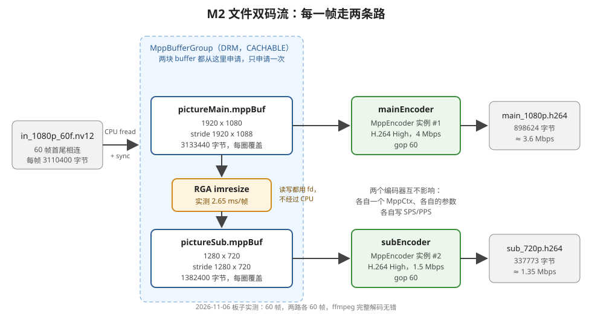

# 理解 M2 的需求和代码：文件双码流

> 2026-11-06 写。代码以 `day4_rga/src/main.cpp` 当前版本为准（行号也按这一版）；数字都是 2026-11-06 在板子上实测的，没实测的地方写了"推断"。
> 上一篇：[1_理解M1的需求和代码.md](1_理解M1的需求和代码.md)（RGA 缩放一帧）

## 0. 一句话

**同一路画面，同时编出两路码流：原图编成 1080p 4 Mbps 的主码流，再用 RGA 缩成 720p，编成 1.5 Mbps 的子码流。**

跑完能回答 3 个问题：

| 问题 | 答案（实测） | 详见 |
|---|---|---|
| 一路画面，怎么同时编出两路不同分辨率的码流？ | 两个独立的 `MppEncoder` 实例 + RGA 缩放 | 第 3.1 节 |
| 两路码流的参数怎么配？文件差多大？ | 只差宽高、stride、码率三项；子码流 1.5 Mbps，文件是主码流的 **38%** | 第 3.2、3.6 节 |
| RGA 和编码器之间怎么交接画面，才不经过 CPU 拷贝？ | 子码流的 buffer 从 MPP 申请，RGA 通过 fd 写进去，原样交给子编码器 | 第 3.5 节 |

## 1. 需求：为什么要两路码流

### 1.1 先说人话

一个监控摄像头、一台直播推流机，通常**同时**输出两路码流：

| | 主码流 | 子码流 |
|---|---|---|
| 分辨率 | 高（1080p） | 低（720p、D1、CIF……） |
| 码率 | 高（4 Mbps） | 低（1.5 Mbps 以下） |
| 给谁用 | 录像存盘、在电脑上看回放 | 手机预览、九宫格多画面、网络差的时候看 |

打个比方：同一场比赛，电视台既出高清信号给电视机，也出一个小码率的信号给手机 App。内容一样，只是清晰度和流量不同。

### 1.2 为什么不先编一路 1080p，再转码成 720p

也可以，但要多走一圈：1080p 码流 → **解码**回 YUV → 缩小 → **再编码**。多一次解码、多一次编码，延迟和功耗都更高，画质还要多损失一次。

直接在**编码之前**把画面分成两份（一份原图、一份缩小），两个编码器各编各的，是最省的做法。RK3588 上，缩小交给 RGA 硬件，编码交给 VPU 硬件，CPU 几乎不参与。

### 1.3 MPP 编码器自己不会缩放

MPP 编码器"给什么尺寸就编什么尺寸"：`prep:width` / `prep:height` 必须和送进去的画面一样大（Day 1 学过）。所以要出 720p 的码流，就得先有一张 720p 的画面，这就是 RGA 的工作。

## 2. 整体流程



每一帧都要走完这 4 步（`main.cpp:275-289` 的 while 循环）：

```
① 读一帧 1080p NV12 进 pictureMain.mppBuf      read_nv12_frame
② mainEncoder 编 pictureMain → 写主码流文件      mainEncoder.encode + write_packet
③ RGA 把 pictureMain 缩成 720p 写进 pictureSub   resize_nv12_by_rga
④ subEncoder 编 pictureSub → 写子码流文件        subEncoder.encode + write_packet
```

文件读完以后，给两个编码器各送一次 EOS，把剩下的码流取完（`drain_encoder`）。

## 3. 核心知识点

### 3.1 两个编码器实例，互不影响

`main.cpp:245-246` 声明了两个对象：

```cpp
MppEncoder mainEncoder;
MppEncoder subEncoder;
```

每个 `MppEncoder` 在 `init()` 里都会调用一次 `mpp_create` + `mpp_init`（`mpp_encoder.cpp:27`、`:29`），各自拿到**自己的** `MppCtx`（编码器实例的句柄）和自己的一套参数（`MppEncCfg`）。

- 两个实例的宽高、码率、GOP 可以完全不同，互相看不到对方的设置
- 两个实例各自维护参考帧、码率控制的状态。比如子码流的 P 帧只参考子码流自己的上一帧，和主码流无关
- 底层是同一个 VPU 硬件，MPP 驱动负责让两个实例轮流使用它（推断：按 MPP 的多实例设计，没有看驱动的调度代码）

### 3.2 两路参数只差三项

`main.cpp:226-238`：

| 参数 | 主码流 `mainCfg` | 子码流 `subCfg` | 对应 `mpp_enc_cfg` 的 key |
|---|---|---|---|
| 宽 × 高 | 1920 × 1080 | 1280 × 720 | `prep:width` / `prep:height` |
| stride | 1920 × 1088 | 1280 × 720 | `prep:hor_stride` / `prep:ver_stride` |
| 码率 | 4 Mbps | 1.5 Mbps | `rc:bps_target`（`mpp_encoder.cpp:56`） |
| 编码格式、帧率、GOP、码控模式 | H.264、30 fps、60、CBR | 一样（都用 `EncoderConfigArg` 的默认值） | `codec:type`、`rc:fps_*`、`rc:gop`、`rc:mode` |

宽高和 stride 是直接从 `pictureMain` / `pictureSub` 抄过来的（`mainCfg.width = pictureMain.width;` ……）。这样写的好处是：**编码器以为的画面排布，和 buffer 里实际的排布，一定是同一组数**。两边对不上，编码器就会把 UV 当成 Y 去读，画面错乱。

为什么 720p 的 ver_stride 是 720，不是 1088 那种"多出来几行"：`ALIGN(720, 16) = 720`，720 本来就是 16 的倍数；1080 不是，所以向上对齐到 1088。

### 3.3 SPS/PPS：每路码流都要有自己的一份

**SPS / PPS 是什么**：H.264 码流开头的两小段"说明书"。SPS（序列参数集）里写着分辨率、profile、level 等；PPS（图像参数集）里写着熵编码方式（CABAC 还是 CAVLC）等。解码器必须先读到它们，才知道后面的数据怎么解。

两路码流的分辨率不同，SPS 自然不同，所以**每路都要写自己的那一份**。`init_encoder_and_write_header`（`main.cpp:108-118`）做的就是：`init` 完马上 `getHeader`，拿到这个编码器的 SPS/PPS，写到它自己的码流文件开头。

**实测**（用 Python 扫两个文件里的 NAL 起始码）：

| | 主码流 | 子码流 |
|---|---|---|
| 文件开头 | SPS（31 字节）+ PPS（9 字节）= **40 字节** | SPS（30 字节）+ PPS（9 字节）= **39 字节** |
| ffprobe 看到的 level | **4.0** | **3.1** |
| 整个文件里有几份 SPS / PPS | 1 / 1 | 1 / 1 |

- 两份 SPS 不一样长，就是因为里面的宽高、level 不同。
- level 不是我们设的：帧率是 30，`mpp_encoder.cpp:69` 那句只在 `fps > 30` 时才设 level，所以这里用的是 MPP 按分辨率自动选的值，1080p 选 4.0，720p 选 3.1。
- 程序打印的"主码流 898584 字节"比文件实际大小 898624 **少 40 字节**，子码流少 39 字节：统计只累加了每帧的包，没算开头的 SPS/PPS，差值正好是上表的头大小。

**为什么文件里只有 1 份 SPS/PPS**：`init()` 里设了 `MPP_ENC_HEADER_MODE_EACH_IDR`（`mpp_encoder.cpp:80`），意思是每个 IDR 帧前面都自动带一份 SPS/PPS。可是 60 帧里只有第 0 帧是 IDR，而在这之前我们已经用 `MPP_ENC_GET_HDR_SYNC` 主动取过一次头了。MPP 源码里，主动取头会设一个"头已经输出过"的标志（`rk_code/external/mpp/mpp/codec/mpp_enc_impl.cpp:1007`，`hdr_status.added_by_ctrl = 1`），编码第一帧时看到这个标志，就不再往 IDR 前面重复加头（同一文件 `:1540-1557`：只有 `hdr_status` 里 3 个"已加过"标志都是 0 时才加）。所以第 0 帧的包是从 SEI 开始的，不带 SPS/PPS。这个标志在每一帧编完时清掉（`:2936`，`hdr_status.val = hdr_status.ready`），所以 GOP 更短、文件里有第二个 IDR 时，第二个 IDR 前面会自动带上 SPS/PPS（按源码推断，没有实测）。

### 3.4 一块 buffer 反复用：为什么安全

`pictureMain.mppBuf` 和 `pictureSub.mppBuf` 都只在循环**之前**申请一次（`main.cpp:260-261`），每一圈用新的一帧覆盖内容，循环结束后才释放（`:300-305`）。

2026-11-06 加探针实测前 3 圈：`mpp_buffer_get_ptr` 每次返回的都是同一个地址 `0x7f867f6000`，`Y[0]` 依次是 189、153、51，说明地址不变，内容每圈都是新的一帧。原因在 MPP 源码 `mpp/base/mpp_buffer.cpp:174-176`：第一次调用时才 mmap，之后直接返回存好的地址。

覆盖之前，上一帧必须已经被用完。现在每一步都是**同步**的，函数返回就说明用完了：

| 步骤 | 为什么返回时已经用完 |
|---|---|
| `mainEncoder.encode(pictureMain.mppBuf, ...)` | 先 `encode_put_frame`，再用 `MPP_POLL_BLOCK` 阻塞等 `encode_get_packet`（`mpp_encoder.cpp:26`、`:129`、`:135`），拿到这一帧的码流才返回 |
| `resize_nv12_by_rga(...)` | `imresize` 的 `sync` 参数默认是 1（sysroot 里 `rga/im2d_single.h:61`），RGA 做完才返回 |

以后换成多线程编码（Day 5），送帧的线程不等编码器编完就去读下一帧，这时候就要用好几块 buffer 轮流用了。Day 3 摄像头的 V4L2 有 4 块 buffer 轮转，也是同样的原因。

**填充行不用管**：1080 → 1088 多出来的 8 行，`read_nv12_frame` 从来不写，实测一直是 0。编码器和 RGA 只按 width × height 读画面，不会去读这几行。

**CPU cache 要管**：buffer 是 `MPP_BUFFER_FLAGS_CACHABLE` 申请的，CPU 写进去的数据可能还停在 cache 里，没写回 DRAM；编码器和 RGA 是用 DMA 直接读 DRAM 的。所以 `read_nv12_frame` 在写之前调 `mpp_buffer_sync_begin`，写完调 `mpp_buffer_sync_end`（`main.cpp:65`、`:79`），把新数据写回 DRAM。

### 3.5 RGA → 编码器：零拷贝交接

```
pictureMain.mppBuf ──fd──► RGA 读
                              │ 缩放
pictureSub.mppBuf  ◄──fd── RGA 写
        │
        └──（同一块 MppBuffer，原样传进去）──► subEncoder.encode(pictureSub.mppBuf, ...)
```

- `pictureSub.mppBuf` 不是 `malloc` 来的，是从 MPP 的 DRM buffer group 申请的（`main.cpp:261`）。这种 buffer 背后是 dma_buf，有一个 fd。
- RGA 通过 `mpp_buffer_get_fd` 拿到 fd，再用 `importbuffer_fd` 导入（`rga_resizer.cpp:18-22`），直接往这块物理内存里写。
- 写完以后，同一个 `MppBuffer` 原样传给 `subEncoder.encode()`，编码器也是直接读这块物理内存。

整个过程**没有 CPU memcpy**。如果子码流的 buffer 是 `malloc` 来的，RGA 写完以后还得 CPU 拷一遍到 MPP 的 buffer 里，1280 × 720 × 1.5 = 1.38 MB，每秒 30 次就是 41 MB/s 的白拷贝。

### 3.6 决定文件大小的是码率，不是分辨率

这是 M2 最有意思的实验。主码流一直是 4 Mbps 不变，子码流的码率换了 3 次：

| 子码流码率 | 子码流文件大小 | 和主码流（898,624 字节）比 |
|---|---|---|
| 4 Mbps（和主码流一样） | 859,490 字节 | **96%** |
| 6 Mbps（`4 * 1500 * 1000` 写错时） | 1,263,134 字节 | **141%** |
| **1.5 Mbps** | **337,773 字节** | **38%** |

结论：

1. **只降分辨率、不降码率，子码流就白做了**。720p 的像素只有 1080p 的 44%，可是文件几乎一样大：码率控制（CBR）按设定的码率花钱，像素少了，它就把省下来的码率全用在画质上。
2. 文件大小 ≈ 码率 × 时长。60 帧 ÷ 30 fps = 2 秒：
   - 主码流：898,624 × 8 ÷ 2 ≈ **3.6 Mbps**（设的 4 Mbps）
   - 子码流：337,773 × 8 ÷ 2 ≈ **1.35 Mbps**（设的 1.5 Mbps）
   - 两路都比设定值低 10% 左右。推断：只有 2 秒、60 帧，码率控制还没来得及收敛；跑长一点应该更接近设定值（未实测）。

## 4. 代码逐段讲（`src/main.cpp`）

### 4.1 `run_m2_dual_stream_from_file()` 的骨架

| 行 | 做什么 | 要点 |
|---|---|---|
| 208-212 | 建 buffer group（DRM + CACHABLE） | 和 M1 一样。DRM 类型的 buffer 有 fd，RGA 和编码器都能直接用 |
| 214-224 | 描述两张画面 `pictureMain`、`pictureSub` | stride 用 `ALIGN(x, 16)`：1080 → 1088，720 → 720 |
| 226-238 | 两路编码参数 | 只差宽高、stride、码率（第 3.2 节） |
| 241-258 | 打开 1 个输入文件、2 个输出文件 | 输出用 `"wb"`；打开失败就关掉已经打开的，返回 1 |
| 260-263 | 申请两块 buffer；两个编码器各自 init + 写 SPS/PPS | 4 步都成功才进循环 |
| 275-289 | **主循环**：读 → 编主码流 → RGA 缩放 → 编子码流 | 第 4.2 节 |
| 291-297 | 两个编码器各自 drain；打印统计 | 第 4.3 节 |
| 300-313 | 释放两块 buffer、关文件、销毁 buffer group | buffer 要在 group 之前释放 |

### 4.2 主循环（`main.cpp:275-289`）

```cpp
while (isAllOk && read_nv12_frame(inputFile, pictureMain)) {
```

- **为什么用 while**：输入文件是 60 帧首尾相连拼成的，没有"一共几帧"的文件头。每读一次，`fread` 的位置往后移一帧，读到文件末尾时 `read_nv12_frame` 返回 false，循环就停了。换成 30 帧或 300 帧的文件，代码不用改。
- **为什么 `isAllOk` 写在前面**：`&&` 有短路规则，左边是 false 就不算右边。上一圈出错后，这一圈不会再白读一帧。

```cpp
isAllOk = mainEncoder.encode(pictureMain.mppBuf, false, mainPacket) &&
          write_packet(mainStreamFile, mainPacket);
```

这一行做两件事：① 把 `pictureMain.mppBuf` 里的这一帧送进编码器，取回这一帧的码流；② 把码流追加写进主码流文件。

- `encode()` 返回时，码流已经从 `MppPacket` **拷贝**到了 `mainPacket.data`（`std::vector<uint8_t>`，`mpp_encoder.cpp:151`），`MppPacket` 自己已经释放了。
- `encode()` 返回 true 只表示没出错，`mainPacket.data` 可能是空的（这一轮编码器还没输出）。`write_packet` 第一行判断了空包（`main.cpp:102-104`），空包什么都不写，也不算失败。实测 60 帧每帧都有输出。

```cpp
const double beforeResizeMs = get_now_ms();
isAllOk = isAllOk && resize_nv12_by_rga(pictureMain, pictureSub);
resizeTotalMs += get_now_ms() - beforeResizeMs;
```

计时只包住 RGA 这一步，最后除以帧数，得到"RGA 缩放平均 x ms/帧"。

```cpp
isAllOk = isAllOk && subEncoder.encode(pictureSub.mppBuf, false, subPacket) &&
          write_packet(subStreamFile, subPacket);
```

和主码流一样，只是换成子编码器和缩小后的 buffer。

### 4.3 收尾：drain（`main.cpp:128-147`、`:291`）

**drain = 排空**：告诉编码器"没有新帧了"（送一个不带图像、只带 EOS 标志的空帧），然后把编码器内部还没输出的码流全部取出来，直到收到带 EOS 标志的包。

为什么需要：编码器内部有流水线，开了 B 帧或者多线程编码时，会积压几帧不立刻输出。不排空就关掉编码器，最后几帧就丢了。

**实测**：在现在的配置下，drain 取出 **0 字节**。对比过 drain 没执行（`drain_encoder` 里还写着 `!= MPP_OK`、第一次就 return 的时候）和执行了两种情况，主码流文件都是 898,624 字节。推断原因：没开 B 帧，只有 I 帧和 P 帧；`encode()` 是 put 一帧就阻塞 get 一包，一进一出，编码器里没有积压。写 drain 是标准流程，Day 5 换成多线程以后就会真正派上用场。

`for (... tryIndex < 30 ...)`：最多送 30 次，防止编码器一直不回 EOS 包时死循环。

### 4.4 用到的小函数

| 函数 | 行 | 做什么 |
|---|---|---|
| `alloc_nv12_picture` | 42-50 | 按 `horStride × verStride × 1.5` 申请一块 MppBuffer |
| `read_nv12_frame` | 62-81 | 按 stride 一行行 fread：Y 写 `height` 行；UV 从第 `verStride` 行开始写 `height / 2` 行；前后 sync |
| `write_packet` | 101-106 | 空包直接返回 true；否则 fwrite，返回写够没有 |
| `init_encoder_and_write_header` | 108-118 | `init` → `getHeader` → 把 SPS/PPS 写到文件开头 |
| `drain_encoder` | 128-147 | 送 EOS，取包写文件，直到 EOS 包 |

## 5. 运行和验证

```bash
cd ~/Documents/AV/rk_work/day4_rga
./run_on_board_with_mac.sh m2        # 编译 → adb push → 板子上运行（不带参数默认也是 m2）
./get_result_from_board.sh           # 把两个 .h264 拷到 result_from_board/，核对大小

cd result_from_board
ffprobe -v error -count_frames -select_streams v:0 \
  -show_entries stream=profile,level,width,height,nb_read_frames -of compact=p=0 main_1080p.h264
ffprobe -v error -count_frames -select_streams v:0 \
  -show_entries stream=profile,level,width,height,nb_read_frames -of compact=p=0 sub_720p.h264
ffmpeg -v error -i main_1080p.h264 -f null - && echo "main ok"
ffmpeg -v error -i sub_720p.h264  -f null - && echo "sub ok"
ffplay main_1080p.h264
ffplay sub_720p.h264
```

> ffmpeg / ffplay 的路径是 `result_from_board/` 下的相对路径。在 CLion 里点 md 代码块的 ▶ 运行时，当前目录是工程根目录 `day4_rga/`，要写成 `result_from_board/main_1080p.h264`，或者先 `cd`。

**板子输出（2026-11-06 实测）**：

```
I Main: ===== M2：文件双码流（1080p 主码流 + 720p 子码流）=====
rga_api version 1.10.0_[8]
I Main: 60 帧；RGA 缩放平均 2.65 ms/帧
I Main: 主码流 1920x1080：898584 字节 -> /userdata/av/main_1080p.h264
I Main: 子码流 1280x720：337734 字节 -> /userdata/av/sub_720p.h264
```

**Mac 上验证（2026-11-06 实测）**：

| | profile | level | 宽 × 高 | 帧数 | ffmpeg 完整解码 |
|---|---|---|---|---|---|
| main_1080p.h264 | High | 4.0 | 1920 × 1080 | 60 | 无错 |
| sub_720p.h264 | High | 3.1 | 1280 × 720 | 60 | 无错 |

两路的第 30 帧并排看过：内容一样，子码流稍微软一点，看不出块状失真。

验收：
- [x] 两个文件 ffprobe 都是 60 帧，宽高分别是 1920 × 1080、1280 × 720
- [x] 两个文件都能完整解码，内容一样，只是清晰度不同
- [x] 两个文件的大小比（38%）和码率比（1.5 ÷ 4 = 37.5%）接近

## 6. 实测数据解读

### 6.1 I 帧和 P 帧各多大

用 `ffprobe -show_packets` 看每个包的大小和关键帧标志：

| | I 帧 | P 帧（59 个） | I 帧是 P 帧平均的几倍 | I 帧占整个文件 |
|---|---|---|---|---|
| 主码流 | 1 个，74,714 字节（第 0 帧） | 平均 13,964 字节，最小 9,687，最大 27,520 | 5.4 倍 | 8.3% |
| 子码流 | 1 个，35,675 字节（第 0 帧） | 平均 5,120 字节，最小 3,129，最大 13,007 | 7.0 倍 | 10.6% |

- **只有 1 个 I 帧**：GOP 设的是 60（每 60 帧一个 I 帧），文件正好 60 帧，所以只有第 0 帧是 I 帧。
- **I 帧大得多**：I 帧不参考别的帧，整张画面都要编进去；P 帧只编"和上一帧哪里不一样"。
- 这就是 GOP 影响文件大小的原因：GOP 越小，I 帧越多，同样码率下画质越差，或者同样画质下文件越大（流程文档第 7 节的 GOP 实验可以验证，还没做）。

### 6.2 RGA 有多快

- M2：60 帧平均 **2.65 ms/帧**（几次运行在 2.64～2.73 ms 之间）
- M1 只缩一帧：3.45～3.75 ms。推断：M1 那一次是程序里第一次调用 RGA，包含了 librga 初始化的时间
- 30 fps 时每帧只有 33 ms，RGA 只占 **8%** 左右，而且是硬件做的，不占 CPU

### 6.3 整个程序跑多久

板子日志里，从第一行到统计日志，大约 **1 秒**跑完 60 帧（包含两个编码器的初始化）。60 帧对应视频时长 2 秒，所以比实时快一倍左右。这个数是从日志时间戳粗算的，没有单独计时。

## 7. review 时抓到的坑（都是编译器不报、运行才出问题的）

| 坑 | 现象 | 为什么 | 改法 |
|---|---|---|---|
| 主码流 `fopen(..., "rb")` | 文件不存在时打开失败；存在也写不进去 | `"rb"` 是只读 | 输出文件用 `"wb"` |
| `exitCode` 声明在 `if { }` 里面 | 编译报 `'exitCode' was not declared in this scope` | 变量只在声明它的大括号里有效 | 挪到 `if` 前面 |
| `encoder.encode(...) != MPP_OK` | 成功被当成失败：drain 第一次就 return false，统计日志不打印 | `encode` 返回 `bool`（成功 = true = 1），`MPP_OK` 是 0，`1 != 0` 成立 | 返回 `bool` 的函数用 `!encoder.encode(...)`；返回 `MPP_RET` 的 MPP 原生函数才用 `!= MPP_OK` |
| `int` 函数里 `return false;` | 打开文件失败时，退出码却是 0（成功） | `false` 转成 int 是 0 | 返回 1（或者返回还没改过的 `exitCode`） |
| `subCfg.bps = 4 * 1500 * 1000;` | 子码流比主码流还大 | 算出来是 6 Mbps | `1500 * 1000` |

判断用 `!` 还是 `!= MPP_OK`：在 CLion 里把鼠标停在函数名上，看返回类型。

## 8. 问题和答案

1. **为什么两路码流要各自写 SPS/PPS？把子码流开头的 SPS/PPS 去掉，还能播吗？**
   SPS 里有分辨率、profile、level，两路不一样（实测 31 字节和 30 字节，level 4.0 和 3.1）。去掉以后解码器不知道画面多大、怎么解，**不能播**。而且这个文件里只有开头这一份 SPS/PPS（第 3.3 节），去掉就一份都没有了。（"不能播"是按 H.264 规范推断的，没有实际删掉试过。）
2. **子码流码率从 1.5 Mbps 改成 0.5 Mbps，文件变多小？画质差多少？** 还没做。按"文件 ≈ 码率 × 时长"估算，大约 0.5 × 2 ÷ 8 ≈ 125 KB。可以和第 3.6 节的表放在一起看。
3. **子码流改成 H.265（`subCfg.type = MPP_VIDEO_CodingHEVC`），同样码率，画质比 H.264 怎么样？** 还没做。注意 `mpp_encoder.cpp` 里 `h264:` 开头的参数只在 H.264 时设置，H.265 会用 MPP 的默认值。
4. **为什么一块 `pictureMain.mppBuf` 可以反复用，不用每帧申请新的？** 每一步都是同步的，返回时上一帧已经用完（第 3.4 节）。
5. **drain 在这里取出了多少字节？为什么还要写？** 0 字节；Day 5 多线程、开 B 帧时才会有积压（第 4.3 节）。

## 9. 下一步：M3 摄像头双码流

和 M2 只差输入：把"从文件读一帧"换成"摄像头 DQBUF 出来的那块 buffer"（Day 3 的零拷贝 import）。注意摄像头 buffer 的 stride 是 1920 × 1080，不是 1088（Day 3 踩过）。等摄像头装回再做，见流程文档第 6 节。
