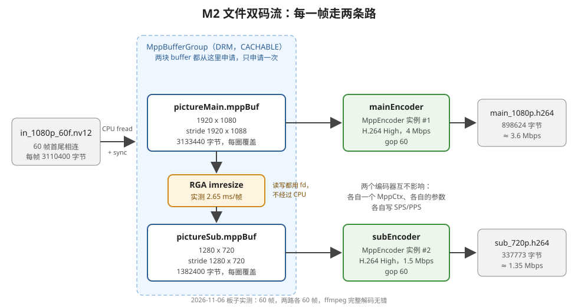

# 理解 M2：文件双码流

> 2026-11-08 重写。代码行号按重构后的 `day4_rga/src/`；数字都是 2026-11-06 ～ 11-08 在板子上实测的，没实测的地方写了"推断"。
> 入口：[app/m2_dual_stream_from_file.cpp](../src/app/m2_dual_stream_from_file.cpp) 的 `run_m2_dual_stream_from_file()`

## 1. M2 干了什么

**读一个 60 帧的 1080p NV12 文件，每一帧同时编成两路 H.264：原图编成 1080p 4 Mbps 的主码流；用 RGA 缩成 720p，编成 1.5 Mbps 的子码流。**



每一帧走 4 步：

```
① 读一帧 1080p NV12 进 mainPicture            read_nv12_frame
② 编码器 #1 编 mainPicture → 写主码流文件       ┐ encode_main_and_resize_to_sub
③ RGA 把 mainPicture 缩成 720p 写进子码流 buffer ┘
④ 编码器 #2 编子码流 buffer → 写子码流文件       encode_sub
```

文件读完以后，两个编码器各送一次 EOS，把剩下的码流取完。

程序按这 4 步走：

| 步 | 行号 | 做什么 |
|:--:|---|---|
| 1 | [16-29](../src/app/m2_dual_stream_from_file.cpp#L16-L29) | 申请输入画面的 buffer（1920×1080，stride 1920×1088），打开输入文件 |
| 2 | [31-50](../src/app/m2_dual_stream_from_file.cpp#L31-L50) | 配两路编码参数；`DualStreamEncoder::open` 申请子码流 buffer、打开两个输出文件、两个编码器 init 并写 SPS/PPS |
| 3 | [52-58](../src/app/m2_dual_stream_from_file.cpp#L52-L58) | 循环：读一帧 → 编主码流 + RGA 缩 → 编子码流，读到文件末尾为止 |
| 4 | [60-70](../src/app/m2_dual_stream_from_file.cpp#L60-L70) | 两个编码器收尾（送 EOS），打印帧数、RGA 平均耗时、两路字节数 |

## 2. 输入

| 项 | 值 |
|---|---|
| 文件 | `/userdata/av/in_1080p_60f.nv12`（Day 1 用过的测试素材） |
| 格式 | NV12，1920 × 1080 |
| 排法 | 60 帧首尾相连，每帧没有填充，3,110,400 字节；没有文件头，所以程序靠"读不满一帧"判断结束 |
| 帧率 | 文件本身不带帧率；编码时按 30 fps，60 帧 = 2 秒 |

## 3. 输出

| | 主码流 | 子码流 |
|---|---|---|
| 文件 | `/userdata/av/main_1080p.h264` | `/userdata/av/sub_720p.h264` |
| 编码参数 | H.264 High，CBR **4 Mbps**，30 fps，GOP 60 | H.264 High，CBR **1.5 Mbps**，30 fps，GOP 60 |
| 宽 × 高 | 1920 × 1080 | 1280 × 720 |
| 帧数 | 60 | 60 |
| 文件大小 | **898,624 字节** | **337,773 字节**（主码流的 38%） |
| 实际码率（÷ 2 s） | 3.6 Mbps | 1.35 Mbps |
| level（MPP 自动选的） | 4.0 | 3.1 |
| 开头的 SPS + PPS | 31 + 9 = 40 字节 | 30 + 9 = 39 字节 |
| md5 | `da5d76febd1c236cd9c70d04cb6a0f62` | `4ec9db88c6795b030bdd41e19adaabe9` |

两个都是裸 H.264 码流（Annex-B），`ffplay` 能直接播；ffmpeg 完整解码无错。两路的第 30 帧并排看：内容一样，子码流稍微软一点，看不出块状失真。输入是同一个文件，所以每次跑出来逐字节相同，可以用 md5 验证。

程序打印：

```
I M2: ===== M2：文件双码流（1080p 主码流 + 720p 子码流）=====
rga_api version 1.10.0_[8]
I M2: 60 帧；RGA 缩放平均 2.74 ms/帧
I M2: 主码流 1920x1080：898584 字节 -> /userdata/av/main_1080p.h264
I M2: 子码流 1280x720：337734 字节 -> /userdata/av/sub_720p.h264
```

打印的字节数比文件少 40 和 39 字节，正好是开头 SPS/PPS 的大小：统计只累加了每帧的包。

实际码率都比设定值低 10% 左右。推断：只有 2 秒、60 帧，CBR 码率控制还没来得及收敛（未实测更长的文件）。

## 4. 用到的技术点

### 4.1 MPP 编码器：两个实例，各编各的

代码在 [encoder/mpp_encoder.cpp](../src/encoder/mpp_encoder.cpp)。`DualStreamEncoder` 里有两个 `MppEncoder` 对象，每个 `init()` 都调用一次 `mpp_create` + `mpp_init`（[第 27、29 行](../src/encoder/mpp_encoder.cpp#L27)），各自有自己的 `MppCtx` 和参数。

- 两个实例的宽高、码率可以完全不同，互相看不到对方的设置
- 各自维护参考帧和码率控制的状态：子码流的 P 帧只参考子码流自己的上一帧
- 底层是同一个 VPU 硬件，MPP 驱动让两个实例轮流用（推断，没看驱动的调度代码）

两路参数只差三项：

| 参数（`mpp_enc_cfg` 的 key） | 行号 | 主码流 | 子码流 |
|---|---|---|---|
| `prep:width` / `prep:height` | [mpp_encoder.cpp:39-40](../src/encoder/mpp_encoder.cpp#L39) | 1920 × 1080 | 1280 × 720 |
| `prep:hor_stride` / `prep:ver_stride` | [41-42](../src/encoder/mpp_encoder.cpp#L41) | 1920 × 1088 | 1280 × 720 |
| `rc:bps_target` | [56](../src/encoder/mpp_encoder.cpp#L56) | 4,000,000 | 1,500,000 |
| `codec:type`、`rc:fps_*`、`rc:gop`、`rc:mode` | | H.264、30、60、CBR | 一样 |

宽高和 stride 直接从画面描述（`Nv12Picture`）抄过来，所以**编码器以为的排法和 buffer 里实际的排法一定是同一组数**。

用到的编码器接口：

| 调用 | 行号 | 做什么 |
|---|---|---|
| `MPP_SET_OUTPUT_TIMEOUT = MPP_POLL_BLOCK` | [26](../src/encoder/mpp_encoder.cpp#L26) | 取码流时阻塞等，直到这一帧编完 |
| `MPP_ENC_GET_CFG` → `mpp_enc_cfg_set_s32` × N → `MPP_ENC_SET_CFG` | [34](../src/encoder/mpp_encoder.cpp#L34)、[78](../src/encoder/mpp_encoder.cpp#L78) | 先拿默认参数，改，再让它生效 |
| `MPP_ENC_SET_HEADER_MODE = EACH_IDR` | [80-81](../src/encoder/mpp_encoder.cpp#L80) | 每个 IDR 帧前自动带 SPS/PPS |
| `MPP_ENC_GET_HDR_SYNC` | [94](../src/encoder/mpp_encoder.cpp#L94) | 主动取 SPS/PPS，写到文件开头 |
| `encode_put_frame` → `encode_get_packet` | [129](../src/encoder/mpp_encoder.cpp#L129)、[135](../src/encoder/mpp_encoder.cpp#L135) | 送一帧，取一包。返回时码流已经拷进 `std::vector`（[151](../src/encoder/mpp_encoder.cpp#L151)），`MppPacket` 已释放 |
| `KEY_OUTPUT_INTRA` | [147](../src/encoder/mpp_encoder.cpp#L147) | 这一包是不是 I 帧 |
| `mpp_frame_set_eos` + 空 buffer | [123-125](../src/encoder/mpp_encoder.cpp#L123) | 收尾：送"没有图像、只带 EOS"的帧，把编码器里剩下的码流取完（`drain_encoder`，[dual_stream_encoder.cpp:56](../src/encoder/dual_stream_encoder.cpp#L56)） |

drain 实测取出 **0 字节**：没开 B 帧，而且 put 一帧就阻塞 get 一包，编码器里没有积压。写 drain 是标准流程，开 B 帧或多线程编码时才会真正取出东西。

### 4.2 H.264 码流：SPS/PPS、I 帧和 P 帧

**SPS / PPS**：码流开头的两小段"说明书"。SPS 里有分辨率、profile、level；PPS 里有熵编码方式（CABAC / CAVLC）等。解码器先读到它们，才知道后面怎么解。两路分辨率不同，SPS 也不同（31 字节和 30 字节），所以**每路都写自己的一份**（`init_encoder_and_write_header`，[dual_stream_encoder.cpp:37](../src/encoder/dual_stream_encoder.cpp#L37)）。

**level 不是我们设的**：只有 `fps > 30` 时才设 level（[mpp_encoder.cpp:69](../src/encoder/mpp_encoder.cpp#L69)），30 fps 时由 MPP 按分辨率自动选，1080p 是 4.0，720p 是 3.1。

**为什么文件里只有 1 份 SPS/PPS**：设了 EACH_IDR，可 60 帧里只有第 0 帧是 IDR，而在这之前已经用 `MPP_ENC_GET_HDR_SYNC` 主动取过一次头。MPP 主动取头时会设"头已经输出过"的标志（`rk_code/external/mpp/mpp/codec/mpp_enc_impl.cpp:1007`），编第一帧时看到它，就不再往 IDR 前面重复加（同一文件 `:1540-1557`）。这个标志每帧编完清掉（`:2936`），所以文件里有第二个 IDR 时，它前面会自动带上 SPS/PPS（按源码推断，没实测）。

**I 帧和 P 帧各多大**（`ffprobe -show_packets`）：

| | I 帧 | P 帧（59 个） | I 帧是 P 帧平均的几倍 |
|---|---|---|---|
| 主码流 | 1 个，74,714 字节 | 平均 13,964 字节（9,687 ～ 27,520） | 5.4 倍 |
| 子码流 | 1 个，35,675 字节 | 平均 5,120 字节（3,129 ～ 13,007） | 7.0 倍 |

GOP = 60、文件正好 60 帧，所以只有第 0 帧是 I 帧。I 帧不参考别的帧，整张画面都要编；P 帧只编"和上一帧哪里不一样"，所以小得多。

### 4.3 决定文件大小的是码率，不是分辨率（实测）

主码流一直是 4 Mbps，子码流的码率换了 3 次：

| 子码流码率 | 子码流文件大小 | 和主码流（898,624 字节）比 |
|---|---|---|
| 4 Mbps（和主码流一样） | 859,490 字节 | **96%** |
| 6 Mbps | 1,263,134 字节 | **141%** |
| **1.5 Mbps** | **337,773 字节** | **38%** |

720p 的像素只有 1080p 的 44%，可是码率不降的话，文件几乎一样大：CBR 按设定的码率花，像素少了，省下来的码率全用在画质上。**只降分辨率、不降码率，子码流就白做了。** 文件大小 ≈ 码率 × 时长。

### 4.4 MPP buffer + RGA：零拷贝交接

| 调用 | 位置 | 做什么 |
|---|---|---|
| `mpp_buffer_group_get_internal(DRM \| CACHABLE)` + `mpp_buffer_get` | [m2_dual_stream_from_file.cpp:18、24](../src/app/m2_dual_stream_from_file.cpp#L18)；[dual_stream_encoder.cpp:81、91](../src/encoder/dual_stream_encoder.cpp#L81) | 申请输入画面 buffer 和子码流 buffer。DRM 类型有 fd，RGA 和编码器都能直接用 |
| `mpp_buffer_sync_begin` / `sync_end` | [nv12_picture.cpp:39、52](../src/common/nv12_picture.cpp#L39) | CPU `fread` 写 cached buffer 前后各调一次，保证编码器和 RGA 从内存里读到的是新的一帧 |
| `mpp_buffer_get_fd` → `importbuffer_fd` | [rga_resizer.cpp:18-22](../src/rga/rga_resizer.cpp#L18-L22) | RGA 拿到两块 buffer 的 fd |
| `imresize` | [rga_resizer.cpp:56](../src/rga/rga_resizer.cpp#L56) | 缩放，同步调用。实测平均 **2.7 ms/帧**（2.64 ～ 2.74） |

```
mainPicture.mppBuf ──fd──► RGA 读 ──缩放──► RGA 写 ──fd──► 子码流 buffer
                                                              │ 同一个 MppBuffer，原样传进去
                                                              ▼
                                                      编码器 #2 直接读
```

RGA 写进去的那块 buffer，原样交给编码器 #2，**没有 CPU memcpy**。要是子码流 buffer 是 `malloc` 的，RGA 写完还得 CPU 拷一遍到 MPP 的 buffer：1280 × 720 × 1.5 = 1.38 MB，每秒 30 次就是 41 MB/s 的白拷贝。

**两块 buffer 都只申请一次、每帧反复用**：每一步都是同步的（编码器 put 后阻塞 get，`imresize` 做完才返回），函数返回就说明上一帧已经用完，下一帧可以直接覆盖。实测前 3 圈 `mpp_buffer_get_ptr` 返回的都是同一个地址 `0x7f867f6000`，`Y[0]` 依次是 189、153、51：地址不变，内容每圈都是新的一帧（MPP 源码 `mpp/base/mpp_buffer.cpp:174-176`：第一次调用才 mmap，之后直接返回存好的地址）。

### 4.5 Linux / C++ 基础

| 技术点 | 在哪里用到 |
|---|---|
| `fopen` / `fread` / `fwrite` | 读 NV12 文件、写两个码流文件。输出用 `"wb"`（`"rb"` 只读，写不进去） |
| 按 stride 一行行读 | 文件一帧 3,110,400 字节（没填充），buffer 一帧 3,133,440 字节（有填充），不能一次 `fread` 整帧（[nv12_picture.cpp:42-51](../src/common/nv12_picture.cpp#L42-L51)） |
| `&&` 短路 | `while (isAllOk && read_nv12_frame(...))`：上一圈出错了，这一圈就不再白读一帧 |
| RAII（`unique_ptr` + 自定义 deleter） | `FilePtr`、`MppBufferPtr`、`MppBufferGroupPtr`：离开作用域自动 `fclose`、`mpp_buffer_put`；失败时直接 `return 1` 也不会漏释放 |

## 5. 实际业务场景

M2 的输入是**文件**，做的是"一份视频源，同时生成好几档清晰度"。这在点播、存储、分发里很常见：

| 场景 | 主码流（高清）用来 | 子码流（低清）用来 |
|---|---|---|
| **视频网站、短视频平台上传后转码** | 1080p 档给 Wi-Fi、电视、电脑 | 720p / 480p 档给手机流量、网络差的用户；播放器按网速自动切（HLS / DASH 的多码率） |
| **直播多清晰度** | "超清"档 | "高清""流畅"档 |
| **监控录像文件二次处理** | 保留原画质归档 | 生成低码率版本，方便远程调阅、长期存储省空间 |
| **视频编辑、导出** | 导出成片 | 同时导出预览版、发给手机看的小文件 |
| **边缘盒子批量处理** | 原画质上传云端 | 小码流实时预览、或者给 AI 分析平台用 |

这些场景的共同点就是 M2 实测出来的：**两路同时出，子码流必须把码率也降下来**（1.5 Mbps 文件只有主码流的 38%；码率不降的话，文件几乎一样大，省不了带宽和存储）。缩放用 RGA、编码用 VPU，全是硬件，CPU 只负责读文件和调度。

## 6. 运行

```bash
cd ~/Documents/AV/rk_work/day4_rga
./run_on_board_with_mac.sh m2        # 不带参数默认跑 m3，跑 M2 要带 m2
./get_result_from_board.sh           # 把两个 .h264 拷到 result_from_board/，核对大小

cd result_from_board
md5 main_1080p.h264 sub_720p.h264    # 应该是 da5d76fe…、4ec9db88…
ffprobe -v error -count_frames -select_streams v:0 \
  -show_entries stream=profile,level,width,height,nb_read_frames -of compact=p=0 main_1080p.h264
ffmpeg -v error -i sub_720p.h264 -f null - && echo "sub ok"
ffplay sub_720p.h264
```

> 在 CLion 里点 md 代码块的 ▶ 运行时，当前目录是 `day4_rga/`，要先 `cd result_from_board`，或者写成 `result_from_board/main_1080p.h264`。
