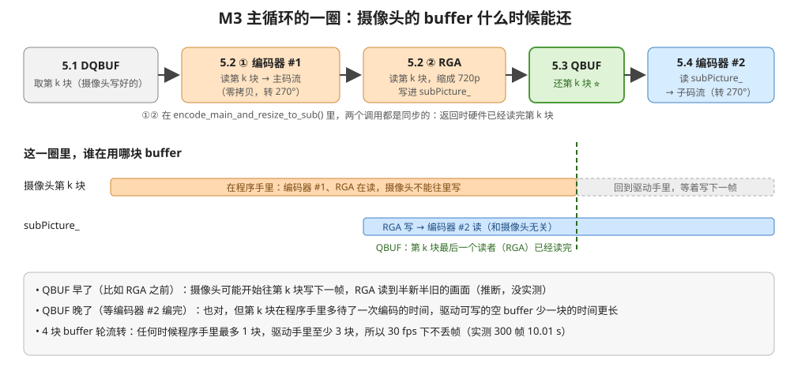

# 理解 M3：摄像头双码流

> 2026-11-08 写。代码行号按重构后的 `day4_rga/src/`；数字都是 2026-11-08 在板子上实测的。
> 入口：[app/m3_dual_stream_from_camera.cpp](../src/app/m3_dual_stream_from_camera.cpp) 的 `run_m3_dual_stream_from_camera()`

## 1. M3 干了什么

**摄像头拍 10 秒，同时录成两个 H.264 文件：一个 1080p 高清的，一个 720p 小的。**

每一帧画面都走两条路：

```
摄像头拍到一帧（1920×1080 NV12）
   ├─► MPP 编码器 #1 ──────────────────────► cam_main_1080p.h264（主码流，4 Mbps）
   └─► RGA 缩成 1280×720 ─► MPP 编码器 #2 ─► cam_sub_720p.h264 （子码流，1.5 Mbps）
```

整个过程 CPU 不碰画面：摄像头写进内存，编码器和 RGA 直接从同一块内存读，没有复制。

程序按这 6 步走（`run_m3_dual_stream_from_camera()`）：

| 步 | 行号 | 做什么 |
|:--:|---|---|
| 1 | [17-21](../src/app/m3_dual_stream_from_camera.cpp#L17-L21) | 打开摄像头，申请 4 块 buffer，开拍 |
| 2 | [23-28](../src/app/m3_dual_stream_from_camera.cpp#L23-L28) | 记下摄像头画面的宽高和 stride（1920 × 1080） |
| 3 | [30-52](../src/app/m3_dual_stream_from_camera.cpp#L30-L52) | 配置两个编码器（分辨率、码率、旋转），打开两个输出文件，写入 SPS/PPS |
| 4 | [54-59](../src/app/m3_dual_stream_from_camera.cpp#L54-L59) | 丢掉开头 30 帧（摄像头刚开时曝光、白平衡还没稳定） |
| 5 | [61-85](../src/app/m3_dual_stream_from_camera.cpp#L61-L85) | 循环 300 帧：取一帧 → 编主码流 + RGA 缩小 → 还给摄像头 → 编子码流 |
| 6 | [87-97](../src/app/m3_dual_stream_from_camera.cpp#L87-L97) | 两个编码器收尾（送 EOS），打印帧率和文件大小 |

## 2. 输入

| 项 | 值 |
|---|---|
| 设备 | 摄像头 IMX415，经过 ISP，节点是 `/dev/video22`（ISP0 的 mainpath） |
| 格式 | NV12，1 个 plane（Y 和 UV 在同一块内存里） |
| 分辨率 | 1920 × 1080 |
| stride | 1920 × **1080**（驱动给的；一帧 3,110,400 字节） |
| 帧率 | 30 fps |
| 摄像头方向 | 侧装，画面要转 270° 才是正的 |

## 3. 输出

| 文件 | 内容 | 实测（2026-11-08） |
|---|---|---|
| `/userdata/av/cam_main_1080p.h264` | 主码流：H.264 High，CBR 4 Mbps，GOP 60，转正后 **1080 × 1920** | 300 帧，4,831,990 字节（实际 3.87 Mbps），level 4.0 |
| `/userdata/av/cam_sub_720p.h264` | 子码流：H.264 High，CBR 1.5 Mbps，GOP 60，转正后 **720 × 1280** | 300 帧，1,788,490 字节（实际 1.43 Mbps），level 3.1 |

两个都是裸 H.264 码流（Annex-B，NAL 单元前面是 `00 00 00 01`），没有 MP4 封装，`ffplay` 能直接播。每个 I 帧前面都带一份 SPS/PPS，从中间开始播也能解。

程序打印：

```
I Camera: /dev/video22: 1920x1080 NV12，stride 1920x1080，sizeimage 3110400
I Main: 300 帧，用时 10.01 s，实际 30.0 fps
I Main: 主码流（转正后 1080x1920）：4831950 字节 -> /userdata/av/cam_main_1080p.h264
I Main: 子码流（转正后 720x1280）：1788451 字节 -> /userdata/av/cam_sub_720p.h264
```

（打印的字节数比文件少 40 和 39 字节：开头那份 SPS/PPS 没算进统计。日志标签 `Main` 是重构前的，现在是 `M3`）

验证：ffprobe 两个文件都是 300 帧、宽高正确；ffmpeg 完整解码无错；两路各抽第 150 帧看，画面是正的、颜色正常、内容一样。**30.0 fps 说明两路编码 + RGA 跟得上摄像头，没有丢帧。**

## 4. 用到的技术点

### 4.1 V4L2：从摄像头拿画面

代码在 [camera/camera_capture.cpp](../src/camera/camera_capture.cpp)（`CameraCapture` 类）。

| 调用 | 行号 | 在 M3 里做什么 |
|---|---|---|
| `open("/dev/video22", O_RDWR \| O_CLOEXEC)` | [28](../src/camera/camera_capture.cpp#L28) | 打开摄像头节点 |
| `VIDIOC_S_FMT` / `VIDIOC_G_FMT` | [42](../src/camera/camera_capture.cpp#L42)、[47](../src/camera/camera_capture.cpp#L47) | 要 1920×1080 NV12；再读回驱动实际给的宽高、`bytesperline`（= horStride）、`sizeimage` |
| `VIDIOC_REQBUFS` | [71](../src/camera/camera_capture.cpp#L71) | 让驱动分配 4 块 buffer（`V4L2_MEMORY_MMAP`：内存由驱动分配） |
| `VIDIOC_QUERYBUF` | [92](../src/camera/camera_capture.cpp#L92) | 查每块 buffer 多大 |
| `VIDIOC_EXPBUF` | [103](../src/camera/camera_capture.cpp#L103) | 把每块 buffer 导出成 dma_buf fd，交给 MPP 和 RGA（零拷贝的关键） |
| `VIDIOC_QBUF` | [147](../src/camera/camera_capture.cpp#L147) | 把一块空 buffer 交给驱动，让摄像头往里写 |
| `VIDIOC_STREAMON` / `STREAMOFF` | [131](../src/camera/camera_capture.cpp#L131)、[175](../src/camera/camera_capture.cpp#L175) | 开拍 / 停拍 |
| `VIDIOC_DQBUF` | [161](../src/camera/camera_capture.cpp#L161) | 取出一块摄像头写好的 buffer（没有就阻塞等，最多约 33 ms） |

- **多平面类型**：buffer 类型是 `V4L2_BUF_TYPE_VIDEO_CAPTURE_MPLANE`。板子的 rkisp 节点只支持这种，所以每次都要挂 `planes` 数组。
- **4 块 buffer 轮转**：DQBUF 取一块 → 用完 → QBUF 还回去。任何时候程序手里最多 1 块，驱动手里至少 3 块，所以摄像头总有空 buffer 可写。
- **verStride 要自己算**：V4L2 只给 `bytesperline` 和 `sizeimage`，没有"Y 平面占多少行"。用 `sizeimage ÷ horStride × 2 ÷ 3` 倒推出 1080（[第 62 行](../src/camera/camera_capture.cpp#L62)）。编码器和 RGA 都必须用这个 1080，填成按 16 对齐的 1088，它们就会在错的位置找 UV，颜色错位。

### 4.2 MPP：buffer 和编码

**buffer**

| 调用 | 位置 | 在 M3 里做什么 |
|---|---|---|
| `mpp_buffer_import`（`MPP_BUFFER_TYPE_EXT_DMA`） | [camera_capture.cpp:117](../src/camera/camera_capture.cpp#L117) | 把摄像头 buffer 的 dma_buf fd 包装成 `MppBuffer`，编码器 #1 直接编它 |
| `mpp_buffer_group_get_internal`（DRM \| CACHABLE）+ `mpp_buffer_get` | [dual_stream_encoder.cpp:81](../src/encoder/dual_stream_encoder.cpp#L81)、[91](../src/encoder/dual_stream_encoder.cpp#L91) | 申请子码流的 buffer（1280×720，RGA 往里写，编码器 #2 从里读） |
| `mpp_buffer_get_fd` | [rga_resizer.cpp:18](../src/rga/rga_resizer.cpp#L18) | 从 `MppBuffer` 拿回 fd，交给 RGA |
| `mpp_buffer_put` | 析构函数里 | 释放；摄像头那 4 块由 `CameraCapture` 释放，子码流 buffer 由 `DualStreamEncoder` 释放 |

画面全程只有硬件读写（摄像头写，编码器、RGA 读），CPU 不碰，所以不用 `mpp_buffer_sync_begin/end`，也不用 mmap。

**编码器**（[encoder/mpp_encoder.cpp](../src/encoder/mpp_encoder.cpp)，两个编码器各一个实例，互不影响）

| 调用 / 参数 | 行号 | 在 M3 里做什么 |
|---|---|---|
| `mpp_create` + `mpp_init(MPP_CTX_ENC, AVC)` | [27](../src/encoder/mpp_encoder.cpp#L27)、[29](../src/encoder/mpp_encoder.cpp#L29) | 创建一个 H.264 编码器 |
| `prep:width/height/hor_stride/ver_stride/format` | [41](../src/encoder/mpp_encoder.cpp#L41) 附近 | 告诉编码器输入画面多大、内存怎么排；主码流的 stride 必须填摄像头的 1920 × 1080 |
| `prep:rotation = 3` | [44](../src/encoder/mpp_encoder.cpp#L44) | 编码前转 270°，码流画面变成竖的 |
| `rc:mode = CBR`、`rc:bps_*`、`rc:fps_*`、`rc:gop` | [45](../src/encoder/mpp_encoder.cpp#L45)、[61](../src/encoder/mpp_encoder.cpp#L61) | 码率控制：主码流 4 Mbps、子码流 1.5 Mbps，30 fps，每 60 帧一个 I 帧 |
| `MPP_ENC_SET_CFG` | [78](../src/encoder/mpp_encoder.cpp#L78) | 让上面的参数生效 |
| `MPP_ENC_HEADER_MODE_EACH_IDR` | [80](../src/encoder/mpp_encoder.cpp#L80) | 每个 I 帧前都带 SPS/PPS |
| `MPP_ENC_GET_HDR_SYNC` | [94](../src/encoder/mpp_encoder.cpp#L94) | 取 SPS/PPS，写到文件开头 |
| `encode_put_frame` / `encode_get_packet` | [129](../src/encoder/mpp_encoder.cpp#L129)、[135](../src/encoder/mpp_encoder.cpp#L135) | 送一帧进去，取一包码流出来（阻塞，返回时这一帧已经编完） |
| `KEY_OUTPUT_INTRA` | [147](../src/encoder/mpp_encoder.cpp#L147) | 看这一包是不是 I 帧 |
| `mpp_frame_set_eos` | [123](../src/encoder/mpp_encoder.cpp#L123) | 收尾时送一个只带 EOS 标志的空帧，把编码器里剩下的码流取完 |

`prep:width/height` 填的是**转之前**的宽高（和送进去的画面一致：主码流 1920×1080，子码流 1280×720），编码器自己转。

### 4.3 RGA：把 1080p 缩成 720p

代码在 [rga/rga_resizer.cpp](../src/rga/rga_resizer.cpp)。

| 调用 | 行号 | 做什么 |
|---|---|---|
| `importbuffer_fd` | [22](../src/rga/rga_resizer.cpp#L22) | 把 dma_buf fd 登记给 RGA，拿到一个 handle |
| `wrapbuffer_handle` | [42](../src/rga/rga_resizer.cpp#L42)、[44](../src/rga/rga_resizer.cpp#L44) | 描述画面：宽高、格式（`RK_FORMAT_YCbCr_420_SP` = NV12）、stride |
| `imcheck` | [48](../src/rga/rga_resizer.cpp#L48) | 先检查参数合不合法 |
| `imresize` | [56](../src/rga/rga_resizer.cpp#L56) | 硬件缩放，同步调用，返回时已经缩完 |
| `releasebuffer_handle` | [63-64](../src/rga/rga_resizer.cpp#L63-L64) | 注销 handle |

RGA 只缩不转，输出还是横的 1280 × 720；旋转交给编码器 #2 的 `prep:rotation`。

### 4.4 Linux 基础

| 技术点 | 在 M3 里哪里用到 |
|---|---|
| `ioctl` | 所有 V4L2 命令都是 `ioctl(fd, 命令号, 结构体地址)`。被信号打断时返回 -1、`errno = EINTR`，要重试（`xioctl`，[camera_capture.cpp:18](../src/camera/camera_capture.cpp#L18)） |
| dma_buf fd | 一块物理内存的"通行证"，同一个 fd 摄像头驱动、MPP、RGA 都认。这就是零拷贝的基础 |
| 文件描述符要 close | EXPBUF 拿到的 4 个 fd、`/dev/video22` 的 fd，析构时都要 `close`（[第 182、186 行](../src/camera/camera_capture.cpp#L182)）；`mpp_buffer_put` 不会替你关 |
| 阻塞 IO | 打开时没加 `O_NONBLOCK`，所以 DQBUF 没有新帧就在内核里等 |

### 4.5 这一次的重点：摄像头的 buffer 什么时候能还



一块摄像头 buffer 有两个硬件要读：编码器 #1 和 RGA。**两个都读完，才能 QBUF 还给摄像头**；还早了，摄像头可能开始往里写下一帧，读的人就读到半新半旧的画面（推断，没实测）。

两个调用都是同步的（返回时硬件已经读完），所以代码是这个顺序（[第 74-82 行](../src/app/m3_dual_stream_from_camera.cpp#L74-L82)）：

```cpp
isAllOk = dualStreamEncoder.encode_main_and_resize_to_sub(mainPicture); // 编码器 #1、RGA 读摄像头 buffer
isAllOk = camera.queueBuffer(filledBufIndex) && isAllOk;              // 都读完了，还给摄像头
isAllOk = isAllOk && dualStreamEncoder.encode_sub();                   // 编码器 #2 读的是 RGA 的输出，不用等它
```

`queueBuffer` 写在 `&&` 左边：前面失败了也照样还。少还一块，摄像头就少一块可写的 buffer。

## 5. 实际业务场景

一路摄像头同时出"高清 + 低清"两路码流，是很常见的做法。高清的用来存、用来看细节；低清的用来实时看、省流量。

| 场景 | 主码流（高清）用来 | 子码流（低清）用来 |
|---|---|---|
| **安防监控摄像头（IPC）+ 录像机（NVR）** | NVR 7×24 小时录像存硬盘，事后回放看车牌、人脸 | 监控中心九宫格、十六宫格同时看很多路；手机 App 远程预览 |
| **家用摄像头、智能门铃** | 存云端或 SD 卡，看回放 | 手机 App 实时看，4G 网络也流畅 |
| **直播推流** | 推给直播平台，观众看高清 | 主播本地预览，或者给网络差的观众一个低码率档 |
| **行车记录仪、执法记录仪** | 本地录高清，事故取证 | 实时回传到后台，指挥中心看现场 |
| **无人机、巡检机器人图传** | 机上录高清，回来再看 | 无线链路带宽小，实时传低清画面给操作员 |
| **视频会议** | 发言人大画面 | 画廊模式小窗口；对方网络差时自动切过去 |

这些场景的共同要求，正好是 M3 做的事：

- **两路同时出、实时**：30 fps 不能丢帧（实测 30.0 fps）
- **省 CPU**：缩放用 RGA，编码用 VPU，全是硬件；画面全程零拷贝，CPU 只负责调度
- **码率差得开**：子码流文件只有主码流的 37%（1.5 ÷ 4 = 37.5%），传输和存储都省

## 6. 运行

```bash
./run_on_board_with_mac.sh m3
adb pull /userdata/av/cam_main_1080p.h264 .
adb pull /userdata/av/cam_sub_720p.h264 .
ffprobe -v error -show_entries stream=width,height,profile,level,nb_read_frames -count_frames cam_main_1080p.h264
ffplay cam_sub_720p.h264
```

输入是摄像头，每次拍到的画面不一样，所以每次跑出来的文件大小都不一样（三次实测主码流 4,829,805 ～ 4,846,188 字节），不能用 md5 对比；验证看帧数、宽高、帧率、画面对不对。
