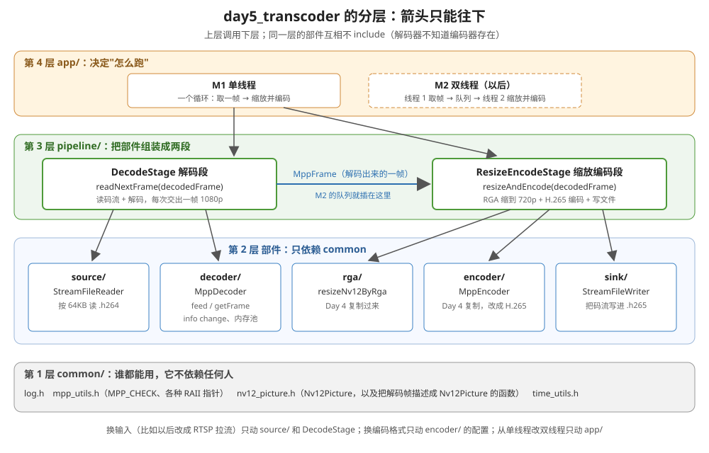
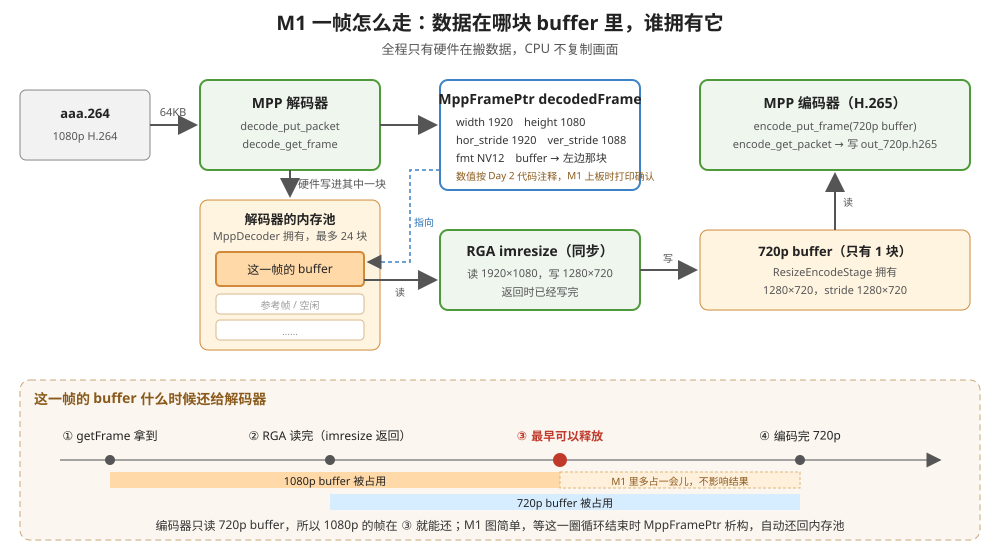

# M1 单线程转码

Day 5 做一个**转码器**：把 1080p 的 H.264 文件转成 720p 的 H.265 文件。

```
aaa.264（1080p H.264）→ MPP 解码 → RGA 缩到 720p → MPP 编码（H.265）→ out_720p.h265
```

**从 Day 5 起不写面条代码**：先定架构（本文第 2 节），再按架构写代码。

---

## 1. Day 5 的四个里程碑

| 里程碑 | 做什么 | 新学的东西 |
|---|---|---|
| **M1 单线程转码** | 一个循环：解码一帧 → RGA 缩放 → 编码一帧 | 解码器输出的帧直接交给 RGA；解码帧什么时候还给解码器；EOS 从解码器传到编码器；编码器改成 H.265 |
| **M2 双线程流水线** | 线程 1 解码，放进队列；线程 2 取出来缩放、编码 | 生产者-消费者、背压、两个线程怎么正常结束 |
| **M3 RTSP 播放** | 板子上跑 live555MediaServer，Mac 上用 VLC 看 | RTSP 点播的基本流程 |
| **M4（可选）抓包** | Wireshark 看 OPTIONS / DESCRIBE / SETUP / PLAY | 为以后的 `cam_rtsp` 预习 |

每个里程碑一份文档：本文（M1）、[m2流程.md](m2流程.md)、[m3流程.md](m3流程.md)、[m4流程.md](m4流程.md)。整个 Day 5 的架构写在本文第 2 节，M2～M4 都沿用它。

---

## 2. 架构

### 2.1 分层图



一共 4 层，**上层调用下层，下层不知道上层存在**：

| 层 | 目录 | 管什么 | 能 include 谁 |
|---|---|---|---|
| 第 4 层 | `app/` | 决定"怎么跑"：M1 单线程循环，M2 双线程 | pipeline、common |
| 第 3 层 | `pipeline/` | 把部件组装成两段：解码段、缩放编码段 | 第 2 层的部件、common |
| 第 2 层 | `source/` `decoder/` `rga/` `encoder/` `sink/` | 每个只管一件事 | **只有 common**。部件之间互相不 include |
| 第 1 层 | `common/` | 日志、`MPP_CHECK`、RAII 指针、`Nv12Picture` | 谁都不依赖 |

为什么部件之间不能互相 include？举个例子：如果 `MppDecoder` 里直接调用了 RGA，那以后想"解码完直接送显示、不缩放"，就得改解码器。部件互相不认识，换掉一个部件不会牵连别的。

### 2.2 为什么切成"解码段"和"缩放编码段"两段

这是这次架构里最重要的决定。

M2 要变成两个线程：线程 1 解码，线程 2 缩放和编码，中间用一个队列传**解码出来的 MppFrame**。所以 M1 就在这个位置切开：

- `DecodeStage::readNextFrame(decodedFrame)`：每调用一次，交出一帧解码好的 1080p 画面
- `ResizeEncodeStage::resizeAndEncode(decodedFrame)`：收一帧，缩放、编码、写文件

M1 在一个循环里先调用前者、再调用后者。M2 把这两个调用分到两个线程里，中间加一个队列。**两个 Stage 类在 M2 一行都不用改**，只改 `app/` 里的跑法。

如果 M1 写成一个大循环、解码和编码搅在一起，到 M2 就得拆开重写。这就是"按后面的需求来切接口"。

### 2.3 不做的事

- **不写虚接口**（比如 `StreamSource` 基类）。现在输入只有文件一种，等真的出现第二种（RTSP 拉流）再抽接口。
- **不做命令行参数解析**。学习计划里的 `transcoder -i ... -o ... -W 1280` 先不做，参数都写在 `app/app_config.h` 里。

### 2.4 目录

```
day5_transcoder/
├── CMakeLists.txt
├── run_on_board_with_mac.sh            编译 → adb push → adb shell 运行
├── day5编码流程/                       m1～m4 流程文档
├── doc/img/
└── src/
    ├── main.cpp                        只做一件事：按参数调用 run_m1 / run_m2
    ├── app/
    │   ├── app_config.h                路径、尺寸、码率等常量
    │   ├── milestones.h                声明 run_m1_xxx、run_m2_xxx
    │   └── m1_transcode_single_thread.cpp   M1 的主循环
    ├── common/
    │   ├── log.h                       带颜色的日志 LOGI / LOGE……
    │   ├── mpp_utils.h                 ALIGN、MPP_CHECK、RAII 指针
    │   ├── time_utils.h                getNowMs
    │   └── nv12_picture.h / .cpp       Nv12Picture、申请 buffer、把解码帧描述成 Nv12Picture
    ├── source/
    │   └── stream_file_reader.h / .cpp 按 64KB 读码流文件
    ├── decoder/
    │   └── mpp_decoder.h / .cpp        MPP 解码器
    ├── rga/
    │   └── rga_resizer.h / .cpp        RGA 缩放
    ├── encoder/
    │   └── mpp_encoder.h / .cpp        MPP 编码器（H.264 / H.265）
    ├── sink/
    │   └── stream_file_writer.h / .cpp 把码流写进文件
    └── pipeline/
        ├── decode_stage.h / .cpp       解码段：readNextFrame
        └── resize_encode_stage.h / .cpp 缩放编码段：resizeAndEncode
```

### 2.5 代码在哪

M1 的全部代码都在本文 **3.6 节**，一个文件一段，可以直接照着建工程，不用去翻前几天的代码。

建议重点自己敲一遍的（MPP 核心）：

| 文件 | 练什么 |
|---|---|
| `decoder/mpp_decoder.cpp` | 解码 API：create / init / split_parse / put_packet / getFrame / info change |
| `pipeline/decode_stage.cpp` | 送码流、取帧的循环，EOS 和错误帧的判断 |
| `common/nv12_picture.cpp` 的 `describeDecodedFrame` | 从解码帧里取 buffer、宽高、stride、fmt |
| `pipeline/resize_encode_stage.cpp` | 解码帧交给 RGA、编码，帧的释放时机 |
| `encoder/mpp_encoder.cpp` | 编码 API：prep / rc / codec 参数、取头、送帧取包 |

其余的（CMake、日志、读写文件、main、运行脚本）是样板代码，直接复制就行。

---

## 3. M1：单线程转码

### 3.1 干了什么

把 `aaa.264` 一帧一帧解码，每帧用 RGA 缩成 1280×720，再编码成 H.265，写进 `out_720p.h265`。

### 3.2 输入

`/userdata/av/aaa.264`（Day 2 用过的文件）。2026-11-08 在 Mac 上用 `ffprobe` 看的：

| 项目 | 值 |
|---|---|
| 编码 | H.264，Constrained Baseline |
| 分辨率 | 1920×1080 |
| 像素格式 | yuv420p（8 bit） → MPP 解码出来是 NV12 |
| 帧数 | 1803 |
| 帧率 | 约 30 fps（ffprobe 报 3003/100） |
| 大小 | 55.7 MB |

### 3.3 输出

`/userdata/av/out_720p.h265`：H.265，1280×720，2 Mbps，30 fps，GOP 60，帧数应该和输入一样是 1803。

验收：
- `adb pull` 到 Mac，用 `ffprobe` 看：codec 是 hevc、1280×720、1803 帧
- 用 VLC 或 `ffplay` 播放，画面正常
- 文件比 55.7 MB 小（具体多大以实测为准）

### 3.4 一帧怎么走



1. `DecodeStage` 读码流、送进解码器，拿到一个 `MppFrame`。画面在**解码器内存池**的一块 buffer 里（池子归 `MppDecoder` 管）。
2. 用 `describeDecodedFrame` 把这个 MppFrame 描述成 `Nv12Picture`：取出 buffer、宽高、stride。**不复制数据**，只是把这几个值抄出来。
3. RGA 读这块 1080p buffer，缩放后写进 `ResizeEncodeStage` 自己的 720p buffer。
4. 编码器读 720p buffer，编出 H.265 包，写进文件。
5. 这一圈循环结束，`MppFramePtr` 析构，调用 `mpp_frame_deinit`，1080p 的 buffer 回到解码器的内存池，解码器可以拿它解后面的帧。

### 3.5 技术点

#### ① 解码出来的帧，直接交给 RGA

Day 4 的 RGA 输入是我们自己从 group 申请的 buffer；Day 5 的输入换成**解码器内存池里的 buffer**。RGA 不在乎 buffer 是谁申请的，只要能拿到 dma_buf fd 就行（Day 4 M1 文档 4.2 节的 `importMppBufferToRga`）。

要从 MppFrame 里取出这几个值：

| 函数 | 取出什么 | 1080p 的值 |
|---|---|---|
| `mpp_frame_get_buffer(frame)` | 画面所在的 MppBuffer | 内存池里的一块 |
| `mpp_frame_get_width / height` | 画面宽高（像素） | 1920 × 1080 |
| `mpp_frame_get_hor_stride / ver_stride` | 一行占多少字节 / Y 平面占多少行 | 1920 × 1088（2026-11-12 上板实测：info change 和第 1 帧都打印 stride 1920x1088，fmt 0x0） |
| `mpp_frame_get_fmt(frame)` | 像素格式 | `MPP_FMT_YUV420SP`（NV12） |

**注意 fmt 的判断**：`mpp_frame_get_fmt` 返回的值，高位可能带别的标志（比如 FBC 压缩格式的标志）。要先 `& MPP_FRAME_FMT_MASK` 再和 `MPP_FMT_YUV420SP` 比（`mpp_frame.h:188`）。不是 NV12 就报错，不要硬送给 RGA。

#### ② 解码帧什么时候还给解码器

解码器内存池最多 24 块 buffer（Day 2 的 `kFrameBufferCount`）。我们手里每拿着一帧不还，池子就少一块。池子用光了，解码器就停下来等。

- 编码器只读 720p buffer，**不读 1080p 那块**。所以 RGA 一读完（`imresize` 是同步的，返回就代表读完了），1080p 那块就可以还。
- M1 为了简单，等这一圈循环结束才还（`MppFramePtr` 声明在循环里面）。只多占一会儿，不影响结果。
- 到 M2 这件事就重要了：队列里每排着一帧，就占着池子里的一块。队列长度要比 24 小很多，这是 M2 的内容。

对比 Day 4 M3：摄像头的 buffer 要等编码器 #1 和 RGA 都读完才能 QBUF 还回去，因为编码器 #1 直接读的就是摄像头 buffer。Day 5 的编码器不读解码 buffer，所以能更早还。

#### ③ EOS 从解码器传到编码器

结束的过程分三步，一步接一步：

1. 文件读完 → 最后一块码流打上 EOS 送进解码器（Day 2 做过）
2. 解码器把剩下的帧都吐出来以后，吐出一个**带 EOS 标志的帧** → `readNextFrame` 返回 `EndOfStream`
3. M1 的循环看到 `EndOfStream` → 调用 `ResizeEncodeStage::drainEncoder()`：给编码器送一个"空帧 + EOS"，把编码器里剩的包取完

两个容易错的地方：
- **EOS 可能贴在最后一帧画面上**：帧里有 buffer，同时 eos = 1。这一帧要先正常缩放、编码，下一次调用 `readNextFrame` 再返回 `EndOfStream`。
- **EOS 也可能是一个空帧**：没有 buffer，只有 eos = 1。这时直接返回 `EndOfStream`，不要送给 RGA（没有 buffer，RGA 会出错）。

Day 2 的 `drain_frames` 里 eos 单独判断，就是为了这两种情况。

#### ④ 错误帧直接跳过

`mpp_frame_get_errinfo` 或 `mpp_frame_get_discard` 不为 0 的帧，画面是坏的。`readNextFrame` 内部跳过它们、计个数，不交给上层。

#### ⑤ 编码器改成 H.265

`MppEncoder` 同时支持 H.264 和 H.265，由 `EncoderConfig.codingType` 决定，M1 填 `MPP_VIDEO_CodingHEVC`：
- `init` 里 `mpp_init` 和 `codec:type` 用的都是这个值；`h264:*` 那几行在 `if (codingType == MPP_VIDEO_CodingAVC)` 里，H.265 不会执行
- `MPP_ENC_GET_HDR_SYNC` 取出来的头，H.265 是 **VPS + SPS + PPS**，比 H.264 多一个 VPS。取头的代码两种格式一样，照样写到文件开头

MPP 文档里的 `h265:profile`、`h265:level`（`Rockchip_Developer_Guide_MPP_CN.md:690`）不设置就用默认值，M1 不设置。

### 3.6 完整代码

按"从下往上"的顺序排：先 common，再各个部件，再 pipeline，最后 app 和 main。照这个顺序建文件，每建完一层都能编译一下。

2026-11-11 改成驼峰命名后重新交叉编译通过（gcc 10.4，`-Wall -Wextra -Wshadow` 没有警告）。2026-11-12 解码段上板通过：正常帧 1803、错误帧 0、读入 58449590 字节（等于文件大小）、stride 1920×1088；**缩放和编码还没上板**。

> 命名（2026-11-11 定）：函数、方法用驼峰，私有成员不加结尾的 `_`。所以**参数不能和成员同名**，否则 `chunkSizeBytes = chunkSizeBytes;` 是参数自己赋给自己，成员一直是 0，编译还不报错。参数统一叫 `requestedXxx`（`requestedChunkSizeBytes`、`requestedConfig`），CMake 里加了 `-Wshadow`，同名时编译器会警告。

#### 3.6.1 `CMakeLists.txt`

工程文件。头文件搜索目录加了 `src`，所以所有 include 都写成 `"common/log.h"` 这种从 src 开始的路径。

```cmake
cmake_minimum_required(VERSION 3.20)
project(day5_transcoder)

# C++20：要用指定初始化（Nv12Picture{.width = 1280, ...}）
set(CMAKE_CXX_STANDARD 20)

add_executable(day5_transcoder
        src/main.cpp
        src/app/app_config.h
        src/app/milestones.h
        src/app/m1_transcode_single_thread.cpp
        src/common/log.h
        src/common/mpp_utils.h
        src/common/time_utils.h
        src/common/nv12_picture.h
        src/common/nv12_picture.cpp
        src/source/stream_file_reader.h
        src/source/stream_file_reader.cpp
        src/decoder/mpp_decoder.h
        src/decoder/mpp_decoder.cpp
        src/rga/rga_resizer.h
        src/rga/rga_resizer.cpp
        src/encoder/mpp_encoder.h
        src/encoder/mpp_encoder.cpp
        src/sink/stream_file_writer.h
        src/sink/stream_file_writer.cpp
        src/pipeline/decode_stage.h
        src/pipeline/decode_stage.cpp
        src/pipeline/resize_encode_stage.h
        src/pipeline/resize_encode_stage.cpp)

# 头文件搜索目录加上 src：任何文件里都写 #include "common/log.h"，不用数 ../ 有几层
target_include_directories(day5_transcoder PRIVATE src)

if (CMAKE_SYSTEM_PROCESSOR STREQUAL "aarch64")
    # rockchip_mpp → 链接器参数 -lrockchip_mpp → 在 sysroot 里找 librockchip_mpp.so（解码、编码）
    # rga → -lrga → sysroot 里的 librga.so（缩放）
    target_link_libraries(day5_transcoder PRIVATE rockchip_mpp rga)
    target_compile_options(day5_transcoder PRIVATE -Wall -Wextra -Wshadow)

    # 板子 /usr/lib 里出厂的 MPP 库太旧，运行时优先加载自己编译的那份（/userdata/mpp_build/lib）
    # -Wl,-rpath,目录：把"运行时先去这个目录找库"写进程序文件，效果和 LD_LIBRARY_PATH 一样
    target_link_options(day5_transcoder PRIVATE "-Wl,-rpath,/userdata/mpp_build/lib")
endif ()
```

#### 3.6.2 `src/common/log.h`

带颜色的日志。用法：`LOGI(kTag, "格式", 参数...)`，不用写 `\n`。

```cpp
/*
 * 带颜色的日志（照 Android logcat 的样子）：
 *
 *   16:52:01.123 D CameraFinder: /dev/media0  model=rkcif-mipi-lvds  13 个实体     ← 橙色（DA7537）
 *   16:52:01.125 I CameraFinder: main path : /dev/video22                        ← 绿色（108A0D）
 *   16:52:01.126 W CameraFinder: ...                                             ← 黄色（E8A908）
 *   16:52:01.127 E CameraFinder: 没有找到摄像头                                    ← 红色（C40E0A）
 *
 *   （V 是蓝色 0E83E3）
 *
 * 原理：ANSI 颜色转义码。终端看到 "\033[32m" 不会把它显示出来，而是把后面的字改成绿色，
 * 看到 "\033[0m" 就恢复默认颜色。CLion 的终端和 Run 窗口、macOS 终端、adb shell 都认这种写法。
 * （day3_cam2h264 的 doc/终端彩色输出_ANSI颜色码.md 里有详细说明）
 *
 * 用法（不用写 \n，每条日志自动换行）：
 *   LOGI("CameraFinder", "main path : %s", path.c_str());
 *   LOGE("CameraFinder", "open %s failed: %s", dev, strerror(errno));
 *
 * 不想要颜色（比如输出重定向到文件，不想文件里出现 \033[..m 这些字符）：
 *   NO_COLOR=1 ./day5_transcoder m1
 */
#pragma once

#include <cstdarg>    // va_list
#include <cstdio>     // printf / vprintf / fflush
#include <cstdlib>    // getenv
#include <ctime>      // localtime_r
#include <sys/time.h> // gettimeofday

// 日志级别，和 logcat 一样从低到高
enum class LogLevel { Verbose, Debug, Info, Warn, Error };


// 和 Android 的 Log.v / Log.d / Log.i / Log.w / Log.e 对应
#define LOGV(tag, ...) logPrint(LogLevel::Verbose, tag, __VA_ARGS__)
#define LOGD(tag, ...) logPrint(LogLevel::Debug, tag, __VA_ARGS__)
#define LOGI(tag, ...) logPrint(LogLevel::Info, tag, __VA_ARGS__)
#define LOGW(tag, ...) logPrint(LogLevel::Warn, tag, __VA_ARGS__)
#define LOGE(tag, ...) logPrint(LogLevel::Error, tag, __VA_ARGS__)


/**
 * @brief 要不要输出颜色
 * @return 没设置环境变量 NO_COLOR 时返回 true；设置了（任何值）返回 false
 * @note 只在第一次调用时读一次环境变量（static 局部变量）。
 * @note 没有用 isatty() 判断"是不是终端"：通过 adb shell 运行时，板子上的 stdout 不是终端，
 *       用 isatty 判断的话颜色就全没了，但 Mac 这边的终端其实是能显示颜色的。
 */
inline bool isLogColorEnabled() {
    static const bool enabled = std::getenv("NO_COLOR") == nullptr;
    return enabled;
}

/**
 * @brief 打印一条带时间、级别、标签、颜色的日志，自动换行
 * @param[in] level  级别，决定颜色和字母（V/D/I/W/E）
 * @param[in] tag    标签，一般写模块或类名，例如 "CameraFinder"
 * @param[in] fmt    和 printf 一样的格式字符串，末尾不用写 \n
 * @param[in] ...    格式字符串对应的参数
 * @note format(printf, 3, 4)：让编译器像检查 printf 一样检查 fmt 和参数类型对不对得上
 *       （第 3 个参数是格式串，可变参数从第 4 个开始）。
 * @note 每条日志后 fflush：通过 adb 运行时 stdout 是全缓冲的，不刷新的话日志会攒一大段才出来，
 *       程序崩溃时最后几条还会丢。
 */
__attribute__((format(printf, 3, 4))) inline void logPrint(LogLevel level, const char* tag, const char* fmt, ...) {
    // 颜色（RRGGBBAA，最后的 FF 是不透明度，终端用不到）：
    // V ：0E83E3FF
    // D ：DA7537FF
    // I ：108A0DFF
    // W ：E8A908FF
    // E ：C40E0AFF
    // 用 24 位真彩色写法 "\033[38;2;R;G;Bm"（38 = 设置文字颜色，2 = 后面跟 R;G;B 三个十进制数）
    // 例：0E83E3 → R=0x0E=14，G=0x83=131，B=0xE3=227 → "\033[38;2;14;131;227m"
    static const char* const kColor[] = {
        "\033[38;2;14;131;227m", // V：0E83E3
        "\033[38;2;218;117;55m", // D：DA7537
        "\033[38;2;16;138;13m",  // I：108A0D
        "\033[38;2;232;169;8m",  // W：E8A908
        "\033[38;2;196;14;10m",  // E：C40E0A
    };
    static const char kLetter[] = {'V', 'D', 'I', 'W', 'E'};
    const char* const kReset    = "\033[0m";

    const int i      = static_cast<int>(level);
    const bool color = isLogColorEnabled();

    // 时间：时:分:秒.毫秒（板子的时区可能是 UTC，和 Mac 差 8 小时）
    timeval tv;
    gettimeofday(&tv, nullptr);
    tm t;
    localtime_r(&tv.tv_sec, &t);

    printf("%s%02d:%02d:%02d.%03ld %c %s: ", color ? kColor[i] : "", t.tm_hour, t.tm_min, t.tm_sec,
        static_cast<long>(tv.tv_usec / 1000), kLetter[i], tag);
    va_list args;
    va_start(args, fmt);
    vprintf(fmt, args);
    va_end(args);
    printf("%s\n", color ? kReset : "");
    fflush(stdout);
}
```

#### 3.6.3 `src/common/time_utils.h`

计时。

```cpp
//
// 计时用的小工具
//
#pragma once

#include <chrono>

/**
 * @brief 取当前时间，单位毫秒（steady_clock：只往前走，不受改系统时间影响）
 * @return 从某个固定起点开始的毫秒数；只用来相减算时间差，单独看没有意义
 * @note inline：写在头文件里，多个 .cpp 都 include 也不会链接冲突
 */
inline double getNowMs() {
    using namespace std::chrono;
    return duration<double, std::milli>(steady_clock::now().time_since_epoch()).count();
}
```

#### 3.6.4 `src/common/mpp_utils.h`

`MPP_CHECK` 和各种 RAII 指针。MPP 的对象都交给 unique_ptr 管，离开作用域自动释放。

```cpp
//
// MPP 公用工具：ALIGN、MPP_CHECK，以及自动释放 MPP 对象的 RAII 指针
//
#pragma once

#include <cstdio>
#include <memory>
#include <rockchip/rk_mpi.h>

#include "common/log.h"

// 把 x 向上对齐到 a 的倍数（a 必须是 2 的幂）。例：ALIGN(1080, 16) = 1088
#define ALIGN(x, a) (((x) + (a) - 1) & ~((a) - 1))

inline const char *const kMppCheckTag = "MPP_CHECK";

// 执行一个返回 MPP_RET 的调用；不是 MPP_OK 就打印是哪一句、返回码多少、第几行，然后 return failValue
#define MPP_CHECK(expr, failValue)                                                                                     \
    do {                                                                                                               \
        MPP_RET mppRet = (expr);                                                                                       \
        if (mppRet != MPP_OK) {                                                                                        \
            LOGE(kMppCheckTag, "[FAIL] %s ret=%d (line %d)", #expr, static_cast<int>(mppRet), __LINE__);              \
            return failValue;                                                                                          \
        }                                                                                                              \
    } while (0)

// ---- 下面每一对"Deleter + Ptr"都是同一个套路 ----
// std::unique_ptr<void, XxxDeleter>：MPP 的句柄（MppFrame、MppBuffer……）本质是 void*，
// unique_ptr 离开作用域时自动调用 XxxDeleter::operator()，把对应的释放函数调了，不会忘、不会重复

/**
 * @brief FilePtr 的释放器：fclose 会把缓冲区里还没写下去的数据写进文件，再关闭
 */
struct FileCloser {
    /**
     * @brief 关闭文件
     * @param[in] file  fopen 返回的 FILE*；unique_ptr 保证不会传 nullptr 进来
     * @return 无
     * @note fclose 的返回值没有检查：析构时出错也没法处理
     */
    void operator()(FILE *file) const { fclose(file); }
};
using FilePtr = std::unique_ptr<FILE, FileCloser>;

/**
 * @brief MppBufferGroupPtr 的释放器：mpp_buffer_group_put 释放整个 buffer group
 */
struct MppBufferGroupDeleter {
    /**
     * @brief 释放 buffer group
     * @param[in] group  mpp_buffer_group_get_internal 得到的 group
     * @return 无
     * @note group 里还有 buffer 没 put 时，MPP 会等这些 buffer 都 put 了才真正释放
     */
    void operator()(MppBufferGroup group) const { mpp_buffer_group_put(group); }
};
using MppBufferGroupPtr = std::unique_ptr<void, MppBufferGroupDeleter>;

/**
 * @brief MppBufferPtr 的释放器：mpp_buffer_put 把 buffer 的引用计数减 1
 */
struct MppBufferDeleter {
    /**
     * @brief 释放 buffer
     * @param[in] buffer  mpp_buffer_get 得到的 buffer（直接传句柄，不传 &）
     * @return 无
     * @note 引用计数减到 0 才真正释放；编码器正在用的 buffer 会多一个引用，用完才释放
     */
    void operator()(MppBuffer buffer) const { mpp_buffer_put(buffer); }
};
using MppBufferPtr = std::unique_ptr<void, MppBufferDeleter>;

/**
 * @brief MppFramePtr 的释放器：mpp_frame_deinit 释放 MppFrame
 */
struct MppFrameDeleter {
    /**
     * @brief 释放 frame
     * @param[in] frame  mpp_frame_init 或 decode_get_frame 得到的 frame
     * @return 无
     * @note mpp_frame_deinit 的参数是 MppFrame*（要传 &）：它释放完会把你的变量置空。
     *       frame 带着 buffer 时，deinit 会把 buffer 的引用计数减 1；解码帧的 buffer 就这样回到解码器的内存池
     */
    void operator()(MppFrame frame) const { mpp_frame_deinit(&frame); }
};
using MppFramePtr = std::unique_ptr<void, MppFrameDeleter>;

/**
 * @brief MppPacketPtr 的释放器：mpp_packet_deinit 释放 MppPacket
 */
struct MppPacketDeleter {
    /**
     * @brief 释放 packet
     * @param[in] packet  mpp_packet_init 或 encode_get_packet 得到的 packet
     * @return 无
     * @note 和 mpp_frame_deinit 一样要传 &
     */
    void operator()(MppPacket packet) const { mpp_packet_deinit(&packet); }
};
using MppPacketPtr = std::unique_ptr<void, MppPacketDeleter>;
```

#### 3.6.5 `src/common/nv12_picture.h`

```cpp
//
// Nv12Picture：描述一帧 NV12 画面（在哪块 MppBuffer、宽高、stride），以及申请它、从解码帧得到它的函数
//
#pragma once

#include <rockchip/rk_mpi.h>

#include "common/mpp_utils.h"

/**
 * @brief 一帧 NV12 画面：画面在哪块 MppBuffer 里，以及 RGA、编码器需要的宽高和 stride
 * @note 只是"描述"，不负责释放 mppBuf。buffer 归谁管，由得到它的地方决定
 *       （allocNv12Buffer 返回的 MppBufferPtr，或者解码器的内存池）
 */
struct Nv12Picture {
    MppBuffer mppBuf = nullptr; // 画面所在的 MppBuffer
    int width = 0;              // 画面宽，单位像素
    int height = 0;             // 画面高，单位像素
    int horStride = 0;          // 一行在内存里占多少字节（≥ width）
    int verStride = 0;          // Y 平面在内存里占多少行（≥ height）；UV 平面从第 verStride 行开始
};

/**
 * @brief 按"宽高都对齐到 16"的规则，描述一帧自己申请的 NV12 画面（还没有 buffer）
 * @param[in] width   画面宽，单位像素，例如 1280
 * @param[in] height  画面高，单位像素，例如 720
 * @return mppBuf 为空的 Nv12Picture；stride = ALIGN(width, 16) × ALIGN(height, 16)，720p 是 1280 × 720
 * @note 解码帧不用这个函数：它的 stride 由解码器决定，用 describeDecodedFrame 取
 */
Nv12Picture makeAlignedNv12Picture(int width, int height);

/**
 * @brief 从 buffer group 申请一块能放下 picture 的 buffer，并把它填进 picture.mppBuf
 * @param[in]     bufferGroup  从哪个 group 申请（DRM 类型，RGA、编码器都能用它的 fd）
 * @param[in,out] picture      [in] 宽高和 stride；[out] mppBuf 指向新申请的 buffer
 * @return 管理这块 buffer 的 MppBufferPtr，离开作用域时自动 mpp_buffer_put；申请失败返回空（已打印原因）
 * @note 大小 = horStride × verStride × 1.5。返回值一定要接住，丢掉的话 buffer 马上就被释放
 */
MppBufferPtr allocNv12Buffer(MppBufferGroup bufferGroup, Nv12Picture &picture);

/**
 * @brief 把解码器给的一帧描述成 Nv12Picture：抄出 buffer、宽高、stride，不复制画面
 * @param[in]  decodedFrame  解码器输出的正常画面帧（有 buffer，不是错误帧）
 * @param[out] picture       填好的描述；mppBuf 指向解码器内存池里的 buffer
 * @return true = 是 NV12，填好了；false = 不是 NV12，或者没有 buffer（已打印原因）
 * @note picture 只是"借用"：buffer 归解码器内存池。decodedFrame 释放以后，picture 就不能再用了
 */
bool describeDecodedFrame(MppFrame decodedFrame, Nv12Picture &picture);
```

#### 3.6.6 `src/common/nv12_picture.cpp`

`describeDecodedFrame` 是 M1 新加的，对应 3.5 节 ①。

```cpp
#include "common/nv12_picture.h"

#include "common/log.h"

static const char *const kTag = "Nv12";

/**
 * @brief 描述一帧自己申请的 NV12 画面，stride 按 16 对齐
 * @param[in] width   画面宽，单位像素
 * @param[in] height  画面高，单位像素
 * @return mppBuf 为空的 Nv12Picture
 * @note 16 对齐是 MPP 编码器对输入的要求（ALIGN 见 mpp_utils.h）
 */
Nv12Picture makeAlignedNv12Picture(int width, int height) {
    return {.mppBuf = nullptr,
            .width = width,
            .height = height,
            .horStride = ALIGN(width, 16),
            .verStride = ALIGN(height, 16)};
}

/**
 * @brief 从 buffer group 申请一块 NV12 buffer
 * @param[in]     bufferGroup  从哪个 group 申请
 * @param[in,out] picture      [in] 宽高和 stride；[out] mppBuf
 * @return 管理这块 buffer 的 MppBufferPtr；失败返回空
 * @note 返回值要接住，否则 buffer 马上被释放
 */
MppBufferPtr allocNv12Buffer(MppBufferGroup bufferGroup, Nv12Picture &picture) {
    // NV12 一帧的大小：Y 占 horStride × verStride 字节，UV 是 Y 的一半
    const size_t frameSizeBytes = static_cast<size_t>(picture.horStride) * picture.verStride * 3 / 2;
    picture.mppBuf = nullptr;
    // mpp_buffer_get(group, &buffer, 字节数)：从 group 里拿一块 buffer，句柄写进 buffer（所以传 &）
    if (mpp_buffer_get(bufferGroup, &picture.mppBuf, frameSizeBytes) != MPP_OK) {
        LOGE(kTag, "mpp_buffer_get %zu 字节失败", frameSizeBytes);
        picture.mppBuf = nullptr;
        return nullptr;
    }
    // 交给 MppBufferPtr 管：它离开作用域时调用 mpp_buffer_put
    return MppBufferPtr(picture.mppBuf);
}

/**
 * @brief 把解码帧描述成 Nv12Picture
 * @param[in]  decodedFrame  解码器输出的正常画面帧
 * @param[out] picture       填好的描述
 * @return true = 成功；false = 不是 NV12 或没有 buffer
 * @note 只抄 5 个值，不碰画面数据，所以不需要 sync
 */
bool describeDecodedFrame(MppFrame decodedFrame, Nv12Picture &picture) {
    // mpp_frame_get_fmt：像素格式。低 20 位是格式本身，高位可能带别的标志（比如 FBC 压缩），
    // 所以先 & MPP_FRAME_FMT_MASK（mpp_frame.h:188，0x000fffff）把标志去掉，再和 NV12 比
    const MppFrameFormat frameFormat = mpp_frame_get_fmt(decodedFrame);
    const int pixelFormat = frameFormat & MPP_FRAME_FMT_MASK;
    if (pixelFormat != MPP_FMT_YUV420SP) {
        // MPP_FMT_YUV420SP 就是 NV12：Y 平面 + UV 交错平面
        LOGE(kTag, "解码帧不是 NV12：fmt = 0x%x", static_cast<unsigned>(frameFormat));
        return false;
    }
    // mpp_frame_get_buffer：画面所在的 MppBuffer（在解码器的内存池里）。只是取出来看，不增加引用计数
    MppBuffer frameBuffer = mpp_frame_get_buffer(decodedFrame);
    if (!frameBuffer) {
        LOGE(kTag, "解码帧没有 buffer（只带 EOS 的空帧不该走到这里）");
        return false;
    }
    picture.mppBuf = frameBuffer;
    picture.width = static_cast<int>(mpp_frame_get_width(decodedFrame));         // 画面宽，例 1920
    picture.height = static_cast<int>(mpp_frame_get_height(decodedFrame));       // 画面高，例 1080
    picture.horStride = static_cast<int>(mpp_frame_get_hor_stride(decodedFrame)); // 一行占的字节，例 1920
    picture.verStride = static_cast<int>(mpp_frame_get_ver_stride(decodedFrame)); // Y 平面占的行数，例 1088
    return true;
}
```

#### 3.6.7 `src/source/stream_file_reader.h`

```cpp
//
// StreamFileReader：从码流文件里按固定长度（默认 64KB）一块一块读
//
// 不按帧切：MppDecoder 打开了内部分帧（split_parse），给它任意长度的码流都行
//
#pragma once

#include <cstddef>
#include <cstdint>
#include <vector>

#include "common/mpp_utils.h" // FilePtr

class StreamFileReader {
public:
    /**
     * @brief 打开码流文件
     * @param[in] path            文件路径，例如 "/userdata/av/aaa.264"
     * @param[in] requestedChunkSizeBytes  每次读多少字节，默认 64KB（参数名不和成员 chunkSizeBytes 同名，见 -Wshadow）
     * @return true = 打开成功；false = 打开失败（已打印原因）
     * @note 文件由成员 file 管，对象析构时自动 fclose
     */
    bool open(const char *path, size_t requestedChunkSizeBytes = 64 * 1024);

    /**
     * @brief 读下一块
     * @param[out] chunk        这一块的数据，size() 就是真正读到的字节数（最后一块可能是 0 字节）
     * @param[out] isLastChunk  true = 这是最后一块，后面没有了
     * @return true = 读成功；false = 读出错（已打印原因）
     * @note 读不满 chunkSizeBytes 就说明到文件尾了
     */
    bool readChunk(std::vector<uint8_t> &chunk, bool &isLastChunk);

    /**
     * @brief 到目前为止一共读了多少字节
     * @return 字节数；读完整个文件后就是文件大小
     */
    int64_t getReadBytes() const { return readBytes; }

private:
    FilePtr file;              // 码流文件，析构时自动 fclose
    size_t chunkSizeBytes = 0; // 每次读多少字节
    int64_t readBytes = 0;     // 一共读了多少字节
};
```

#### 3.6.8 `src/source/stream_file_reader.cpp`

```cpp
#include "source/stream_file_reader.h"

#include <cerrno>
#include <cstring>

#include "common/log.h"

static const char *const kTag = "StreamReader";

/**
 * @brief 打开码流文件
 * @param[in] path            文件路径
 * @param[in] requestedChunkSizeBytes  每次读多少字节
 * @return true = 成功；false = 打开失败
 * @note "rb"：只读、二进制方式打开
 */
bool StreamFileReader::open(const char *path, size_t requestedChunkSizeBytes) {
    file.reset(fopen(path, "rb"));
    if (!file) {
        LOGE(kTag, "打开 %s 失败：%s", path, strerror(errno));
        return false;
    }
    chunkSizeBytes = requestedChunkSizeBytes; // 存进成员，readChunk 每次按它读
    return true;
}

/**
 * @brief 读下一块
 * @param[out] chunk        这一块的数据
 * @param[out] isLastChunk  true = 最后一块
 * @return true = 成功；false = 读出错
 * @note fread 读不满有两种可能：到文件尾（feof）或者出错（ferror），要分开判断
 */
bool StreamFileReader::readChunk(std::vector<uint8_t> &chunk, bool &isLastChunk) {
    chunk.resize(chunkSizeBytes);
    // fread(目标, 每个元素的字节数, 元素个数, 文件)：返回真正读到的元素个数，这里元素是 1 字节
    const size_t readSizeBytes = fread(chunk.data(), 1, chunkSizeBytes, file.get());
    if (readSizeBytes < chunkSizeBytes && ferror(file.get())) {
        LOGE(kTag, "fread 出错：%s", strerror(errno));
        return false;
    }
    chunk.resize(readSizeBytes); // 只保留真正读到的部分
    isLastChunk = readSizeBytes < chunkSizeBytes;
    readBytes += static_cast<int64_t>(readSizeBytes);
    return true;
}
```

#### 3.6.9 `src/decoder/mpp_decoder.h`

```cpp
//
// MppDecoder：把 MPP 硬件解码器包成一个类
//
// 只管解码器本身：创建、打开内部分帧、送码流、取帧、处理 info change、销毁。
// 外面调用 getFrame 拿不到 info change 帧（在类里处理掉了），只会拿到：正常画面帧、错误帧、只带 EOS 的空帧。
//
#pragma once

#include <cstddef>
#include <cstdint>
#include <rockchip/rk_mpi.h>

#include "common/mpp_utils.h" // MppBufferGroupPtr、MppFramePtr

/** feed() 的结果 */
enum class FeedResult {
    Sent,  // 送进去了，可以读下一块
    Full,  // 解码器的输入队列满了：这块数据 MPP 没收下，留着等一会儿原样再送（正常的流量控制，不是错误）
    Error, // 出错（已打印原因）
};

/** getFrame() 的结果 */
enum class GetFrameResult {
    Frame, // 拿到一个 MppFrame（正常画面 / 错误帧 / 只带 EOS 的空帧，由调用方再区分）
    None,  // 现在没有输出（非阻塞），回去继续送码流
    Error, // 出错（已打印原因）
};

class MppDecoder {
public:
    MppDecoder() = default;

    /**
     * @brief 析构：mpp_dec_cfg_deinit → mpp_destroy → 成员 frameGroup 析构（释放内存池）
     * @return 无
     * @note 析构函数体先执行，成员后析构，所以内存池一定在解码器销毁之后才释放
     */
    ~MppDecoder();

    // 禁止拷贝：解码器实例只能有一个主人，拷贝后两个对象析构时会 mpp_destroy 两次
    MppDecoder(const MppDecoder &) = delete;
    MppDecoder &operator=(const MppDecoder &) = delete;

    /**
     * @brief 创建解码器并打开内部分帧
     *        mpp_create → mpp_init(MPP_CTX_DEC, codingType) → mpp_dec_cfg_init → GET_CFG → split_parse = 1 → SET_CFG
     * @param[in] codingType  码流格式：MPP_VIDEO_CodingAVC（H.264）/ MPP_VIDEO_CodingHEVC（H.265）
     * @return true = 成功；false = 任何一步失败（已打印是哪一句；已申请的资源由析构函数释放）
     * @note 只能调用一次
     */
    bool init(MppCodingType codingType);

    /**
     * @brief 送一块码流：mpp_packet_init → decode_put_packet → mpp_packet_deinit
     * @param[in] data       码流数据（MPP 只读）
     * @param[in] sizeBytes  字节数，可以是 0（文件正好读完时，最后一块是 0 字节，只用来带 EOS）
     * @param[in] isEos      true = 这是最后一块，给 packet 打上 EOS 标志
     * @return FeedResult::Sent / Full / Error
     * @note 返回 Full 时 MPP 没有收下数据，调用方保留数据，等 1ms 原样再送
     */
    FeedResult feed(const uint8_t *data, size_t sizeBytes, bool isEos);

    /**
     * @brief 取一个输出帧（非阻塞）；取到 info change 帧时在这里处理掉，接着再取
     * @param[out] outputFrame  拿到的帧（正常画面 / 错误帧 / 只带 EOS 的空帧），离开作用域自动 mpp_frame_deinit
     * @return GetFrameResult::Frame / None / Error
     * @note 正常画面帧的 buffer 在解码器的内存池里，outputFrame 释放后 buffer 才回到池子
     */
    GetFrameResult getFrame(MppFramePtr &outputFrame);

    /**
     * @brief 到目前为止遇到了几次 info change
     * @return 次数；aaa.264 应该是 1 次（开头一次）
     */
    int getInfoChangeCount() const { return infoChangeCount; }

private:
    /**
     * @brief 处理 info change：打印宽高、stride、buf_size，配置内存池，通知解码器继续
     *        第一次：mpp_buffer_group_get_internal 建池子；以后（码流中途换分辨率）：mpp_buffer_group_clear
     *        → mpp_buffer_group_limit_config(buf_size, 24) → SET_EXT_BUF_GROUP → SET_INFO_CHANGE_READY
     * @param[in] infoChangeFrame  info change 帧（只带宽高、stride、buf_size，没有画面）
     * @return true = 成功；false = 失败（已打印原因）
     * @note 不调用 SET_INFO_CHANGE_READY，解码器会一直停在这里不往下解
     */
    bool handleInfoChange(MppFrame infoChangeFrame);

    // ⚠️ 成员声明顺序：frameGroup 是 RAII 成员，在析构函数体（释放 ctx、cfg）执行完之后才析构，
    //    保证内存池在解码器销毁之后才释放（解码器销毁前，参考帧还在用池子里的 buffer）
    MppBufferGroupPtr frameGroup;     // 解码输出用的内存池，第一次 info change 时创建
    MppCtx decoderCtx = nullptr;      // 解码器实例。每次调用 decoderApi->xxx 都要把它传进去
    MppApi *decoderApi = nullptr;     // 操作解码器的函数表：control、decode_put_packet、decode_get_frame……
    MppDecCfg decoderCfg = nullptr;   // 解码参数，只用来设 split_parse
    int infoChangeCount = 0;          // 遇到过几次 info change

    // 内存池最多多少块 buffer：H.264 / H.265 的参考帧（DPB）最多 16 帧，
    // 再加上正在解的、等着被取走的、调用方手里拿着的，24 块足够
    static constexpr int kFrameBufferCount = 24;
};
```

#### 3.6.10 `src/decoder/mpp_decoder.cpp`

★ MPP 核心。

```cpp
#include "decoder/mpp_decoder.h"

#include <utility> // std::move

#include "common/log.h"

static const char *const kTag = "MppDecoder";

/**
 * @brief 析构：释放解码参数和解码器实例；内存池由成员 frameGroup 最后释放
 * @return 无
 * @note init 中途失败也能正确释放：没申请过的句柄还是 nullptr，直接跳过
 */
MppDecoder::~MppDecoder() {
    if (decoderCfg) {
        mpp_dec_cfg_deinit(decoderCfg); // 直接传句柄，不传 &（deinit 不需要改你的变量）
    }
    if (decoderCtx) {
        mpp_destroy(decoderCtx); // 销毁解码器实例，同时停掉 MPP 内部的解码线程
    }
    // 函数体执行完以后，成员 frameGroup 析构，自动 mpp_buffer_group_put
}

/**
 * @brief 创建解码器并打开内部分帧
 * @param[in] codingType  码流格式
 * @return true = 成功；false = 失败
 * @note 哪个参数传 &：mpp_create、mpp_dec_cfg_init 要把新对象写回你的变量，传 &；control、set_u32 只用不改，不传 &
 */
bool MppDecoder::init(MppCodingType codingType) {
    if (decoderCtx) {
        LOGE(kTag, "init 只能调用一次");
        return false;
    }
    // 第 1 步 创建实例：mpp_create(&ctx, &api) 把新实例写进 decoderCtx，函数表写进 decoderApi
    MPP_CHECK(mpp_create(&decoderCtx, &decoderApi), false);
    // 第 2 步 初始化成解码器：MPP_CTX_DEC = 解码，codingType = 码流格式
    MPP_CHECK(mpp_init(decoderCtx, MPP_CTX_DEC, codingType), false);

    // 第 3 步 打开内部分帧：取出默认参数 → 改 split_parse → 写回
    // 为什么要打开：我们按 64KB 读文件，一块里可能有半帧、也可能有好几帧；split_parse = 1 让 MPP 自己找帧边界
    MPP_CHECK(mpp_dec_cfg_init(&decoderCfg), false);
    MPP_CHECK(decoderApi->control(decoderCtx, MPP_DEC_GET_CFG, decoderCfg), false);
    MPP_CHECK(mpp_dec_cfg_set_u32(decoderCfg, "base:split_parse", 1), false);
    MPP_CHECK(decoderApi->control(decoderCtx, MPP_DEC_SET_CFG, decoderCfg), false);
    return true;
}

/**
 * @brief 送一块码流
 * @param[in] data       码流数据
 * @param[in] sizeBytes  字节数
 * @param[in] isEos      true = 最后一块
 * @return Sent / Full / Error
 * @note 每次都新建一个 packet、送完就释放：packet 不带 MppBuffer 时，MPP 收下会把数据拷走，
 *       所以 decode_put_packet 返回以后，data 和 packet 都可以不要了
 */
FeedResult MppDecoder::feed(const uint8_t *data, size_t sizeBytes, bool isEos) {
    MppPacket rawPacket = nullptr;
    // mpp_packet_init(&packet, 数据地址, 字节数)：新建一个 packet，指向 data，不复制。
    // 参数类型是 void*（不带 const），MPP 只读这块数据，所以 const_cast 去掉 const 是安全的
    MPP_CHECK(mpp_packet_init(&rawPacket, const_cast<uint8_t *>(data), sizeBytes), FeedResult::Error);
    MppPacketPtr packet(rawPacket); // 函数返回时自动 mpp_packet_deinit
    if (isEos) {
        mpp_packet_set_eos(packet.get()); // 告诉解码器"码流到此结束"，它解完剩下的帧后会吐出带 EOS 的帧
    }

    // decode_put_packet：把码流交给解码器（非阻塞）
    const MPP_RET putRet = decoderApi->decode_put_packet(decoderCtx, packet.get());
    if (putRet == MPP_OK) {
        return FeedResult::Sent;
    }
    if (putRet == MPP_ERR_BUFFER_FULL) {
        return FeedResult::Full; // 输入队列满：MPP 没收下，调用方等 1ms 原样再送
    }
    LOGE(kTag, "decode_put_packet ret=%d", static_cast<int>(putRet));
    return FeedResult::Error;
}

/**
 * @brief 取一个输出帧（非阻塞）；info change 帧在这里处理掉
 * @param[out] outputFrame  拿到的帧
 * @return Frame / None / Error
 * @note 一拿到 rawFrame 就交给 MppFramePtr：后面不管从哪里 return，帧都会被 deinit，不会泄漏
 */
GetFrameResult MppDecoder::getFrame(MppFramePtr &outputFrame) {
    while (true) {
        MppFrame rawFrame = nullptr;
        // decode_get_frame(ctx, &frame)：取一帧，写进 rawFrame（所以传 &）。
        // 默认非阻塞：解码器现在没有帧时，返回 MPP_OK，rawFrame 还是 nullptr
        MPP_CHECK(decoderApi->decode_get_frame(decoderCtx, &rawFrame), GetFrameResult::Error);
        if (!rawFrame) {
            return GetFrameResult::None;
        }
        MppFramePtr frame(rawFrame);

        // info change 帧：解码器解出了 SPS，知道了宽高，要我们准备好内存池。它没有画面
        if (mpp_frame_get_info_change(rawFrame)) {
            if (!handleInfoChange(rawFrame)) {
                return GetFrameResult::Error;
            }
            continue; // 处理完接着取；frame 在这里析构，info change 帧被释放
        }

        outputFrame = std::move(frame); // 所有权交给调用方
        return GetFrameResult::Frame;
    }
}

/**
 * @brief 处理 info change：配置内存池，通知解码器继续
 * @param[in] infoChangeFrame  info change 帧
 * @return true = 成功；false = 失败
 * @note 第一次建池子；以后（码流中途换分辨率）用 clear 清掉旧尺寸的 buffer，池子复用
 */
bool MppDecoder::handleInfoChange(MppFrame infoChangeFrame) {
    const RK_U32 width = mpp_frame_get_width(infoChangeFrame);         // 画面宽，单位像素
    const RK_U32 height = mpp_frame_get_height(infoChangeFrame);       // 画面高，单位像素
    const RK_U32 horStride = mpp_frame_get_hor_stride(infoChangeFrame); // 一行占多少字节
    const RK_U32 verStride = mpp_frame_get_ver_stride(infoChangeFrame); // Y 平面占多少行
    const size_t bufSizeBytes = mpp_frame_get_buf_size(infoChangeFrame); // 每帧 buffer 要多大，单位字节
    infoChangeCount++;
    LOGI(kTag, "info change：%ux%u，stride %ux%u，buf_size %zu", width, height, horStride, verStride, bufSizeBytes);

    if (!frameGroup) {
        // 第一次：建一个"内部分配"的空池子（buffer 按需创建，不是一下子建 24 块）
        // MPP_BUFFER_TYPE_DRM：用 DRM 分配，每块 buffer 都有 dma_buf fd，RGA 能直接用
        MppBufferGroup rawGroup = nullptr;
        MPP_CHECK(mpp_buffer_group_get_internal(&rawGroup, MPP_BUFFER_TYPE_DRM), false);
        frameGroup.reset(rawGroup); // 交给 RAII 成员管，析构时自动 mpp_buffer_group_put
    } else {
        // 码流中途换分辨率：旧尺寸的 buffer 清掉（空闲的马上释放，正在用的用完再释放）
        MPP_CHECK(mpp_buffer_group_clear(frameGroup.get()), false);
    }
    // limit_config(group, 每块多大, 最多几块)：池子里最多 kFrameBufferCount 块，每块 bufSizeBytes 字节
    MPP_CHECK(mpp_buffer_group_limit_config(frameGroup.get(), bufSizeBytes, kFrameBufferCount), false);
    // SET_EXT_BUF_GROUP：告诉解码器"输出的画面放到这个池子里"
    MPP_CHECK(decoderApi->control(decoderCtx, MPP_DEC_SET_EXT_BUF_GROUP, frameGroup.get()), false);
    // SET_INFO_CHANGE_READY：告诉解码器"池子准备好了，继续解"
    MPP_CHECK(decoderApi->control(decoderCtx, MPP_DEC_SET_INFO_CHANGE_READY, nullptr), false);
    return true;
}
```

#### 3.6.11 `src/rga/rga_resizer.h`

```cpp
//
// 用 RGA 缩放一帧 NV12 画面
//
#pragma once

#include "common/nv12_picture.h"

/**
 * @brief 用 RGA 把 srcPicture 缩放到 dstPicture 的尺寸（NV12 → NV12）
 * @param[in] srcPicture  源画面：buffer、宽高、stride（M1 里是解码帧，1920×1080）
 * @param[in] dstPicture  目标画面：buffer、宽高、stride（M1 里是 1280×720）
 * @return true = 缩放完成；false = 导入 buffer、参数检查或缩放失败（已打印原因）
 * @note 同步：返回时 RGA 已经读完 src、写完 dst。所以返回以后，src 的 buffer 就可以还回去了
 */
bool resizeNv12ByRga(const Nv12Picture &srcPicture, const Nv12Picture &dstPicture);
```

#### 3.6.12 `src/rga/rga_resizer.cpp`

```cpp
#include "rga/rga_resizer.h"

#include <cstring> // memset：im2d.h 里的 imcheck 是个宏，展开后用到 memset，但 im2d.h 自己没 include 它
#include <rga/im2d.h>
#include <rga/rga.h>

#include "common/log.h"

static const char *const kTag = "RGA";

/**
 * @brief 把一块 MppBuffer 登记给 RGA 驱动，得到 RGA 自己的编号（handle）
 * @param[in] mppBuf  要登记的 buffer（必须有 dma_buf fd，DRM 类型的都有）
 * @return handle；0 = 登记失败
 * @note 不分配新内存、不复制数据。用完要 releasebuffer_handle 注销
 */
static rga_buffer_handle_t importMppBufferToRga(MppBuffer mppBuf) {
    // mpp_buffer_get_fd：这块内存的 dma_buf fd
    const int dmaFd = mpp_buffer_get_fd(mppBuf);
    // mpp_buffer_get_size：这块 buffer 一共多少字节（解码帧的 buffer 比画面大，用的是 info change 的 buf_size）
    const int sizeBytes = static_cast<int>(mpp_buffer_get_size(mppBuf));
    // importbuffer_fd：librga 用 ioctl(RGA_IOC_IMPORT_BUFFER) 把 fd 交给 RGA 驱动，返回驱动给的编号
    return importbuffer_fd(dmaFd, sizeBytes);
}

/**
 * @brief 用 RGA 缩放一帧 NV12
 * @param[in] srcPicture  源画面
 * @param[in] dstPicture  目标画面
 * @return true = 成功；false = 失败
 * @note 每一步失败都要把已经登记的 handle 注销掉
 */
bool resizeNv12ByRga(const Nv12Picture &srcPicture, const Nv12Picture &dstPicture) {
    // 第 1 步 登记：把两块 buffer 交给 RGA 驱动，拿到 handle
    const rga_buffer_handle_t srcHandle = importMppBufferToRga(srcPicture.mppBuf);
    const rga_buffer_handle_t dstHandle = importMppBufferToRga(dstPicture.mppBuf);
    if (srcHandle == 0 || dstHandle == 0) {
        LOGE(kTag, "importbuffer_fd 失败：src handle %u，dst handle %u", srcHandle, dstHandle);
        if (srcHandle != 0) {
            releasebuffer_handle(srcHandle);
        }
        if (dstHandle != 0) {
            releasebuffer_handle(dstHandle);
        }
        return false;
    }

    // 第 2 步 描述画面：handle 只代表"一块内存"，wrapbuffer_handle 补上"画面怎么排"
    // 参数：handle、宽、高、格式、hor_stride、ver_stride。RK_FORMAT_YCbCr_420_SP 就是 NV12
    const rga_buffer_t srcImage = wrapbuffer_handle(srcHandle, srcPicture.width, srcPicture.height,
                                                    RK_FORMAT_YCbCr_420_SP, srcPicture.horStride, srcPicture.verStride);
    const rga_buffer_t dstImage = wrapbuffer_handle(dstHandle, dstPicture.width, dstPicture.height,
                                                    RK_FORMAT_YCbCr_420_SP, dstPicture.horStride, dstPicture.verStride);

    // 第 3 步 检查参数：imcheck 在真正干活之前检查宽高、对齐、格式 RGA 支不支持。
    // 后两个参数是源、目标的矩形区域，{} = 整幅画面
    bool isResizeOk = false;
    const IM_STATUS checkStatus = static_cast<IM_STATUS>(imcheck(srcImage, dstImage, {}, {}));
    if (checkStatus != IM_STATUS_NOERROR) {
        LOGE(kTag, "imcheck：%s", imStrError(checkStatus));
    } else {
        // 第 4 步 缩放：imresize 默认同步，返回时 RGA 已经做完
        const IM_STATUS resizeStatus = imresize(srcImage, dstImage);
        isResizeOk = resizeStatus == IM_STATUS_SUCCESS;
        if (!isResizeOk) {
            LOGE(kTag, "imresize：%s", imStrError(resizeStatus));
        }
    }

    // 第 5 步 注销 handle：只是让 RGA 驱动忘掉这个编号，内存本身不动，还归原来的主人
    releasebuffer_handle(srcHandle);
    releasebuffer_handle(dstHandle);
    return isResizeOk;
}
```

#### 3.6.13 `src/encoder/mpp_encoder.h`

```cpp
//
// MppEncoder：把 MPP 硬件编码器包成一个类。支持 H.264 和 H.265，由 EncoderConfig::codingType 决定
//
#pragma once

#include <cstdint>
#include <rockchip/rk_mpi.h>
#include <vector>

/**
 * @brief 编码参数
 */
struct EncoderConfig {
    int width = 1920;                                // 画面宽，单位像素
    int height = 1080;                               // 画面高，单位像素
    int horStride = 0;                               // 输入 buffer 一行占多少字节；0 = 按 16 对齐自动算
    int verStride = 0;                               // 输入 buffer 的 Y 平面占多少行；0 = 按 16 对齐自动算
    MppCodingType codingType = MPP_VIDEO_CodingAVC;  // 输出格式：AVC = H.264，HEVC = H.265
    MppEncRcMode rcMode = MPP_ENC_RC_MODE_CBR;       // 码率控制：CBR = 恒定码率
    int bps = 4 * 1000 * 1000;                       // 目标码率，单位 bit/s
    int fps = 30;                                    // 帧率
    int gop = 60;                                    // 每隔多少帧一个 I 帧
};

/**
 * @brief 编码出来的一个包
 */
struct EncodedPacket {
    std::vector<uint8_t> data; // 码流数据；编码器这次没出包时为空
    bool isKeyFrame = false;   // true = I 帧
    bool isEos = false;        // true = 编码器表示"码流全部输出完了"
};

class MppEncoder {
public:
    MppEncoder() = default;

    /**
     * @brief 析构：mpp_enc_cfg_deinit → mpp_destroy
     * @return 无
     * @note init 中途失败也能正确释放：没申请过的句柄还是 nullptr，直接跳过
     */
    ~MppEncoder();

    // 禁止拷贝：编码器实例只能有一个主人
    MppEncoder(const MppEncoder &) = delete;
    MppEncoder &operator=(const MppEncoder &) = delete;

    /**
     * @brief 创建编码器并设置参数
     *        mpp_create → SET_OUTPUT_TIMEOUT（阻塞）→ mpp_init(MPP_CTX_ENC) → mpp_enc_cfg_init → GET_CFG
     *        → 改 prep / rc / codec 参数 → SET_CFG → SET_HEADER_MODE
     * @param[in] requestedConfig  编码参数
     * @return true = 成功；false = 任何一步失败（已打印是哪一句）
     * @note 只能调用一次
     */
    bool init(const EncoderConfig &requestedConfig);

    /**
     * @brief 取码流头：H.264 是 SPS + PPS，H.265 是 VPS + SPS + PPS
     * @param[out] header  头的数据，要写在码流文件最前面
     * @return true = 成功；false = 失败（已打印原因）
     * @note 要在 init 之后调用
     */
    bool getHeader(std::vector<uint8_t> &header);

    /**
     * @brief 编码一帧：送一帧进去，再阻塞取一个包出来
     * @param[in]  frameBuffer    输入画面所在的 MppBuffer；isInputEos = true 时不用（传 nullptr）
     * @param[in]  isInputEos     true = 没有新画面了，送一个只带 EOS 标志的空帧
     * @param[out] encodedPacket  取出来的包；编码器没出包时 data 为空
     * @return true = 成功；false = 送帧或取包失败（已打印原因）
     * @note frameBuffer 的宽高、stride 必须和 init 时的 config 一致
     */
    bool encode(MppBuffer frameBuffer, bool isInputEos, EncodedPacket &encodedPacket);

private:
    MppCtx encoderCtx = nullptr;   // 编码器实例
    MppApi *encoderApi = nullptr;  // 操作编码器的函数表：control、encode_put_frame、encode_get_packet……
    MppEncCfg encoderCfg = nullptr; // 编码参数对象
    EncoderConfig config;          // init 时传进来的参数，encode 时要用宽高
    int horStride = 0;             // 实际使用的 hor_stride
    int verStride = 0;             // 实际使用的 ver_stride
};
```

#### 3.6.14 `src/encoder/mpp_encoder.cpp`

★ MPP 核心。

```cpp
#include "encoder/mpp_encoder.h"

#include "common/log.h"
#include "common/mpp_utils.h"

static const char *const kTag = "MppEncoder";

// 设置一个整数参数，失败就 return false
#define SET_CFG_S32(key, value) MPP_CHECK(mpp_enc_cfg_set_s32(encoderCfg, key, value), false)

/**
 * @brief 析构：释放编码参数和编码器实例
 * @return 无
 * @note 直接传句柄，不传 &
 */
MppEncoder::~MppEncoder() {
    if (encoderCfg) {
        mpp_enc_cfg_deinit(encoderCfg);
    }
    if (encoderCtx) {
        mpp_destroy(encoderCtx);
    }
}

/**
 * @brief 创建编码器并设置参数
 * @param[in] requestedConfig  编码参数
 * @return true = 成功；false = 失败
 * @note 参数分三组：prep（输入画面）、rc（码率控制）、codec（输出格式）
 */
bool MppEncoder::init(const EncoderConfig &requestedConfig) {
    if (encoderCtx) {
        LOGE(kTag, "init 只能调用一次");
        return false;
    }
    config = requestedConfig; // 先存进成员，下面和 encode() 里都用成员 config

    // 第 1 步 创建实例
    MPP_CHECK(mpp_create(&encoderCtx, &encoderApi), false);
    // MPP_SET_OUTPUT_TIMEOUT = MPP_POLL_BLOCK：encode_get_packet 阻塞，一直等到有包才返回。
    // 必须在 mpp_init 之前设置。参数是指针（传 &）
    MppPollType outputTimeout = MPP_POLL_BLOCK;
    MPP_CHECK(encoderApi->control(encoderCtx, MPP_SET_OUTPUT_TIMEOUT, &outputTimeout), false);
    // mpp_init(ctx, MPP_CTX_ENC, 格式)：初始化成编码器
    MPP_CHECK(mpp_init(encoderCtx, MPP_CTX_ENC, config.codingType), false);

    // 第 2 步 取出默认参数
    MPP_CHECK(mpp_enc_cfg_init(&encoderCfg), false);
    MPP_CHECK(encoderApi->control(encoderCtx, MPP_ENC_GET_CFG, encoderCfg), false); // 不传 &

    // 第 3 步 改参数
    // stride：调用方给了就用调用方的；没给（0）就按 16 对齐算：1280 → 1280，720 → 720
    horStride = config.horStride > 0 ? config.horStride : ALIGN(config.width, 16);
    verStride = config.verStride > 0 ? config.verStride : ALIGN(config.height, 16);
    // prep：输入画面长什么样
    SET_CFG_S32("prep:width", config.width);
    SET_CFG_S32("prep:height", config.height);
    SET_CFG_S32("prep:hor_stride", horStride);
    SET_CFG_S32("prep:ver_stride", verStride);
    SET_CFG_S32("prep:format", MPP_FMT_YUV420SP); // NV12

    // rc：码率控制
    SET_CFG_S32("rc:mode", config.rcMode);
    // 帧率用分数表示：num / denom，30 / 1 = 30 fps；flex = 0 表示固定帧率。输入、输出帧率一样
    SET_CFG_S32("rc:fps_in_flex", 0);
    SET_CFG_S32("rc:fps_in_num", config.fps);
    SET_CFG_S32("rc:fps_in_denom", 1);
    SET_CFG_S32("rc:fps_out_flex", 0);
    SET_CFG_S32("rc:fps_out_num", config.fps);
    SET_CFG_S32("rc:fps_out_denom", 1);
    // 码率上下限：CBR 为目标的 ±1/16；其他模式下限放宽到 1/16
    const int bpsMin = config.rcMode == MPP_ENC_RC_MODE_CBR ? config.bps * 15 / 16 : config.bps / 16;
    SET_CFG_S32("rc:bps_target", config.bps);
    SET_CFG_S32("rc:bps_max", config.bps * 17 / 16);
    SET_CFG_S32("rc:bps_min", bpsMin);
    // GOP：每隔多少帧一个 I 帧。I 帧能独立解码，P 帧要参考前面的帧
    SET_CFG_S32("rc:gop", config.gop);

    // codec：输出格式
    SET_CFG_S32("codec:type", config.codingType);
    if (config.codingType == MPP_VIDEO_CodingAVC) {
        // 只有 H.264 才设这几个。profile：66 = Baseline，77 = Main，100 = High
        SET_CFG_S32("h264:profile", 100);
        // CABAC：比 CAVLC 压缩率更高，Main 以上的 profile 才能用
        SET_CFG_S32("h264:cabac_en", 1);
        SET_CFG_S32("h264:cabac_idc", 0);
    }
    // H.265 不设 h265:profile / h265:level，用 MPP 的默认值（MPP 文档：profile 固定为 Main）

    // 第 4 步 写回，参数真正生效
    MPP_CHECK(encoderApi->control(encoderCtx, MPP_ENC_SET_CFG, encoderCfg), false);
    // MPP_ENC_HEADER_MODE_EACH_IDR：每个 IDR 帧前面都自动带一份头，播放器从中间开始播也能解码
    MppEncHeaderMode headerMode = MPP_ENC_HEADER_MODE_EACH_IDR;
    MPP_CHECK(encoderApi->control(encoderCtx, MPP_ENC_SET_HEADER_MODE, &headerMode), false);
    return true;
}

/**
 * @brief 取码流头
 * @param[out] header  头的数据
 * @return true = 成功；false = 失败
 * @note 容器要我们自己准备好，包成 MppPacket 交给编码器，编码器把头拷进来
 */
bool MppEncoder::getHeader(std::vector<uint8_t> &header) {
    // ⚠️ MPP 不检查容器大小，要给够：VPS/SPS/PPS 一共只有几十到一两百字节，64KB 绰绰有余
    std::vector<uint8_t> container(64 * 1024);
    MppPacket rawPacket = nullptr;
    MPP_CHECK(mpp_packet_init(&rawPacket, container.data(), container.size()), false);
    MppPacketPtr packet(rawPacket);
    // ⚠️ 一定要把 length 清零：mpp_packet_init 把 length 设成整个容器的大小，不清零编码器会以为容器已经装满了
    mpp_packet_set_length(packet.get(), 0);
    // MPP_ENC_GET_HDR_SYNC：同步取头，control 返回时数据已经拷进 container
    MPP_CHECK(encoderApi->control(encoderCtx, MPP_ENC_GET_HDR_SYNC, packet.get()), false);
    // pos：数据从哪开始；length：有多少字节
    const uint8_t *headerStart = static_cast<const uint8_t *>(mpp_packet_get_pos(packet.get()));
    header.assign(headerStart, headerStart + mpp_packet_get_length(packet.get()));
    return true;
}

/**
 * @brief 编码一帧
 * @param[in]  frameBuffer    输入画面的 buffer
 * @param[in]  isInputEos     true = 送 EOS 空帧
 * @param[out] encodedPacket  取出来的包
 * @return true = 成功；false = 失败
 * @note 送一帧取一个包：现在只有 I/P 帧，没有 B 帧，编码器不会攒帧
 */
bool MppEncoder::encode(MppBuffer frameBuffer, bool isInputEos, EncodedPacket &encodedPacket) {
    encodedPacket.data.clear();
    encodedPacket.isKeyFrame = false;
    encodedPacket.isEos = false;

    // 第 1 步 包一个 MppFrame：描述输入画面，指向 frameBuffer，不复制
    MppFrame rawFrame = nullptr;
    MPP_CHECK(mpp_frame_init(&rawFrame), false);
    MppFramePtr frame(rawFrame);
    // 这 5 个值必须和 init 里的 prep:* 一致
    mpp_frame_set_width(frame.get(), config.width);
    mpp_frame_set_height(frame.get(), config.height);
    mpp_frame_set_hor_stride(frame.get(), horStride);
    mpp_frame_set_ver_stride(frame.get(), verStride);
    mpp_frame_set_fmt(frame.get(), MPP_FMT_YUV420SP);
    mpp_frame_set_eos(frame.get(), isInputEos ? 1 : 0);
    // EOS 时送一个没有画面的空帧，只带 EOS 标志
    mpp_frame_set_buffer(frame.get(), isInputEos ? nullptr : frameBuffer);

    // 第 2 步 送帧：encode_put_frame 把画面交给编码器。
    // 编码器会给 buffer 加一个引用，编完再减掉，所以 frame 送完就可以释放
    MPP_CHECK(encoderApi->encode_put_frame(encoderCtx, frame.get()), false);
    frame.reset();

    // 第 3 步 取包：前面设了 MPP_POLL_BLOCK，这里会一直等到编码器出包
    MppPacket rawPacket = nullptr;
    MPP_CHECK(encoderApi->encode_get_packet(encoderCtx, &rawPacket), false);
    if (!rawPacket) {
        return true; // 没有包
    }
    MppPacketPtr packet(rawPacket);
    encodedPacket.isEos = mpp_packet_get_eos(packet.get());
    const size_t packetLengthBytes = mpp_packet_get_length(packet.get());
    if (packetLengthBytes > 0) {
        // 是不是 I 帧：从包的 meta 里取 KEY_OUTPUT_INTRA（整数，1 = I 帧）
        RK_S32 isIntra = 0;
        if (mpp_packet_has_meta(packet.get())) {
            mpp_meta_get_s32(mpp_packet_get_meta(packet.get()), KEY_OUTPUT_INTRA, &isIntra);
        }
        encodedPacket.isKeyFrame = isIntra != 0;
        // 包里的数据在编码器的输出 buffer 里，packet 释放后就没了，所以拷到 vector 里
        const uint8_t *packetStart = static_cast<const uint8_t *>(mpp_packet_get_pos(packet.get()));
        encodedPacket.data.assign(packetStart, packetStart + packetLengthBytes);
    }
    return true;
}
```

#### 3.6.15 `src/sink/stream_file_writer.h`

```cpp
//
// StreamFileWriter：把编码出来的码流（头 + 一个个包）按顺序写进文件
//
#pragma once

#include <cstdint>
#include <vector>

#include "common/mpp_utils.h" // FilePtr

class StreamFileWriter {
public:
    /**
     * @brief 新建（或清空）输出文件
     * @param[in] path  文件路径，例如 "/userdata/av/out_720p.h265"
     * @return true = 成功；false = 打开失败（已打印原因）
     * @note 文件由成员 file 管，对象析构时自动 fclose
     */
    bool open(const char *path);

    /**
     * @brief 把一段数据追加写到文件末尾
     * @param[in] data  要写的数据；为空时什么都不写
     * @return true = 写完整了，或者 data 为空；false = 没写完（比如磁盘满了，已打印原因）
     * @note 编码器这次没出包时 data 是空的，这是正常情况
     */
    bool writeBytes(const std::vector<uint8_t> &data);

    /**
     * @brief 到目前为止一共写了多少字节
     * @return 字节数；写完以后就是输出文件的大小
     */
    int64_t getWrittenBytes() const { return writtenBytes; }

private:
    FilePtr file;             // 输出文件，析构时自动 fclose
    int64_t writtenBytes = 0; // 一共写了多少字节
};
```

#### 3.6.16 `src/sink/stream_file_writer.cpp`

```cpp
#include "sink/stream_file_writer.h"

#include <cerrno>
#include <cstring>

#include "common/log.h"

static const char *const kTag = "StreamWriter";

/**
 * @brief 新建（或清空）输出文件
 * @param[in] path  文件路径
 * @return true = 成功；false = 打开失败
 * @note "wb"：写、二进制方式；文件已经存在时会被清空
 */
bool StreamFileWriter::open(const char *path) {
    file.reset(fopen(path, "wb"));
    if (!file) {
        LOGE(kTag, "打开 %s 失败：%s", path, strerror(errno));
        return false;
    }
    return true;
}

/**
 * @brief 追加写一段数据
 * @param[in] data  要写的数据
 * @return true = 写完整或为空；false = 没写完
 * @note fwrite 返回真正写进去的元素个数，比要写的少就是出错了
 */
bool StreamFileWriter::writeBytes(const std::vector<uint8_t> &data) {
    if (data.empty()) {
        return true;
    }
    if (fwrite(data.data(), 1, data.size(), file.get()) != data.size()) {
        LOGE(kTag, "fwrite 没写完：%s", strerror(errno));
        return false;
    }
    writtenBytes += static_cast<int64_t>(data.size());
    return true;
}
```

#### 3.6.17 `src/pipeline/decode_stage.h`

和 Day 2 的 `DecodePipeline::run()` 比：Day 2 是 run() 自己一直循环到结束，"推"着帧往外走；这里改成调用一次给一帧，由上层来"拉"。上层才能决定拿到帧以后干什么（M1 直接处理，M2 放进队列）。

```cpp
//
// DecodeStage：解码段 = 读码流文件 + MPP 解码器。每调用一次 readNextFrame，交出一帧解码好的画面
//
// 上层"拉"帧：拿到帧以后干什么由上层决定（M1 直接缩放编码，M2 放进队列）
//
#pragma once

#include <cstdint>
#include <vector>

#include "common/mpp_utils.h"
#include "decoder/mpp_decoder.h"
#include "source/stream_file_reader.h"

/** readNextFrame() 的结果 */
enum class ReadFrameResult {
    Frame,       // 拿到一帧正常画面
    EndOfStream, // 码流解完了，以后不会再有帧
    Error,       // 出错（已打印原因）
};

class DecodeStage {
public:
    /**
     * @brief 打开码流文件，初始化解码器
     * @param[in] streamPath  码流文件路径，例如 "/userdata/av/aaa.264"
     * @param[in] codingType  码流格式：MPP_VIDEO_CodingAVC（H.264）/ MPP_VIDEO_CodingHEVC（H.265）
     * @return true = 成功；false = 打开文件或初始化解码器失败（已打印原因）
     * @note 只能调用一次
     */
    bool open(const char *streamPath, MppCodingType codingType);

    /**
     * @brief 交出下一帧正常画面
     * @param[out] decodedFrame  拿到的帧；返回 Frame 时才有效。帧的 buffer 在解码器内存池里，
     *                           decodedFrame 释放（离开作用域）后 buffer 才回到池子
     * @return ReadFrameResult::Frame = 拿到一帧；EndOfStream = 解完了；Error = 出错
     * @note 内部负责：读文件、送码流、队列满时等 1ms 再送、跳过错误帧、跳过只带 EOS 的空帧
     */
    ReadFrameResult readNextFrame(MppFramePtr &decodedFrame);

    /**
     * @brief 交出去了多少帧正常画面
     * @return 帧数
     */
    int getDecodedFrameCount() const { return decodedFrameCount; }

    /**
     * @brief 跳过了多少个错误帧（errinfo 或 discard 不为 0）
     * @return 帧数；正常的码流应该是 0
     */
    int getErrorFrameCount() const { return errorFrameCount; }

    /**
     * @brief 从文件读了多少字节
     * @return 字节数；解完以后就是输入文件的大小
     */
    int64_t getInputBytes() const { return reader.getReadBytes(); }

private:
    StreamFileReader reader;           // 读码流文件
    MppDecoder decoder;                // 解码器
    std::vector<uint8_t> pendingChunk; // 读出来、还没送进解码器的一块码流
    bool hasPendingChunk = false;      // pendingChunk 里有没送进去的数据（刚读出来，或者上次队列满没送进去）
    bool isInputEos = false;           // 文件读完了：最后一块已经读出来
    bool isOutputEos = false;          // 解码器给出了带 EOS 标志的帧
    int decodedFrameCount = 0;         // 交出去的正常画面数
    int errorFrameCount = 0;           // 跳过的错误帧数
};
```

#### 3.6.18 `src/pipeline/decode_stage.cpp`

★ 送码流、取帧的循环。**先取后送**：解码器里已经有现成的帧就直接交出去，不用多读一块码流。

```cpp
#include "pipeline/decode_stage.h"

#include <unistd.h> // usleep
#include <utility>  // std::move

#include "common/log.h"

static const char *const kTag = "DecodeStage";

/**
 * @brief 打开码流文件，初始化解码器
 * @param[in] streamPath  码流文件路径
 * @param[in] codingType  码流格式
 * @return true = 成功；false = 失败
 * @note 解码器的内存池要等第一次 info change 才建，所以 open 完还没有申请画面内存
 */
bool DecodeStage::open(const char *streamPath, MppCodingType codingType) {
    return reader.open(streamPath) && decoder.init(codingType);
}

/**
 * @brief 交出下一帧正常画面
 * @param[out] decodedFrame  拿到的帧
 * @return Frame / EndOfStream / Error
 * @note 先取后送：解码器里已经有现成的帧就直接交出去，不用多读一块码流
 */
ReadFrameResult DecodeStage::readNextFrame(MppFramePtr &decodedFrame) {
    while (true) {
        // 解码器已经给过 EOS：以后不会再有帧
        if (isOutputEos) {
            return ReadFrameResult::EndOfStream;
        }

        // 第 1 步 先取
        MppFramePtr outputFrame;
        const GetFrameResult getResult = decoder.getFrame(outputFrame);
        if (getResult == GetFrameResult::Error) {
            return ReadFrameResult::Error;
        }
        if (getResult == GetFrameResult::Frame) {
            MppFrame rawFrame = outputFrame.get();
            // EOS 单独判断：它可能贴在最后一帧画面上，也可能是一个没有画面的空帧。
            // 先记下来，这一帧该交出去照样交出去，下一次调用在循环开头返回 EndOfStream
            if (mpp_frame_get_eos(rawFrame)) {
                isOutputEos = true;
            }
            // errinfo：解码出错（码流坏了）；discard：解码器建议丢掉（比如缺参考帧）。两种画面都不能用
            const RK_U32 errInfo = mpp_frame_get_errinfo(rawFrame);
            const RK_U32 discard = mpp_frame_get_discard(rawFrame);
            if (errInfo || discard) {
                errorFrameCount++;
                LOGW(kTag, "跳过错误帧：errinfo 0x%x，discard %u", errInfo, discard);
                continue; // outputFrame 在这里析构，buffer 回到内存池
            }
            if (mpp_frame_get_buffer(rawFrame)) {
                // 有 buffer = 正常画面，所有权交给调用方
                decodedFrameCount++;
                decodedFrame = std::move(outputFrame);
                return ReadFrameResult::Frame;
            }
            continue; // 没有 buffer = 只带 EOS 的空帧，回到循环开头返回 EndOfStream
        }

        // 第 2 步 解码器现在没有帧（None）：再送一块码流
        // 2.1 手上没有待送的数据、文件也没读完，才读新的一块
        if (!hasPendingChunk && !isInputEos) {
            bool isLastChunk = false;
            if (!reader.readChunk(pendingChunk, isLastChunk)) {
                return ReadFrameResult::Error;
            }
            hasPendingChunk = true;
            isInputEos = isLastChunk;
            if (isInputEos) {
                LOGI(kTag, "文件读完了，最后一块带上 EOS 送进解码器");
            }
        }
        // 2.2 送进解码器
        if (hasPendingChunk) {
            const FeedResult feedResult = decoder.feed(pendingChunk.data(), pendingChunk.size(), isInputEos);
            if (feedResult == FeedResult::Error) {
                return ReadFrameResult::Error;
            }
            if (feedResult == FeedResult::Sent) {
                hasPendingChunk = false;
                continue; // 送进去了，马上回去取帧
            }
            // Full：输入队列满，pendingChunk 留着，等 1ms 让解码器消化一下
            usleep(1000);
            continue;
        }
        // 2.3 文件读完了、EOS 也送了，解码器还在解最后几帧：等 1ms 再取
        usleep(1000);
    }
}
```

#### 3.6.19 `src/pipeline/resize_encode_stage.h`

```cpp
//
// ResizeEncodeStage：缩放编码段 = RGA 缩放 + MPP 编码器 + 写码流文件。每调用一次 resizeAndEncode，处理一帧
//
#pragma once

#include <cstdint>

#include "common/mpp_utils.h"
#include "common/nv12_picture.h"
#include "encoder/mpp_encoder.h"
#include "sink/stream_file_writer.h"

class ResizeEncodeStage {
public:
    /**
     * @brief 申请缩放后画面的 buffer，打开输出文件，初始化编码器并把码流头写到文件开头
     * @param[in] config      编码参数；宽高就是缩放后的尺寸，horStride / verStride 不用填（按 16 对齐自动算）
     * @param[in] outputPath  输出码流文件路径，例如 "/userdata/av/out_720p.h265"
     * @return true = 成功；false = 任何一步失败（已打印原因）
     * @note 只能调用一次
     */
    bool open(const EncoderConfig &config, const char *outputPath);

    /**
     * @brief 处理一帧：RGA 把解码帧缩放到 resizedPicture，编码，写文件
     * @param[in] decodedFrame  解码器给的正常画面帧（有 buffer、NV12）
     * @return true = 成功；false = 描述帧、缩放、编码或写文件失败（已打印原因）
     * @note 只是借用 decodedFrame：函数返回时已经不再需要它，调用方可以马上释放
     *       （RGA 是同步的，返回时已经读完；编码器只读 resizedPicture，不读解码帧）
     */
    bool resizeAndEncode(MppFrame decodedFrame);

    /**
     * @brief 排空编码器：送一个只带 EOS 的空帧，把编码器里剩下的包都取出来写进文件，直到收到带 EOS 的包
     * @return true = 收到 EOS 包（或者送了 30 次还没收到，只打 warning）；false = 编码或写文件失败
     * @note 所有帧都送完以后调用一次
     */
    bool drainEncoder();

    /**
     * @brief 编了多少帧
     * @return 帧数
     */
    int getEncodedFrameCount() const { return encodedFrameCount; }

    /**
     * @brief 输出文件一共写了多少字节（包括码流头）
     * @return 字节数
     */
    int64_t getOutputBytes() const { return writer.getWrittenBytes(); }

private:
    // ⚠️ 声明顺序 = 构造顺序，析构顺序相反：
    //    encoder 最先析构（编码器可能还引用着缩放后的 buffer），bufferGroup 最后析构
    MppBufferGroupPtr bufferGroup;  // 缩放后的 buffer 从这里申请
    MppBufferPtr resizedBufOwner;   // 管缩放后 buffer 的释放
    Nv12Picture resizedPicture;     // 描述缩放后的 buffer：1280×720，stride 1280×720
    StreamFileWriter writer;        // 写输出文件
    MppEncoder encoder;             // 编码器
    EncodedPacket encodedPacket;    // 每帧复用，不用每帧新建 vector
    int encodedFrameCount = 0;      // 编了多少帧
};
```

#### 3.6.20 `src/pipeline/resize_encode_stage.cpp`

★ 第 2 步 RGA 返回以后，解码帧就用完了（3.5 节 ②）。

```cpp
#include "pipeline/resize_encode_stage.h"

#include <vector>

#include "common/log.h"
#include "rga/rga_resizer.h"

static const char *const kTag = "ResizeEncode";

/**
 * @brief 申请缩放后画面的 buffer，打开输出文件，初始化编码器并写码流头
 * @param[in] config      编码参数
 * @param[in] outputPath  输出文件路径
 * @return true = 成功；false = 失败
 * @note 缩放后的 buffer 只申请 1 块，每帧复用：M1 一帧编完才处理下一帧，不会同时用两块
 */
bool ResizeEncodeStage::open(const EncoderConfig &config, const char *outputPath) {
    // 第 1 步 申请缩放后画面的 buffer
    // MPP_BUFFER_TYPE_DRM：有 dma_buf fd，RGA 和编码器都能直接用。CPU 不读写这块，所以不用 CACHABLE
    MppBufferGroup rawGroup = nullptr;
    MPP_CHECK(mpp_buffer_group_get_internal(&rawGroup, MPP_BUFFER_TYPE_DRM), false);
    bufferGroup.reset(rawGroup); // 交给 RAII，析构时自动 mpp_buffer_group_put
    resizedPicture = makeAlignedNv12Picture(config.width, config.height);
    resizedBufOwner = allocNv12Buffer(bufferGroup.get(), resizedPicture);
    if (!resizedBufOwner) {
        return false;
    }

    // 第 2 步 打开输出文件
    if (!writer.open(outputPath)) {
        return false;
    }

    // 第 3 步 初始化编码器：stride 用缩放后 buffer 的 stride，保证编码器和 RGA 对内存排布的理解一致
    EncoderConfig encoderConfig = config;
    encoderConfig.horStride = resizedPicture.horStride;
    encoderConfig.verStride = resizedPicture.verStride;
    if (!encoder.init(encoderConfig)) {
        return false;
    }

    // 第 4 步 码流头（H.265 是 VPS + SPS + PPS）写到文件开头
    std::vector<uint8_t> header;
    if (!encoder.getHeader(header)) {
        return false;
    }
    LOGI(kTag, "码流头 %zu 字节", header.size());
    return writer.writeBytes(header);
}

/**
 * @brief 处理一帧：缩放、编码、写文件
 * @param[in] decodedFrame  解码器给的正常画面帧
 * @return true = 成功；false = 失败
 * @note 第 2 步返回后，解码帧的 buffer 就用完了；后面两步只用 resizedPicture
 */
bool ResizeEncodeStage::resizeAndEncode(MppFrame decodedFrame) {
    // 第 1 步 把解码帧描述成 Nv12Picture：抄出 buffer、宽高、stride，不复制画面
    Nv12Picture decodedPicture;
    if (!describeDecodedFrame(decodedFrame, decodedPicture)) {
        return false;
    }
    if (encodedFrameCount == 0) {
        LOGI(kTag, "第一帧解码画面：%dx%d，stride %dx%d", decodedPicture.width, decodedPicture.height,
             decodedPicture.horStride, decodedPicture.verStride);
    }

    // 第 2 步 RGA 缩放：读解码帧的 buffer，写进 resizedPicture 的 buffer。同步，返回时已经做完
    if (!resizeNv12ByRga(decodedPicture, resizedPicture)) {
        return false;
    }

    // 第 3 步 编码：编码器只读 resizedPicture 的 buffer
    if (!encoder.encode(resizedPicture.mppBuf, false, encodedPacket)) {
        return false;
    }

    // 第 4 步 写文件
    if (!writer.writeBytes(encodedPacket.data)) {
        return false;
    }
    encodedFrameCount++;
    return true;
}

/**
 * @brief 排空编码器
 * @return true = 收到 EOS 包；false = 失败
 * @note 现在只有 I/P 帧、送一帧取一包，编码器里一般不会剩东西；开了 B 帧时必须排空，否则丢尾帧
 */
bool ResizeEncodeStage::drainEncoder() {
    // 最多送 30 次：防止编码器一直不回 EOS 包时死循环
    for (int tryIndex = 0; tryIndex < 30; ++tryIndex) {
        // 送一个"空帧 + EOS 标志"，同时取一个包
        if (!encoder.encode(nullptr, true, encodedPacket)) {
            return false;
        }
        if (!writer.writeBytes(encodedPacket.data)) {
            return false;
        }
        // 包上带 EOS 标志：编码器表示"码流已经全部输出完了"
        if (encodedPacket.isEos) {
            return true;
        }
    }
    LOGW(kTag, "送了 30 次 EOS 还没拿到 EOS 包");
    return true;
}
```

#### 3.6.21 `src/app/app_config.h`

```cpp
//
// 各个里程碑共用的常量：板子上的文件路径、输出画面的尺寸和编码参数
//
#pragma once

// inline constexpr：常量写在头文件里，多个 .cpp include 也只有一份

// 输入：Day 2 用过的 H.264 裸码流，1920×1080，1803 帧（2026-11-08 Mac 上 ffprobe）
inline constexpr const char *kInputH264StreamPath = "/userdata/av/aaa.264";

// 输出：H.265 裸码流
inline constexpr const char *kOutputH265StreamPath = "/userdata/av/out_720p.h265";

// 输出画面的尺寸，单位像素
inline constexpr int kOutputWidth = 1280;
inline constexpr int kOutputHeight = 720;

// 输出码流的编码参数
inline constexpr int kOutputBps = 2 * 1000 * 1000; // 目标码率，单位 bit/s（2 Mbps）
inline constexpr int kOutputFps = 30;              // 帧率：aaa.264 约 30 fps（ffprobe 报 3003/100）
inline constexpr int kOutputGop = 60;              // 每 60 帧一个 I 帧（30 fps 下 2 秒）
```

#### 3.6.22 `src/app/milestones.h`

```cpp
//
// 每个里程碑一个入口函数，main.cpp 按参数调用
//
#pragma once

/**
 * @brief M1：单线程转码。aaa.264（1080p H.264）→ 解码 → RGA 缩到 720p → 编码 H.265 → out_720p.h265
 * @return 0 = 成功；1 = 任何一步失败（已打印原因）
 * @note 实现在 app/m1_transcode_single_thread.cpp
 */
int runM1TranscodeSingleThread();
```

#### 3.6.23 `src/app/m1_transcode_single_thread.cpp`

`decodeStage` 和 `resizeEncodeStage` 谁先声明都可以：解码帧在循环里就释放了，两个 Stage 析构时手里都没有对方的东西。到 M2 加了队列就要注意：队列里还排着解码帧时，不能先销毁解码器（内存池会被提前释放）。

```cpp
//
// M1：单线程转码。aaa.264（1080p H.264）→ 解码 → RGA 缩到 720p → 编码 H.265 → out_720p.h265
//
#include "app/app_config.h"
#include "app/milestones.h"
#include "common/log.h"
#include "common/mpp_utils.h"
#include "common/time_utils.h"
#include "pipeline/decode_stage.h"
#include "pipeline/resize_encode_stage.h"

static const char *const kTag = "M1";

/**
 * @brief M1：单线程转码
 * @return 0 = 成功；1 = 任何一步失败（已打印原因）
 * @note 一个循环里先"取一帧"、再"缩放并编码"。M2 把这两步分到两个线程，两个 Stage 类不用改
 */
int runM1TranscodeSingleThread() {
    // 第 1 步 解码段：打开 aaa.264，初始化 H.264 解码器
    DecodeStage decodeStage;
    if (!decodeStage.open(kInputH264StreamPath, MPP_VIDEO_CodingAVC)) {
        return 1;
    }

    // 第 2 步 缩放编码段：H.265，1280×720
    const EncoderConfig encoderConfig = {.width = kOutputWidth,
                                         .height = kOutputHeight,
                                         .codingType = MPP_VIDEO_CodingHEVC,
                                         .rcMode = MPP_ENC_RC_MODE_CBR,
                                         .bps = kOutputBps,
                                         .fps = kOutputFps,
                                         .gop = kOutputGop};
    ResizeEncodeStage resizeEncodeStage;
    if (!resizeEncodeStage.open(encoderConfig, kOutputH265StreamPath)) {
        return 1;
    }

    // 第 3 步 一帧一帧转
    const double startMs = getNowMs();
    while (true) {
        // decodedFrame 声明在循环里面：这一圈结束时自动 mpp_frame_deinit，buffer 回到解码器的内存池
        MppFramePtr decodedFrame;
        const ReadFrameResult readResult = decodeStage.readNextFrame(decodedFrame);
        if (readResult == ReadFrameResult::EndOfStream) {
            break;
        }
        if (readResult == ReadFrameResult::Error) {
            return 1;
        }
        if (!resizeEncodeStage.resizeAndEncode(decodedFrame.get())) {
            return 1;
        }
    }

    // 第 4 步 解码器的帧都处理完了，排空编码器
    if (!resizeEncodeStage.drainEncoder()) {
        return 1;
    }
    const double elapsedMs = getNowMs() - startMs;

    // 第 5 步 打印结果
    const int encodedFrameCount = resizeEncodeStage.getEncodedFrameCount();
    LOGI(kTag, "解码 %d 帧，错误帧 %d，编码 %d 帧", decodeStage.getDecodedFrameCount(),
         decodeStage.getErrorFrameCount(), encodedFrameCount);
    LOGI(kTag, "用时 %.0f ms，%.1f fps", elapsedMs, elapsedMs > 0 ? encodedFrameCount * 1000.0 / elapsedMs : 0.0);
    LOGI(kTag, "输入 %lld 字节 → 输出 %lld 字节（%s）", static_cast<long long>(decodeStage.getInputBytes()),
         static_cast<long long>(resizeEncodeStage.getOutputBytes()), kOutputH265StreamPath);
    return 0;
}
```

#### 3.6.24 `src/main.cpp`

```cpp
//
// day5_transcoder：1080p H.264 → 解码 → RGA 缩到 720p → 编码 H.265
//
// 用法：./day5_transcoder m1（不写参数默认 m1）
//   m1  单线程转码 → app/m1_transcode_single_thread.cpp
//
#include <cstring>

#include "app/milestones.h"
#include "common/log.h"

static const char *const kTag = "Main";

/**
 * @brief 程序入口：按第一个参数选择跑哪个里程碑
 * @param[in] argc  参数个数（包括程序名）
 * @param[in] argv  参数；argv[1] 是里程碑名字，比如 "m1"
 * @return 0 = 成功；1 = 失败或参数不认识
 * @note main 只做分发，不放任何业务逻辑
 */
int main(int argc, char **argv) {
    const char *milestoneName = argc > 1 ? argv[1] : "m1";
    if (strcmp(milestoneName, "m1") == 0) {
        return runM1TranscodeSingleThread();
    }
    LOGE(kTag, "用法：%s m1", argv[0]);
    return 1;
}
```

#### 3.6.25 `run_on_board_with_mac.sh`

运行脚本，走 USB（adb）。放在 `day5_transcoder/` 下，记得 `chmod +x`。

```sh
#!/bin/sh
# 编译 → 通过 USB（adb）把程序传到板子 → 在板子上运行，输出显示在当前终端
# 用法：./run_on_board_with_mac.sh [程序参数...]，例如 ./run_on_board_with_mac.sh m1
# 可选环境变量：
#   ADB_SERIAL=xxxx  同时连了多台 adb 设备时，指定板子的序列号（adb devices 第一列）

BIN_NAME=day5_transcoder
BUILD_DIR=cmake-build-rk3588-debug     # CLion 的 RK3588-Debug 配置生成的编译目录
REMOTE_DIR=/tmp/CLion/run
BOARD_MPP_LIB=/userdata/mpp_build/lib  # 板子出厂的 MPP 库太旧，用自己编译的这份

cd "$(dirname "$0")" || exit 1

ADB=adb
if [ -n "$ADB_SERIAL" ]; then
    ADB="adb -s $ADB_SERIAL"
fi

# 第 1 步 编译（用 CLion 自带的 cmake）
CMAKE=/Applications/CLion.app/Contents/bin/cmake/mac/aarch64/bin/cmake
"$CMAKE" --build "$BUILD_DIR" --target "$BIN_NAME" || exit 1

# 第 2 步 确认板子连上了
if ! $ADB get-state >/dev/null 2>&1; then
    echo "adb 没找到板子：检查板子开机了吗、OTG 线（TypeC0 口）插好了吗，执行 adb devices 看看" >&2
    exit 1
fi

# 第 3 步 传程序、运行
# < /dev/null：不让 adb 读终端输入，否则一次粘贴多行命令时，后面几行会被 adb 吃掉
$ADB shell "mkdir -p $REMOTE_DIR" < /dev/null || exit 1
$ADB push "$BUILD_DIR/$BIN_NAME" "$REMOTE_DIR/" >/dev/null || exit 1
$ADB shell "chmod +x $REMOTE_DIR/$BIN_NAME" < /dev/null || exit 1
echo "=== 在板子上运行 $REMOTE_DIR/$BIN_NAME $* ==="
exec $ADB shell "LD_LIBRARY_PATH=$BOARD_MPP_LIB $REMOTE_DIR/$BIN_NAME $*" < /dev/null
```

### 3.7 运行和验收

1. CLion 里给 day5_transcoder 配好 RK3588-Debug 的 CMake profile（和前几天一样，toolchain 是 `/Users/dev/rk-toolchain/rk3588-toolchain.cmake`），编译目录 `cmake-build-rk3588-debug`
2. 确认板子上有输入文件：`adb shell ls -l /userdata/av/aaa.264`
3. 运行：`./run_on_board_with_mac.sh m1`
4. 看日志：
   - `info change：1920x1080，stride …`：解码帧的 stride，就是 3.5 节 ① 要确认的值
   - `解码 N 帧，错误帧 0，编码 N 帧`：N 应该是 1803
5. 取回来检查：
   ```bash
   adb pull /userdata/av/out_720p.h265 .
   ffprobe -v error -select_streams v:0 -show_entries stream=codec_name,width,height -count_packets \
           -show_entries stream=nb_read_packets -of default=nw=1 out_720p.h265
   ffplay out_720p.h265
   ```
   应该看到 `codec_name=hevc`、`width=1280`、`height=720`、`nb_read_packets=1803`，画面正常

### 3.8 建议的顺序

1. 建目录，复制样板代码（CMake、log、time_utils、mpp_utils、reader、writer、main、app_config、milestones、脚本）
2. 敲 `mpp_decoder` 和 `decode_stage`。先**只验证解码段**：M1 的循环里先不调用 `resizeAndEncode`，只数帧数，跑出 1803 帧、错误帧 0，就说明解码段对了
3. 敲 `nv12_picture`、`rga_resizer`、`mpp_encoder`、`resize_encode_stage`，接上缩放和编码
4. 上板跑，按 3.7 节检查

第 2 步能先单独验证解码段，也是分成两段的好处：每段能单独测。
