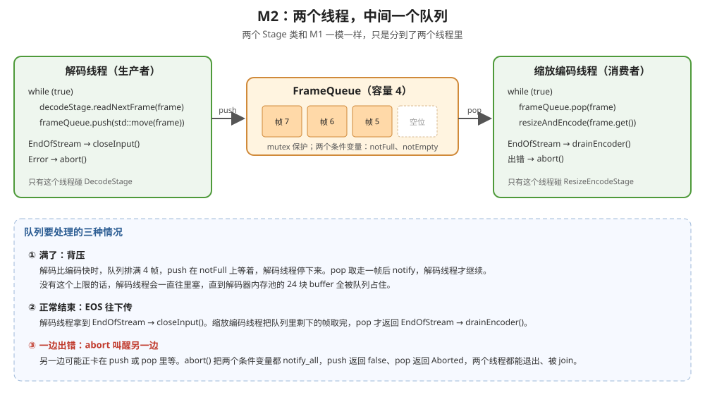

# M2 双线程流水线
* 线程 1 解码，放进队列；线程 2 取出来缩放、编码

> 架构沿用 [m1流程.md](m1流程.md) 第 2 节。本文只写 M2 新加的和改动的东西。

---

## 1. 干了什么

和 M1 做的事一样：`aaa.264` → 解码 → RGA 缩到 720p → 编码 H.265。区别是分成两个线程：

- **解码线程**：一直调用 `DecodeStage::readNextFrame`，把解码好的帧放进队列
- **缩放编码线程**：从队列取帧，调用 `ResizeEncodeStage::resizeAndEncode`

两个线程同时干活：编码线程在编第 N 帧时，解码线程已经在解第 N+1、N+2 帧了。

## 2. 输入和输出

| | 内容 |
|---|---|
| 输入 | `/userdata/av/aaa.264`，和 M1 一样 |
| 输出 | `/userdata/av/out_720p_m2.h265`。故意和 M1 的 `out_720p.h265` 分开，方便比较两次的结果 |

## 3. 两个线程怎么配合



### 3.1 为什么两个 Stage 类不用改

M1 就是按这个切分点设计的（m1流程.md 2.2 节）：

- `DecodeStage` 只被解码线程用，`ResizeEncodeStage` 只被缩放编码线程用。**每个对象只有一个线程碰**，所以类里面不用加锁。
- 两个线程之间唯一共享的是 `FrameQueue`，锁只加在队列里。

所以 M2 只多了一个 `pipeline/frame_queue.h/.cpp` 和一个 `app/m2_transcode_two_threads.cpp`。

### 3.2 队列里放什么：MppFramePtr

队列里放的是 `MppFramePtr`（`unique_ptr`），不是裸的 `MppFrame`：

- `push(std::move(frame))`：所有权交给队列，解码线程手里的 `frame` 变成空的
- `pop(frame)`：所有权交给缩放编码线程，这一圈循环结束时自动 `mpp_frame_deinit`

帧在任何时候都只有一个主人，不会忘了释放，也不会释放两次。

**跨线程释放没问题**：帧是解码线程拿到的，却在缩放编码线程里释放。释放就是把 buffer 的引用计数减 1、还回内存池，MPP 在这里加了锁（`mpp_buffer_impl.cpp` 的 `put_buffer`，第 246 行起，函数里有 `pthread_mutex_lock(&buffer->lock)`）。

### 3.3 队列容量：为什么是 4

每排着一帧，就占着解码器内存池的一块 buffer。池子一共 24 块（`MppDecoder::kFrameBufferCount`），其中一部分要留给解码器当参考帧。

- 容量太大：队列占掉太多 buffer，解码器没有空 buffer 可用，自己就卡住了
- 容量太小（比如 1）：两个线程几乎轮流干活，并行的效果变差

取 4：远小于 24，又能让解码线程领先几帧。日志里会打印"最多同时排过几帧"：等于 4，说明解码比编码快，解码线程被背压挡住过。

### 3.4 线程知识点

| 知识点 | 在哪 | 一句话 |
|---|---|---|
| `std::thread` | m2_transcode_two_threads.cpp 第 4 步 | 创建线程，马上开始运行传进去的函数 |
| `join()` | 同上 | 等线程结束。join 返回后，线程里写的变量在主线程一定能读到 |
| `std::mutex` | frame_queue.h | 同一时间只让一个线程改队列 |
| `std::unique_lock` / `std::lock_guard` | frame_queue.cpp | 加锁，离开作用域自动解锁。`wait` 要的是 `unique_lock`，因为它要中途解锁 |
| `std::condition_variable` | frame_queue.cpp | 让线程睡着等一个条件。`wait(锁, 条件)` 一定要带条件，防止虚假唤醒 |
| 背压 | `push` 里等 `notFull` | 下游慢，上游就停下来等，内存不会无限增长 |

### 3.5 对象的声明顺序

```
DecodeStage decodeStage;               // 1. 最先构造，最后析构
ResizeEncodeStage resizeEncodeStage;   // 2.
FrameQueue frameQueue(4);              // 3. 最后构造，最先析构
```

出错退出时，队列里可能还剩几帧。这些帧的 buffer 在解码器的内存池里，所以**队列必须比解码器先析构**：先释放队列里的帧，再销毁解码器和内存池。C++ 局部变量按声明的反顺序析构，队列声明在最后就行。

## 4. 完整代码

M2 新加 3 个文件，改了 4 个文件。其余文件和 m1流程.md 3.6 节一模一样，不用动。

2026-11-11 改成驼峰命名后重新交叉编译通过（gcc 10.4，`-Wall -Wextra -Wshadow` 没有警告）。`FrameQueue` 另外在 Mac 上用假的帧类型测过：1000 帧全部按顺序收到，最多排 4 帧；两边分别叫停，等着的线程都能退出。**还没上板跑过。**

### 4.1 新加：`src/pipeline/frame_queue.h`

```cpp
//
// FrameQueue：两个线程之间传解码帧的队列（生产者-消费者）
//
//   解码线程 ──push──→ [ 帧 | 帧 | 帧 | 帧 ] ──pop──→ 缩放编码线程
//
// 有容量上限：满了 push 就等着（背压），空了 pop 就等着。
// 队列里放的是 MppFramePtr：帧的所有权跟着走，谁手里拿着谁负责释放，不会漏、不会重复
//
#pragma once

#include <condition_variable>
#include <cstddef>
#include <deque>
#include <mutex>

#include "common/mpp_utils.h" // MppFramePtr

/** pop() 的结果 */
enum class PopResult {
    Frame,       // 取到一帧
    EndOfStream, // 生产者说了"没有了"，队列也空了
    Aborted,     // 有一方出错，叫停了整个流程
};

class FrameQueue {
public:
    /**
     * @brief 构造一个空队列
     * @param[in] requestedCapacityFrameCount  最多排几帧；排满了 push 就会等
     * @note 每排着一帧，就占着解码器内存池里的一块 buffer（池子一共 24 块），所以容量要比 24 小很多
     */
    explicit FrameQueue(size_t requestedCapacityFrameCount) : capacityFrameCount(requestedCapacityFrameCount) {}

    // 禁止拷贝：里面有 mutex，而且帧只能有一个主人
    FrameQueue(const FrameQueue &) = delete;
    FrameQueue &operator=(const FrameQueue &) = delete;

    /**
     * @brief 生产者放一帧进去；队列满了就等，直到有空位
     * @param[in] decodedFrame  要放进去的帧，所有权交给队列（调用方要写 std::move）
     * @return true = 放进去了；false = 流程被叫停（abort），帧没放进去，随参数一起释放
     * @note 会阻塞：这就是"背压"，解码比编码快时，解码线程在这里停下来等
     */
    bool push(MppFramePtr decodedFrame);

    /**
     * @brief 消费者取一帧；队列空了就等，直到有帧、或者生产者说"没有了"、或者被叫停
     * @param[out] decodedFrame  取到的帧，所有权交给调用方；返回 Frame 时才有效
     * @return PopResult::Frame / EndOfStream / Aborted
     * @note 会阻塞
     */
    PopResult pop(MppFramePtr &decodedFrame);

    /**
     * @brief 生产者说"不会再 push 了"
     * @return 无
     * @note 消费者把剩下的帧取完以后，pop 返回 EndOfStream
     */
    void closeInput();

    /**
     * @brief 叫停：任何一方出错时调用，把正在等的 push / pop 都叫醒，让两个线程都尽快退出
     * @return 无
     * @note 叫停以后队列里剩下的帧在队列析构时释放
     */
    void abort();

    /**
     * @brief 队列里最多同时排过几帧
     * @return 帧数；等于容量说明解码线程被背压挡住过
     */
    size_t getMaxQueuedFrameCount() const;

private:
    const size_t capacityFrameCount;  // 最多排几帧
    mutable std::mutex mutex;         // 保护下面所有成员；mutable：const 函数里也要加锁
    std::condition_variable notFull;  // "有空位了"：pop 取走一帧后通知，push 在这上面等
    std::condition_variable notEmpty; // "有帧了"：push 放进一帧后通知，pop 在这上面等
    std::deque<MppFramePtr> frames;   // 排着的帧，先进先出
    bool isInputClosed = false;       // 生产者调用过 closeInput
    bool isAborted = false;           // 有人调用过 abort
    size_t maxQueuedFrameCount = 0;   // 最多同时排过几帧
};
```

### 4.2 新加：`src/pipeline/frame_queue.cpp`

```cpp
#include "pipeline/frame_queue.h"

#include <utility> // std::move

/**
 * @brief 放一帧进去，满了就等
 * @param[in] decodedFrame  要放进去的帧
 * @return true = 放进去了；false = 被叫停
 * @note 等待用 condition_variable::wait(锁, 条件)：条件不满足时，先释放锁再睡；被叫醒后重新拿锁、再检查条件。
 *       必须带条件：线程可能被"无缘无故"叫醒（虚假唤醒），只靠 notify 不可靠
 */
bool FrameQueue::push(MppFramePtr decodedFrame) {
    // unique_lock：加锁，离开作用域自动解锁；wait 要的就是 unique_lock（它需要中途解锁、再加锁）
    std::unique_lock<std::mutex> lock(mutex);
    notFull.wait(lock, [this] { return frames.size() < capacityFrameCount || isAborted; });
    if (isAborted) {
        return false;
    }
    frames.push_back(std::move(decodedFrame));
    if (frames.size() > maxQueuedFrameCount) {
        maxQueuedFrameCount = frames.size();
    }
    lock.unlock();          // 先解锁再通知：被叫醒的线程马上就能拿到锁
    notEmpty.notify_one(); // 叫醒一个在 pop 里等的线程（只有一个消费者）
    return true;
}

/**
 * @brief 取一帧，空了就等
 * @param[out] decodedFrame  取到的帧
 * @return Frame / EndOfStream / Aborted
 * @note 生产者 closeInput 以后，队列里剩下的帧照样取，取完才返回 EndOfStream
 */
PopResult FrameQueue::pop(MppFramePtr &decodedFrame) {
    std::unique_lock<std::mutex> lock(mutex);
    notEmpty.wait(lock, [this] { return !frames.empty() || isInputClosed || isAborted; });
    if (isAborted) {
        return PopResult::Aborted;
    }
    if (frames.empty()) {
        return PopResult::EndOfStream; // 走到这里说明 isInputClosed 而且没有帧了
    }
    decodedFrame = std::move(frames.front());
    frames.pop_front();
    lock.unlock();
    notFull.notify_one(); // 叫醒在 push 里等空位的生产者
    return PopResult::Frame;
}

/**
 * @brief 生产者说"不会再 push 了"
 * @return 无
 * @note 要 notify：消费者可能正在 pop 里等，不叫醒它就永远等下去
 */
void FrameQueue::closeInput() {
    {
        std::lock_guard<std::mutex> lock(mutex); // lock_guard：只加锁、离开大括号解锁，不能中途解锁
        isInputClosed = true;
    }
    notEmpty.notify_all();
}

/**
 * @brief 叫停，叫醒所有在等的线程
 * @return 无
 * @note 两个条件变量都要 notify：生产者可能在等空位，消费者可能在等帧
 */
void FrameQueue::abort() {
    {
        std::lock_guard<std::mutex> lock(mutex);
        isAborted = true;
    }
    notFull.notify_all();
    notEmpty.notify_all();
}

/**
 * @brief 最多同时排过几帧
 * @return 帧数
 * @note 两个线程都可能在用队列，读成员也要加锁
 */
size_t FrameQueue::getMaxQueuedFrameCount() const {
    std::lock_guard<std::mutex> lock(mutex);
    return maxQueuedFrameCount;
}
```

### 4.3 新加：`src/app/m2_transcode_two_threads.cpp`

```cpp
//
// M2：双线程转码。解码线程 → FrameQueue → 缩放编码线程
//
#include <thread>
#include <utility> // std::move

#include "app/app_config.h"
#include "app/milestones.h"
#include "common/log.h"
#include "common/mpp_utils.h"
#include "common/time_utils.h"
#include "pipeline/decode_stage.h"
#include "pipeline/frame_queue.h"
#include "pipeline/resize_encode_stage.h"

static const char *const kTag = "M2";

/**
 * @brief 解码线程做的事：一帧一帧解，放进队列；解完了告诉队列"没有了"
 * @param[in,out] decodeStage  解码段，只有这个线程用它
 * @param[in,out] frameQueue   放帧的队列
 * @return true = 正常解完；false = 解码出错，或者被缩放编码线程叫停
 * @note 出错时调用 frameQueue.abort()，把可能在 pop 里等着的缩放编码线程叫醒
 */
static bool runDecodeThread(DecodeStage &decodeStage, FrameQueue &frameQueue) {
    while (true) {
        MppFramePtr decodedFrame;
        const ReadFrameResult readResult = decodeStage.readNextFrame(decodedFrame);
        if (readResult == ReadFrameResult::EndOfStream) {
            frameQueue.closeInput(); // EOS 往下传：缩放编码线程取完剩下的帧就会拿到 EndOfStream
            return true;
        }
        if (readResult == ReadFrameResult::Error) {
            frameQueue.abort();
            return false;
        }
        // std::move：所有权交给队列。push 返回以后 decodedFrame 是空的，这一圈结束不会再释放它
        if (!frameQueue.push(std::move(decodedFrame))) {
            return false; // 被缩放编码线程叫停了
        }
    }
}

/**
 * @brief 缩放编码线程做的事：从队列取帧，缩放、编码；队列说"没有了"就排空编码器
 * @param[in,out] resizeEncodeStage  缩放编码段，只有这个线程用它
 * @param[in,out] frameQueue         取帧的队列
 * @return true = 正常编完；false = 缩放、编码出错，或者被解码线程叫停
 * @note 出错时调用 frameQueue.abort()，把可能在 push 里等着空位的解码线程叫醒
 */
static bool runResizeEncodeThread(ResizeEncodeStage &resizeEncodeStage, FrameQueue &frameQueue) {
    while (true) {
        // decodedFrame 声明在循环里面：这一圈结束时自动 mpp_frame_deinit，buffer 回到解码器的内存池。
        // 释放发生在这个线程，而内存池归解码线程用：MPP 的 buffer 引用计数操作内部有锁（mpp_buffer_impl.cpp 的 put_buffer），跨线程释放没问题
        MppFramePtr decodedFrame;
        const PopResult popResult = frameQueue.pop(decodedFrame);
        if (popResult == PopResult::EndOfStream) {
            return resizeEncodeStage.drainEncoder();
        }
        if (popResult == PopResult::Aborted) {
            return false;
        }
        if (!resizeEncodeStage.resizeAndEncode(decodedFrame.get())) {
            frameQueue.abort();
            return false;
        }
    }
}

/**
 * @brief M2：双线程转码
 * @return 0 = 成功；1 = 任何一步失败（已打印原因）
 * @note 两个 Stage 类和 M1 一模一样，只是分到了两个线程里
 */
int runM2TranscodeTwoThreads() {
    // ⚠️ 声明顺序：decodeStage → resizeEncodeStage → frameQueue。析构顺序相反：
    //    frameQueue 最先析构，里面剩下的帧先释放，然后才轮到 decodeStage 销毁解码器和内存池
    // 第 1 步 解码段
    DecodeStage decodeStage;
    if (!decodeStage.open(kInputH264StreamPath, MPP_VIDEO_CodingAVC)) {
        return 1;
    }

    // 第 2 步 缩放编码段：和 M1 一样，输出到另一个文件，方便和 M1 的结果比较
    const EncoderConfig encoderConfig = {.width = kOutputWidth,
                                         .height = kOutputHeight,
                                         .codingType = MPP_VIDEO_CodingHEVC,
                                         .rcMode = MPP_ENC_RC_MODE_CBR,
                                         .bps = kOutputBps,
                                         .fps = kOutputFps,
                                         .gop = kOutputGop};
    ResizeEncodeStage resizeEncodeStage;
    if (!resizeEncodeStage.open(encoderConfig, kM2OutputH265StreamPath)) {
        return 1;
    }

    // 第 3 步 队列
    FrameQueue frameQueue(kFrameQueueCapacity);

    // 第 4 步 启动两个线程，等它们都结束
    const double startMs = getNowMs();
    bool isDecodeOk = false;
    bool isResizeEncodeOk = false;
    // std::thread(函数)：创建线程，马上开始运行这个函数。
    // lambda 用 & 捕获：线程里直接用这里的局部变量。下面 join 等线程结束，所以局部变量一定比线程活得久
    std::thread decodeThread([&] { isDecodeOk = runDecodeThread(decodeStage, frameQueue); });
    std::thread resizeEncodeThread([&] { isResizeEncodeOk = runResizeEncodeThread(resizeEncodeStage, frameQueue); });
    // join：等线程结束。join 返回后，线程里写的 isDecodeOk 等变量在这里一定能读到最新值
    decodeThread.join();
    resizeEncodeThread.join();
    const double elapsedMs = getNowMs() - startMs;
    if (!isDecodeOk || !isResizeEncodeOk) {
        LOGE(kTag, "失败：解码线程 %s，缩放编码线程 %s", isDecodeOk ? "正常" : "出错",
             isResizeEncodeOk ? "正常" : "出错");
        return 1;
    }

    // 第 5 步 打印结果
    const int encodedFrameCount = resizeEncodeStage.getEncodedFrameCount();
    LOGI(kTag, "解码 %d 帧，错误帧 %d，编码 %d 帧", decodeStage.getDecodedFrameCount(),
         decodeStage.getErrorFrameCount(), encodedFrameCount);
    LOGI(kTag, "用时 %.0f ms，%.1f fps", elapsedMs, elapsedMs > 0 ? encodedFrameCount * 1000.0 / elapsedMs : 0.0);
    LOGI(kTag, "队列容量 %zu，最多同时排过 %zu 帧", kFrameQueueCapacity, frameQueue.getMaxQueuedFrameCount());
    LOGI(kTag, "输入 %lld 字节 → 输出 %lld 字节（%s）", static_cast<long long>(decodeStage.getInputBytes()),
         static_cast<long long>(resizeEncodeStage.getOutputBytes()), kM2OutputH265StreamPath);
    return 0;
}
```

### 4.4 改：`src/app/app_config.h`

加了 `kM2OutputH265StreamPath` 和 `kFrameQueueCapacity`，并 `#include <cstddef>`（`size_t` 要用）。

```cpp
//
// 各个里程碑共用的常量：板子上的文件路径、输出画面的尺寸和编码参数
//
#pragma once

#include <cstddef> // size_t

// inline constexpr：常量写在头文件里，多个 .cpp include 也只有一份

// 输入：Day 2 用过的 H.264 裸码流，1920×1080，1803 帧（2026-11-08 Mac 上 ffprobe）
inline constexpr const char *kInputH264StreamPath = "/userdata/av/aaa.264";

// 输出：H.265 裸码流。M1、M2 分开两个文件，方便比较两次的结果
inline constexpr const char *kOutputH265StreamPath = "/userdata/av/out_720p.h265";
inline constexpr const char *kM2OutputH265StreamPath = "/userdata/av/out_720p_m2.h265";

// 输出画面的尺寸，单位像素
inline constexpr int kOutputWidth = 1280;
inline constexpr int kOutputHeight = 720;

// 输出码流的编码参数
inline constexpr int kOutputBps = 2 * 1000 * 1000; // 目标码率，单位 bit/s（2 Mbps）
inline constexpr int kOutputFps = 30;              // 帧率：aaa.264 约 30 fps（ffprobe 报 3003/100）
inline constexpr int kOutputGop = 60;              // 每 60 帧一个 I 帧（30 fps 下 2 秒）

// M2：解码线程和缩放编码线程之间的队列最多排几帧。
// 每排着一帧就占着解码器内存池的一块 buffer（池子一共 24 块），所以要比 24 小很多
inline constexpr size_t kFrameQueueCapacity = 4;
```

### 4.5 改：`src/app/milestones.h`

加了 `runM2TranscodeTwoThreads` 的声明。

```cpp
//
// 每个里程碑一个入口函数，main.cpp 按参数调用
//
#pragma once

/**
 * @brief M1：单线程转码。aaa.264（1080p H.264）→ 解码 → RGA 缩到 720p → 编码 H.265 → out_720p.h265
 * @return 0 = 成功；1 = 任何一步失败（已打印原因）
 * @note 实现在 app/m1_transcode_single_thread.cpp
 */
int runM1TranscodeSingleThread();

/**
 * @brief M2：双线程转码。解码线程把帧放进队列，缩放编码线程从队列取帧；输出 out_720p_m2.h265
 * @return 0 = 成功；1 = 任何一步失败（已打印原因）
 * @note 实现在 app/m2_transcode_two_threads.cpp
 */
int runM2TranscodeTwoThreads();
```

### 4.6 改：`src/main.cpp`

加了 `m2` 分支。

```cpp
//
// day5_transcoder：1080p H.264 → 解码 → RGA 缩到 720p → 编码 H.265
//
// 用法：./day5_transcoder m1 | m2（不写参数默认 m1）
//   m1  单线程转码 → app/m1_transcode_single_thread.cpp
//   m2  双线程转码 → app/m2_transcode_two_threads.cpp
//
#include <cstring>

#include "app/milestones.h"
#include "common/log.h"

static const char *const kTag = "Main";

/**
 * @brief 程序入口：按第一个参数选择跑哪个里程碑
 * @param[in] argc  参数个数（包括程序名）
 * @param[in] argv  参数；argv[1] 是里程碑名字："m1" 或 "m2"
 * @return 0 = 成功；1 = 失败或参数不认识
 * @note main 只做分发，不放任何业务逻辑
 */
int main(int argc, char **argv) {
    const char *milestoneName = argc > 1 ? argv[1] : "m1";
    if (strcmp(milestoneName, "m1") == 0) {
        return runM1TranscodeSingleThread();
    }
    if (strcmp(milestoneName, "m2") == 0) {
        return runM2TranscodeTwoThreads();
    }
    LOGE(kTag, "用法：%s m1 | m2", argv[0]);
    return 1;
}
```

### 4.7 改：`CMakeLists.txt`

加了两个源文件，并链接线程库（`Threads::Threads`）。

```cmake
cmake_minimum_required(VERSION 3.20)
project(day5_transcoder)

# C++20：要用指定初始化（Nv12Picture{.width = 1280, ...}）
set(CMAKE_CXX_STANDARD 20)

add_executable(day5_transcoder
        src/main.cpp
        src/app/app_config.h
        src/app/milestones.h
        src/app/m1_transcode_single_thread.cpp
        src/app/m2_transcode_two_threads.cpp
        src/common/log.h
        src/common/mpp_utils.h
        src/common/time_utils.h
        src/common/nv12_picture.h
        src/common/nv12_picture.cpp
        src/source/stream_file_reader.h
        src/source/stream_file_reader.cpp
        src/decoder/mpp_decoder.h
        src/decoder/mpp_decoder.cpp
        src/rga/rga_resizer.h
        src/rga/rga_resizer.cpp
        src/encoder/mpp_encoder.h
        src/encoder/mpp_encoder.cpp
        src/sink/stream_file_writer.h
        src/sink/stream_file_writer.cpp
        src/pipeline/decode_stage.h
        src/pipeline/decode_stage.cpp
        src/pipeline/resize_encode_stage.h
        src/pipeline/resize_encode_stage.cpp
        src/pipeline/frame_queue.h
        src/pipeline/frame_queue.cpp)

# 头文件搜索目录加上 src：任何文件里都写 #include "common/log.h"，不用数 ../ 有几层
target_include_directories(day5_transcoder PRIVATE src)

# M2 用 std::thread：链接 pthread 库。Threads::Threads 是 CMake 给的写法，会自动加上 -pthread
find_package(Threads REQUIRED)
target_link_libraries(day5_transcoder PRIVATE Threads::Threads)

if (CMAKE_SYSTEM_PROCESSOR STREQUAL "aarch64")
    # rockchip_mpp → 链接器参数 -lrockchip_mpp → 在 sysroot 里找 librockchip_mpp.so（解码、编码）
    # rga → -lrga → sysroot 里的 librga.so（缩放）
    target_link_libraries(day5_transcoder PRIVATE rockchip_mpp rga)
    target_compile_options(day5_transcoder PRIVATE -Wall -Wextra -Wshadow)

    # 板子 /usr/lib 里出厂的 MPP 库太旧，运行时优先加载自己编译的那份（/userdata/mpp_build/lib）
    # -Wl,-rpath,目录：把"运行时先去这个目录找库"写进程序文件，效果和 LD_LIBRARY_PATH 一样
    target_link_options(day5_transcoder PRIVATE "-Wl,-rpath,/userdata/mpp_build/lib")
endif ()
```

## 5. 运行和验收

1. 运行：`./run_on_board_with_mac.sh m2`
2. 看日志：
   - `解码 1803 帧，错误帧 0，编码 1803 帧`
   - `队列容量 4，最多同时排过 N 帧`
   - `用时`、`fps`：和 M1 的日志放在一起看一眼就行，**不专门做性能对比实验**
3. 和 M1 的结果比较（先跑过 `m1`）：
   ```bash
   adb shell md5sum /userdata/av/out_720p.h265 /userdata/av/out_720p_m2.h265
   ```
   预计两个 md5 一样：输入一样、参数一样，多线程只是改了"什么时候做"，没有改"做什么"。这是推断，以实测为准。如果不一样，再用 ffprobe 比帧数、ffplay 看画面。

## 6. 容易错的地方

- **忘了 `std::move`**：`push(decodedFrame)` 编译不过，因为 `unique_ptr` 不能拷贝。这正是想要的效果：编译器帮你保证帧只有一个主人
- **出错时只退出自己，不 abort**：另一个线程会卡在 `push` 或 `pop` 里永远等下去，`join` 也就永远不返回，程序卡死
- **`closeInput` / `abort` 后不 notify**：同上，等着的线程醒不过来
- **`wait` 不带条件**：可能被虚假唤醒，队列是空的却去取帧
